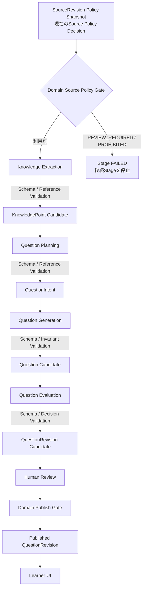
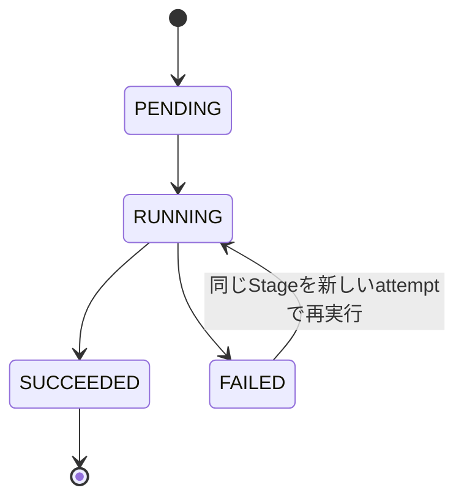

# アーキテクチャ

このDirectoryは、`refriq`の現在のComponent、Package境界、Data Flowを説明する。Decisionの背景は[`docs/adr/`](../adr/)を参照する。

## Workspaceの責務

| Package | 現在の責務 |
| --- | --- |
| `apps/pipeline` | PipelineのComposition Root。Applicationの実行関数を公開し、Fake ProviderでStage契約を検証する。 |
| `packages/application` | Stage契約、JSON Schema検証、Pipeline Orchestration、LLM Structured Output Portを持つ。 |
| `packages/domain` | Source Policy Gate、immutable Revision Snapshot、QuestionSource、Human Review / Publish Gateを持つ。Pipeline OrchestrationやProvider SDKは持たない。 |
| `packages/contracts` | 外部API Contract用Workspace。Pipeline DTOを先行して複製しない。 |
| `apps/api`、`apps/web` | Pipeline、Reviewer UI、Learner UIの実装はまだ持たない。 |

Application Pipelineは`packages/domain`のSource PolicyとPublish Policyを呼び出す。HTTP Handlerは経由せず、`apps/pipeline`からApplication Use Caseを実行する。

## 文書の役割

| 文書 | 記載内容 |
| --- | --- |
| [`README.md`](../../README.md) | Project概要と開発開始方法 |
| [`docs/mvp-scope.md`](../mvp-scope.md) | MVPの対象、対象外、Source利用方針 |
| [`docs/domain/`](../domain/) | Domain Concept、Lifecycle、不変条件 |
| [`docs/domain/source-governance.md`](../domain/source-governance.md) | Source Policy、Provenance、利用 / Publish Gate |
| [`docs/adr/`](../adr/) | Architecture Decisionの背景、代替案、影響 |
| [`AGENTS.md`](../../AGENTS.md) | Repository共通の開発Rule |
| GitHub Issue | 個別TaskのGoal、Scope、Acceptance Criteria、Verification |

## Knowledge / Question Pipeline



`packages/application/src/pipeline/contracts.ts`に各StageのInput / Output Contractがあり、[`schemas.ts`](../../packages/application/src/pipeline/schemas.ts)にJSON Schema Draft 2020-12を置く。LLM Provider PortへOutput Schemaを渡し、返却値はAjvと追加の決定論的な参照・Invariant Validationを通るまで次Stageへ渡さない。

| Stage | Input | Output | 責務と境界 |
| --- | --- | --- | --- |
| `KNOWLEDGE_EXTRACTION` | Certification、ExamTopic、SourceRevision ID、選択済みGrounding Segment | KnowledgePoint Draft候補、ExamTopic ID、SourceReference | Sourceに記載されたKnowledgeを抽出する。Question本文や選択肢は作らない。Candidate IDはSchema検証後にApplicationがRun内だけで付ける。 |
| `QUESTION_PLANNING` | Certification、ExamTopic、KnowledgePoint CandidateとSourceReference | 1件以上のKnowledgePoint Candidateを参照するQuestionIntent | Question Type、Format、Learning Objective、Difficulty、Target Conceptを決める。問題文・選択肢は作らない。 |
| `QUESTION_GENERATION` | Intentが選んだKnowledgePoint / ExamTopic、対応するGrounding Segment、生成規則 | Question Candidate | Stem、Options、正答、全OptionのExplanation、Learning Explanationを作る。正しさの最終評価はしない。 |
| `QUESTION_EVALUATION` | Question Candidate、選択KnowledgePoint / ExamTopic、IntentのGrounding Segment、評価Criteria | PASS / REVISE / REJECTとChecks / Findings | Scope、KnowledgePoint整合性、正答根拠、Distractor、曖昧さ、設問の自己完結性などをSemanticに確認する。Human Reviewを代替しない。 |

1回のPipeline Runは1つのQuestionIntentをPlanし、1件以上のKnowledgePoint候補と関連づけたQuestion Candidateを1つ生成する。大量生成や複数問題を1 requestに詰め込むBatch処理は持たない。

### Source ProvenanceとLLM Request Context

`PipelineInput`では、Domainの`SourceRevisionPolicySnapshot`と現在の`SourcePolicyDecision`を受け取り、`canUseForKnowledgeExtraction` / `canUseForQuestionGeneration`でGateする。取得時Snapshotは変更せず、現在のPolicy Decisionは別のDecisionとして扱う。

SourceRevisionのProvenanceとLLMへ渡す文章Contextは分ける。Pipeline Inputには取得済みRevision全体ではなく、Revision ID / Snapshotと呼び出し元が選んだ`GroundingSegment`を渡す。Knowledge Extractionは入力されたSegmentを利用し、PlanningはKnowledgePointの要約と参照だけを使い、Generation / Evaluationは対象QuestionのSourceReferenceと一致するSegmentだけを選択する。候補にはReviewerが確認できるSourceRevision Snapshot、Source URL、Locator、実際に利用したGrounding Segmentを保持する。

この境界はSource全体を一回のLLM Requestへ送る前提を置かない。Contextをどう分割・選択するかは呼び出し元 / Provider Adapterが決め、Kong AI Gateway等のProvider / Gateway token上限は設定として扱う。Domain LogicやStage Contractに具体的なToken上限値は置かない。

### Schema ValidationとSemantic Evaluation

Schema / Programmatic Validationは決定論的な構造・参照条件を検査する。

- 必須Field、Enum、余分なFieldをSchemaで検査する。未知のQuestion Typeは拒否する。
- SourceReferenceは入力Context内のSourceRevision ID / Locatorと一致しなければならない。
- QuestionIntentは入力KnowledgePointを参照し、Question CandidateはそのIntentのKnowledgePoint / Question Typeを維持する。
- Option ID重複、存在しない正答ID、Explanationの欠落を拒否する。
- `single_choice`は正答1件、`multiple_select`は1件以上を必須とする。
- Evaluation DecisionはChecksから決定的に導出する。いずれか`FAIL`なら`REJECT`、`CONCERN`のみがある場合は`REVISE`、全て`PASS`の場合は`PASS`とする。

その後のQuestion Evaluation Stageは、Source本文に照らした正しさ、Distractor、Unsupported Claim、Ambiguityなど意味上の品質を評価する。Semantic判断をSchema Validationに混ぜない。Evaluation自体のJSONもSchema検証される。

### LLM Provider Boundary

`StructuredOutputProvider`はApplication内のPortであり、Provider固有SDK、認証情報、ネットワーク処理は含まない。PortにはStage名、検証済みInput、Output JSON Schemaを渡す。実Provider Adapterは将来`apps/pipeline`側に追加できる。現在は`apps/pipeline/src/fake-llm-provider.ts`のFixture Fakeだけを使い、Production LLM callは行わない。

RuntimeからChatGPT Skillを呼び出さない。SkillはGeneration / Evaluation WorkflowとQuality Contractを試すHarnessとしてRuntime外に置く。

## Stage Failure、再実行、重複実行



`QuestionPipelineRun`はStageごとの現在Status、Attempt、開始・完了時刻、失敗理由、およびAttempt履歴を返す。Providerが返すprovider / model / prompt version / request IDはprovider-neutralな`generationMetadata`としてStage Resultに残す。Schema / Input Validation失敗またはProvider失敗では後続Stageを実行しない。Provider Errorは`retryable: true`として同じStageから再実行できる。Validation Errorは`retryable: false`で原因を修正した後に明示的に再試行する。`resumeQuestionPipeline`は直前までに得た検証済みArtifactを保持し、FAILED Stageと後続Stageだけを再実行する。現在Persistenceはなく、Run Artifactの耐久保存は行わない。

`REVISE` / `REJECT`はExecution Failureではない。全Stageを正常実行した後ならPipeline RunとEvaluation Stageは`SUCCEEDED`のまま、候補の`reviewEligibility`で結果を分ける。`PASS`も`ELIGIBLE_FOR_HUMAN_REVIEW`を示すだけで、Human `APPROVE`やPublish許可を作らない。

同じInputでもProvider Responseは変化し得るため、Response本文の完全一致をIdempotency条件にしない。再実行 / 重複実行は別Pipeline Run Candidateとして扱い、既存`QuestionRevision`を上書きしない。Issue #6の通り、将来作られる`QuestionRevision`と`SourceRevision`はImmutableとし、修正は新Revisionで表す。Pipeline CandidateのSourceReferenceは、実際の`QuestionRevision`作成時に既存Domainの`createQuestionSourceAssociation`へ接続する。PipelineはDomain Revisionや`QuestionSource`を先行作成しない。

## Reviewer / Learner境界

`QuestionRevisionCandidate`がReviewerへ渡す情報は次の通り。

- Certification、関連ExamTopic、1件以上のKnowledgePoint Candidate、QuestionIntent / Type / Difficulty
- Stem、Options、正答、各Option Explanation、Learning Explanation
- SourceRevision Policy Snapshot、取得時URL、SourceReference Locator、利用したGrounding Segment
- Evaluation Decision、Criterion別Checks、Findings、Ambiguity、Assumptions
- Pipeline Run ID、Stage Attempt / Status / Timing、provider-neutralなprovider / model / prompt version / request ID

CandidateはIssue #6のDomain `QuestionRevision`ではなく、Human Review前のApplication Outputである。ReviewerがHuman Decisionを記録した後、既存のDomain Publish Gateを通して初めてPublished Revisionとなる。

```text
Pipeline
  → QuestionRevision Candidate
  → Human Review
  → Publish Gate
  → Published QuestionRevision
  → Learner UI
```

Learner UIからPipelineを実行せず、Published QuestionRevisionを表示する。Reviewer UI、Learner UI、Persistence、Kong AI GatewayのProduction Adapterはこの実装範囲に含めない。
