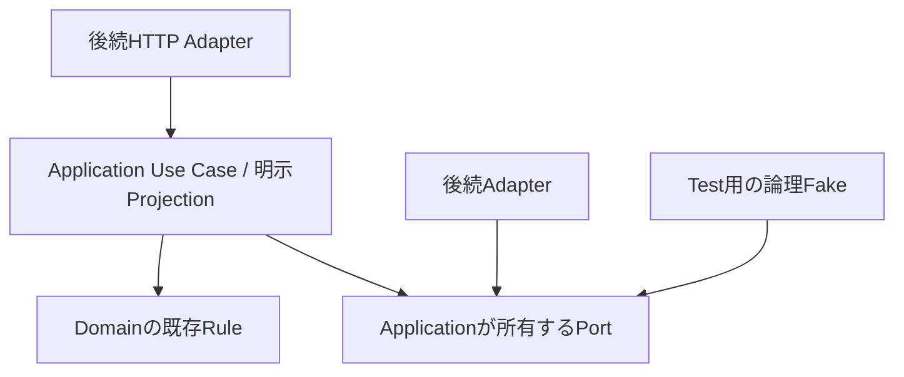

# Issue #11に基づくApplication Port / DTO設計案

- 状態: 実装準備の設計案。Accepted ADRではない。
- 正本: [確定Access Pattern](issue-11-access-patterns.md)。Formal Q21 / C15 / 36、内部保証7、H01〜H09承認済みを変更しない。
- 実装分割: [実装Issue Plan](issue-11-implementation-plan.md)。証明計画: [Test Matrix](issue-11-contract-test-matrix.md)。
- 正本参照SHA-256: `24a6ea4e48c50f9b56dafc31b921fbecff8946437fa447c836643f4ec5c81047`。RV-03による既存Diff規則の明確化後の版。H01〜H09の承認・36 APの意味は維持する。

## 1. Repositoryの境界と配置候補

[Architecture](README.md)、[ADR-0001〜0006](../adr/README.md)、[Domain](../domain/README.md)、[Source Governance](../domain/source-governance.md)、[AGENTS.md](../../AGENTS.md)を再読した。`packages/application`はP8 Orchestration / Stage DTOと`StructuredOutputProvider`を持ち、`packages/domain`は既存Source / Publish Gateを持つ。`packages/contracts/src/index.ts`は空で、外部API Contract用Workspaceである。Domain文書にある全Entityの実装済みclassが存在するとは仮定しない。

Port型、内部facts、Application request / resultは`packages/application/src/`内の`ports / contracts`等へ置く候補。Feature Use Caseは`catalog / source / learning / review / pipeline / feedback`等の責務で整理する。名前とファイル分割は実装時に既存規約へ合わせ、今回ファイルを作らない。SDK、HTTP、認証方式は導入しない。`packages/contracts`へPipeline DTOや内部正答factsをコピーせず、外部wire DTOは後続#13等で安全なApplication出力から定義する。

## 2. 設計の単位

Use Caseは36 APの意味を保つが、Portは交換可能な外部依存の意味でまとめる。同じSessionの開始 / 確定 / Draft / 提出 / 終了は同じSession boundary、三Human decisionは同じexact Revision decision boundaryを使う。Question Diffはimmutable factsのpure comparisonであり独立Repository methodを要求しない。前版・Run状態・validated Artifact・current Policy・結果照合を独立公開APへ増やさない。

以下のsignatureは意味記法であり、TypeScriptコード・API Payload Schema・Endpointの確定ではない。Public Use Case resultと内部Port factsを分け、callerがprojection段階・Actor権限・consistencyを任意に下げられる形にしない。

| Port候補 | 担当 | 責務 | 意味上signature | 利用AP |
| --- | --- | --- | --- | --- |
| ExactQuestionFactsReader | [IMPL-01 / #29](https://github.com/abi-yusuke-wada/refriq/issues/29) | exact Revision / Intent / Knowledge / Source関係とmaterialization対象の内部facts解決。Candidate fallbackなし | loadExact(revisionRefs) → ExactRevisionFacts；resolveTargets(targetQuestion?,knowledgeRefs) → stable Intent / Knowledgeとcurrent Topic関係facts（分類 / materializationの内部依存） | AP-LEARNING-002、AP-LEARNING-003、AP-LEARNING-004、AP-LEARNING-005、AP-LEARNING-006、AP-LEARNING-007、AP-LEARNING-010、AP-LEARNING-011、AP-REVIEW-002、AP-REVIEW-003、AP-REVIEW-006、AP-REVIEW-007、AP-REVIEW-009 |
| CertificationCatalogReader | [IMPL-02 / #31](https://github.com/abi-yusuke-wada/refriq/issues/31) | 資格 / Topicの所属と表示順 | readCatalog(scope); readCertification(certificationId) → Catalog / Topic facts | AP-CATALOG-001、AP-CATALOG-002、AP-LEARNING-004、AP-LEARNING-011 |
| SourceContextReader | [IMPL-02 / #31](https://github.com/abi-yusuke-wada/refriq/issues/31) | 歴史Snapshotとcurrent Decisionの別読取、許可Grounding、確定時Gate再取得 | resolveSourceContext(exactRefs, purpose); recheckCurrent(gateDependencies) → SourceContext / Gate結果 | AP-LEARNING-002、AP-LEARNING-003、AP-LEARNING-004、AP-LEARNING-005、AP-LEARNING-006、AP-LEARNING-007、AP-LEARNING-010、AP-LEARNING-011、AP-LEARNING-012、AP-LEARNING-014、AP-PIPELINE-002、AP-PIPELINE-003、AP-PIPELINE-004、AP-PIPELINE-005、AP-REVIEW-002、AP-REVIEW-003、AP-REVIEW-004、AP-REVIEW-006、AP-REVIEW-007、AP-REVIEW-009、AP-SOURCE-001 |
| PublishedQuestionResolver | [IMPL-03 / #32](https://github.com/abi-yusuke-wada/refriq/issues/32) | 候補発見 / 個別current参照 / 完全な現在集合の不足証明の読取能力 | discover(scope,page); resolveCurrent(questionRefs); confirmCurrentCount(scope) → discovery / exact current binding・適格性 / complete current count証拠またはunresolved | AP-LEARNING-001、AP-LEARNING-004、AP-LEARNING-011 |
| LearningSessionReader | [IMPL-03 / #32](https://github.com/abi-yusuke-wada/refriq/issues/32) | 所有ActiveとSnapshot・保存集合 / 保存状態の一貫読取 | findActive(owner,certification,mode); readSession(sessionRef) → Active / SessionStateFacts | AP-LEARNING-002、AP-LEARNING-003、AP-LEARNING-005、AP-LEARNING-006、AP-LEARNING-009、AP-LEARNING-010、AP-LEARNING-012、AP-LEARNING-013 |
| LearningSessionCommands | [IMPL-03 / #32](https://github.com/abi-yusuke-wada/refriq/issues/32) / [IMPL-04 / #35](https://github.com/abi-yusuke-wada/refriq/issues/35) | Session lifecycleと回答 / 保存 / 提出の論理成功境界、K・現在条件 | execute(invocation, preparedIntent) → CommandOutcome；reconcile(invocation) → OperationResolution | AP-LEARNING-004、AP-LEARNING-005、AP-LEARNING-006、AP-LEARNING-011、AP-LEARNING-012、AP-LEARNING-013 |
| LearningResultsReader | [IMPL-05 / #37](https://github.com/abi-yusuke-wada/refriq/issues/37) | 確定事実・開始時分類・terminal履歴の読取 / 再構築材料 | readResult(sessionRef); readProgress(scope); listTerminalSessions(scope,page) → Result / Progress facts / History Page | AP-LEARNING-007、AP-LEARNING-008、AP-LEARNING-014、AP-LEARNING-015 |
| ReviewFactsReader | [IMPL-06 / #36](https://github.com/abi-yusuke-wada/refriq/issues/36) | 種別Queue、exact Review state・previous・Human Record・成立済み対応 | listQueue(scope,page); readRevisionContext(revisionRef) → Queue / ReviewRevisionFacts | AP-REVIEW-001、AP-REVIEW-002、AP-REVIEW-003、AP-REVIEW-004、AP-REVIEW-005、AP-REVIEW-006、AP-REVIEW-008、AP-REVIEW-009 |
| ReviewDecisionCommands | [IMPL-06 / #36](https://github.com/abi-yusuke-wada/refriq/issues/36) | 最大1 exact Human decision、APPROVEのPublish一貫成功 | decide(invocation, request: HumanDecisionRequest) → CommandOutcome；reconcile(invocation)。全種別でCommon Human Decision validation、APPROVE分岐だけAPPROVE-specific readiness validation | AP-REVIEW-004、AP-REVIEW-005、AP-REVIEW-008 |
| CandidateWorkflowCommands | [IMPL-07 / #38](https://github.com/abi-yusuke-wada/refriq/issues/38) | 新編集候補・最大1 materialization・新評価処理の別成功境界 | edit(invocation,intent); materialize(invocation,intent); requestReevaluation(invocation,intent) → 各CommandOutcome；reconcile(invocation) | AP-REVIEW-006、AP-REVIEW-007、AP-REVIEW-009 |
| PipelineFactsReader | [IMPL-08 / #33](https://github.com/abi-yusuke-wada/refriq/issues/33) | current Run / Stage / Attemptとvalidated Candidate / 評価の内部復元 | listWaiting(scope,page); readCandidate(candidateRef); readEvaluation(binding) → Waiting / Candidate / Evaluation facts | AP-PIPELINE-001、AP-PIPELINE-002、AP-PIPELINE-003、AP-PIPELINE-005、AP-REVIEW-001、AP-REVIEW-002、AP-REVIEW-004、AP-REVIEW-007、AP-REVIEW-009 |
| PipelineExecutionCommands | [IMPL-08 / #33](https://github.com/abi-yusuke-wada/refriq/issues/33) | 新生成Run / FAILED ResumeのK・Artifact / Attempt整合 | start(invocation,P8Input); resume(invocation,runRef,expected,P8Input) → CommandOutcome；reconcile(invocation) | AP-PIPELINE-004、AP-PIPELINE-005 |
| StructuredOutputProvider | P8既存 / [IMPL-08 / #33](https://github.com/abi-yusuke-wada/refriq/issues/33)再利用 | Schema付きStructured Output。既存Provider中立Portを維持 | 既存generateStructuredOutput(request) → 検証前Response。Schema / 参照 / 意味ValidationはApplicationで行う | AP-PIPELINE-004、AP-PIPELINE-005、AP-REVIEW-009 |
| ExamFeedbackCommands | [IMPL-09 / #34](https://github.com/abi-yusuke-wada/refriq/issues/34) | 有限allowlist・immutable原本・訂正新Record・K | submit(invocation,validatedSelections) → CommandOutcome；reconcile(invocation) | AP-FEEDBACK-001 |
| FeedbackFactsReader | [IMPL-09 / #34](https://github.com/abi-yusuke-wada/refriq/issues/34) | 有限選択原本と期間内集計材料の内部読取。内部Identityは公開しない | listRecords(scope,page); readExact(feedbackRef); readContributionFacts(scope,observation) → 内部Feedback facts | AP-FEEDBACK-002、AP-FEEDBACK-003、AP-FEEDBACK-004 |

### 内部factsと公開DTOの責務

`ExactRevisionFacts`はexact Content / Intent / Knowledge / QuestionSourceを持つ内部限定facts。Lifecycle、Human Record、current Policyは別の現在観測であり、immutable Contentへ上書きしない。StableQuestionKnowledgeFactsは明示stable QuestionのIntent、stable Knowledgeの所属・対応と現在Topic関係を内部解決する。ApplicationがmaterializationのIntent比較とSession開始時の分類解決を行い、Catalogの資格所属を確認する。Content類似で自動統合せず、新しいQuestion管理APを追加しない。`SessionStateFacts`はSnapshot・確定Answer参照・Draft集合・対応保存状態を同じ論理読取で返す。`PipelineFacts`はRun / Stage / Attempt / Artifact / 評価対象Contentを対応づける。`FeedbackContributionFacts`だけが集計用のopaque Learner対応を持つ。

内部factsをそのままAPIへ返さない。Query resultはUse Caseが所有者・解禁状態・現在利用許可を検査し、明示allowlistで構築する。`Omit<FullQuestion, ...>`、cast、spreadした全ContentのUI非表示だけで境界を作らない。Source本文読取は現在用途の許可後だけとし、PROHIBITED ContentをError / Log / 操作照合へ流さない。

## 3. 共通DTOと現在状態依存

| DTO候補 | 意味と必要な情報 | 境界 |
| --- | --- | --- |
| ActorContext | 呼出元で解決済みのopaque Actor identityとUse Case Context。Learner owner / Human Context / Pipeline主体を区別 | ClientのuserId / roleを信用しない。新Role・認証方式を追加しない |
| ExactQuestionRef / CandidateRef | 前者はstable Question / exact QuestionRevision、後者はpipelineRunId + candidateIdと必要なAttempt照合 | 相互代入不可。Candidate IDをDomain IDに流用しない |
| ReadObservation | 算出 / 観測位置、必要なら計算版、確定済み操作参照との対応 | E / R / C / Iは実保証。metadataを付けただけでC / R成立としない |
| PageRequest / Page<T> | opaque cursor・希望limit、Filter後items・必要なnextCursor、観測条件 | 表示limit / Encoding / 最大値は後続。offsetや物理参照は契約に含めない |
| CurrentDependencies | 対象Session / Revision / Run / 保存状態と全Source現在判断の論理参照・照合条件 | Use Caseが必要条件を導出しCommand確定時に再検査。Lock方法等を含めない |
| CommandInvocation<Input> | trusted Actor、操作種別、operationId、元Requestのsemantic input / identity | 種別はUse Caseから導出。生成ID・時刻・LLM応答をsemantic inputへ混ぜない |
| CommandOutcome<T> | committed（確定結果参照 / 安全なReceipt）、rejected（未確定と確認できたFailure）、unknown（確定有無を識別不能） | rejectedは未commitと確認できたFailureだけ。timeoutをrejectedへ変換しない。これらはApplication outcomeでDomain State追加ではない |
| OperationResolution<T> | committed、confirmed uncommitted、still unknownの区別と安全な照合結果 | 既存Command Portの内部capability。独立Query AP / Port / Endpointを追加しない |
| ContentVisibility | 現在表示可能な部分 / 禁止部分 / 比較不能と安全な理由 | Source Gateの既存Reasonを使い、禁止本文を空文字の通常Contentや「差分なし」にしない |

## 4. Request DTO候補とAP入力

共通Actor / read ContextとCommandInvocationはすべての対象へ適用する。以下は#11の意味上Inputを束ねた候補であり、Identifier形式・wire enum・HTTP payloadを決めない。Operationのidentityに必要な元expected state / clientStateRef等も再送時に保持する。

| Request候補 | AP / variant | 必要なInput（共通Context / Invocation込み） |
| --- | --- | --- |
| CatalogQuery | AP-CATALOG-001 | 呼出元Context |
| CertificationQuery | AP-CATALOG-002 | certificationId |
| SourceQuery | AP-SOURCE-001 | sourceRevisionId、usagePurpose、必要なlocator |
| PublishedDiscoveryQuery | AP-LEARNING-001 | certificationId、cursor / limit、必要なら一覧走査参照 |
| SessionQuestionQuery | AP-LEARNING-002、AP-LEARNING-003 | 所有者Context、sessionId、ordinal、questionRevisionId照合値 / 所有者Context、sessionId、ordinal、必要ならuserAnswerId |
| SessionStartRequest | AP-LEARNING-004、AP-LEARNING-011 | 所有者Context、certificationId、operationId |
| PracticeConfirmationRequest | AP-LEARNING-005 | 所有者Context、sessionId、ordinal、表示Revision照合値、selectedOptionIds、期待状態、operationId |
| MockSubmissionRequest | AP-LEARNING-006 | 所有者Context、sessionId、期待保存状態参照、提出対象の状態照合値、operationId |
| SessionQuery | AP-LEARNING-007、AP-LEARNING-010 | 所有者Context、sessionId |
| ProgressQuery | AP-LEARNING-008、AP-LEARNING-015 | 所有者Context、certificationId、mode、対象sessionIdまたは累積対象 / 所有者Context、certificationId、mode |
| ActiveSessionQuery | AP-LEARNING-009 | 所有者Context、certificationId、mode |
| MockDraftChangeRequest | AP-LEARNING-012 | 所有者Context、sessionId、選択状態または変更集合、期待保存状態、clientStateRef、operationId |
| SessionEndRequest | AP-LEARNING-013 | 所有者Context、sessionId、期待状態、operationId |
| TerminalHistoryQuery | AP-LEARNING-014 | 所有者Context、certificationId、mode、既存terminal状態条件、cursor / limit |
| ReviewQueueQuery | AP-REVIEW-001 | certificationId、対象種別、状態 / Evaluation / Policy表示条件、cursor / limit |
| ExactReviewQuery | AP-REVIEW-002 | questionRevisionId、必要ならquestionId照合値 |
| RevisionComparisonQuery | AP-REVIEW-003 | fromQuestionRevisionId、toQuestionRevisionId。比較元はprevious exact参照から解決可能。初版だけfromなし |
| ApproveDecisionRequest | AP-REVIEW-004 / decision=APPROVE | 共通Human Decision入力 + Question / 公開参照の期待状態、matching Evaluation binding、evaluated exact Content / Context identity、current Source / Publish Gateの依存参照 |
| RejectDecisionRequest | AP-REVIEW-005 / decision=REJECT | 共通Human Decision入力。Evaluation binding / PASS / Publish Gateを必須にしない |
| RequestChangesDecisionRequest | AP-REVIEW-008 / decision=REQUEST_CHANGES | 共通Human Decision入力。Evaluation binding / PASS / Publish Gateを必須にしない |
| EditRequest | AP-REVIEW-006 | baseQuestionRevisionId、同一Intentの編集Content・参照、operationId、Human Context |
| MaterializationRequest | AP-REVIEW-007 | pipelineRunId、candidateId、exact validated Artifact参照、明示したstable Questionまたは別Intentの新規要求、検証可能なstable KnowledgePoint対応、operationId |
| ReevaluationRequest | AP-REVIEW-009 | 編集後exact Candidate Content / 参照、base Revision参照、許可Grounding・評価対象Context、operationId |
| PipelineWaitingQuery | AP-PIPELINE-001 | certificationId、stage、対象status、cursor / limit |
| CandidateQuery | AP-PIPELINE-002 | pipelineRunId、candidateId、必要なら生成Attempt |
| EvaluationQuery | AP-PIPELINE-003 | pipelineRunId、candidateId、評価Attemptまたは評価Artifact参照 |
| RunStartRequest | AP-PIPELINE-004 | P8 Pipeline Input、operationId |
| RunResumeRequest | AP-PIPELINE-005 | pipelineRunId、期待Run / Stage状態、P8再開Input、operationId |
| FeedbackSubmissionRequest | AP-FEEDBACK-001 | Learner Context、certificationId、feedbackContractVersion、R10の有限allowlistによる資格内Topic・形式・難易度・シナリオ比率・実機重要度・Similarity・不足分野の選択、operationId |
| FeedbackSummaryQuery | AP-FEEDBACK-002 | certificationId、対象期間、許可Topic / facet Filter、必要な計算版参照 |
| FeedbackListQuery | AP-FEEDBACK-003 | certificationId、期間・Topic / facet条件、cursor / limit |
| FeedbackDetailQuery | AP-FEEDBACK-004 | examFeedbackId |

### Human Decisionの共通条件とDecision別Request（RV-01）

論理設計案として`HumanDecisionRequest = ApproveDecisionRequest | RejectDecisionRequest | RequestChangesDecisionRequest`のdiscriminated unionとする。判別子は既存decisionの`APPROVE / REJECT / REQUEST_CHANGES`。新Domain enum・HTTP Schema・TypeScript実装は作らない。共通Human Decision入力は、materialized exact QuestionRevision reference・確認対象参照、expected state / version、operationId、有効なHuman Context（CommandInvocationのtrusted metadataを含む）。APPROVEの追加参照を他variantの必須Fieldにしない。

| 検査段階 | 対象 | 確認する正本・保証 |
| --- | --- | --- |
| Common Human Decision validation | 全3 Decision | 対象をmaterialized exact Domain QuestionRevisionとして確認。QuestionRevision Lifecycle = REVIEW_REQUIRED、有効Human Context、既存definitive Human Recordなし、expected state / versionとconcurrencyを現在確認。最大1 definitive Human Reviewと全Command共通Kを維持 |
| APPROVE-specific readiness validation | APPROVEのみ | matching Evaluationがevaluated exact Content / Contextに一致し、PASS / ELIGIBLE_FOR_HUMAN_REVIEW。取得時Provenance適格・全Sourceのcurrent Publish Gateと公開状態 / 参照を確定境界で再確認し、Human Record / PUBLISHED / 公開参照を一貫成功 |
| 負のDecision確定 | REJECT / REQUEST_CHANGES | 共通条件を満たせばEvaluation mismatch / missing、matching REVISE / REJECTでも確定可能。Evaluation一致 / PASS・Publish Gateを前提にしない。exact RevisionへRecordと対応Lifecycleを確定し、旧Published Revision維持。Candidateには記録しない |

exact対象自体が未確認 / 不一致なら全Decision不可。許容するのは負のDecisionに対するEvaluation不一致 / 欠落であり、Review対象の不一致ではない。QuestionRevision LifecycleのREVIEW_REQUIREDとSource Policy分類のREVIEW_REQUIREDを混同しない。N-01はSource blocker中APPROVE / Edit不可であり、Source blockerだけを理由にREQUEST_CHANGES / REJECTを禁止しない。

Client / CallerのEvaluation・Policy参照、eligible表示や取得時Snapshotは許可判定の正本ではない。Use Caseが正本を解決し、Commandの論理確定境界で共通現在状態を再確認する。APPROVEだけはさらに評価時Content / Context・matching結果・現在Source / Publish依存を再確認する。負のDecisionにAPPROVE用依存の解決を強制しない。同操作の既成功K照合を古いexpected state判定より先に行う。成功Receiptもdecision別の確定事実を示し、負のDecisionにPublish transition成功を要求しない。RV02-01〜05とRV01-01で検証設計を追跡する。

## 5. 公開Result DTO候補

| Result DTO候補 | AP | 許可される情報・projection | 含めないもの |
| --- | --- | --- | --- |
| CertificationCatalogView | AP-CATALOG-001 | 対象資格ID・名称・概要。MVPは1件 | 禁止本文・Raw依存結果・新Role / 物理参照 / SDK型 |
| CertificationTopicView | AP-CATALOG-002 | 資格説明、所属Topic ID・名称・説明・表示順 | 禁止本文・Raw依存結果・新Role / 物理参照 / SDK型 |
| SourceContextView | AP-SOURCE-001 | 取得時URL・日時・Fingerprint・Metadata / Terms / Policy Snapshotと現在用途別Policy参照、許可されるGrounding。禁止本文は返さず許可Metadata・exact参照を区別 | 禁止本文・Historical Snapshot上書き・ambiguous / missingのTRUSTED補完 |
| PublishedCandidatePage | AP-LEARNING-001 | 一意Question ID、現在公開Revision参照、開始用件数・鮮度 / 完全性。Learner向けは安全な概要のみ | 未解禁の正答・correctness・score・全Explanation・answer revealing source・Reviewer内部情報。Resumeの解禁後参照は別projection |
| LearnerQuestionBefore | AP-LEARNING-002 | exact固定Revisionのstem / type / options、Question ID、ordinal、本人保存状態。回答前Projection。利用不可時は許可Metadata・停止理由のみ | 未解禁の正答・correctness・score・全Explanation・answer revealing source・Reviewer内部情報。Resumeの解禁後参照は別projection |
| LearnerQuestionAfter | AP-LEARNING-003 | 同じRevisionの許可本文、本人の確定回答 / 未回答・正誤・正答・解説・固定Source。利用不可本文は返さず許可されるAnswer / Result事実・exact参照を維持 | 他人の結果・未解禁問・Reviewer内部情報・現在禁止本文・Currentへの置換 |
| SessionStartReceipt | AP-LEARNING-004、AP-LEARNING-011 | sessionId、Practice、10一意Question stable ID・exact Revision ID・ordinal・開始時Topic分類Identityの固定Snapshot、成功状態 / sessionId、Mock、20一意Question stable ID・exact Revision ID・ordinal・開始時Topic分類Identityの固定Snapshot | 未解禁の正答・correctness・score・全Explanation・answer revealing source・Reviewer内部情報。Resumeの解禁後参照は別projection |
| PracticeConfirmationReceipt | AP-LEARNING-005 | immutable UserAnswer参照・対象Revision・確定時点、進行状態、対応する操作参照 | 未解禁の正答・correctness・score・全Explanation・answer revealing source・Reviewer内部情報。Resumeの解禁後参照は別projection |
| MockSubmissionReceipt | AP-LEARNING-006 | 提出済み状態・確定時点、実回答のimmutable参照、未回答を含む20問の確定結果参照 | 禁止本文・Raw操作証拠・成功でない部分状態。Evaluation PASS / Human / Publishedの暗黙継承 |
| SessionResultView | AP-LEARNING-007 | モード、完了 / 提出時点、正答数・分母・率、各問exact参照・正誤 / 未回答、開始時固定分類によるTopic結果。禁止本文と許可Result事実を分離 | 他人の結果・未解禁問・Reviewer内部情報・現在禁止本文・Currentへの置換 |
| TopicAccuracyView | AP-LEARNING-008 | 開始時固定Topic分類による正答数・対象件数・率 / 未学習、Mode・集計対象・観測位置・計算規則参照 | 禁止本文・Current再分類・Mode混合・未提出Mock score・分母0の0%補完 |
| ActiveSessionView | AP-LEARNING-009 | User×資格×ModeのActive Session参照・進行 / 保存状態・利用可否確認待ちの理由、または正常な不存在。採点情報なし | 未解禁の正答・correctness・score・全Explanation・answer revealing source・Reviewer内部情報。Resumeの解禁後参照は別projection |
| ResumeView | AP-LEARNING-010 | 固定Question / exact Revision / ordinal / Topic分類、Practice確定参照または保存済みMock Draft集合と対応保存状態、進行 / 停止理由。解禁範囲だけのProjection | 未解禁の正答・correctness・score・全Explanation・answer revealing source・Reviewer内部情報。Resumeの解禁後参照は別projection |
| DraftSaveReceipt | AP-LEARNING-012 | 受理された状態参照・clientStateRef・操作参照・保存時点。採点情報なし | 未解禁の正答・correctness・score・全Explanation・answer revealing source・Reviewer内部情報。Resumeの解禁後参照は別projection |
| SessionEndReceipt | AP-LEARNING-013 | 終了したSession参照・時点、保持されたPractice確定回答参照。未提出Mockは採点しない | 未解禁の正答・correctness・score・全Explanation・answer revealing source・Reviewer内部情報。Resumeの解禁後参照は別projection |
| TerminalHistoryPage | AP-LEARNING-014 | terminal Session参照・startedAt / 完了 / 終了時点・既存状態、存在するResult参照またはResultなし、Practice確定回答 / exact Revision参照・開始時固定分類。利用許可に従うMetadata | 禁止本文・Current再分類・Mode混合・未提出Mock score・分母0の0%補完 |
| LearningProgressView | AP-LEARNING-015 | Mode別の累積正答数・対象件数・率 / 未学習、開始時固定分類のTopic概要またはAP-LEARNING-008参照、計算版・観測位置 | 禁止本文・Current再分類・Mode混合・未提出Mock score・分母0の0%補完 |
| ReviewQueuePage | AP-REVIEW-001 | Candidate参照またはexact Revision参照、queuedAt、Evaluation・対象一致 / 未確認・Human Review・Lifecycle・全Source分類の別概要 | 禁止本文・Learner個別情報。Candidateをexact Domain Revisionへcastすること・EvaluationをHuman Reviewへ変換すること |
| ExactReviewRevisionView | AP-REVIEW-002 | 凍結Content・Intent・Language / Difficulty・stable Knowledge関係・QuestionSource、Lifecycle、Human Record、生成元Candidate参照、評価時Content / Contextと対象一致状態、Evaluation・Source情報、previous exact Revision参照 / 初版、前版Human Record、成立済みCandidate→Domain対応 | 禁止本文・Learner個別情報。Candidateをexact Domain Revisionへcastすること・EvaluationをHuman Reviewへ変換すること |
| RevisionDiffView | AP-REVIEW-003 | 比較ID、許可Content項目差分、比較規則参照。初版はfromなしと明示。禁止本文部分の非表示 / 比較不能を差分なしと区別。凍結Intent内SourceReference（sourceRevisionId + locator）の比較を含む。QuestionSourceへlocator追加なし | 禁止本文・Learner個別情報。Candidateをexact Domain Revisionへcastすること・EvaluationをHuman Reviewへ変換すること |
| HumanDecisionReceipt | AP-REVIEW-004、AP-REVIEW-005、AP-REVIEW-008 | 同一RevisionのQuestionReview、PUBLISHED状態、切替済み公開参照、確定時点 / 同一RevisionのQuestionReview REJECT、REJECTED状態、確定時点 / 同一RevisionのQuestionReview REQUEST_CHANGES、CHANGES_REQUESTED状態、確定時点 | 禁止本文・Raw操作証拠・成功でない部分状態。Evaluation PASS / Human / Publishedの暗黙継承 |
| EditedCandidateReceipt | AP-REVIEW-006 | 元Revision参照、新Candidateの識別参照、再Validation / Evaluation待ちの状態、作成時点 | 禁止本文・Raw操作証拠・成功でない部分状態。Evaluation PASS / Human / Publishedの暗黙継承 |
| MaterializationReceipt | AP-REVIEW-007 | stable Question / KnowledgePoint、新exact QuestionRevision順序・immutable QuestionSource / Provenance、元Run内Candidateとの一意materialization対応・確定時点。未公開 / Human判断なし | 禁止本文・Raw操作証拠・成功でない部分状態。Evaluation PASS / Human / Publishedの暗黙継承 |
| ReevaluationReceipt | AP-REVIEW-009 | 新Validation / Evaluation処理参照、編集後Content / Grounding対応・状態、元Revision / 編集候補と新処理の対応。評価成功 / materializationとは別 | 禁止本文・Raw操作証拠・成功でない部分状態。Evaluation PASS / Human / Publishedの暗黙継承 |
| PipelineWaitingPage | AP-PIPELINE-001 | Run・Stage・現在Attempt・状態・待ちに入った時点、依存Stage / Artifact、Failure概要、実行可能性を判断する材料。PENDING / FAILEDの可視性はscheduling eligibilityと別であり、dueAtなし / retryable=falseだけで除外しない。Run状態・current Stage / retryableを内部解決し、validated依存の完全性を確認 | 禁止本文・Raw依存結果・新Role / 物理参照 / SDK型 |
| CandidateDetailView | AP-PIPELINE-002 | Candidate Content、Knowledge候補、Intent、Source Snapshot / 実Grounding、Run / Stage参照・Eligibility、Evaluation参照、current Run / Stage / Failure概要。validated Artifactを内部復元・照合 | 禁止本文・Learner個別情報。Candidateをexact Domain Revisionへcastすること・EvaluationをHuman Reviewへ変換すること |
| EvaluationDetailView | AP-PIPELINE-003 | 対象Candidate / Content参照、PASS / REVISE / REJECT、Checks / Findings・曖昧さ・前提、metadata | 禁止本文・Learner個別情報。Candidateをexact Domain Revisionへcastすること・EvaluationをHuman Reviewへ変換すること |
| RunStartReceipt | AP-PIPELINE-004 | 新pipelineRunId、固定入力同一性・処理参照 | 禁止本文・Raw操作証拠・成功でない部分状態。Evaluation PASS / Human / Publishedの暗黙継承 |
| RunResumeReceipt | AP-PIPELINE-005 | 同じRunの再開参照・FAILED Stage・新Attempt参照、成功済み前段validated Artifact保持・完全性。current Run / Stage / Failureを内部確認 | 禁止本文・Raw操作証拠・成功でない部分状態。Evaluation PASS / Human / Publishedの暗黙継承 |
| FeedbackSubmissionReceipt | AP-FEEDBACK-001 | immutable ExamFeedback参照、許可選択の受理結果、提出時点 | 未知 / Raw選択・実試験本文・自由記述・添付 / URL。操作証拠の無制限公開 |
| FeedbackSummaryView | AP-FEEDBACK-002 | 期間内最新1件 / Learnerによる抽象分布、facetごとのdenominator / count・unknown / not_used / unansweredの別、計算版・観測位置。Learner identityなし | Learner identity / 集計内部対応・実試験本文・自由記述・添付 / URL / Question内容 |
| ReviewerFeedbackPage | AP-FEEDBACK-003 | feedback record reference、submittedAt、許可資格 / Topic Context、抽象選択の安全な概要。Learner identityなし | Learner identity / 集計内部対応・実試験本文・自由記述・添付 / URL / Question内容 |
| ReviewerFeedbackView | AP-FEEDBACK-004 | exact Feedback参照・提出時点・許可Context・抽象選択・Contract版。Learner identity / Question本文等なし | Learner identity / 集計内部対応・実試験本文・自由記述・添付 / URL / Question内容 |

### Session Snapshotと解禁

`SessionSnapshot`はPractice10 / Mock20のordered entriesを持ち、各entryにstable Question ID、exact QuestionRevision ID、ordinal、開始時に解決したTopic classification identity集合を固定する。分類は同Topic内で重複除去する。正答・解説をSnapshot公開DTOへ含めない。現在Topic表示名は別の表示情報であり、historical contribution identityを変えない。

`ResumeView`は同Snapshotと保存済み状態を対応づける。Practice確定Answerの参照とMock Draftを区別し、本文は現在許可された回答前projection、解禁後詳細は別Queryで取得する。新Revision公開やPolicy停止からの復帰で再抽選しない。

`LearnerQuestionBefore`はstem、type、options内順、Question / Revision / ordinal、本人選択・保存状態等の明示allowlist。correct answer / correctOptionIds / correctness / score / explanation / Option explanation / answer revealing source / Reviewer内部情報のfieldは定義しない。Practice確定後はその問だけ`LearnerQuestionAfter`、Mockは最終提出後だけ全対象を解禁する。成功Receipt・unknown・Errorにも同じ境界を適用する。

### Review対象と評価対応

`ReviewQueueTarget`はCandidateTarget（Run-qualified CandidateRef、Evaluation / Eligibility概要）とQuestionRevisionTarget（exact RevisionRef、Lifecycle / Human概要）のdiscriminated shape。Domain enumは増やさない。`CandidateDetailView`と`ExactReviewRevisionView`は別型であり、Human decisionのrequestはexact RevisionRefのみを受ける。

`EvaluationBinding`は評価対象Candidate / exact Content・Context・Attempt / Artifact参照を示す。P8のimmutableInputFingerprintは生成入力の同一性であり、Question Content一致の証明ではない。既存Domainのoptional QuestionReview Comment fieldは維持し、入力UXは後続へ残す。materialization後の対応と評価時factsで一致を検査し、現在Revisionを後付けコピーして旧PASSへ接続しない。

previous exact RevisionはQuestion系列から解決し、初版と読取欠損を区別する。Diffは固定Contentのtype / format / stem / Options / 正答 / 解説 / language / difficulty / Intent / Knowledge / Source関係を比較する。集合の並び替えは変更なし、Options・constraints順は変更あり。current Policy / Lifecycleの差は別情報。禁止本文はDiffでも返さない。凍結QuestionIntent.sourceReferencesは既存SourceReferenceのsourceRevisionId + locatorで集合比較し、同じSourceRevisionでlocatorだけが変わっても変更とする。QuestionSourceの全関係値比較とは別であり、Domain QuestionSourceにlocatorを追加しない。追加の正規化 / 欠落補完は定義せず、現行referenceKey / referenceSetに従う。RV03-01〜04で同じ組・locator変更・集合順・SourceRevision変更を追跡する。

### Sourceの歴史と現在

`SourceContextView`はHistoricalSourceSnapshotとCurrentPolicyObservationを別要素として持ち、同じオブジェクトをcurrent値で上書きしない。現在Decisionの解決はresolved / ambiguous / missing / dependency unavailableを意味上区別し、曖昧・欠落をTRUSTEDへ補完しない。同一Decision IDは同一recordの意味を持ち、同じ内容の複数参照は許可する（N-02）。特定FixtureのevaluatedAtを全SourceのRuleにしない。

APPROVEとEditはbase Revision全QuestionSourceのcurrent blockerで拒否する。編集後Source集合の差替えだけでは元blockerを迂回できない。SourceContextの取得後も、Source Gateを必要とするCommand（APPROVE / Edit等）の確定境界が現在条件を再検査する。prepared intentやread時のeligible=trueだけを確定許可にせず、Actor・対象・expected stateと、その操作が必要とする全Source依存を再確認する論理責務をCommand Portへ残す。実保証の証明は後続real Adapterで行う。blocker解消後は対象＋currentを再取得する。REQUEST_CHANGES / REJECTをblockerだけで拒否しない。

### Feedbackの内部IdentityとReviewer出力

SubmissionはContract版に結び付く有限選択だけ。資格所属Topic、形式、難易度 / 実機重要度1〜5、有限シナリオ区分、Similarity三観点、不足分野と不明 / 不足なしの制約をR10 / #11に従い検証する。未知Field / 値・自由記述・本文・添付 / URL・Question参照をRaw保存しない。Concrete wire spellingは後続APIで扱う。

Contribution factsのopaque Learner対応はApplication集計内部だけで使う。資格・対象期間内のlatest1件をsubmittedAt desc + examFeedbackId descで選んだ後にTopic / facet Filterを適用する。過去Recordを消さず、古いRecordを再選択して重みを増やさない。期間の意味と計算規則は再現可能な入力 / 規則参照として保持し、既定期間・表示・small-cell値を捏造しない。Reviewer一覧 / 詳細 / summaryはLearner identityを持たない。

## 6. Application Failure案

| #11意味 | Application variant候補 | 扱い |
| --- | --- | --- |
| N | NotFound | 指定ID不存在 / 所有対象でない。正常Empty / Activeなしと区別しCurrentへfallbackしない |
| S | InvalidState | 未提出 / 未完了 / Review不可 / 必須validated前提未成立。成功済み保存を巻き戻さない |
| X | Conflict | expected state・同時操作・別semantic inputで同operationId・別Target materialization。再取得 / 同成功操作照合を区別 |
| V | ValidationFailure | Input / 所属 / Options / cursor / allowlist不正。安全なfield pathと理由のみ |
| D | DependencyUnavailable | 必要読取 / 保存 / 評価依存が完了不能。Query Emptyや成功、Command未保存を推測しない |
| G | GateRejected | Source / Publish用途の不許可。既存Domain reasonCodes / 安全な参照を利用し、新Reason enumを作らない |
| 保存結果不明 | CommandOutcome.unknown / OperationResolution.still unknown | Errorの一種としてconfirmed failureへ潰さない。別operationId・Decisionで再実行しない |

HTTP status・API error payload・Retry intervalは決めない。必須参照欠損をEmpty / 初版 / 未学習へ変換しない。QueryのDependency failureと、確定前に失敗したCommand・確定有無が不明なCommandを分ける。操作証拠が見つからないだけではconfirmed uncommittedにできない。safe error / log projectionは全Feature共通。

## 7. Paginationと観測

| 一覧AP | 順序 | 観測 / cursor条件 |
| --- | --- | --- |
| AP-LEARNING-001 | questionId asc、Question単位重複除去 | discovery Eは不足証明ではない。cursor終端だけでもcurrent完全集合とは断定しない |
| AP-REVIEW-001 | queuedAt asc + targetKind + targetRef（CandidateはRun ID含む） | mutable Queue、全page同時点Snapshotを要求しない。行の現在判断はCommand時に再確認 |
| AP-LEARNING-014 | startedAt desc + sessionId desc | 初回terminal観測上限と順序位置を別に維持。途中でterminalになったSessionは次回 |
| AP-PIPELINE-001 | waitingSince asc + pipelineRunId + Stage契約順 | 現在Attempt / Failureを解決。Eventual行から実行成功 / 自動reclaimを推測しない |
| AP-FEEDBACK-003 | submittedAt desc + examFeedbackId desc | immutable追記、初回上限外の新提出は次回 |

cursorはowner / Actor Context、資格、mode / 種別等のFilterと結び付く。不一致はV。limitはFilterと重複除去後itemsへ適用し、走査を途中で切る短いpageはcontinuationを返す。Page全順序のtie-breakにstable IDを使い、IDの時刻順性を仮定しない。資格 / Topic、Session最大20、有限facet等のBは#11の件数根拠を維持する。

## 8. 全15 CommandのK・結果不明・論理Atomicity

各Command Portは共通Resolution capabilityを持つ設計案。同じinvocationのperformと内部reconcileは同じActor / kind / operationId / semantic input identityに結び付き、独立公開Queryを増やさない。Adapter保存方式や一般用途のCommand busを先行設計しない。

1. Input形状・trusted Contextを検証し、選択集合等を意味で正規化する。Inputの元expected stateを保持する。
2. 既成功operationを照合する。同じsemantic inputは同じ確定結果identity、別inputはX。これを旧expected state競合より先に行う。
3. 新規操作だけ現在Session / Review / Run / 全Source条件を再検査し、論理成功条件を一貫して確定する。
4. commit後の応答喪失はunknownとし、内部reconcileでcommitted / confirmed uncommitted / still unknownを区別する。再送UIの扱いはL9 / R10の既存Contractに従う。

Actor・kind・operationId・semantic input identity・committed result identityを再照合できる証拠にMVP自動TTLを設けない。Kの同じ結果identityと、今返せる本文projectionは別であり、replayにも現在禁止本文を含めない。新しい明示回答 / 生成 / 再評価 / 再提出は新操作とし、business invariantはKと独立に守る。

| Command AP | semantic input / 操作種別 | 競合 | 論理成功・同じ確定結果 |
| --- | --- | --- | --- |
| AP-LEARNING-004 | 10問Practice Sessionを開始する：所有者Context、certificationId、operationId | 同User×資格×Practice開始、公開適格性 / 分類解決 | 10一意Question・exact Snapshot / 分類・Session・操作結果を全体成功。既存Active自動終了なし |
| AP-LEARNING-005 | Practiceの1問を確定する：所有者Context、sessionId、ordinal、表示Revision照合値、selectedOptionIds、期待状態、operationId | 同出題確定、Session終了 / 利用不可 | immutable実Answer・exact対象・進行状態・操作結果。解説Query失敗で再確定しない |
| AP-LEARNING-006 | Mockの保存済み最新状態を最終提出する：所有者Context、sessionId、期待保存状態参照、提出対象の状態照合値、operationId | 保存状態変更、提出 / 終了 / 利用不可 | 最新指定Draft・実Answer・20問未回答を含む提出 / Result事実・操作結果を一貫して確定 |
| AP-LEARNING-011 | 20問Mock Sessionを開始する：所有者Context、certificationId、operationId | 同User×資格×Mock開始、公開適格性 / 分類解決 | 20一意Question・exact Snapshot / 分類・Session・操作結果を全体成功 |
| AP-LEARNING-012 | Mock Draftの変更・削除を保存する：所有者Context、sessionId、選択状態または変更集合、期待保存状態、clientStateRef、operationId | stale write、選択削除、提出 / 終了 / 利用不可 | 保存集合・対応保存状態・ackを一致。古い成功応答が最新編集の保存成功を示さない |
| AP-LEARNING-013 | 既存Active Sessionを明示終了する：所有者Context、sessionId、期待状態、operationId | 並行保存 / 回答 / 提出 / 終了 | 明示terminal化・Active解放・確定Practice保持・操作結果。未提出Mockを採点しない |
| AP-REVIEW-004 | exact RevisionをAPPROVEして公開する：questionId、questionRevisionId、確認対象参照、期待Revision / Question状態、評価対象Content対応参照、確認した用途別Policy参照、operationId、Human Context | 三Human decision、Question公開更新、Policy変更 / 対象Mismatch | max1 exact Human Record・Lifecycle・公開参照・操作結果を一貫成功。Gate拒否なら部分成功なし |
| AP-REVIEW-005 | exact RevisionをREJECTする：questionRevisionId、確認対象参照、期待状態、operationId、Human Context | 同exact Revisionの別Human decision | REJECT Record・Lifecycle・操作結果を一貫成功。旧公開維持 |
| AP-REVIEW-006 | exact Revisionを元に編集した新Candidateを作る：baseQuestionRevisionId、同一Intentの編集Content・参照、operationId、Human Context | 重複Edit・base全Source blocker化 | 元Revision / Review / 公開参照不変、新Candidate・元対応・操作結果。Source差替え迂回なし |
| AP-REVIEW-007 | validated CandidateをDomainへmaterializeする：pipelineRunId、candidateId、exact validated Artifact参照、明示したstable Questionまたは別Intentの新規要求、検証可能なstable KnowledgePoint対応、operationId | 同Candidate適用、系列順序・stable対応 / current Policy変更 | 最大1 materialization・stable対象・新Revision・QuestionSource / Provenance・元候補対応・操作結果。公開 / Human判断なし |
| AP-REVIEW-008 | exact RevisionへREQUEST_CHANGESを記録する：questionRevisionId、確認対象参照、期待状態、Human Context、operationId | 同exact Revisionの別Human decision | REQUEST_CHANGES Record・Lifecycle・操作結果を一貫成功。Source blockerだけでは禁止しない |
| AP-REVIEW-009 | 編集候補の再Validation / Evaluationを要求する：編集後exact Candidate Content / 参照、base Revision参照、許可Grounding・評価対象Context、operationId | 同新評価要求・対象Content / Grounding変化 | 編集候補と新評価処理の対応・操作結果。開始失敗でbase不変、旧PASSを継承しない |
| AP-PIPELINE-004 | 新しい生成Runを開始する：P8 Pipeline Input、operationId | 同操作による二重Run開始・Source Gate | 新Run・固定Input / 処理参照・操作結果。LLM本文完全一致は要求しない |
| AP-PIPELINE-005 | FAILED Runを同じ失敗StageからRetry / Resumeする：pipelineRunId、期待Run / Stage状態、P8再開Input、operationId | 同時Resume・current Attempt変更・stale worker結果 | FAILED再開受付 / Attempt・前段validated Artifact対応・操作結果。旧結果のcurrent上書きなし、自動crash回復なし |
| AP-FEEDBACK-001 | 選択式ExamFeedbackを提出する：Learner Context、certificationId、feedbackContractVersion、R10の有限allowlistによる資格内Topic・形式・難易度・シナリオ比率・実機重要度・Similarity・不足分野の選択、operationId | 同提出の重複・版 / 項目制約不正 | immutable原本・許可選択 / 版・操作結果。再提出新Record、同操作同Record |

### materializationと再評価の成功境界

1 Run内Candidate最大1対応。別operationIdでも同Targetは既存対応、別TargetはX。新Question要求のretryも最初のstable対応へ解決する。既存Questionは明示TargetとIntent一致、新Intentは新Question。Content類似だけで統合しない。Question / Knowledge解決・new exact Revision・immutable QuestionSource / Provenance・元対応がそろわなければ成功ではない。公開 / Human Recordは作らない。

Editはbase不変のまま新Run-qualified Candidate参照と元対応を作る。再評価は編集後exact Contentと許可Groundingに新Validation / Evaluation処理を対応づけ、旧PASS / Human Reviewを継承しない。CandidateWorkflowCommandsの再評価成功は処理受付の成立であり、Evaluation PASS・materialization・Publish成功を意味しない。入力構築はP8のStage契約を検証して再利用し、生成Input全体を無検証に転用しない。

Run開始 / Resumeも確定した処理参照と後のStage状態を区別する。Process crashの自動RUNNING reclaimを要求せず、FAILEDの明示Resume・前段Artifact完全性・stale result拒否は守る。manual recoveryのResidual Riskと後続Adapterの実保証確認を残す。

## 9. Formal AP → Issue / Port / DTO

| AP | Q/C / Issue | Request候補 | Result候補 | Port候補 | Consistency / Failure |
| --- | --- | --- | --- | --- | --- |
| AP-CATALOG-001 | Q / [IMPL-02 / #31](https://github.com/abi-yusuke-wada/refriq/issues/31) | CatalogQuery | CertificationCatalogView | CertificationCatalogReader | E / V / D |
| AP-CATALOG-002 | Q / [IMPL-02 / #31](https://github.com/abi-yusuke-wada/refriq/issues/31) | CertificationQuery | CertificationTopicView | CertificationCatalogReader | E。更新直後の同一操作はR / N / V / D |
| AP-SOURCE-001 | Q / [IMPL-02 / #31](https://github.com/abi-yusuke-wada/refriq/issues/31) | SourceQuery | SourceContextView | SourceContextReader | I + 用途確認C / N / V / D / G（要求された本文 / 用途が未許可）。許可Metadataのみの応答は明示 |
| AP-LEARNING-001 | Q / [IMPL-03 / #32](https://github.com/abi-yusuke-wada/refriq/issues/32) | PublishedDiscoveryQuery | PublishedCandidatePage | PublishedQuestionResolver | 一覧E、各Questionのcurrent published reference / 適格性確認C。不足判定は完全な現在集合の一意数確認 / N / V / D（完全性 / freshness未確認もunresolved）。未確定件数を不足へ変換しない |
| AP-LEARNING-002 | Q / [IMPL-03 / #32](https://github.com/abi-yusuke-wada/refriq/issues/32) | SessionQuestionQuery | LearnerQuestionBefore | LearningSessionReader、ExactQuestionFactsReader、SourceContextReader | I + Session状態R / C、現在用途別Policy C / N / V / D / G（本文 / 進行が未許可）。許可Metadataを区別 |
| AP-LEARNING-003 | Q / [IMPL-05 / #37](https://github.com/abi-yusuke-wada/refriq/issues/37) | SessionQuestionQuery | LearnerQuestionAfter | LearningSessionReader、ExactQuestionFactsReader、SourceContextReader | I + 解禁状態C / R + 現在用途別Policy C / N / S / V / D / G（本文 / 用途未許可）。許可確定事実と非表示部分を区別 |
| AP-LEARNING-004 | C / [IMPL-03 / #32](https://github.com/abi-yusuke-wada/refriq/issues/32) | SessionStartRequest(Practice) | SessionStartReceipt | CertificationCatalogReader、ExactQuestionFactsReader、PublishedQuestionResolver、LearningSessionCommands、SourceContextReader | 選択QuestionごとC、成功後R / I。全体同時logical timestampは不要 / N / S（完全な現在集合で確認した不足 / 不正状態）/ X / V / D / G |
| AP-LEARNING-005 | C / [IMPL-04 / #35](https://github.com/abi-yusuke-wada/refriq/issues/35) | PracticeConfirmationRequest | PracticeConfirmationReceipt | LearningSessionReader、ExactQuestionFactsReader、LearningSessionCommands、SourceContextReader | C + 成功後R / I。利用不可停止中は新規回答確定しない / N / S / X / V / D / G |
| AP-LEARNING-006 | C / [IMPL-04 / #35](https://github.com/abi-yusuke-wada/refriq/issues/35) | MockSubmissionRequest | MockSubmissionReceipt | LearningSessionReader、ExactQuestionFactsReader、LearningSessionCommands、SourceContextReader | C + 成功後R / I。利用不可停止中は新規提出しない / N / S / X / V / D / G |
| AP-LEARNING-007 | Q / [IMPL-05 / #37](https://github.com/abi-yusuke-wada/refriq/issues/37) | SessionQuery | SessionResultView | LearningResultsReader、ExactQuestionFactsReader、SourceContextReader | R + I。提出済み結果に未反映の採点を成功Resultとして返さない / N / S（未完了）/ V / D |
| AP-LEARNING-008 | Q / [IMPL-05 / #37](https://github.com/abi-yusuke-wada/refriq/issues/37) | ProgressQuery(Topic) | TopicAccuracyView | LearningResultsReader | 指定回R、累積E可。観測位置と未反映を識別。分類はH03の固定Identity / N / S / V / D |
| AP-LEARNING-009 | Q / [IMPL-03 / #32](https://github.com/abi-yusuke-wada/refriq/issues/32) | ActiveSessionQuery | ActiveSessionView | LearningSessionReader | R / C / V / D。不在は正常結果 |
| AP-LEARNING-010 | Q / [IMPL-03 / #32](https://github.com/abi-yusuke-wada/refriq/issues/32) | SessionQuery | ResumeView | LearningSessionReader、ExactQuestionFactsReader、SourceContextReader | Snapshot / 分類I + 保存集合 / 対応状態R、Resume可否・current Policy C / N / S / V / D / G（進行 / 本文が未許可）。許可Metadataと停止理由を区別 |
| AP-LEARNING-011 | C / [IMPL-03 / #32](https://github.com/abi-yusuke-wada/refriq/issues/32) | SessionStartRequest(Mock) | SessionStartReceipt | CertificationCatalogReader、ExactQuestionFactsReader、PublishedQuestionResolver、LearningSessionCommands、SourceContextReader | 選択QuestionごとC、成功後R / I。全体同時logical timestampは不要 / N / S（完全な現在集合で確認した不足 / 不正状態）/ X / V / D / G |
| AP-LEARNING-012 | C / [IMPL-04 / #35](https://github.com/abi-yusuke-wada/refriq/issues/35) | MockDraftChangeRequest | DraftSaveReceipt | LearningSessionReader、LearningSessionCommands、SourceContextReader | C + 成功後R / N / S / X / V / D / G |
| AP-LEARNING-013 | C / [IMPL-03 / #32](https://github.com/abi-yusuke-wada/refriq/issues/32) | SessionEndRequest | SessionEndReceipt | LearningSessionReader、LearningSessionCommands | C + 成功後R / N / S / X / V / D |
| AP-LEARNING-014 | Q / [IMPL-05 / #37](https://github.com/abi-yusuke-wada/refriq/issues/37) | TerminalHistoryQuery | TerminalHistoryPage | LearningResultsReader、SourceContextReader | E、完了 / 終了直後の同操作はR、exact参照I / V / D |
| AP-LEARNING-015 | Q / [IMPL-05 / #37](https://github.com/abi-yusuke-wada/refriq/issues/37) | ProgressQuery(Overall) | LearningProgressView | LearningResultsReader | E、計算版・観測位置付き。読取失敗を未学習 / 0件にしない / N / V / D |
| AP-REVIEW-001 | Q / [IMPL-06 / #36](https://github.com/abi-yusuke-wada/refriq/issues/36) | ReviewQueueQuery | ReviewQueuePage | ReviewFactsReader、PipelineFactsReader | E。詳細R、Human確定C / V / D |
| AP-REVIEW-002 | Q / [IMPL-06 / #36](https://github.com/abi-yusuke-wada/refriq/issues/36) | ExactReviewQuery | ExactReviewRevisionView | ExactQuestionFactsReader、ReviewFactsReader、PipelineFactsReader、SourceContextReader | I + Lifecycle / Human Record R、現在Policy C / N / V / D / G（許可されない本文部分） |
| AP-REVIEW-003 | Q / [IMPL-06 / #36](https://github.com/abi-yusuke-wada/refriq/issues/36) | RevisionComparisonQuery | RevisionDiffView | ExactQuestionFactsReader、ReviewFactsReader、SourceContextReader | I + 本文表示 / Source用途のcurrent Policy C / N / V / D / G（禁止本文 / 用途）。許可参照・非表示部分を区別 |
| AP-REVIEW-004 | C / [IMPL-06 / #36](https://github.com/abi-yusuke-wada/refriq/issues/36) | ApproveDecisionRequest | HumanDecisionReceipt | ReviewFactsReader、PipelineFactsReader、SourceContextReader、ReviewDecisionCommands | C + 成功後R / N / S（評価未確認含む）/ X / V / D / G |
| AP-REVIEW-005 | C / [IMPL-06 / #36](https://github.com/abi-yusuke-wada/refriq/issues/36) | RejectDecisionRequest | HumanDecisionReceipt | ReviewFactsReader、ReviewDecisionCommands | C + 成功後R / N / S / X / V / D |
| AP-REVIEW-006 | C / [IMPL-07 / #38](https://github.com/abi-yusuke-wada/refriq/issues/38) | EditRequest | EditedCandidateReceipt | ExactQuestionFactsReader、ReviewFactsReader、SourceContextReader、CandidateWorkflowCommands | I + 元Revisionの全Source current Policy / Gateと編集参照適格性C。Edit開始時・保存確定時に確認、成功後R / N / V / X / D / G（元RevisionのSource Gate拒否） |
| AP-REVIEW-007 | C / [IMPL-07 / #38](https://github.com/abi-yusuke-wada/refriq/issues/38) | MaterializationRequest | MaterializationReceipt | ExactQuestionFactsReader、PipelineFactsReader、SourceContextReader、CandidateWorkflowCommands | C + 成功後R / I / N / S / X / V / D / G |
| AP-REVIEW-008 | C / [IMPL-06 / #36](https://github.com/abi-yusuke-wada/refriq/issues/36) | RequestChangesDecisionRequest | HumanDecisionReceipt | ReviewFactsReader、ReviewDecisionCommands | C + 成功後R / N / S / X / V / D |
| AP-REVIEW-009 | C / [IMPL-07 / #38](https://github.com/abi-yusuke-wada/refriq/issues/38) | ReevaluationRequest | ReevaluationReceipt | ExactQuestionFactsReader、ReviewFactsReader、PipelineFactsReader、SourceContextReader、CandidateWorkflowCommands、StructuredOutputProvider | 対象Content / validated依存I、current Gate / 処理開始C、成功後R / N / S / X / V / D / G |
| AP-PIPELINE-001 | Q / [IMPL-08 / #33](https://github.com/abi-yusuke-wada/refriq/issues/33) | PipelineWaitingQuery | PipelineWaitingPage | PipelineFactsReader | E。実行 / resume確定時はC / V / D |
| AP-PIPELINE-002 | Q / [IMPL-08 / #33](https://github.com/abi-yusuke-wada/refriq/issues/33) | CandidateQuery | CandidateDetailView | PipelineFactsReader、SourceContextReader | I + 作成直後R、現在Policy C / N / V / D / G |
| AP-PIPELINE-003 | Q / [IMPL-08 / #33](https://github.com/abi-yusuke-wada/refriq/issues/33) | EvaluationQuery | EvaluationDetailView | PipelineFactsReader、SourceContextReader | I + 作成直後R、本文 / Grounding用途のcurrent Policy C / N / S / V / D / G |
| AP-PIPELINE-004 | C / [IMPL-08 / #33](https://github.com/abi-yusuke-wada/refriq/issues/33) | RunStartRequest | RunStartReceipt | PipelineExecutionCommands、SourceContextReader、StructuredOutputProvider | C + 成功後R / V / X / D / G |
| AP-PIPELINE-005 | C / [IMPL-08 / #33](https://github.com/abi-yusuke-wada/refriq/issues/33) | RunResumeRequest | RunResumeReceipt | PipelineFactsReader、PipelineExecutionCommands、SourceContextReader、StructuredOutputProvider | C + 成功後R / N / S / X / V / D / G |
| AP-FEEDBACK-001 | C / [IMPL-09 / #34](https://github.com/abi-yusuke-wada/refriq/issues/34) | FeedbackSubmissionRequest | FeedbackSubmissionReceipt | ExamFeedbackCommands | C（入力・参照検証）+ 成功後R / N / V / X / D |
| AP-FEEDBACK-002 | Q / [IMPL-09 / #34](https://github.com/abi-yusuke-wada/refriq/issues/34) | FeedbackSummaryQuery | FeedbackSummaryView | FeedbackFactsReader | E、計算版・観測位置と対象期間を示す / N / V / D。未対応版 / 不完全依存を0件へ変換しない |
| AP-FEEDBACK-003 | Q / [IMPL-09 / #34](https://github.com/abi-yusuke-wada/refriq/issues/34) | FeedbackListQuery | ReviewerFeedbackPage | FeedbackFactsReader | E + 提出直後の同一操作R / N / V / D |
| AP-FEEDBACK-004 | Q / [IMPL-09 / #34](https://github.com/abi-yusuke-wada/refriq/issues/34) | FeedbackDetailQuery | ReviewerFeedbackView | FeedbackFactsReader | I + 作成直後R / N / V / D |

## 10. 内部保証7の組込み

| 内部保証 | 保証先Formal AP | 意味 | Port / 共通契約 | 担当Issue |
| --- | --- | --- | --- | --- |
| CAND-REVIEW-001 | AP-REVIEW-002、AP-REVIEW-003 | previous exact Revision特定、Human Record確認、Diff比較元解決。前版欠損を初版 / 差分なしにしない。全Revision履歴Paginationは採用しない | ReviewFactsReader、ExactQuestionFactsReader | [IMPL-06 / #36](https://github.com/abi-yusuke-wada/refriq/issues/36) |
| CAND-PIPELINE-001 | AP-PIPELINE-001、AP-PIPELINE-002、AP-PIPELINE-005 | current RunとStage概要・入力同一性・Artifact参照を整合して内部解決。独立Run監視Queryなし | PipelineFactsReader | [IMPL-08 / #33](https://github.com/abi-yusuke-wada/refriq/issues/33) |
| CAND-PIPELINE-002 | AP-PIPELINE-001、AP-PIPELINE-002、AP-PIPELINE-005 | current Stage / Attempt / Failure / retryableを内部解決。過去Failureを現在Attemptへ混ぜない | PipelineFactsReader | [IMPL-08 / #33](https://github.com/abi-yusuke-wada/refriq/issues/33) |
| CAND-PIPELINE-004 | AP-PIPELINE-002、AP-PIPELINE-003、AP-PIPELINE-005、AP-REVIEW-007、AP-REVIEW-009 | exact Run / Stage / Attemptのvalidated Artifactを復元・対象 / Schema / 完全性照合。欠損 / 部分結果を成功にしない。Raw Artifact browseなし | PipelineFactsReader、CandidateWorkflowCommands | [IMPL-08 / #33](https://github.com/abi-yusuke-wada/refriq/issues/33)、[IMPL-07 / #38](https://github.com/abi-yusuke-wada/refriq/issues/38) |
| CAND-PIPELINE-011 | AP-REVIEW-002、AP-REVIEW-007 | materialization成功結果とexact Revision詳細からCandidate→Domain対応を確認。対応だけ成立しRevision欠損を成功にしない | ReviewFactsReader、CandidateWorkflowCommands | [IMPL-06 / #36](https://github.com/abi-yusuke-wada/refriq/issues/36)、[IMPL-07 / #38](https://github.com/abi-yusuke-wada/refriq/issues/38) |
| CAND-SOURCE-001 | AP-SOURCE-001、AP-REVIEW-002、AP-REVIEW-004、AP-REVIEW-006、AP-REVIEW-007、AP-REVIEW-009、AP-PIPELINE-004、AP-PIPELINE-005 | 全参照Sourceの用途別current Policyを内部解決し確定時再検査。取得時Snapshotで代替しない。N-02のDecision identityと歴史Snapshotを維持。独立Policy Queryなし | SourceContextReader、各Command既存境界 | [IMPL-02 / #31](https://github.com/abi-yusuke-wada/refriq/issues/31)、[IMPL-06 / #36](https://github.com/abi-yusuke-wada/refriq/issues/36)、[IMPL-07 / #38](https://github.com/abi-yusuke-wada/refriq/issues/38)、[IMPL-08 / #33](https://github.com/abi-yusuke-wada/refriq/issues/33) |
| CAND-SYSTEM-001 | 全15 Command | 全15 CommandのK・結果不明照合。same Actor / kind / operationId / semantic inputはsame committed result、別入力はX。result not found != definitely not committed。独立Queryなし | 全Command Portの共通Resolution capability | [IMPL-01 / #29](https://github.com/abi-yusuke-wada/refriq/issues/29)、[IMPL-10 / #30](https://github.com/abi-yusuke-wada/refriq/issues/30)、[IMPL-03 / #32](https://github.com/abi-yusuke-wada/refriq/issues/32)、[IMPL-04 / #35](https://github.com/abi-yusuke-wada/refriq/issues/35)、[IMPL-06 / #36](https://github.com/abi-yusuke-wada/refriq/issues/36)、[IMPL-07 / #38](https://github.com/abi-yusuke-wada/refriq/issues/38)、[IMPL-08 / #33](https://github.com/abi-yusuke-wada/refriq/issues/33)、[IMPL-09 / #34](https://github.com/abi-yusuke-wada/refriq/issues/34) |

全内部保証は上記既存Portのfacts解決・現在条件・成功条件・Resolutionに含む。独立Policy Query、Run監視、Raw Artifact browse、全Revision履歴、結果照合の公開APを作らない。

## 11. #12との境界・設計案の検証

#12はConsumer。Formal36 + 内部7の再レビューと実保証確認を経て、上記Portを満たすAdapterを後続で設計する。今回は外部依存の論理保証までとし、具体Store配置・物理定義・保存手順・接続Codeを設計しない。DTO / Portに物理配置の都合を入れない。

共通DTO、Use Case Input / Output、Failure、Page順序、K、pure calculation / projection、logical fake testsは#12再レビュー前に進められる。Adapterのcurrent再検査・同時確定・read-after-write・Evidence持続・Artifact復元は、real Adapterで証明するまで未検証。#12が制約を満たせない場合も#11を弱めず、Consumer側へ保証不足として戻す。

Open CAND-PIPELINE-008 / 009（自動durable execution）とDeferred CAND-PIPELINE-003、CAND-SOURCE-002 / 003 / 004 / 005、CAND-FEEDBACK-003は実装IssueのMVP Scopeに含めない。既存Evidence / exact referenceは維持する。設計案の名前 / method分割は実装レビューで調整可能だが、H01〜H09や36 APの意味を再承認待ちへ戻さない。

準備設計時の文書ValidationはPlan第9節の履歴、今回RV改修の検証command / 実測は第10節に記載する。全36 APのRequest / Result / Port対応、15 CommandのK / 結果不明、内部7の組込みを確認する。Scenario実行・real Adapter保証の成功を主張しない。
