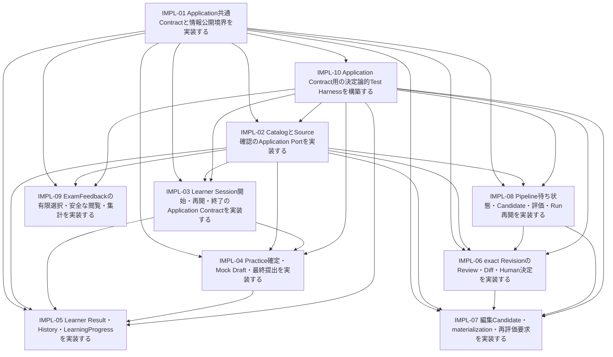

# Issue #11に基づく後続実装Issue Plan

- 状態: 実装準備の設計案。確定#11を変更せず、Application実装Issueの責務と検証を提案する。
- 準備設計時の作業場所: `/tmp/refriq-issue11`、branch `feature/11-access-patterns`。現在の改修場所とHEADは第11節に分けて記録し、当時の入力履歴を保持する。
- 正本: [Access Pattern Contract](issue-11-access-patterns.md)。関連案: [Port / DTO](issue-11-application-contract-draft.md)、[Test Matrix](issue-11-contract-test-matrix.md)。

## 1. 目的・境界・入力

#11 Contract → Application Port / DTO → 実装Issue → Contract Testの順に落とす。Formal36（Q21 / C15）、内部保証7、H01〜H09はHuman確定済み。旧CandidateのADOPTED16 / INTERNALIZED7 / OPEN2 / DEFERRED6を維持し、Open / Deferredを実装Scopeへ含めない。準備設計時は設計文書と承認された新Issue作成までを扱った。RV改修時は承認済み4件の文書修正のみを行い、正本へRV-03の既存規則明確化を反映した。今回のPOST改修は第1.1 / 11節の現状追従であり、正本とTest Matrixは変更しない。確定判断・ID・Q/Cは変更せず、このDocs Track AではProduction / Adapter / API / UI / Testコード、#12 / ADR、commit / push / PR / GitHub更新を扱わない。

| 入力 | 実際の読取版 | 用いる境界 |
| --- | --- | --- |
| #11 | 確定正本SHA-256 `24a6ea4e48c50f9b56dafc31b921fbecff8946437fa447c836643f4ec5c81047`、本文 / commentsをGitHub再確認 | Formal36 / 内部7 / K15 / H01〜H09 |
| Repository | worktree HEAD `9874feb3043d9eff5d7fb69d73a0c220f84fa6e9`、AGENTS.md / README / MVP / Architecture / Accepted ADR-0001〜0006 | Domain / Application / HTTP境界、既存Vitest / P8 |
| #6 / #7 / #8 | Domain / Lifecycle / Source Governance、P8 Stage Contract・実行 / Resume / Provider | stable ID、immutable、current Gate、validated境界 |
| #9 | mainマージ済みlearner-ui.md。SHA-256 `05426e1a2cc7a7f25cf10b400490eead7db60df752ec85bcb38433e826ecae71` | 10 / 20、Snapshot、解禁、stale write / ack |
| #10 | `/tmp/refriq-issue10/docs/ux/reviewer-ui.md`、SHA-256 `cad9d6320026286a2612038bdc15aa8f5b015aad254348e5396ed324ef64b490` | N-01、N-02、exact Review / Feedback。#11のprivacy優先 |
| #12（Consumer） | HEAD `0669dffcc5a7d5ee40f37f0430a291f6ec726268`、Plan SHA-256 `21e0401153d7c11e27ce056bb4b40446771b2c9702746bec3451d1ed9e7ebd9b` | 進捗・一時追跡だけ確認。要求の根拠にしない |
| 既存#13〜#19 | 既存本文を読取確認。GitHubへの編集はしない | 新Issueの後続Consumer。旧本文との差は#11優先で接続する |

環境切替後（2026-10-14）、消失した専用worktree・未コミット正本・作成途中の案を当該セッションの編集記録から復元した。正本は以前のSHA-256とbyte単位で完全一致し、意味を再設計していない。#10は復元後の実ファイルを再読し、上表は現在Hashを記録する。N-01、exact Revision、matching評価、有限Feedbackの境界は確定#11と照合して維持する。#12 PlanはGitHubの上記HEADから取得した実bytesでHashを再計算した。

Requirement優先順位は確定#11 → Accepted ADR → #6 / #7 → #8 → #9 → #10。実装・Fixtureは補助。旧#17のEdit即Revision化や#19のPlanning範囲を新Issueへ継承しない。これらの既存Issue本文は編集せず、後続統合で#11を優先する。#11変更が必要な設計Blockerはなし。

### 1.1 mainの#10実装を再利用する責務（POST-05）

2026-10-21、#10 PR #39マージ済みmain `17a0bd1`を再確認した。上表の準備設計時HEAD / Issue状態 / Hashは当時の入力履歴であり、現在状態の宣言ではない。[Port / DTO Draft第1.1節](issue-11-application-contract-draft.md#11-10マージ後の既存実装と再利用post-05)にALREADY_IMPLEMENTED / PARTIALLY_IMPLEMENTED / NOT_IMPLEMENTED / CONTRACT_MISMATCHを機能単位で整理した。以下の完成済みIssue本文も新規全面実装ではなく、既存ReviewerService / ReviewerStore / 共有Contract / HTTP・Webの再利用と不足補完として読む。実依存の保証やFormal全件充足は別途証明する。

| Issue | 再利用 | 不足・改修の所有先 |
| --- | --- | --- |
| #36 | Decision共通条件 / APPROVE固有Gate / exact詳細 / Diff / Queue | POST-02 Diff集合比較とPOST-04 Queue全順序は別Track B。追加Filter・前版Human Record・実依存保証は#36の補完。RV-01〜03の設計は維持 |
| #38 | 既存Edit・Source blocker・new Candidate・Edit再送 | materialization / reevaluationはNOT_IMPLEMENTED。既存Editを作り直さず成功境界と接続を追加 |
| #34 | finite Feedback / immutable Submit / list・detail privacy | POST-03の成功再送Kは別Track B。latest-per-Learner summaryはNOT_IMPLEMENTED。追加Filter / 観測条件は#34で補完 |
| #33 | 4 Stage実行 / Validation / FAILED Resume | Waiting Query / KはNOT_IMPLEMENTED、stale確定拒否・Artifact復元は未証明。既存Pipelineを重複実装せず補完。RV04-01〜03と自動crash recoveryのMVP除外は維持 |

## 2. 推奨Issue構成

36 APを8つのFeature責務へ分け、共通基盤とHarnessを加えた10件。Query / Command件数ではなく、成功境界・状態・情報解禁・計算責務と既存P8再利用で分割する。IMPL番号は本Planの追跡IDでありGitHub番号・正式AP IDではない。

| Issue / 表題 | 目的 | 対象範囲 / AP | 依存 | 受入条件の要点 |
| --- | --- | --- | --- | --- |
| [IMPL-01 / #29](https://github.com/abi-yusuke-wada/refriq/issues/29) Application共通Contractと情報公開境界を実装する | 全Use Caseの論理DTO・Failure・cursor・Command Kを共通化し、外部境界で禁止情報を返さない。 | 共通型、trusted Actor Context、exact参照、Observation、opaque cursor、CommandInvocation / Outcome / Resolution、semantic inputの正規化、明示allowlist projection。共通のcurrent-state依存・論理Atomicityを定義する。 対象: 全36横断（個別所有なし） | なし | 同じActor・kind・operationId・同じsemantic inputは同じcommitted result identity、別inputはConflict。既成功照合を旧expected state判定より先に置く。 |
| [IMPL-02 / #31](https://github.com/abi-yusuke-wada/refriq/issues/31) CatalogとSource確認のApplication Portを実装する | 資格・Topicとexact Sourceの歴史Snapshot / current Policyを安全に解決する。 | 1資格・8 Topicの取得、資格所属検査、exact Snapshot / 現在Decisionの分離、全Source current Gateの内部解決、許可Metadata / Groundingのprojection。 対象: AP-CATALOG-001、AP-CATALOG-002、AP-SOURCE-001 | [IMPL-01 / #29](https://github.com/abi-yusuke-wada/refriq/issues/29)、[IMPL-10 / #30](https://github.com/abi-yusuke-wada/refriq/issues/30) | MVP資格1件・資格内8 Topicを表示順＋stable IDで返し、存在しない資格・所属不一致・依存失敗を正常Emptyへ変換しない。 |
| [IMPL-03 / #32](https://github.com/abi-yusuke-wada/refriq/issues/32) Learner Session開始・再開・終了のApplication Contractを実装する | 10 / 20一意Questionの固定Sessionを開始し、同じSnapshotで再開・明示終了する。 | 候補発見、個別current公開参照 / 適格性の解決、完全な現在集合での不足確定、Snapshot / 開始時Topic分類固定、Active一意、Resume / 明示終了、回答前projection。 対象: AP-LEARNING-001、AP-LEARNING-002、AP-LEARNING-004、AP-LEARNING-009、AP-LEARNING-010、AP-LEARNING-011、AP-LEARNING-013 | [IMPL-01 / #29](https://github.com/abi-yusuke-wada/refriq/issues/29)、[IMPL-02 / #31](https://github.com/abi-yusuke-wada/refriq/issues/31)、[IMPL-10 / #30](https://github.com/abi-yusuke-wada/refriq/issues/30) | Question9件・Revision12件の完全な現在集合ではPractice不足。不完全 / Eventual / freshness不明 / 依存失敗では不足を確定しない。 |
| [IMPL-04 / #35](https://github.com/abi-yusuke-wada/refriq/issues/35) Practice確定・Mock Draft・最終提出を実装する | 実回答をimmutableに確定し、Mockの可変Draftと提出事実を分離する。 | Practice confirm、Mock Draft変更 / 削除、latest saved state照合、最終提出、immutable実UserAnswer / 未回答、ack対応・stale write / end / submit競合。 対象: AP-LEARNING-005、AP-LEARNING-006、AP-LEARNING-012 | [IMPL-01 / #29](https://github.com/abi-yusuke-wada/refriq/issues/29)、[IMPL-02 / #31](https://github.com/abi-yusuke-wada/refriq/issues/31)、[IMPL-03 / #32](https://github.com/abi-yusuke-wada/refriq/issues/32)、[IMPL-10 / #30](https://github.com/abi-yusuke-wada/refriq/issues/30) | Practiceの同出題への別操作二重確定を拒否し、確定AnswerのID・選択・exact Revisionを変更しない。解説Query失敗は回答の再保存を起こさない。 |
| [IMPL-05 / #37](https://github.com/abi-yusuke-wada/refriq/issues/37) Learner Result・History・LearningProgressを実装する | exact履歴と開始時分類から、Mode別のResult・Topic正答率・累積進捗を再構築する。 | 解禁後exact問題projection、通常完了 / 提出Result、terminal History、Topic / 全体Progress、固定分類・未学習・再回答・未回答 / 重複除去、禁止本文の非公開。 対象: AP-LEARNING-003、AP-LEARNING-007、AP-LEARNING-008、AP-LEARNING-014、AP-LEARNING-015 | [IMPL-01 / #29](https://github.com/abi-yusuke-wada/refriq/issues/29)、[IMPL-02 / #31](https://github.com/abi-yusuke-wada/refriq/issues/31)、[IMPL-03 / #32](https://github.com/abi-yusuke-wada/refriq/issues/32)、[IMPL-04 / #35](https://github.com/abi-yusuke-wada/refriq/issues/35)、[IMPL-10 / #30](https://github.com/abi-yusuke-wada/refriq/issues/30) | 同TopicにKnowledgePointが2件でも1出題はTopicに1寄与、全体も1寄与。別Session再回答は新寄与、Practice / Mockを混ぜない。 |
| [IMPL-06 / #36](https://github.com/abi-yusuke-wada/refriq/issues/36) exact RevisionのReview・Diff・Human決定を実装する | CandidateとRevisionを区別して確認し、exact Revisionへの最大1 Human decisionを確定する。 | 種別Queue、exact Content / previous / Human Record、三Human Decisionの共通条件。APPROVEだけmatching Evaluation / Content・Context一致 / PASSとcurrent Source / Provenance / Publish Gate。REJECT / REQUEST_CHANGESは共通条件下でEvaluation不一致 / 欠落でも可。集合Diffは凍結IntentのSourceReference（sourceRevisionId + locator）を含む。 対象: AP-REVIEW-001、AP-REVIEW-002、AP-REVIEW-003、AP-REVIEW-004、AP-REVIEW-005、AP-REVIEW-008 | [IMPL-01 / #29](https://github.com/abi-yusuke-wada/refriq/issues/29)、[IMPL-02 / #31](https://github.com/abi-yusuke-wada/refriq/issues/31)、[IMPL-08 / #33](https://github.com/abi-yusuke-wada/refriq/issues/33)、[IMPL-10 / #30](https://github.com/abi-yusuke-wada/refriq/issues/30) | Candidate IDをHuman decisionの対象として拒否し、exact Domain Revisionと評価時Content / Context不一致またはmatching評価欠落ではAPPROVE不可。 |
| [IMPL-07 / #38](https://github.com/abi-yusuke-wada/refriq/issues/38) 編集Candidate・materialization・再評価要求を実装する | exact Revisionから新Candidateを作り、最大1 Domain対応と新評価を追跡する。 | N-01 Edit Gate、編集Content / Run内Candidate対応、stable Question / Knowledge解決、new Revision / QuestionSource / Provenance・最大1対応、新Validation / Evaluation処理接続。 対象: AP-REVIEW-006、AP-REVIEW-007、AP-REVIEW-009 | [IMPL-01 / #29](https://github.com/abi-yusuke-wada/refriq/issues/29)、[IMPL-02 / #31](https://github.com/abi-yusuke-wada/refriq/issues/31)、[IMPL-06 / #36](https://github.com/abi-yusuke-wada/refriq/issues/36)、[IMPL-08 / #33](https://github.com/abi-yusuke-wada/refriq/issues/33)、[IMPL-10 / #30](https://github.com/abi-yusuke-wada/refriq/issues/30) | base Revision全Sourceに四blockerのどれかがあればEdit不可。PROHIBITED Sourceだけ外して元Contentを流用する経路を拒否する。途中Policy変更は保存確定を拒否し、解消後に対象＋currentを再取得する。 |
| [IMPL-08 / #33](https://github.com/abi-yusuke-wada/refriq/issues/33) Pipeline待ち状態・Candidate・評価・Run再開を実装する | P8の生成・FAILED再開をApplication Contractへ接続し、validated Artifactと現在Attemptを守る。 | 待ちPage（PENDING / FAILEDの可視性と実行適格性を分離、dueAtなし / retryable=falseだけで除外しない）、Run内Candidate、exact matching Evaluation、新Run開始、FAILED位置からRetry / Resume、Run / Stage / Attempt / Failure / immutable Input / Artifact対応の内部解決。 対象: AP-PIPELINE-001、AP-PIPELINE-002、AP-PIPELINE-003、AP-PIPELINE-004、AP-PIPELINE-005 | [IMPL-01 / #29](https://github.com/abi-yusuke-wada/refriq/issues/29)、[IMPL-02 / #31](https://github.com/abi-yusuke-wada/refriq/issues/31)、[IMPL-10 / #30](https://github.com/abi-yusuke-wada/refriq/issues/30) | waitingはPENDING / FAILEDを区別し、FAILEDを自動実行可能やEvaluation REVISE / REJECTと混同しない。Filter後limitとstable cursorを守る。 |
| [IMPL-09 / #34](https://github.com/abi-yusuke-wada/refriq/issues/34) ExamFeedbackの有限選択・安全な閲覧・集計を実装する | immutableな抽象Signalを記録し、個人非公開のReviewer表示と最新1件寄与を返す。 | versioned finite allowlist、immutable submit / 再提出、新旧Record、Reviewer list / detail、期間内latest per Learner選定後のTopic / facet集計・分母 / count / 版 / 観測位置。 対象: AP-FEEDBACK-001、AP-FEEDBACK-002、AP-FEEDBACK-003、AP-FEEDBACK-004 | [IMPL-01 / #29](https://github.com/abi-yusuke-wada/refriq/issues/29)、[IMPL-02 / #31](https://github.com/abi-yusuke-wada/refriq/issues/31)、[IMPL-10 / #30](https://github.com/abi-yusuke-wada/refriq/issues/30) | unknown != not_used、Similarity三観点not_used all-or-none。未知Field / 値、本文、自由記述、Attachment / URL / Question参照をRaw保存・Logへ出さない。 |
| [IMPL-10 / #30](https://github.com/abi-yusuke-wada/refriq/issues/30) Application Contract用の決定論的Test Harnessを構築する | 36 Formal / 7内部保証をStorageなしで検証し、並行・応答喪失・stale・Policy変更を再現する。 | 既存VitestのScenario runner、制御可能な時計 / ID・schedule / failure point、論理Port fake / in-memory state、safe synthetic fixtures、projection漏出・成功条件のnegative control。 対象: 全36横断（個別所有なし） | [IMPL-01 / #29](https://github.com/abi-yusuke-wada/refriq/issues/29) | 同時開始・決定・submit、write拒否、commit後応答喪失、照合不能 / 確定未保存、Policyの読取後変更を順序制御で再現し、実時間sleepに依存しない。 |

## 3. 依存方向と実装順序

図の矢印は先行Issue → それを利用するIssue。共通型 → Harness → Catalog / Source → Featureの方向。HarnessはFeatureをimportせず、型・共通schedule / assertionだけに依存する。Feature固有fakeは各Feature Issueが所有するため循環しない。

| 実装順 | Issue | 完了時に渡すもの |
| --- | --- | --- |
| 1 | [IMPL-01 / #29](https://github.com/abi-yusuke-wada/refriq/issues/29) | 全Use Caseの論理DTO・Failure・cursor・Command Kを共通化し、外部境界で禁止情報を返さない。 |
| 2 | [IMPL-10 / #30](https://github.com/abi-yusuke-wada/refriq/issues/30) | 36 Formal / 7内部保証をStorageなしで検証し、並行・応答喪失・stale・Policy変更を再現する。 |
| 3 | [IMPL-02 / #31](https://github.com/abi-yusuke-wada/refriq/issues/31) | 資格・Topicとexact Sourceの歴史Snapshot / current Policyを安全に解決する。 |
| 4 | [IMPL-03 / #32](https://github.com/abi-yusuke-wada/refriq/issues/32) | 10 / 20一意Questionの固定Sessionを開始し、同じSnapshotで再開・明示終了する。 |
| 5 | [IMPL-08 / #33](https://github.com/abi-yusuke-wada/refriq/issues/33) | P8の生成・FAILED再開をApplication Contractへ接続し、validated Artifactと現在Attemptを守る。 |
| 6 | [IMPL-09 / #34](https://github.com/abi-yusuke-wada/refriq/issues/34) | immutableな抽象Signalを記録し、個人非公開のReviewer表示と最新1件寄与を返す。 |
| 7 | [IMPL-04 / #35](https://github.com/abi-yusuke-wada/refriq/issues/35) | 実回答をimmutableに確定し、Mockの可変Draftと提出事実を分離する。 |
| 8 | [IMPL-06 / #36](https://github.com/abi-yusuke-wada/refriq/issues/36) | CandidateとRevisionを区別して確認し、exact Revisionへの最大1 Human decisionを確定する。 |
| 9 | [IMPL-05 / #37](https://github.com/abi-yusuke-wada/refriq/issues/37) | exact履歴と開始時分類から、Mode別のResult・Topic正答率・累積進捗を再構築する。 |
| 10 | [IMPL-07 / #38](https://github.com/abi-yusuke-wada/refriq/issues/38) | exact Revisionから新Candidateを作り、最大1 Domain対応と新評価を追跡する。 |

共通型とHarnessの後、Session・Pipeline・Feedbackを並行できる。ReviewはPipelineのvalidated facts読取に依存する。編集 / materializationはReview / Pipelineの型と読取を利用するが、Review読取はmaterializerの実装へ依存しない。mapを読めるPortとmapを作るCommandを区別する。Result / History / Progressは固定Snapshotと確定Answerに依存する。

#12再レビュー前に進められるのは論理型・projection・pure計算・Use Case・fake Contract Test。real Adapterのcurrent再検査・競合・一貫成功・Evidence持続・Artifact復元は#12再レビュー後のAdapter設計 / 実証に依存する。fakeでreal保証を完了扱いしない。

## 4. Formal APの全件所有・Port / DTO対応

各APに主担当を1件割り当てる。共通01 / Harness10は横断支援でありAP所有を重複計上しない。

| AP | Q/C | 主担当 | Request案 → Result案 | Port案 |
| --- | --- | --- | --- | --- |
| AP-CATALOG-001 | Q | [IMPL-02 / #31](https://github.com/abi-yusuke-wada/refriq/issues/31) | CatalogQuery → CertificationCatalogView | CertificationCatalogReader |
| AP-CATALOG-002 | Q | [IMPL-02 / #31](https://github.com/abi-yusuke-wada/refriq/issues/31) | CertificationQuery → CertificationTopicView | CertificationCatalogReader |
| AP-SOURCE-001 | Q | [IMPL-02 / #31](https://github.com/abi-yusuke-wada/refriq/issues/31) | SourceQuery → SourceContextView | SourceContextReader |
| AP-LEARNING-001 | Q | [IMPL-03 / #32](https://github.com/abi-yusuke-wada/refriq/issues/32) | PublishedDiscoveryQuery → PublishedCandidatePage | PublishedQuestionResolver |
| AP-LEARNING-002 | Q | [IMPL-03 / #32](https://github.com/abi-yusuke-wada/refriq/issues/32) | SessionQuestionQuery → LearnerQuestionBefore | LearningSessionReader、ExactQuestionFactsReader、SourceContextReader |
| AP-LEARNING-003 | Q | [IMPL-05 / #37](https://github.com/abi-yusuke-wada/refriq/issues/37) | SessionQuestionQuery → LearnerQuestionAfter | LearningSessionReader、ExactQuestionFactsReader、SourceContextReader |
| AP-LEARNING-004 | C | [IMPL-03 / #32](https://github.com/abi-yusuke-wada/refriq/issues/32) | SessionStartRequest(Practice) → SessionStartReceipt | CertificationCatalogReader、ExactQuestionFactsReader、PublishedQuestionResolver、LearningSessionCommands、SourceContextReader |
| AP-LEARNING-005 | C | [IMPL-04 / #35](https://github.com/abi-yusuke-wada/refriq/issues/35) | PracticeConfirmationRequest → PracticeConfirmationReceipt | LearningSessionReader、ExactQuestionFactsReader、LearningSessionCommands、SourceContextReader |
| AP-LEARNING-006 | C | [IMPL-04 / #35](https://github.com/abi-yusuke-wada/refriq/issues/35) | MockSubmissionRequest → MockSubmissionReceipt | LearningSessionReader、ExactQuestionFactsReader、LearningSessionCommands、SourceContextReader |
| AP-LEARNING-007 | Q | [IMPL-05 / #37](https://github.com/abi-yusuke-wada/refriq/issues/37) | SessionQuery → SessionResultView | LearningResultsReader、ExactQuestionFactsReader、SourceContextReader |
| AP-LEARNING-008 | Q | [IMPL-05 / #37](https://github.com/abi-yusuke-wada/refriq/issues/37) | ProgressQuery(Topic) → TopicAccuracyView | LearningResultsReader |
| AP-LEARNING-009 | Q | [IMPL-03 / #32](https://github.com/abi-yusuke-wada/refriq/issues/32) | ActiveSessionQuery → ActiveSessionView | LearningSessionReader |
| AP-LEARNING-010 | Q | [IMPL-03 / #32](https://github.com/abi-yusuke-wada/refriq/issues/32) | SessionQuery → ResumeView | LearningSessionReader、ExactQuestionFactsReader、SourceContextReader |
| AP-LEARNING-011 | C | [IMPL-03 / #32](https://github.com/abi-yusuke-wada/refriq/issues/32) | SessionStartRequest(Mock) → SessionStartReceipt | CertificationCatalogReader、ExactQuestionFactsReader、PublishedQuestionResolver、LearningSessionCommands、SourceContextReader |
| AP-LEARNING-012 | C | [IMPL-04 / #35](https://github.com/abi-yusuke-wada/refriq/issues/35) | MockDraftChangeRequest → DraftSaveReceipt | LearningSessionReader、LearningSessionCommands、SourceContextReader |
| AP-LEARNING-013 | C | [IMPL-03 / #32](https://github.com/abi-yusuke-wada/refriq/issues/32) | SessionEndRequest → SessionEndReceipt | LearningSessionReader、LearningSessionCommands |
| AP-LEARNING-014 | Q | [IMPL-05 / #37](https://github.com/abi-yusuke-wada/refriq/issues/37) | TerminalHistoryQuery → TerminalHistoryPage | LearningResultsReader、SourceContextReader |
| AP-LEARNING-015 | Q | [IMPL-05 / #37](https://github.com/abi-yusuke-wada/refriq/issues/37) | ProgressQuery(Overall) → LearningProgressView | LearningResultsReader |
| AP-REVIEW-001 | Q | [IMPL-06 / #36](https://github.com/abi-yusuke-wada/refriq/issues/36) | ReviewQueueQuery → ReviewQueuePage | ReviewFactsReader、PipelineFactsReader |
| AP-REVIEW-002 | Q | [IMPL-06 / #36](https://github.com/abi-yusuke-wada/refriq/issues/36) | ExactReviewQuery → ExactReviewRevisionView | ExactQuestionFactsReader、ReviewFactsReader、PipelineFactsReader、SourceContextReader |
| AP-REVIEW-003 | Q | [IMPL-06 / #36](https://github.com/abi-yusuke-wada/refriq/issues/36) | RevisionComparisonQuery → RevisionDiffView | ExactQuestionFactsReader、ReviewFactsReader、SourceContextReader |
| AP-REVIEW-004 | C | [IMPL-06 / #36](https://github.com/abi-yusuke-wada/refriq/issues/36) | ApproveDecisionRequest → HumanDecisionReceipt | ReviewFactsReader、PipelineFactsReader、SourceContextReader、ReviewDecisionCommands |
| AP-REVIEW-005 | C | [IMPL-06 / #36](https://github.com/abi-yusuke-wada/refriq/issues/36) | RejectDecisionRequest → HumanDecisionReceipt | ReviewFactsReader、ReviewDecisionCommands |
| AP-REVIEW-006 | C | [IMPL-07 / #38](https://github.com/abi-yusuke-wada/refriq/issues/38) | EditRequest → EditedCandidateReceipt | ExactQuestionFactsReader、ReviewFactsReader、SourceContextReader、CandidateWorkflowCommands |
| AP-REVIEW-007 | C | [IMPL-07 / #38](https://github.com/abi-yusuke-wada/refriq/issues/38) | MaterializationRequest → MaterializationReceipt | ExactQuestionFactsReader、PipelineFactsReader、SourceContextReader、CandidateWorkflowCommands |
| AP-REVIEW-008 | C | [IMPL-06 / #36](https://github.com/abi-yusuke-wada/refriq/issues/36) | RequestChangesDecisionRequest → HumanDecisionReceipt | ReviewFactsReader、ReviewDecisionCommands |
| AP-REVIEW-009 | C | [IMPL-07 / #38](https://github.com/abi-yusuke-wada/refriq/issues/38) | ReevaluationRequest → ReevaluationReceipt | ExactQuestionFactsReader、ReviewFactsReader、PipelineFactsReader、SourceContextReader、CandidateWorkflowCommands、StructuredOutputProvider |
| AP-PIPELINE-001 | Q | [IMPL-08 / #33](https://github.com/abi-yusuke-wada/refriq/issues/33) | PipelineWaitingQuery → PipelineWaitingPage | PipelineFactsReader |
| AP-PIPELINE-002 | Q | [IMPL-08 / #33](https://github.com/abi-yusuke-wada/refriq/issues/33) | CandidateQuery → CandidateDetailView | PipelineFactsReader、SourceContextReader |
| AP-PIPELINE-003 | Q | [IMPL-08 / #33](https://github.com/abi-yusuke-wada/refriq/issues/33) | EvaluationQuery → EvaluationDetailView | PipelineFactsReader、SourceContextReader |
| AP-PIPELINE-004 | C | [IMPL-08 / #33](https://github.com/abi-yusuke-wada/refriq/issues/33) | RunStartRequest → RunStartReceipt | PipelineExecutionCommands、SourceContextReader、StructuredOutputProvider |
| AP-PIPELINE-005 | C | [IMPL-08 / #33](https://github.com/abi-yusuke-wada/refriq/issues/33) | RunResumeRequest → RunResumeReceipt | PipelineFactsReader、PipelineExecutionCommands、SourceContextReader、StructuredOutputProvider |
| AP-FEEDBACK-001 | C | [IMPL-09 / #34](https://github.com/abi-yusuke-wada/refriq/issues/34) | FeedbackSubmissionRequest → FeedbackSubmissionReceipt | ExamFeedbackCommands |
| AP-FEEDBACK-002 | Q | [IMPL-09 / #34](https://github.com/abi-yusuke-wada/refriq/issues/34) | FeedbackSummaryQuery → FeedbackSummaryView | FeedbackFactsReader |
| AP-FEEDBACK-003 | Q | [IMPL-09 / #34](https://github.com/abi-yusuke-wada/refriq/issues/34) | FeedbackListQuery → ReviewerFeedbackPage | FeedbackFactsReader |
| AP-FEEDBACK-004 | Q | [IMPL-09 / #34](https://github.com/abi-yusuke-wada/refriq/issues/34) | FeedbackDetailQuery → ReviewerFeedbackView | FeedbackFactsReader |

## 5. 内部保証7の組込み

| 内部保証 | 保証先Formal AP | 意味 | Port / 共通契約 | 担当Issue |
| --- | --- | --- | --- | --- |
| CAND-REVIEW-001 | AP-REVIEW-002、AP-REVIEW-003 | previous exact Revision特定、Human Record確認、Diff比較元解決。前版欠損を初版 / 差分なしにしない。全Revision履歴Paginationは採用しない | ReviewFactsReader、ExactQuestionFactsReader | [IMPL-06 / #36](https://github.com/abi-yusuke-wada/refriq/issues/36) |
| CAND-PIPELINE-001 | AP-PIPELINE-001、AP-PIPELINE-002、AP-PIPELINE-005 | current RunとStage概要・入力同一性・Artifact参照を整合して内部解決。独立Run監視Queryなし | PipelineFactsReader | [IMPL-08 / #33](https://github.com/abi-yusuke-wada/refriq/issues/33) |
| CAND-PIPELINE-002 | AP-PIPELINE-001、AP-PIPELINE-002、AP-PIPELINE-005 | current Stage / Attempt / Failure / retryableを内部解決。過去Failureを現在Attemptへ混ぜない | PipelineFactsReader | [IMPL-08 / #33](https://github.com/abi-yusuke-wada/refriq/issues/33) |
| CAND-PIPELINE-004 | AP-PIPELINE-002、AP-PIPELINE-003、AP-PIPELINE-005、AP-REVIEW-007、AP-REVIEW-009 | exact Run / Stage / Attemptのvalidated Artifactを復元・対象 / Schema / 完全性照合。欠損 / 部分結果を成功にしない。Raw Artifact browseなし | PipelineFactsReader、CandidateWorkflowCommands | [IMPL-08 / #33](https://github.com/abi-yusuke-wada/refriq/issues/33)、[IMPL-07 / #38](https://github.com/abi-yusuke-wada/refriq/issues/38) |
| CAND-PIPELINE-011 | AP-REVIEW-002、AP-REVIEW-007 | materialization成功結果とexact Revision詳細からCandidate→Domain対応を確認。対応だけ成立しRevision欠損を成功にしない | ReviewFactsReader、CandidateWorkflowCommands | [IMPL-06 / #36](https://github.com/abi-yusuke-wada/refriq/issues/36)、[IMPL-07 / #38](https://github.com/abi-yusuke-wada/refriq/issues/38) |
| CAND-SOURCE-001 | AP-SOURCE-001、AP-REVIEW-002、AP-REVIEW-004、AP-REVIEW-006、AP-REVIEW-007、AP-REVIEW-009、AP-PIPELINE-004、AP-PIPELINE-005 | 全参照Sourceの用途別current Policyを内部解決し確定時再検査。取得時Snapshotで代替しない。N-02のDecision identityと歴史Snapshotを維持。独立Policy Queryなし | SourceContextReader、各Command既存境界 | [IMPL-02 / #31](https://github.com/abi-yusuke-wada/refriq/issues/31)、[IMPL-06 / #36](https://github.com/abi-yusuke-wada/refriq/issues/36)、[IMPL-07 / #38](https://github.com/abi-yusuke-wada/refriq/issues/38)、[IMPL-08 / #33](https://github.com/abi-yusuke-wada/refriq/issues/33) |
| CAND-SYSTEM-001 | 全15 Command | 全15 CommandのK・結果不明照合。same Actor / kind / operationId / semantic inputはsame committed result、別入力はX。result not found != definitely not committed。独立Queryなし | 全Command Portの共通Resolution capability | [IMPL-01 / #29](https://github.com/abi-yusuke-wada/refriq/issues/29)、[IMPL-10 / #30](https://github.com/abi-yusuke-wada/refriq/issues/30)、[IMPL-03 / #32](https://github.com/abi-yusuke-wada/refriq/issues/32)、[IMPL-04 / #35](https://github.com/abi-yusuke-wada/refriq/issues/35)、[IMPL-06 / #36](https://github.com/abi-yusuke-wada/refriq/issues/36)、[IMPL-07 / #38](https://github.com/abi-yusuke-wada/refriq/issues/38)、[IMPL-08 / #33](https://github.com/abi-yusuke-wada/refriq/issues/33)、[IMPL-09 / #34](https://github.com/abi-yusuke-wada/refriq/issues/34) |

独立Run監視 / Policy照会 / Artifact browse / 全Revision履歴Pagination / 結果照合Endpointを追加しない。APの内部保証として復元 / recheck / receipt照合を扱う。

## 6. 既存Issueと後続Adapterへの受け渡し

| 既存Issue | 新Issueから渡すもの | 責務境界 |
| --- | --- | --- |
| #13 Hono / React基盤 | 共通DTOと安全なUse Case結果 | wire / Handlerは後続。36Endpointを要求しない |
| #14 Pipeline評価Harness | 08のP8再利用、10のApplication Harness | golden評価精度とApplication Contractは別。旧固定選択数を#11へ取り込まない |
| #15 Source ingestion | 02のHistorical / Current読取能力 | 取得 / Normalize / SourceReview管理は追加APにしない |
| #16 Pipeline実装 | 08の5AP、07の編集後評価接続 | Provider / Adapter接続は後続。生成と編集再評価はInputを検証して分離 |
| #17 Reviewer実装 | 06 / 07の9AP | Edit new Candidate、三exact決定、N-01 / N-02、最大1materialization |
| #18 Learner実装 | 03 / 04 / 05の15AP | Snapshot、開始時分類、保存ack、terminal History、非公開境界 |
| #19 Feedback実装 | 09の4AP | finite / immutable / latest1 / privacy。Planning延期 |
| #12 再レビュー | Formal36 + 内部7に対応したPort前提・Test Scenario | 実装済みでも充足未証明。実保証が不足したらConsumerへ戻す |

## 7. 完成済み実装Issue本文

各本文は新Issueへそのまま渡せる。ScopeはApplication型 / Use Case / logical fake検証まで。具体ファイル・method名は実装レビューで調整可能だが#11の意味・K・情報公開境界は変更しない。

### [IMPL-01 / #29](https://github.com/abi-yusuke-wada/refriq/issues/29) Application共通Contractと情報公開境界を実装する

<!-- refriq-issue11-preparation IMPL-01 contract:24a6ea4e48c50f9b56dafc31b921fbecff8946437fa447c836643f4ec5c81047 -->

作業領域: Application・Contract・検証（外部Adapterは後続）

#### 背景

[Issue #11](https://github.com/abi-yusuke-wada/refriq/issues/11)のHuman承認済みAccess Patternを実装へ移す。Formal Q21 / C15 / 36と内部保証7、H01〜H09は確定済み。本IssueはそのApplication責務の一部を担当する。

Repository正本: `docs/architecture/issue-11-access-patterns.md`、SHA-256 `24a6ea4e48c50f9b56dafc31b921fbecff8946437fa447c836643f4ec5c81047`。正本は現時点で専用worktreeの未コミット文書なので、存在しないGitHub blobへリンクしない。下記のAP入出力・条件・受入条件はIssue単体でも確認できるよう記載する。設計案は `docs/architecture/issue-11-implementation-plan.md`、`issue-11-application-contract-draft.md`、`issue-11-contract-test-matrix.md`。Port名・型名は案でありAccepted ADRではない。

#### 目的

全Use Caseの論理DTO・Failure・cursor・Command Kを共通化し、外部境界で禁止情報を返さない。

#### 対象AP

全36 Formal APに適用する基盤。個別APの実装責務は各Feature Issue。

E=Eventual、R=成功後read-after-write、C=確定時の現在状態確認、I=exact immutable読取。P=cursor必須、B=単一対象またはContractの件数上限。N=Not Found、S=Invalid State、X=Conflict、V=Validation Failure、D=Dependency unavailable、G=既存Source / Publish Gate拒否。新Domain reasonやHTTP statusは作らない。

#### Internal Guarantee

| 内部保証 | 保証先 | 意味 |
| --- | --- | --- |
| CAND-SYSTEM-001 | 全15 Command / 共通K | 全15 CommandのK・結果不明照合。same Actor / kind / operationId / semantic inputはsame committed result、別入力はX。result not found != definitely not committed。独立Queryなし |

#### 対象範囲

共通型、trusted Actor Context、exact参照、Observation、opaque cursor、CommandInvocation / Outcome / Resolution、semantic inputの正規化、明示allowlist projection。共通のcurrent-state依存・論理Atomicityを定義する。

#### 対象外

- 実Store配置・物理定義・接続SDK・Persistence Adapter。#12 Plan / 実装の編集や充足宣言。
- HTTP status / wire payload / Endpoint / Handler / 認証方式 / Production UI。AP件数からAPI数やRepository method数を決めない。
- Open CAND-PIPELINE-008 / 009の自動durable recovery、lease / heartbeat / RUNNING自動reclaim。FAILED明示Resumeとstale結果拒否は維持。
- Deferred CAND-PIPELINE-003、CAND-SOURCE-002 / 003 / 004 / 005、CAND-FEEDBACK-003。SourceRevision Diff・Planning summaryをMVPへ戻さない。
- Source登録 / 再取得 / Normalization、KnowledgePoint管理等の新Use Case。必要なexact対応・証跡は消さない。

#### 設計方針

Requirementは確定#11 → Accepted ADR-0001〜0006 → #6 / #7 → #8 → #9 → #10。#12はConsumer。PortはApplicationが所有し、Domainの既存Ruleを呼ぶ。実装時はAGENTS.md、README、MVP Scope、ADRと対象契約を再読する。Application内部DTOを外部API用`packages/contracts`へ先行複製しない。Fixtureの値・旧Issue本文で#11を弱めない。

全CommandのK: same Actor + operation kind + operationId + same semantic input → same committed result identity。same operationId + different semantic input → Conflict。既成功照合は古いexpected state判定より先。operation evidenceにMVP自動TTLを設けない。result not found != definitely not committed。応答喪失は結果不明とし、照合不能を確定失敗へ変換しない。現在禁止本文は再送Receiptにも出さない。

Learner回答前projectionは明示allowlist。正答 / correctOptionIds / correctness / score / explanation / Option explanation / answer revealing source / Reviewer内部情報なし。Practiceは当該確定問だけ、MockはFinal Submit後だけ解禁。Feedback Reviewer projectionにLearner identityなし。歴史Snapshotとcurrent Policyは別概念。現在条件を必要とするCommandは確定時に再検査し、Eventual一覧を判断の正本にしない。

#### 実装候補

packages/application内のcontracts / ports / projection候補。Domainの既存Source Gate型を再利用し、Question全体の新Domain実装を先行要求しない。

Port候補: `ExactQuestionFactsReader`

#### Test

以下は未実装のScenario計画。unit / contract / application integrationを決定論的な論理fakeで検証する。fake成功は実Adapterの原子性・持続性・current読取や#12充足の証明ではない。Adapter contract / HTTP・UI e2eは後続。実試験問題・Exam Dump・流出 / 再現問題はFixture・Prompt・Logにも使わない。

| Scenario | Given | When | Then |
| --- | --- | --- | --- |
| TC-X-L-08 owner / 解禁のnegative control | 他ownerのSession、全正答field入り内部facts | 各Learner Query / ack / errorを構築 | 所有者境界を守り、未解禁採点情報・Source・Reviewer内部Fieldを出力に含めない |
| TC-X-K-01 Actor / kind / semantic集合 | 同operationIdの別Actor / 別kind、同Options集合の並び替え | 各Command boundaryで照合 / 正規化 | 別Actor結果を漏らさずkindも区別。集合順のみ同意味、順序が意味を持つContentは変更扱い |
| TC-X-K-02 証拠の無自動TTL | 成功証拠あり、時計進行・Use Case instance再生成、同logical stateを保持 | same-operationを再照合 | 同committed結果、期限経過で新操作にしない。fake modelは物理持続性を証明しない |

#### 受入条件

- [ ] 同じActor・kind・operationId・同じsemantic inputは同じcommitted result identity、別inputはConflict。既成功照合を旧expected state判定より先に置く。
- [ ] 全15 Commandで使う結果不明 / committed / confirmed uncommittedの区別を型と例で示し、操作結果証拠にMVP自動TTLを設けない。
- [ ] Learner回答前allowlistへ正答・correctness・score・解説・Option説明・Source・Reviewer内部情報が混入すると検査が失敗する。
- [ ] API/HTTP型を先行せずApplication DTOをpackages/contractsへ複製しない。opaque参照から物理配置を読み出す契約を作らない。
- [ ] Applicationから特定外部SDKへ依存せず、明示projectionから禁止情報が出ないnegative caseを検査する。
- [ ] TypeScript実装時はflake.nixの環境で`make check`と`pnpm typecheck`を実行して結果を報告する。未実行Scenarioを成功扱いしない。

#### 依存Issue

なし。

既存#11は確定Requirement、#6 / #7 / #8とAccepted ADRは入力。#12再レビューはreal Adapter着手のGateであり、論理型・Use Case・fake Contract Testの前提としてその実装を取り込まない。

#### 後続Issue

[IMPL-02 / #31](https://github.com/abi-yusuke-wada/refriq/issues/31)、[IMPL-03 / #32](https://github.com/abi-yusuke-wada/refriq/issues/32)、[IMPL-04 / #35](https://github.com/abi-yusuke-wada/refriq/issues/35)、[IMPL-05 / #37](https://github.com/abi-yusuke-wada/refriq/issues/37)、[IMPL-06 / #36](https://github.com/abi-yusuke-wada/refriq/issues/36)、[IMPL-07 / #38](https://github.com/abi-yusuke-wada/refriq/issues/38)、[IMPL-08 / #33](https://github.com/abi-yusuke-wada/refriq/issues/33)、[IMPL-09 / #34](https://github.com/abi-yusuke-wada/refriq/issues/34)、[IMPL-10 / #30](https://github.com/abi-yusuke-wada/refriq/issues/30)。既存の広い実装Issue #13 へApplication成果を渡す。

#13〜#19の既存Scopeを本Issueで変更しない。接続前に確定#11と整合させる。#14のPipeline評価golden harnessと本Application Harnessは別の証明責務。#17の編集経路はnew Candidate → 新評価 → materialization、#19のPlanning Inputは延期。実AdapterはFormal36 + 内部7の#12再照合後に設計する。

### [IMPL-10 / #30](https://github.com/abi-yusuke-wada/refriq/issues/30) Application Contract用の決定論的Test Harnessを構築する

<!-- refriq-issue11-preparation IMPL-10 contract:24a6ea4e48c50f9b56dafc31b921fbecff8946437fa447c836643f4ec5c81047 -->

作業領域: Application・Contract・検証（外部Adapterは後続）

#### 背景

[Issue #11](https://github.com/abi-yusuke-wada/refriq/issues/11)のHuman承認済みAccess Patternを実装へ移す。Formal Q21 / C15 / 36と内部保証7、H01〜H09は確定済み。本IssueはそのApplication責務の一部を担当する。

Repository正本: `docs/architecture/issue-11-access-patterns.md`、SHA-256 `24a6ea4e48c50f9b56dafc31b921fbecff8946437fa447c836643f4ec5c81047`。正本は現時点で専用worktreeの未コミット文書なので、存在しないGitHub blobへリンクしない。下記のAP入出力・条件・受入条件はIssue単体でも確認できるよう記載する。設計案は `docs/architecture/issue-11-implementation-plan.md`、`issue-11-application-contract-draft.md`、`issue-11-contract-test-matrix.md`。Port名・型名は案でありAccepted ADRではない。

#### 目的

36 Formal / 7内部保証をStorageなしで検証し、並行・応答喪失・stale・Policy変更を再現する。

#### 対象AP

全36 Formal AP / 内部7を各Feature Issueで証明する共通Harness。Feature固有Use Caseは担当Issue。

E=Eventual、R=成功後read-after-write、C=確定時の現在状態確認、I=exact immutable読取。P=cursor必須、B=単一対象またはContractの件数上限。N=Not Found、S=Invalid State、X=Conflict、V=Validation Failure、D=Dependency unavailable、G=既存Source / Publish Gate拒否。新Domain reasonやHTTP statusは作らない。

#### Internal Guarantee

| 内部保証 | 保証先 | 意味 |
| --- | --- | --- |
| CAND-SYSTEM-001 | 全15 Command / 共通K | 全15 CommandのK・結果不明照合。same Actor / kind / operationId / semantic inputはsame committed result、別入力はX。result not found != definitely not committed。独立Queryなし |

#### 対象範囲

既存VitestのScenario runner、制御可能な時計 / ID・schedule / failure point、論理Port fake / in-memory state、safe synthetic fixtures、projection漏出・成功条件のnegative control。

#### 対象外

- 実Store配置・物理定義・接続SDK・Persistence Adapter。#12 Plan / 実装の編集や充足宣言。
- HTTP status / wire payload / Endpoint / Handler / 認証方式 / Production UI。AP件数からAPI数やRepository method数を決めない。
- Open CAND-PIPELINE-008 / 009の自動durable recovery、lease / heartbeat / RUNNING自動reclaim。FAILED明示Resumeとstale結果拒否は維持。
- Deferred CAND-PIPELINE-003、CAND-SOURCE-002 / 003 / 004 / 005、CAND-FEEDBACK-003。SourceRevision Diff・Planning summaryをMVPへ戻さない。
- Source登録 / 再取得 / Normalization、KnowledgePoint管理等の新Use Case。必要なexact対応・証跡は消さない。

#### 設計方針

Requirementは確定#11 → Accepted ADR-0001〜0006 → #6 / #7 → #8 → #9 → #10。#12はConsumer。PortはApplicationが所有し、Domainの既存Ruleを呼ぶ。実装時はAGENTS.md、README、MVP Scope、ADRと対象契約を再読する。Application内部DTOを外部API用`packages/contracts`へ先行複製しない。Fixtureの値・旧Issue本文で#11を弱めない。

全CommandのK: same Actor + operation kind + operationId + same semantic input → same committed result identity。same operationId + different semantic input → Conflict。既成功照合は古いexpected state判定より先。operation evidenceにMVP自動TTLを設けない。result not found != definitely not committed。応答喪失は結果不明とし、照合不能を確定失敗へ変換しない。現在禁止本文は再送Receiptにも出さない。

Learner回答前projectionは明示allowlist。正答 / correctOptionIds / correctness / score / explanation / Option explanation / answer revealing source / Reviewer内部情報なし。Practiceは当該確定問だけ、MockはFinal Submit後だけ解禁。Feedback Reviewer projectionにLearner identityなし。歴史Snapshotとcurrent Policyは別概念。現在条件を必要とするCommandは確定時に再検査し、Eventual一覧を判断の正本にしない。

#### 実装候補

packages/applicationのtest-support候補。feature固有Fakeは各担当Issueで作り、共通Harnessはfeature実装をimportしない。既存apps/pipeline/src/fake-llm-provider.tsを再利用する。

Port候補: 共通Harnessのみ。Feature Port fakeは各担当Issue。

#### Test

以下は未実装のScenario計画。unit / contract / application integrationを決定論的な論理fakeで検証する。fake成功は実Adapterの原子性・持続性・current読取や#12充足の証明ではない。Adapter contract / HTTP・UI e2eは後続。実試験問題・Exam Dump・流出 / 再現問題はFixture・Prompt・Logにも使わない。

| Scenario | Given | When | Then |
| --- | --- | --- | --- |
| TC-X-K-01 Actor / kind / semantic集合 | 同operationIdの別Actor / 別kind、同Options集合の並び替え | 各Command boundaryで照合 / 正規化 | 別Actor結果を漏らさずkindも区別。集合順のみ同意味、順序が意味を持つContentは変更扱い |
| TC-X-K-02 証拠の無自動TTL | 成功証拠あり、時計進行・Use Case instance再生成、同logical stateを保持 | same-operationを再照合 | 同committed結果、期限経過で新操作にしない。fake modelは物理持続性を証明しない |

#### 受入条件

- [ ] 同時開始・決定・submit、write拒否、commit後応答喪失、照合不能 / 確定未保存、Policyの読取後変更を順序制御で再現し、実時間sleepに依存しない。
- [ ] fakeが返した追加正答Field・不完全Artifact成功・同一Decision IDの意味不整合をnegative controlとして検査が検出する。fakeとUse Caseで同じ判定関数を共用して証明を循環させない。
- [ ] 全36 AP / 内部7 / 全15 Command KのCaseを各担当Issueへ接続でき、Case未登録をcoverage欠落として報告する。
- [ ] Model成功はApplication判断の証明と記録し、real Adapterのcurrent確認・持続性・原子性や#12充足を証明した扱いにしない。
- [ ] クラウド資格情報・実LLM・実試験問題なしで実行可能。TypeScript実装時はmake check / pnpm typecheckを実行する。
- [ ] Applicationから特定外部SDKへ依存せず、明示projectionから禁止情報が出ないnegative caseを検査する。
- [ ] TypeScript実装時はflake.nixの環境で`make check`と`pnpm typecheck`を実行して結果を報告する。未実行Scenarioを成功扱いしない。

#### 依存Issue

[IMPL-01 / #29](https://github.com/abi-yusuke-wada/refriq/issues/29)。

既存#11は確定Requirement、#6 / #7 / #8とAccepted ADRは入力。#12再レビューはreal Adapter着手のGateであり、論理型・Use Case・fake Contract Testの前提としてその実装を取り込まない。

#### 後続Issue

[IMPL-02 / #31](https://github.com/abi-yusuke-wada/refriq/issues/31)、[IMPL-03 / #32](https://github.com/abi-yusuke-wada/refriq/issues/32)、[IMPL-04 / #35](https://github.com/abi-yusuke-wada/refriq/issues/35)、[IMPL-05 / #37](https://github.com/abi-yusuke-wada/refriq/issues/37)、[IMPL-06 / #36](https://github.com/abi-yusuke-wada/refriq/issues/36)、[IMPL-07 / #38](https://github.com/abi-yusuke-wada/refriq/issues/38)、[IMPL-08 / #33](https://github.com/abi-yusuke-wada/refriq/issues/33)、[IMPL-09 / #34](https://github.com/abi-yusuke-wada/refriq/issues/34)。既存の広い実装Issue #14との役割分離 へApplication成果を渡す。

#13〜#19の既存Scopeを本Issueで変更しない。接続前に確定#11と整合させる。#14のPipeline評価golden harnessと本Application Harnessは別の証明責務。#17の編集経路はnew Candidate → 新評価 → materialization、#19のPlanning Inputは延期。実AdapterはFormal36 + 内部7の#12再照合後に設計する。

### [IMPL-02 / #31](https://github.com/abi-yusuke-wada/refriq/issues/31) CatalogとSource確認のApplication Portを実装する

<!-- refriq-issue11-preparation IMPL-02 contract:24a6ea4e48c50f9b56dafc31b921fbecff8946437fa447c836643f4ec5c81047 -->

作業領域: Application・Contract・検証（外部Adapterは後続）

#### 背景

[Issue #11](https://github.com/abi-yusuke-wada/refriq/issues/11)のHuman承認済みAccess Patternを実装へ移す。Formal Q21 / C15 / 36と内部保証7、H01〜H09は確定済み。本IssueはそのApplication責務の一部を担当する。

Repository正本: `docs/architecture/issue-11-access-patterns.md`、SHA-256 `24a6ea4e48c50f9b56dafc31b921fbecff8946437fa447c836643f4ec5c81047`。正本は現時点で専用worktreeの未コミット文書なので、存在しないGitHub blobへリンクしない。下記のAP入出力・条件・受入条件はIssue単体でも確認できるよう記載する。設計案は `docs/architecture/issue-11-implementation-plan.md`、`issue-11-application-contract-draft.md`、`issue-11-contract-test-matrix.md`。Port名・型名は案でありAccepted ADRではない。

#### 目的

資格・Topicとexact Sourceの歴史Snapshot / current Policyを安全に解決する。

#### 対象AP

| AP | Actor | Q/C | Use Case | 入力 | 出力 |
| --- | --- | --- | --- | --- | --- |
| AP-CATALOG-001 | Learner / Reviewer / System | Q | MVP資格一覧を取得する | 呼出元Context | 対象資格ID・名称・概要。MVPは1件 |
| AP-CATALOG-002 | Learner / Reviewer / Pipeline | Q | 資格詳細とExamTopicを取得する | certificationId | 資格説明、所属Topic ID・名称・説明・表示順 |
| AP-SOURCE-001 | Reviewer / Pipeline | Q | exact SourceRevisionのSnapshotと根拠を取得する | sourceRevisionId、usagePurpose、必要なlocator | 取得時URL・日時・Fingerprint・Metadata / Terms / Policy Snapshotと現在用途別Policy参照、許可されるGrounding。禁止本文は返さず許可Metadata・exact参照を区別 |

##### 取得・更新条件

| AP | 並び順 / Filter / Pagination | Consistency | 競合 / 再検査 | Failure |
| --- | --- | --- | --- | --- |
| AP-CATALOG-001 | certificationId asc / MVP対象の1資格 / B: 1件限定。資格追加時に再検討 | E | Catalog更新を途中混在させず一つの応答を組み立てる | V / D |
| AP-CATALOG-002 | Topic表示順 asc + examTopicId asc。未指定順はID順 / 指定資格所属Topic / B: MVP Scopeの8分野 | E。更新直後の同一操作はR | 所属関係を応答内で一致させる | N / V / D |
| AP-SOURCE-001 | 単一Revision。Segmentは指定locator順 / exact ID・Purpose・locator一致 / B: 単一Snapshot。本文全文の無制限返却は要求しない | I + 用途確認C | current Policyを取得時Snapshotで代替しない。取得中の禁止変更を検知。歴史Snapshot・Decision identityを改変せず許可Metadataと禁止本文を分離 | N / V / D / G（要求された本文 / 用途が未許可）。許可Metadataのみの応答は明示 |

E=Eventual、R=成功後read-after-write、C=確定時の現在状態確認、I=exact immutable読取。P=cursor必須、B=単一対象またはContractの件数上限。N=Not Found、S=Invalid State、X=Conflict、V=Validation Failure、D=Dependency unavailable、G=既存Source / Publish Gate拒否。新Domain reasonやHTTP statusは作らない。

#### Internal Guarantee

| 内部保証 | 保証先 | 意味 |
| --- | --- | --- |
| CAND-SOURCE-001 | AP-SOURCE-001、AP-REVIEW-002、AP-REVIEW-004、AP-REVIEW-006、AP-REVIEW-007、AP-REVIEW-009、AP-PIPELINE-004、AP-PIPELINE-005 | 全参照Sourceの用途別current Policyを内部解決し確定時再検査。取得時Snapshotで代替しない。N-02のDecision identityと歴史Snapshotを維持。独立Policy Queryなし |

#### 対象範囲

1資格・8 Topicの取得、資格所属検査、exact Snapshot / 現在Decisionの分離、全Source current Gateの内部解決、許可Metadata / Groundingのprojection。

#### 対象外

- 実Store配置・物理定義・接続SDK・Persistence Adapter。#12 Plan / 実装の編集や充足宣言。
- HTTP status / wire payload / Endpoint / Handler / 認証方式 / Production UI。AP件数からAPI数やRepository method数を決めない。
- Open CAND-PIPELINE-008 / 009の自動durable recovery、lease / heartbeat / RUNNING自動reclaim。FAILED明示Resumeとstale結果拒否は維持。
- Deferred CAND-PIPELINE-003、CAND-SOURCE-002 / 003 / 004 / 005、CAND-FEEDBACK-003。SourceRevision Diff・Planning summaryをMVPへ戻さない。
- Source登録 / 再取得 / Normalization、KnowledgePoint管理等の新Use Case。必要なexact対応・証跡は消さない。

#### 設計方針

Requirementは確定#11 → Accepted ADR-0001〜0006 → #6 / #7 → #8 → #9 → #10。#12はConsumer。PortはApplicationが所有し、Domainの既存Ruleを呼ぶ。実装時はAGENTS.md、README、MVP Scope、ADRと対象契約を再読する。Application内部DTOを外部API用`packages/contracts`へ先行複製しない。Fixtureの値・旧Issue本文で#11を弱めない。

全CommandのK: same Actor + operation kind + operationId + same semantic input → same committed result identity。same operationId + different semantic input → Conflict。既成功照合は古いexpected state判定より先。operation evidenceにMVP自動TTLを設けない。result not found != definitely not committed。応答喪失は結果不明とし、照合不能を確定失敗へ変換しない。現在禁止本文は再送Receiptにも出さない。

Learner回答前projectionは明示allowlist。正答 / correctOptionIds / correctness / score / explanation / Option explanation / answer revealing source / Reviewer内部情報なし。Practiceは当該確定問だけ、MockはFinal Submit後だけ解禁。Feedback Reviewer projectionにLearner identityなし。歴史Snapshotとcurrent Policyは別概念。現在条件を必要とするCommandは確定時に再検査し、Eventual一覧を判断の正本にしない。

#### 実装候補

ApplicationのCatalog / Source Use CaseとPort型。既存@refriq/domainのGateを使い、取得時TRUSTEDでcurrentを代替しない。

Port候補: `CertificationCatalogReader`、`SourceContextReader`

| AP | Request案 | Result案 | 使用Port案 |
| --- | --- | --- | --- |
| AP-CATALOG-001 | CatalogQuery | CertificationCatalogView | CertificationCatalogReader |
| AP-CATALOG-002 | CertificationQuery | CertificationTopicView | CertificationCatalogReader |
| AP-SOURCE-001 | SourceQuery | SourceContextView | SourceContextReader |

#### Test

以下は未実装のScenario計画。unit / contract / application integrationを決定論的な論理fakeで検証する。fake成功は実Adapterの原子性・持続性・current読取や#12充足の証明ではない。Adapter contract / HTTP・UI e2eは後続。実試験問題・Exam Dump・流出 / 再現問題はFixture・Prompt・Logにも使わない。

| Scenario | Given | When | Then |
| --- | --- | --- | --- |
| TC-AP-CATALOG-001 資格一覧 / 依存失敗 | MVP資格C1のみ、readerの成功 / unavailable | 資格一覧を取得 | 1件のみ。依存失敗はD、正常Emptyにしない |
| TC-AP-CATALOG-002 資格内Topic / 所属 | C1所属8 Topic、同じ表示順のT1 / T2 | C1詳細を取得、別資格所属参照も試す | 8件を表示順＋ID順。不存在N / 所属不正V / 依存失敗D |
| TC-AP-SOURCE-001 歴史 / current / 非公開 | 取得時TRUSTEDのsr1、現在PROHIBITED | exact Sourceを用途指定で読む | 取得時Snapshot不変、currentを別返却、許可Metadataのみ。禁止本文G / 非表示 |
| TC-IG-CAND-SOURCE-001 current / 歴史 / N-01 / N-02 | 取得時TRUSTED、current変更 / 重複ID意味不整合 / missing | 全Source現在取得後、確定直前にPolicy変更 | Snapshot不変、Source Gateで拒否。blocker解消後は対象＋current再読、同一ID内容の不整合を検出 |

#### 受入条件

- [ ] MVP資格1件・資格内8 Topicを表示順＋stable IDで返し、存在しない資格・所属不一致・依存失敗を正常Emptyへ変換しない。
- [ ] 同じSourceRevisionを後日のPROHIBITED Decisionと読んでも取得時Snapshotは変わらず、禁止本文は応答 / Error / Logに出ない。
- [ ] 同一Decision IDの参照は同一内容を表す。異なる内容の同一ID・ambiguous・missingをTRUSTEDに補完しない（N-02）。
- [ ] Source current確認後の変更をCommand確定時に再検査できる論理依存を渡し、読取時の観測だけで確定成功を保証しない。
- [ ] 対象AP AP-CATALOG-001、AP-CATALOG-002、AP-SOURCE-001 の入出力・並び順・Filter後limit・Consistency・上記FailureをApplication Contract Testへ追跡する。
- [ ] Applicationから特定外部SDKへ依存せず、明示projectionから禁止情報が出ないnegative caseを検査する。
- [ ] TypeScript実装時はflake.nixの環境で`make check`と`pnpm typecheck`を実行して結果を報告する。未実行Scenarioを成功扱いしない。

#### 依存Issue

[IMPL-01 / #29](https://github.com/abi-yusuke-wada/refriq/issues/29)、[IMPL-10 / #30](https://github.com/abi-yusuke-wada/refriq/issues/30)。

既存#11は確定Requirement、#6 / #7 / #8とAccepted ADRは入力。#12再レビューはreal Adapter着手のGateであり、論理型・Use Case・fake Contract Testの前提としてその実装を取り込まない。

#### 後続Issue

[IMPL-03 / #32](https://github.com/abi-yusuke-wada/refriq/issues/32)、[IMPL-04 / #35](https://github.com/abi-yusuke-wada/refriq/issues/35)、[IMPL-05 / #37](https://github.com/abi-yusuke-wada/refriq/issues/37)、[IMPL-06 / #36](https://github.com/abi-yusuke-wada/refriq/issues/36)、[IMPL-07 / #38](https://github.com/abi-yusuke-wada/refriq/issues/38)、[IMPL-08 / #33](https://github.com/abi-yusuke-wada/refriq/issues/33)、[IMPL-09 / #34](https://github.com/abi-yusuke-wada/refriq/issues/34)。既存の広い実装Issue #13 / #15 へApplication成果を渡す。

#13〜#19の既存Scopeを本Issueで変更しない。接続前に確定#11と整合させる。#14のPipeline評価golden harnessと本Application Harnessは別の証明責務。#17の編集経路はnew Candidate → 新評価 → materialization、#19のPlanning Inputは延期。実AdapterはFormal36 + 内部7の#12再照合後に設計する。

### [IMPL-03 / #32](https://github.com/abi-yusuke-wada/refriq/issues/32) Learner Session開始・再開・終了のApplication Contractを実装する

<!-- refriq-issue11-preparation IMPL-03 contract:24a6ea4e48c50f9b56dafc31b921fbecff8946437fa447c836643f4ec5c81047 -->

作業領域: Application・Contract・検証（外部Adapterは後続）

#### 背景

[Issue #11](https://github.com/abi-yusuke-wada/refriq/issues/11)のHuman承認済みAccess Patternを実装へ移す。Formal Q21 / C15 / 36と内部保証7、H01〜H09は確定済み。本IssueはそのApplication責務の一部を担当する。

Repository正本: `docs/architecture/issue-11-access-patterns.md`、SHA-256 `24a6ea4e48c50f9b56dafc31b921fbecff8946437fa447c836643f4ec5c81047`。正本は現時点で専用worktreeの未コミット文書なので、存在しないGitHub blobへリンクしない。下記のAP入出力・条件・受入条件はIssue単体でも確認できるよう記載する。設計案は `docs/architecture/issue-11-implementation-plan.md`、`issue-11-application-contract-draft.md`、`issue-11-contract-test-matrix.md`。Port名・型名は案でありAccepted ADRではない。

#### 目的

10 / 20一意Questionの固定Sessionを開始し、同じSnapshotで再開・明示終了する。

#### 対象AP

| AP | Actor | Q/C | Use Case | 入力 | 出力 |
| --- | --- | --- | --- | --- | --- |
| AP-LEARNING-001 | Learner / System | Q | Session選択用の公開Question候補を取得する | certificationId、cursor / limit、必要なら一覧走査参照 | 一意Question ID、現在公開Revision参照、開始用件数・鮮度 / 完全性。Learner向けは安全な概要のみ |
| AP-LEARNING-002 | Learner | Q | Session内の回答前問題を取得する | 所有者Context、sessionId、ordinal、questionRevisionId照合値 | exact固定Revisionのstem / type / options、Question ID、ordinal、本人保存状態。回答前Projection。利用不可時は許可Metadata・停止理由のみ |
| AP-LEARNING-004 | Learner | C | 10問Practice Sessionを開始する | 所有者Context、certificationId、operationId | sessionId、Practice、10一意Question stable ID・exact Revision ID・ordinal・開始時Topic分類Identityの固定Snapshot、成功状態 |
| AP-LEARNING-009 | Learner | Q | Active Sessionを取得する | 所有者Context、certificationId、mode | User×資格×ModeのActive Session参照・進行 / 保存状態・利用可否確認待ちの理由、または正常な不存在。採点情報なし |
| AP-LEARNING-010 | Learner | Q | 固定Snapshotと保存済み状態でResumeする | 所有者Context、sessionId | 固定Question / exact Revision / ordinal / Topic分類、Practice確定参照または保存済みMock Draft集合と対応保存状態、進行 / 停止理由。解禁範囲だけのProjection |
| AP-LEARNING-011 | Learner | C | 20問Mock Sessionを開始する | 所有者Context、certificationId、operationId | sessionId、Mock、20一意Question stable ID・exact Revision ID・ordinal・開始時Topic分類Identityの固定Snapshot |
| AP-LEARNING-013 | Learner | C | 既存Active Sessionを明示終了する | 所有者Context、sessionId、期待状態、operationId | 終了したSession参照・時点、保持されたPractice確定回答参照。未提出Mockは採点しない |

##### 取得・更新条件

| AP | 並び順 / Filter / Pagination | Consistency | 競合 / 再検査 | Failure |
| --- | --- | --- | --- | --- |
| AP-LEARNING-001 | questionId asc / 指定資格・公開参照あり。一意Question単位で重複除去 / P: 件数に上限なし。30問は最低量であり上限ではない | 一覧E、各Questionのcurrent published reference / 適格性確認C。不足判定は完全な現在集合の一意数確認 | 選択対象の公開参照を現在確認しexact解決。全Question同一瞬間のCurrentは要求しない。Eventual / 途中ページ / freshness不明は不足確定に使わない | N / V / D（完全性 / freshness未確認もunresolved）。未確定件数を不足へ変換しない |
| AP-LEARNING-002 | ordinalを維持、OptionsはRevision内順 / 所有Session・Snapshot所属・exact Revision / B: 単一問題。Session内一覧も最大20件 | I + Session状態R / C、現在用途別Policy C | Snapshotと本人状態を対応づける。利用不可なら進行停止・状態保持、許可再確認後も同Snapshot。再抽選 / Current差替えなし | N / V / D / G（本文 / 進行が未許可）。許可Metadataを区別 |
| AP-LEARNING-004 | 作成時のordinal ascを固定 / 所有者・資格・対象Mode、current公開参照と適格性を確認した10一意Question。開始時Topic分類を解決 / B: 10件。抽選元一覧はAP-LEARNING-001 | 選択QuestionごとC、成功後R / I。全体同時logical timestampは不要 | User×資格×Modeの同時開始・公開参照 / 適格性の競合を検知。完全な現在集合による不足確認、Snapshot / 分類の部分成功を禁止 | N / S（完全な現在集合で確認した不足 / 不正状態）/ X / V / D / G |
| AP-LEARNING-009 | 単一組合せ / 所有者・資格・mode、非terminalのActive。利用不可による進行停止中も同Sessionを返す / B: 最大1件。PracticeとMockは別Queryまたは最大2件の合成 | R / C | 同時開始・終了・提出後の現在Sessionを判別。Policy停止をterminalや不存在と誤認しない | V / D。不在は正常結果 |
| AP-LEARNING-010 | ordinal asc、OptionsはRevision内順 / 所有者・同じSession Snapshot / B: 最大20問 | Snapshot / 分類I + 保存集合 / 対応状態R、Resume可否・current Policy C | 同じ論理読取でSnapshot・確定参照 / Draft集合・対応保存状態を返す。再抽選なし。利用不可時は進行停止・状態保持、許可再確認後に同Snapshotを再開 | N / S / V / D / G（進行 / 本文が未許可）。許可Metadataと停止理由を区別 |
| AP-LEARNING-011 | 固定ordinal asc / 所有者・資格・対象Mode、current公開参照と適格性を確認した20一意Question。開始時Topic分類を解決 / B: 20件 | 選択QuestionごとC、成功後R / I。全体同時logical timestampは不要 | User×資格×Modeの同時開始・公開参照 / 適格性の競合を検知。完全な現在集合による不足確認、Snapshot / 分類の部分成功を禁止 | N / S（完全な現在集合で確認した不足 / 不正状態）/ X / V / D / G |
| AP-LEARNING-013 | 単一対象 / 所有者・明示確認した非terminal Active。Policy停止中も終了可能。新開始とは別操作 / B: 1件 | C + 成功後R | 保存・回答確定・提出・同時終了を検知。Snapshot / 確定Practiceを保持、未提出Mockを採点しない | N / S / X / V / D |

##### Commandの論理成功条件

| AP | 検知する競合 | 一貫して成立する成功条件 |
| --- | --- | --- |
| AP-LEARNING-004 | 同User×資格×Practice開始、公開適格性 / 分類解決 | 10一意Question・exact Snapshot / 分類・Session・操作結果を全体成功。既存Active自動終了なし |
| AP-LEARNING-011 | 同User×資格×Mock開始、公開適格性 / 分類解決 | 20一意Question・exact Snapshot / 分類・Session・操作結果を全体成功 |
| AP-LEARNING-013 | 並行保存 / 回答 / 提出 / 終了 | 明示terminal化・Active解放・確定Practice保持・操作結果。未提出Mockを採点しない |

E=Eventual、R=成功後read-after-write、C=確定時の現在状態確認、I=exact immutable読取。P=cursor必須、B=単一対象またはContractの件数上限。N=Not Found、S=Invalid State、X=Conflict、V=Validation Failure、D=Dependency unavailable、G=既存Source / Publish Gate拒否。新Domain reasonやHTTP statusは作らない。

#### Internal Guarantee

| 内部保証 | 保証先 | 意味 |
| --- | --- | --- |
| CAND-SYSTEM-001 | 全15 Command / 共通K | 全15 CommandのK・結果不明照合。same Actor / kind / operationId / semantic inputはsame committed result、別入力はX。result not found != definitely not committed。独立Queryなし |

#### 対象範囲

候補発見、個別current公開参照 / 適格性の解決、完全な現在集合での不足確定、Snapshot / 開始時Topic分類固定、Active一意、Resume / 明示終了、回答前projection。

#### 対象外

- 実Store配置・物理定義・接続SDK・Persistence Adapter。#12 Plan / 実装の編集や充足宣言。
- HTTP status / wire payload / Endpoint / Handler / 認証方式 / Production UI。AP件数からAPI数やRepository method数を決めない。
- Open CAND-PIPELINE-008 / 009の自動durable recovery、lease / heartbeat / RUNNING自動reclaim。FAILED明示Resumeとstale結果拒否は維持。
- Deferred CAND-PIPELINE-003、CAND-SOURCE-002 / 003 / 004 / 005、CAND-FEEDBACK-003。SourceRevision Diff・Planning summaryをMVPへ戻さない。
- Source登録 / 再取得 / Normalization、KnowledgePoint管理等の新Use Case。必要なexact対応・証跡は消さない。

#### 設計方針

Requirementは確定#11 → Accepted ADR-0001〜0006 → #6 / #7 → #8 → #9 → #10。#12はConsumer。PortはApplicationが所有し、Domainの既存Ruleを呼ぶ。実装時はAGENTS.md、README、MVP Scope、ADRと対象契約を再読する。Application内部DTOを外部API用`packages/contracts`へ先行複製しない。Fixtureの値・旧Issue本文で#11を弱めない。

全CommandのK: same Actor + operation kind + operationId + same semantic input → same committed result identity。same operationId + different semantic input → Conflict。既成功照合は古いexpected state判定より先。operation evidenceにMVP自動TTLを設けない。result not found != definitely not committed。応答喪失は結果不明とし、照合不能を確定失敗へ変換しない。現在禁止本文は再送Receiptにも出さない。

Learner回答前projectionは明示allowlist。正答 / correctOptionIds / correctness / score / explanation / Option explanation / answer revealing source / Reviewer内部情報なし。Practiceは当該確定問だけ、MockはFinal Submit後だけ解禁。Feedback Reviewer projectionにLearner identityなし。歴史Snapshotとcurrent Policyは別概念。現在条件を必要とするCommandは確定時に再検査し、Eventual一覧を判断の正本にしない。

#### 実装候補

Session Use CaseとSession読み書きPortのライフサイクルvariant。Question抽選の重み・割合は導入しない。

Port候補: `PublishedQuestionResolver`、`LearningSessionReader`、`LearningSessionCommands`、`ExactQuestionFactsReader`、`SourceContextReader`

| AP | Request案 | Result案 | 使用Port案 |
| --- | --- | --- | --- |
| AP-LEARNING-001 | PublishedDiscoveryQuery | PublishedCandidatePage | PublishedQuestionResolver |
| AP-LEARNING-002 | SessionQuestionQuery | LearnerQuestionBefore | LearningSessionReader、ExactQuestionFactsReader、SourceContextReader |
| AP-LEARNING-004 | SessionStartRequest(Practice) | SessionStartReceipt | CertificationCatalogReader、ExactQuestionFactsReader、PublishedQuestionResolver、LearningSessionCommands、SourceContextReader |
| AP-LEARNING-009 | ActiveSessionQuery | ActiveSessionView | LearningSessionReader |
| AP-LEARNING-010 | SessionQuery | ResumeView | LearningSessionReader、ExactQuestionFactsReader、SourceContextReader |
| AP-LEARNING-011 | SessionStartRequest(Mock) | SessionStartReceipt | CertificationCatalogReader、ExactQuestionFactsReader、PublishedQuestionResolver、LearningSessionCommands、SourceContextReader |
| AP-LEARNING-013 | SessionEndRequest | SessionEndReceipt | LearningSessionReader、LearningSessionCommands |

#### Test

以下は未実装のScenario計画。unit / contract / application integrationを決定論的な論理fakeで検証する。fake成功は実Adapterの原子性・持続性・current読取や#12充足の証明ではない。Adapter contract / HTTP・UI e2eは後続。実試験問題・Exam Dump・流出 / 再現問題はFixture・Prompt・Logにも使わない。

| Scenario | Given | When | Then |
| --- | --- | --- | --- |
| TC-AP-LEARNING-001 候補件数・鮮度 | Q9 stable ID / Revision12、E pageと完全current確認を区別 | 候補発見と現在件数証拠を読む | Questionは9。不完全 / E終端を完全current証拠にしない。回答前情報のみ |
| TC-AP-LEARNING-002 回答前projection | 所有Sessionのqr1、回答未確定 / Mock未提出 | ordinalの問題を読む | qr1 stem / type / options内順・本人保存状態のみ。全正答 / 解説fieldなし |
| TC-AP-LEARNING-004 Practice開始 / 完全不足 | 完全current集合Q9 / Revision12、または適格Q10 | Practiceを開始 | 前者S不足・Sessionなし。後者10一意Question / exact / ordinal / 固定Topicを全体成功 |
| TC-AP-LEARNING-009 Active / 正常不在 | U1×C1×Practice Active、Mock別枠、Policy停止中 | Activeを読む | 最大1 / mode、停止中も同Session。不存在は正常、Dと区別 |
| TC-AP-LEARNING-010 固定Resume / 状態集合 | qr1開始後qr2公開、保存Draft集合と対応保存状態あり | 同SessionをResume | qr1と固定分類・ordinal、同じ保存状態に対応する集合。再抽選なし |
| TC-AP-LEARNING-011 Mock開始 | 適格Q20、公開参照はQuestionごとに異なる確認時点 | Mockを開始 | 20一意Question / exact / ordinal / 固定分類。全Question同時logical timestampを要求しない |
| TC-AP-LEARNING-013 明示終了 / 未提出保持 | Practice確定Answerあり、未提出Mock、Policy停止中 | Activeを明示終了 | terminal / Active解放、確定Answer保持、未提出Mock scoreなし。別開始とは別操作 |
| TC-K-AP-LEARNING-004 K / Conflict / 結果不明 | 同Actor / kind / operationIdの確定結果あり。元Request保持、commit後応答喪失と未保存 / 照合不能を別注入 | same semantic input再送 / certificationId変更 / same-operation照合 | 同input→同committed result ID / 時点、別input→X。既成功照合が旧expected競合より先。committed / confirmed uncommitted / still unknownを区別、未保存推測・別ID再実行なし |
| TC-K-AP-LEARNING-011 K / Conflict / 結果不明 | 同Actor / kind / operationIdの確定結果あり。元Request保持、commit後応答喪失と未保存 / 照合不能を別注入 | same semantic input再送 / certificationId変更 / same-operation照合 | 同input→同committed result ID / 時点、別input→X。既成功照合が旧expected競合より先。committed / confirmed uncommitted / still unknownを区別、未保存推測・別ID再実行なし |
| TC-K-AP-LEARNING-013 K / Conflict / 結果不明 | 同Actor / kind / operationIdの確定結果あり。元Request保持、commit後応答喪失と未保存 / 照合不能を別注入 | same semantic input再送 / sessionId / 元expected state変更 / same-operation照合 | 同input→同committed result ID / 時点、別input→X。既成功照合が旧expected競合より先。committed / confirmed uncommitted / still unknownを区別、未保存推測・別ID再実行なし |
| TC-IG-CAND-SYSTEM-001 照合≠単なるnot found | commit有無不明、証拠読取不能 / foundなし | 既存Command境界でreconcile、論理時計を進める | result not found≠definitely not committed。全15 K・無自動TTL、独立Query / Port不要 |
| TC-X-L-01 不完全不足 / 不足確認失敗 | E一覧Q9、未取得page、current読取失敗 / freshness不明 | Session開始を試す | D / unresolved、S不足や成功Sessionにしない |
| TC-X-L-02 同時開始 / 公開変更 | 同User資格modeの並行start、選択中にpublished ref変更 | 二startと確定前変更を順序制御 | Active最大1、current条件競合検知、部分Snapshotなし。Practice / Mock別枠 |
| TC-X-L-03 分類固定 / 後日変更 | S1開始時K1→T1、後日K1→T2、同qrのS2を開始 | S1結果 / History / 累積とS2寄与を読む | S1はT1を維持、S2開始時T2は許容。Current label≠分類identity |
| TC-X-L-04 保存 / 提出 / 終了競合 | old saved state、並行Draft削除・submit・end | 古い保存参照で提出 / 遅延write | X / Sを識別、最新保存を採点、terminalへ古いDraftを上書きしない |
| TC-X-L-05 利用不可停止 / 同Snapshot復帰 | Active Source現在禁止、Practice確定回答あり | 再開 / 新回答を試し、許可再取得 / 明示終了 | 進行停止・状態保持、許可後同Snapshot。Current差替え / 自動終了 / 未提出Mock採点なし |
| TC-X-L-08 owner / 解禁のnegative control | 他ownerのSession、全正答field入り内部facts | 各Learner Query / ack / errorを構築 | 所有者境界を守り、未解禁採点情報・Source・Reviewer内部Fieldを出力に含めない |
| TC-X-PAGE-01 Filter後limit / continuation | 同時刻tie、Filter除外行・重複Question・短い取得単位 | 希望limitで各一覧を歩く | Filter後件数、stable tie-break、短いpageにも必要cursor。正常終端と途中 / Dを区別 |
| TC-X-PAGE-02 cursor Context / mutable | U1 / FilterA cursor、U2 / FilterB / 別mode、Queue出入り | cursor再利用、mutable Queueのpage2を読む | Context不一致V。Queue全page同時Snapshotとは主張せず、Commandはcurrent再検査 |

#### 受入条件

- [ ] Question9件・Revision12件の完全な現在集合ではPractice不足。不完全 / Eventual / freshness不明 / 依存失敗では不足を確定しない。
- [ ] 成功時はPractice10 / Mock20一意Question stable ID・exact Revision・ordinal・開始時Topic分類がすべて成立し、部分Snapshotを返さない。
- [ ] User×資格×Modeの同時開始でActiveは最大1。同操作retryは同じSnapshotであり、開始後のqr2公開でもqr1をResumeする。
- [ ] Source利用不可時はSession / Snapshot / 保存状態を保持して進行停止。許可再確認後は同Snapshot、明示終了はPractice確定を保持し未提出Mockを採点しない。
- [ ] AP-LEARNING-004 / 011 / 013のK・Conflict・応答喪失照合を検証する。全Question同一logical timestampは要求しない。
- [ ] 対象AP AP-LEARNING-001、AP-LEARNING-002、AP-LEARNING-004、AP-LEARNING-009、AP-LEARNING-010、AP-LEARNING-011、AP-LEARNING-013 の入出力・並び順・Filter後limit・Consistency・上記FailureをApplication Contract Testへ追跡する。
- [ ] 対象Commandすべてでsame-operation同結果 / 別semantic input Conflict / commit後応答喪失・照合不能を検証し、論理成功条件の部分成立を成功にしない。
- [ ] Applicationから特定外部SDKへ依存せず、明示projectionから禁止情報が出ないnegative caseを検査する。
- [ ] TypeScript実装時はflake.nixの環境で`make check`と`pnpm typecheck`を実行して結果を報告する。未実行Scenarioを成功扱いしない。

#### 依存Issue

[IMPL-01 / #29](https://github.com/abi-yusuke-wada/refriq/issues/29)、[IMPL-02 / #31](https://github.com/abi-yusuke-wada/refriq/issues/31)、[IMPL-10 / #30](https://github.com/abi-yusuke-wada/refriq/issues/30)。

既存#11は確定Requirement、#6 / #7 / #8とAccepted ADRは入力。#12再レビューはreal Adapter着手のGateであり、論理型・Use Case・fake Contract Testの前提としてその実装を取り込まない。

#### 後続Issue

[IMPL-04 / #35](https://github.com/abi-yusuke-wada/refriq/issues/35)、[IMPL-05 / #37](https://github.com/abi-yusuke-wada/refriq/issues/37)。既存の広い実装Issue #18 へApplication成果を渡す。

#13〜#19の既存Scopeを本Issueで変更しない。接続前に確定#11と整合させる。#14のPipeline評価golden harnessと本Application Harnessは別の証明責務。#17の編集経路はnew Candidate → 新評価 → materialization、#19のPlanning Inputは延期。実AdapterはFormal36 + 内部7の#12再照合後に設計する。

### [IMPL-08 / #33](https://github.com/abi-yusuke-wada/refriq/issues/33) Pipeline待ち状態・Candidate・評価・Run再開を実装する

<!-- refriq-issue11-preparation IMPL-08 contract:24a6ea4e48c50f9b56dafc31b921fbecff8946437fa447c836643f4ec5c81047 -->

作業領域: Application・Contract・検証（外部Adapterは後続）

#### 背景

[Issue #11](https://github.com/abi-yusuke-wada/refriq/issues/11)のHuman承認済みAccess Patternを実装へ移す。Formal Q21 / C15 / 36と内部保証7、H01〜H09は確定済み。本IssueはそのApplication責務の一部を担当する。

Repository正本: `docs/architecture/issue-11-access-patterns.md`、SHA-256 `24a6ea4e48c50f9b56dafc31b921fbecff8946437fa447c836643f4ec5c81047`。正本は現時点で専用worktreeの未コミット文書なので、存在しないGitHub blobへリンクしない。下記のAP入出力・条件・受入条件はIssue単体でも確認できるよう記載する。設計案は `docs/architecture/issue-11-implementation-plan.md`、`issue-11-application-contract-draft.md`、`issue-11-contract-test-matrix.md`。Port名・型名は案でありAccepted ADRではない。

#### 既存実装の再利用と不足（POST-05）

PARTIALLY_IMPLEMENTED: runQuestionPipeline / resumeQuestionPipelineとvalidated Stage契約を再利用する。Waiting Query・operationId KはNOT_IMPLEMENTED、stale確定拒否・Artifact復元保証は未証明として補完する。RV04-01〜03は維持し、Production Pipeline修正は今回対象外。

#### 目的

P8の生成・FAILED再開をApplication Contractへ接続し、validated Artifactと現在Attemptを守る。

#### 対象AP

| AP | Actor | Q/C | Use Case | 入力 | 出力 |
| --- | --- | --- | --- | --- | --- |
| AP-PIPELINE-001 | Pipeline / System / Reviewer | Q | Pipelineの待ちStage状態を取得する | certificationId、stage、対象status、cursor / limit | Run・Stage・現在Attempt・状態・待ちに入った時点、依存Stage / Artifact、Failure概要、実行可能性を判断する材料。Run状態・current Stage / retryableを内部解決し、validated依存の完全性を確認 |
| AP-PIPELINE-002 | Reviewer / Pipeline | Q | Run内Candidate詳細を取得する | pipelineRunId、candidateId、必要なら生成Attempt | Candidate Content、Knowledge候補、Intent、Source Snapshot / 実Grounding、Run / Stage参照・Eligibility、Evaluation参照、current Run / Stage / Failure概要。validated Artifactを内部復元・照合 |
| AP-PIPELINE-003 | Reviewer / Pipeline | Q | exact Candidateに対応するEvaluationを取得する | pipelineRunId、candidateId、評価Attemptまたは評価Artifact参照 | 対象Candidate / Content参照、PASS / REVISE / REJECT、Checks / Findings・曖昧さ・前提、metadata |
| AP-PIPELINE-004 | Pipeline / System | C | 新しい生成Runを開始する | P8 Pipeline Input、operationId | 新pipelineRunId、固定入力同一性・処理参照 |
| AP-PIPELINE-005 | Pipeline / System | C | FAILED Runを同じ失敗StageからRetry / Resumeする | pipelineRunId、期待Run / Stage状態、P8再開Input、operationId | 同じRunの再開参照・FAILED Stage・新Attempt参照、成功済み前段validated Artifact保持・完全性。current Run / Stage / Failureを内部確認 |

##### 取得・更新条件

| AP | 並び順 / Filter / Pagination | Consistency | 競合 / 再検査 | Failure |
| --- | --- | --- | --- | --- |
| AP-PIPELINE-001 | waitingSince asc + pipelineRunId + Stage契約順 / 資格・Stage・PENDING / FAILEDを区別。FAILEDは実行可能を意味しない / P: Run数に上限なし | E。実行 / resume確定時はC | Run / current Stage / Attempt / Failureを対応づける。過去Failureをcurrentへ混ぜない。Eventual行から実行成功を判断せず、RUNNING自動回復を要求しない | V / D |
| AP-PIPELINE-002 | Content内順、Knowledge / Sourceはstableな参照順 / Run内Candidate一致、許可Source用途 / B: P8は1 Run / 1 Question候補。履歴Artifact一覧ではない | I + 作成直後R、現在Policy C | Run内ID・生成Artifact・current Stage / Attemptを照合。旧Failureや別Runを混ぜず、欠損 / 未検証Artifactを成功にしない | N / V / D / G |
| AP-PIPELINE-003 | P8 Criterion順、Findingは検証済み出力内順 / exact Candidate / 評価対象Content・Attempt一致 / B: 1 Evaluation | I + 作成直後R、本文 / Grounding用途のcurrent Policy C | exact validated評価Artifactを復元し対象Content / Attemptを検証。禁止本文をFindings等へ混ぜず、別Candidate / RevisionへPASSを移さない | N / S / V / D / G |
| AP-PIPELINE-004 | 単一Run / P8 Schema / Source Gateに合うInput / B: 1 Run | C + 成功後R | 同じ操作の二重Run作成を防ぐ。別Run候補を既存Revisionへ自動上書きしない | V / X / D / G |
| AP-PIPELINE-005 | P8 Stage順、失敗位置から後続のみ / FAILED Run・失敗Stage、変更していないimmutable Input、現在Policy適格 / B: 1 Run再開 | C + 成功後R | current Run / Stage / Attempt / retryableとvalidated Artifactを照合。同時Resume・成功Run再実行・immutable Input変更を拒否。stale worker結果がcurrent Stage / Candidate / Evaluationを上書きしない。RUNNING crashの自動再実行なし | N / S / X / V / D / G |

##### Commandの論理成功条件

| AP | 検知する競合 | 一貫して成立する成功条件 |
| --- | --- | --- |
| AP-PIPELINE-004 | 同操作による二重Run開始・Source Gate | 新Run・固定Input / 処理参照・操作結果。LLM本文完全一致は要求しない |
| AP-PIPELINE-005 | 同時Resume・current Attempt変更・stale worker結果 | FAILED再開受付 / Attempt・前段validated Artifact対応・操作結果。旧結果のcurrent上書きなし、自動crash回復なし |

E=Eventual、R=成功後read-after-write、C=確定時の現在状態確認、I=exact immutable読取。P=cursor必須、B=単一対象またはContractの件数上限。N=Not Found、S=Invalid State、X=Conflict、V=Validation Failure、D=Dependency unavailable、G=既存Source / Publish Gate拒否。新Domain reasonやHTTP statusは作らない。

#### Internal Guarantee

| 内部保証 | 保証先 | 意味 |
| --- | --- | --- |
| CAND-PIPELINE-001 | AP-PIPELINE-001、AP-PIPELINE-002、AP-PIPELINE-005 | current RunとStage概要・入力同一性・Artifact参照を整合して内部解決。独立Run監視Queryなし |
| CAND-PIPELINE-002 | AP-PIPELINE-001、AP-PIPELINE-002、AP-PIPELINE-005 | current Stage / Attempt / Failure / retryableを内部解決。過去Failureを現在Attemptへ混ぜない |
| CAND-PIPELINE-004 | AP-PIPELINE-002、AP-PIPELINE-003、AP-PIPELINE-005、AP-REVIEW-007、AP-REVIEW-009 | exact Run / Stage / Attemptのvalidated Artifactを復元・対象 / Schema / 完全性照合。欠損 / 部分結果を成功にしない。Raw Artifact browseなし |
| CAND-SOURCE-001 | AP-SOURCE-001、AP-REVIEW-002、AP-REVIEW-004、AP-REVIEW-006、AP-REVIEW-007、AP-REVIEW-009、AP-PIPELINE-004、AP-PIPELINE-005 | 全参照Sourceの用途別current Policyを内部解決し確定時再検査。取得時Snapshotで代替しない。N-02のDecision identityと歴史Snapshotを維持。独立Policy Queryなし |
| CAND-SYSTEM-001 | 全15 Command / 共通K | 全15 CommandのK・結果不明照合。same Actor / kind / operationId / semantic inputはsame committed result、別入力はX。result not found != definitely not committed。独立Queryなし |

#### 対象範囲

待ちPage（PENDING / FAILEDの可視性と実行適格性を分離、dueAtなし / retryable=falseだけで除外しない）、Run内Candidate、exact matching Evaluation、新Run開始、FAILED位置からRetry / Resume、Run / Stage / Attempt / Failure / immutable Input / Artifact対応の内部解決。

#### 対象外

- 実Store配置・物理定義・接続SDK・Persistence Adapter。#12 Plan / 実装の編集や充足宣言。
- HTTP status / wire payload / Endpoint / Handler / 認証方式 / Production UI。AP件数からAPI数やRepository method数を決めない。
- Open CAND-PIPELINE-008 / 009の自動durable recovery、lease / heartbeat / RUNNING自動reclaim。FAILED明示Resumeとstale結果拒否は維持。
- Deferred CAND-PIPELINE-003、CAND-SOURCE-002 / 003 / 004 / 005、CAND-FEEDBACK-003。SourceRevision Diff・Planning summaryをMVPへ戻さない。
- Source登録 / 再取得 / Normalization、KnowledgePoint管理等の新Use Case。必要なexact対応・証跡は消さない。

#### 設計方針

Requirementは確定#11 → Accepted ADR-0001〜0006 → #6 / #7 → #8 → #9 → #10。#12はConsumer。PortはApplicationが所有し、Domainの既存Ruleを呼ぶ。実装時はAGENTS.md、README、MVP Scope、ADRと対象契約を再読する。Application内部DTOを外部API用`packages/contracts`へ先行複製しない。Fixtureの値・旧Issue本文で#11を弱めない。

全CommandのK: same Actor + operation kind + operationId + same semantic input → same committed result identity。same operationId + different semantic input → Conflict。既成功照合は古いexpected state判定より先。operation evidenceにMVP自動TTLを設けない。result not found != definitely not committed。応答喪失は結果不明とし、照合不能を確定失敗へ変換しない。現在禁止本文は再送Receiptにも出さない。

Learner回答前projectionは明示allowlist。正答 / correctOptionIds / correctness / score / explanation / Option explanation / answer revealing source / Reviewer内部情報なし。Practiceは当該確定問だけ、MockはFinal Submit後だけ解禁。Feedback Reviewer projectionにLearner identityなし。歴史Snapshotとcurrent Policyは別概念。現在条件を必要とするCommandは確定時に再検査し、Eventual一覧を判断の正本にしない。

#### 実装候補

既存runQuestionPipeline / resumeQuestionPipelineとStructuredOutputProviderを再利用するApplication boundary。既存Fake Providerを用い実Provider接続は後続。

Port候補: `PipelineFactsReader`、`PipelineExecutionCommands`、`StructuredOutputProvider`、`SourceContextReader`

| AP | Request案 | Result案 | 使用Port案 |
| --- | --- | --- | --- |
| AP-PIPELINE-001 | PipelineWaitingQuery | PipelineWaitingPage | PipelineFactsReader |
| AP-PIPELINE-002 | CandidateQuery | CandidateDetailView | PipelineFactsReader、SourceContextReader |
| AP-PIPELINE-003 | EvaluationQuery | EvaluationDetailView | PipelineFactsReader、SourceContextReader |
| AP-PIPELINE-004 | RunStartRequest | RunStartReceipt | PipelineExecutionCommands、SourceContextReader、StructuredOutputProvider |
| AP-PIPELINE-005 | RunResumeRequest | RunResumeReceipt | PipelineFactsReader、PipelineExecutionCommands、SourceContextReader、StructuredOutputProvider |

#### Test

以下は未実装のScenario計画。unit / contract / application integrationを決定論的な論理fakeで検証する。fake成功は実Adapterの原子性・持続性・current読取や#12充足の証明ではない。Adapter contract / HTTP・UI e2eは後続。実試験問題・Exam Dump・流出 / 再現問題はFixture・Prompt・Logにも使わない。

| Scenario | Given | When | Then |
| --- | --- | --- | --- |
| TC-AP-PIPELINE-001 待ち / current Failure | PENDING（dueAtなし）・FAILED（retryable=false）・RUNNINGと旧Attempt Failure、同waitingSince | 待ちStageをFilterして読む | PENDING / FAILEDを現在状態として一覧に含め、current Attempt / retryableを対応。visibility != execution scheduling eligibility。dueAt有無 / retryableだけで除外せず、品質REJECTを技術Failureにしない |
| TC-AP-PIPELINE-002 Run-qualified Candidate | Run1とRun2で同candidateId、validated Artifactと欠損例 | Run1 Candidateを読む | Run1のexact Content / Grounding / current Stage参照。別Run / 不完全Artifactを成功にしない |
| TC-AP-PIPELINE-003 exact Evaluation binding | Candidate C1の評価Attempt、別Candidate / ContentのPASSあり | C1 Evaluationを取得 | C1 / Content / Attempt一致を確認。別PASSへfallbackせず、Human Approvalを作らない |
| TC-AP-PIPELINE-004 新生成Run | 検証可能なP8 Inputとcurrent Source、同 / 新operation | Run開始 | 同operationは同Run、意図的新生成は新Run。LLM本文一致・Human / Publishを要求 / 作成しない |
| TC-AP-PIPELINE-005 FAILED Resume | 成功前段validated Artifact、失敗Stage / current Attemptあり | 同Runを明示Resume | 前段保持、失敗Stageから新Attempt、immutable Input照合。成功Run再実行 / stale上書きを拒否 |
| TC-K-AP-PIPELINE-004 K / Conflict / 結果不明 | 同Actor / kind / operationIdの確定結果あり。元Request保持、commit後応答喪失と未保存 / 照合不能を別注入 | same semantic input再送 / P8 immutable Input変更 / same-operation照合 | 同input→同committed result ID / 時点、別input→X。既成功照合が旧expected競合より先。committed / confirmed uncommitted / still unknownを区別、未保存推測・別ID再実行なし |
| TC-K-AP-PIPELINE-005 K / Conflict / 結果不明 | 同Actor / kind / operationIdの確定結果あり。元Request保持、commit後応答喪失と未保存 / 照合不能を別注入 | same semantic input再送 / Run / 再開Input変更 / same-operation照合 | 同input→同committed result ID / 時点、別input→X。既成功照合が旧expected競合より先。committed / confirmed uncommitted / still unknownを区別、未保存推測・別ID再実行なし |
| TC-IG-CAND-PIPELINE-001 Run / Input / Artifact対応 | 複数Runのcurrent Stage・Input・Artifact | waiting / Candidate / Resume前提を読む | 同Runの現在状態とimmutable Inputを内部解決、別Runのartifactを混ぜない |
| TC-IG-CAND-PIPELINE-002 現在Failure / Attempt | 旧Attempt Failed、現在Attempt Running / 新Failure | 必要なPipeline状態を読む | 旧Failureをcurrentへ混ぜず、retryableを現在Failureへ対応 |
| TC-IG-CAND-PIPELINE-004 validated Artifact復元 | raw / 欠損 / Schema不正 / wrong AttemptのArtifact | Candidate / Evaluation / Resume / materialize / 再評価前提を復元 | Run / Stage / Attempt・Schema / completeness一致のみ採用。不完全を成功にしない |
| TC-IG-CAND-SOURCE-001 current / 歴史 / N-01 / N-02 | 取得時TRUSTED、current変更 / 重複ID意味不整合 / missing | 全Source現在取得後、確定直前にPolicy変更 | Snapshot不変、Source Gateで拒否。blocker解消後は対象＋current再読、同一ID内容の不整合を検出 |
| TC-IG-CAND-SYSTEM-001 照合≠単なるnot found | commit有無不明、証拠読取不能 / foundなし | 既存Command境界でreconcile、論理時計を進める | result not found≠definitely not committed。全15 K・無自動TTL、独立Query / Port不要 |
| TC-X-P-01 stale worker | Attempt2がcurrent、Attempt1の結果が遅延 | 旧Stage / Candidate / Evaluation保存結果を渡す | currentを上書きしない。validated Artifact対応と成功状態のintegrityを保つ |
| TC-X-P-02 FAILED / Input例外 | FAILED、前段Artifactあり / Fingerprint未成立の検証前失敗 | immutable Input変更 / 原因修正再開を試す | Fingerprint成立後の変更拒否。未成立時はP8既存例外を維持し、前段を再生成しない |
| TC-X-P-03 crash Scope境界 | 親の観測系からRun / Stage / Attemptを読める隔離process fixture。Stage RUNNINGを観測後、worker processをcrashさせる | 自動処理の候補を一巡させる決定論的な観測区間で、残る状態・新Attempt・実行要求を観測 | crashだけではFAILED化せずRUNNINGを保持、新Attempt・自動reclaim / retry要求は0。FAILED専用Resumeは許可しない。自動遷移 / 要求や不正Resumeがあれば失敗。manual recoveryのResidual Riskを残し、自動回復の欠如自体は失敗にしない |
| TC-X-PAGE-01 Filter後limit / continuation | 同時刻tie、Filter除外行・重複Question・短い取得単位 | 希望limitで各一覧を歩く | Filter後件数、stable tie-break、短いpageにも必要cursor。正常終端と途中 / Dを区別 |
| TC-X-PAGE-02 cursor Context / mutable | U1 / FilterA cursor、U2 / FilterB / 別mode、Queue出入り | cursor再利用、mutable Queueのpage2を読む | Context不一致V。Queue全page同時Snapshotとは主張せず、Commandはcurrent再検査 |

TC-X-P-03は後続の隔離process integrationでのみ検証する計画であり、IMPL-08のApplication unit / integration Coverageや今回のDone条件に含めない。crash後の明示的な観測値で自動遷移・実行要求・不正Resumeを判定し、manual recoveryのResidual Riskは維持する。98 Scenario familyの総数にはこの後続計画1件を含むが、実行PASSを意味しない。

##### 承認済みRVの追加Test設計

| Scenario | Given | When | Then |
| --- | --- | --- | --- |
| RV04-01 PENDING / dueAtなし | Stage.status=PENDING、dueAt未設定、資格 / Stage / PENDING Filter一致 | 待ちStage一覧を取得 | 一覧に含む。waitingSinceを使い、dueAtの存在をFilter必須条件にしない。一覧可視性から実行可能・自動claim / 回復を推測しない |
| RV04-02 FAILED / retryable=false | Stage.status=FAILED、current Failure.retryable=false、FAILED対象Filter一致 | 待ちStage一覧を取得 | 一覧に含む。retryable=falseだけで除外しない。一覧存在 != Retry許可。修正 / 明示Retry条件は既存AP-PIPELINE-005で別確認 |
| RV04-03 待ち順序 / cursor | RV04-01 / 02を含みwaitingSince同時刻・別Run / Stage、Filter不一致行と短い取得単位あり | Filter後limitとcursorで一覧を継続 | waitingSince asc + pipelineRunId + Stage契約順でstable tie-break。dueAtへ置換しない。Filter後件数、短page continuation、Context bindingを維持。自動durable recoveryを要求しない |

#### 受入条件

- [ ] RV-04: RV04-01のPENDING / dueAtなし、RV04-02のFAILED / retryable=falseを対象Filter下で一覧に含める。visibility != scheduling / Retry eligibility。dueAt有無やretryableだけで除外しない。
- [ ] RV04-03でwaitingSince asc + pipelineRunId + Stage契約順、Filter後limit、短page continuation・cursor Contextを維持。waitingSinceをdueAtで代替せず、自動crash recoveryを追加しない。
- [ ] waitingはPENDING / FAILEDを区別し、FAILEDを自動実行可能やEvaluation REVISE / REJECTと混同しない。Filter後limitとstable cursorを守る。
- [ ] 別Run同candidateIdを区別し、ArtifactのRun / Stage / Attempt・Schema / completeness・評価対象Content一致を復元時に確認する。
- [ ] FAILED Resumeは成功前段Artifactを保持して失敗Stageを新Attemptで再開する。immutable Inputの変更拒否とP8のFingerprint未成立時の既存例外を維持する。
- [ ] 旧Attempt / worker結果はcurrent Stage / Candidate / Evaluationを上書きしない。statusだけ成功でArtifact欠損を成功にしない。
- [ ] AP-PIPELINE-004 / 005のK・結果不明を検証する。自動RUNNING reclaim / lease / heartbeat / automatic crash retryを実装範囲・Done条件に入れない。
- [ ] 対象AP AP-PIPELINE-001、AP-PIPELINE-002、AP-PIPELINE-003、AP-PIPELINE-004、AP-PIPELINE-005 の入出力・並び順・Filter後limit・Consistency・上記FailureをApplication Contract Testへ追跡する。
- [ ] 対象Commandすべてでsame-operation同結果 / 別semantic input Conflict / commit後応答喪失・照合不能を検証し、論理成功条件の部分成立を成功にしない。
- [ ] Applicationから特定外部SDKへ依存せず、明示projectionから禁止情報が出ないnegative caseを検査する。
- [ ] TypeScript実装時はflake.nixの環境で`make check`と`pnpm typecheck`を実行して結果を報告する。未実行Scenarioを成功扱いしない。

#### 依存Issue

[IMPL-01 / #29](https://github.com/abi-yusuke-wada/refriq/issues/29)、[IMPL-02 / #31](https://github.com/abi-yusuke-wada/refriq/issues/31)、[IMPL-10 / #30](https://github.com/abi-yusuke-wada/refriq/issues/30)。

既存#11は確定Requirement、#6 / #7 / #8とAccepted ADRは入力。#12再レビューはreal Adapter着手のGateであり、論理型・Use Case・fake Contract Testの前提としてその実装を取り込まない。

#### 後続Issue

[IMPL-06 / #36](https://github.com/abi-yusuke-wada/refriq/issues/36)、[IMPL-07 / #38](https://github.com/abi-yusuke-wada/refriq/issues/38)。既存の広い実装Issue #16 へApplication成果を渡す。

#13〜#19の既存Scopeを本Issueで変更しない。接続前に確定#11と整合させる。#14のPipeline評価golden harnessと本Application Harnessは別の証明責務。#17の編集経路はnew Candidate → 新評価 → materialization、#19のPlanning Inputは延期。実AdapterはFormal36 + 内部7の#12再照合後に設計する。

### [IMPL-09 / #34](https://github.com/abi-yusuke-wada/refriq/issues/34) ExamFeedbackの有限選択・安全な閲覧・集計を実装する

<!-- refriq-issue11-preparation IMPL-09 contract:24a6ea4e48c50f9b56dafc31b921fbecff8946437fa447c836643f4ec5c81047 -->

作業領域: Application・Contract・検証（外部Adapterは後続）

#### 背景

[Issue #11](https://github.com/abi-yusuke-wada/refriq/issues/11)のHuman承認済みAccess Patternを実装へ移す。Formal Q21 / C15 / 36と内部保証7、H01〜H09は確定済み。本IssueはそのApplication責務の一部を担当する。

Repository正本: `docs/architecture/issue-11-access-patterns.md`、SHA-256 `24a6ea4e48c50f9b56dafc31b921fbecff8946437fa447c836643f4ec5c81047`。正本は現時点で専用worktreeの未コミット文書なので、存在しないGitHub blobへリンクしない。下記のAP入出力・条件・受入条件はIssue単体でも確認できるよう記載する。設計案は `docs/architecture/issue-11-implementation-plan.md`、`issue-11-application-contract-draft.md`、`issue-11-contract-test-matrix.md`。Port名・型名は案でありAccepted ADRではない。

#### 既存実装の再利用と不足（POST-05）

ALREADY_IMPLEMENTED（部分機能）: finite allowlist / version・immutable Submit・安全なlist / detailを再利用する。mainの成功再送KはCONTRACT_MISMATCH（POST-03、別Track B）、summaryはNOT_IMPLEMENTED。既存HTTP / Web / 共有DTOを複製せず不足を補う。

#### 目的

immutableな抽象Signalを記録し、個人非公開のReviewer表示と最新1件寄与を返す。

#### 対象AP

| AP | Actor | Q/C | Use Case | 入力 | 出力 |
| --- | --- | --- | --- | --- | --- |
| AP-FEEDBACK-001 | Learner | C | 選択式ExamFeedbackを提出する | Learner Context、certificationId、feedbackContractVersion、R10の有限allowlistによる資格内Topic・形式・難易度・シナリオ比率・実機重要度・Similarity・不足分野の選択、operationId | immutable ExamFeedback参照、許可選択の受理結果、提出時点 |
| AP-FEEDBACK-002 | Reviewer | Q | 資格・Topic・facet別Feedback summaryを取得する | certificationId、対象期間、許可Topic / facet Filter、必要な計算版参照 | 期間内最新1件 / Learnerによる抽象分布、facetごとのdenominator / count・unknown / not_used / unansweredの別、計算版・観測位置。Learner identityなし |
| AP-FEEDBACK-003 | Reviewer | Q | Feedback一覧を取得する | certificationId、期間・Topic / facet条件、cursor / limit | feedback record reference、submittedAt、許可資格 / Topic Context、抽象選択の安全な概要。Learner identityなし |
| AP-FEEDBACK-004 | Reviewer | Q | exact Feedback詳細を取得する | examFeedbackId | exact Feedback参照・提出時点・許可Context・抽象選択・Contract版。Learner identity / Question本文等なし |

##### 取得・更新条件

| AP | 並び順 / Filter / Pagination | Consistency | 競合 / 再検査 | Failure |
| --- | --- | --- | --- | --- |
| AP-FEEDBACK-001 | 単一提出、選択集合を意味で正規化 / 承認版のfinite allowlist / 項目間制約。unknown / not_used区別、Similarity not_usedはall-or-none、本文 / 自由記述 / URL / 添付 / 未知Field禁止 / B: 1提出、Topic8分野と有限選択肢 | C（入力・参照検証）+ 成功後R | 同じ操作の原本・選択・結果を一貫して確定。別操作の再提出は新Record、過去Recordを上書きしない。summaryは期間内最新1件へ | N / V / X / D |
| AP-FEEDBACK-002 | Topic / facet契約順 + 値識別。最新選定はsubmittedAt desc + examFeedbackId desc / 資格・対象期間内で各Learnerの最新1 Recordを先に選定し、その集合へ許可Topic / facet条件。再提出数を重みにしない / B: MVP8 Topicと承認版finite facet値の集計セルのみ。Feedback原本を無制限に返す用途ではない | E、計算版・観測位置と対象期間を示す | 同じ入力位置 / 版で最新Record選定・facet分母 / countを再現。原本は削除せず、古い計算が新観測位置を上書きしない。個人を返さない | N / V / D。未対応版 / 不完全依存を0件へ変換しない |
| AP-FEEDBACK-003 | submittedAt desc + examFeedbackId desc / 資格・対象期間 / Topic / facet、承認版allowlist。原本一覧であり最新寄与だけのsummaryとは別 / P: 提出数に上限なし | E + 提出直後の同一操作R | 追記初回上限固定、原本不変。Learner identity / 禁止ContentをProjectionへ混ぜない | N / V / D |
| AP-FEEDBACK-004 | facet契約順 + 値識別 / exact Feedback、承認版 / 許可表示範囲。Learner identityを返さない / B: 1提出・有限選択項目 | I + 作成直後R | 新提出で旧Recordを置換せず、Raw Input / 個人 / 禁止Contentを返さない | N / V / D |

##### Commandの論理成功条件

| AP | 検知する競合 | 一貫して成立する成功条件 |
| --- | --- | --- |
| AP-FEEDBACK-001 | 同提出の重複・版 / 項目制約不正 | immutable原本・許可選択 / 版・操作結果。再提出新Record、同操作同Record |

E=Eventual、R=成功後read-after-write、C=確定時の現在状態確認、I=exact immutable読取。P=cursor必須、B=単一対象またはContractの件数上限。N=Not Found、S=Invalid State、X=Conflict、V=Validation Failure、D=Dependency unavailable、G=既存Source / Publish Gate拒否。新Domain reasonやHTTP statusは作らない。

#### Internal Guarantee

| 内部保証 | 保証先 | 意味 |
| --- | --- | --- |
| CAND-SYSTEM-001 | 全15 Command / 共通K | 全15 CommandのK・結果不明照合。same Actor / kind / operationId / semantic inputはsame committed result、別入力はX。result not found != definitely not committed。独立Queryなし |

#### 対象範囲

versioned finite allowlist、immutable submit / 再提出、新旧Record、Reviewer list / detail、期間内latest per Learner選定後のTopic / facet集計・分母 / count / 版 / 観測位置。

#### 対象外

- 実Store配置・物理定義・接続SDK・Persistence Adapter。#12 Plan / 実装の編集や充足宣言。
- HTTP status / wire payload / Endpoint / Handler / 認証方式 / Production UI。AP件数からAPI数やRepository method数を決めない。
- Open CAND-PIPELINE-008 / 009の自動durable recovery、lease / heartbeat / RUNNING自動reclaim。FAILED明示Resumeとstale結果拒否は維持。
- Deferred CAND-PIPELINE-003、CAND-SOURCE-002 / 003 / 004 / 005、CAND-FEEDBACK-003。SourceRevision Diff・Planning summaryをMVPへ戻さない。
- Source登録 / 再取得 / Normalization、KnowledgePoint管理等の新Use Case。必要なexact対応・証跡は消さない。

#### 設計方針

Requirementは確定#11 → Accepted ADR-0001〜0006 → #6 / #7 → #8 → #9 → #10。#12はConsumer。PortはApplicationが所有し、Domainの既存Ruleを呼ぶ。実装時はAGENTS.md、README、MVP Scope、ADRと対象契約を再読する。Application内部DTOを外部API用`packages/contracts`へ先行複製しない。Fixtureの値・旧Issue本文で#11を弱めない。

全CommandのK: same Actor + operation kind + operationId + same semantic input → same committed result identity。same operationId + different semantic input → Conflict。既成功照合は古いexpected state判定より先。operation evidenceにMVP自動TTLを設けない。result not found != definitely not committed。応答喪失は結果不明とし、照合不能を確定失敗へ変換しない。現在禁止本文は再送Receiptにも出さない。

Learner回答前projectionは明示allowlist。正答 / correctOptionIds / correctness / score / explanation / Option explanation / answer revealing source / Reviewer内部情報なし。Practiceは当該確定問だけ、MockはFinal Submit後だけ解禁。Feedback Reviewer projectionにLearner identityなし。歴史Snapshotとcurrent Policyは別概念。現在条件を必要とするCommandは確定時に再検査し、Eventual一覧を判断の正本にしない。

#### 実装候補

集計内部だけがopaque Learner対応を使う。Reviewer DTOは明示allowlistで作り、wire enum・閾値を固定しない。

Port候補: `ExamFeedbackCommands`、`FeedbackFactsReader`

| AP | Request案 | Result案 | 使用Port案 |
| --- | --- | --- | --- |
| AP-FEEDBACK-001 | FeedbackSubmissionRequest | FeedbackSubmissionReceipt | ExamFeedbackCommands |
| AP-FEEDBACK-002 | FeedbackSummaryQuery | FeedbackSummaryView | FeedbackFactsReader |
| AP-FEEDBACK-003 | FeedbackListQuery | ReviewerFeedbackPage | FeedbackFactsReader |
| AP-FEEDBACK-004 | FeedbackDetailQuery | ReviewerFeedbackView | FeedbackFactsReader |

#### Test

以下は未実装のScenario計画。unit / contract / application integrationを決定論的な論理fakeで検証する。fake成功は実Adapterの原子性・持続性・current読取や#12充足の証明ではない。Adapter contract / HTTP・UI e2eは後続。実試験問題・Exam Dump・流出 / 再現問題はFixture・Prompt・Logにも使わない。

| Scenario | Given | When | Then |
| --- | --- | --- | --- |
| TC-AP-FEEDBACK-001 immutable Feedback / finite値 | 承認版の有限選択、unknown / not_used、再提出あり | submitと同operation retry / 新operation訂正 | retry同Record、訂正新Record。未知値 / field・Similarity混在・本文 / URL / 添付をRaw保存しない |
| TC-AP-FEEDBACK-002 latest-per-Learner先行 | U1の旧Topic T1 / 最新T2、U2の1件、期間外Record | 期間内latest1 / Learnerを選びT1 Filterで集計 | U1旧T1を選び直さない。count / denominator・版 / 観測位置再現、個人なし、unknown等を区別 |
| TC-AP-FEEDBACK-003 安全な原本一覧 | 同時刻Feedback、新提出、内部Learner対応あり | Reviewer一覧を読む | submittedAt desc + feedback ID desc、初回上限、許可Context / 選択のみ、Learner identityなし |
| TC-AP-FEEDBACK-004 安全なexact詳細 | immutable Feedback F1後に訂正F2、内部Learner対応あり | F1をReviewerが読む | F1の版 / 許可選択 / 時点のまま。F2へ置換せずidentity / 本文 / Raw Inputなし |
| TC-K-AP-FEEDBACK-001 K / Conflict / 結果不明 | 同Actor / kind / operationIdの確定結果あり。元Request保持、commit後応答喪失と未保存 / 照合不能を別注入 | same semantic input再送 / 有限選択変更 / same-operation照合 | 同input→同committed result ID / 時点、別input→X。既成功照合が旧expected競合より先。committed / confirmed uncommitted / still unknownを区別、未保存推測・別ID再実行なし |
| TC-IG-CAND-SYSTEM-001 照合≠単なるnot found | commit有無不明、証拠読取不能 / foundなし | 既存Command境界でreconcile、論理時計を進める | result not found≠definitely not committed。全15 K・無自動TTL、独立Query / Port不要 |
| TC-X-F-01 Similarity組合せ / forbidden input | 3観点全not_used / unknownとRating / 混在、未知field・URL参照 | 有限allowlist Validationとsubmit | 全not_used・観点別unknownは許可。not_used混在等V、Raw保存 / Logなし |
| TC-X-F-02 latest / 期間 / 同時刻 | 同Learner複数Record、期間外・同submittedAt別ID | 期間内latestをID tie-breakで選びFilter | 1 Learner1寄与、同じ版 / 観測位置で再現。分母・unknown / not_used / unansweredを識別 |
| TC-X-F-03 privacy / 再提出 | 内部RecordにLearner identityあり、訂正新Record | list / detail / summary / errorを出力 | identityを全公開Projectionから除き原本維持。Prompt / QuestionSourceへ変換しない |
| TC-X-PAGE-01 Filter後limit / continuation | 同時刻tie、Filter除外行・重複Question・短い取得単位 | 希望limitで各一覧を歩く | Filter後件数、stable tie-break、短いpageにも必要cursor。正常終端と途中 / Dを区別 |
| TC-X-PAGE-02 cursor Context / mutable | U1 / FilterA cursor、U2 / FilterB / 別mode、Queue出入り | cursor再利用、mutable Queueのpage2を読む | Context不一致V。Queue全page同時Snapshotとは主張せず、Commandはcurrent再検査 |

#### 受入条件

- [ ] unknown != not_used、Similarity三観点not_used all-or-none。未知Field / 値、本文、自由記述、Attachment / URL / Question参照をRaw保存・Logへ出さない。
- [ ] 同操作retryは同Record、訂正 / 再提出は新Record。過去Recordを変更・削除しない。AP-FEEDBACK-001のK・結果不明を検証する。
- [ ] 資格・期間内で最新1件 / LearnerをsubmittedAt desc + examFeedbackId descで選び、その後Topic / facet Filter。多数再提出や過去Record再選択で寄与を増やさない。
- [ ] Reviewer list / detail / summary / ErrorにはLearner identityを含めず、禁止本文・技術的正答Sourceへ変換しない。
- [ ] facet別denominator / count / unknown / not_used / unanswered・計算版 / 観測位置を再現し、依存失敗を0件summaryにしない。Planning Input・small-cell閾値は含めない。
- [ ] 対象AP AP-FEEDBACK-001、AP-FEEDBACK-002、AP-FEEDBACK-003、AP-FEEDBACK-004 の入出力・並び順・Filter後limit・Consistency・上記FailureをApplication Contract Testへ追跡する。
- [ ] 対象Commandすべてでsame-operation同結果 / 別semantic input Conflict / commit後応答喪失・照合不能を検証し、論理成功条件の部分成立を成功にしない。
- [ ] Applicationから特定外部SDKへ依存せず、明示projectionから禁止情報が出ないnegative caseを検査する。
- [ ] TypeScript実装時はflake.nixの環境で`make check`と`pnpm typecheck`を実行して結果を報告する。未実行Scenarioを成功扱いしない。

#### 依存Issue

[IMPL-01 / #29](https://github.com/abi-yusuke-wada/refriq/issues/29)、[IMPL-02 / #31](https://github.com/abi-yusuke-wada/refriq/issues/31)、[IMPL-10 / #30](https://github.com/abi-yusuke-wada/refriq/issues/30)。

既存#11は確定Requirement、#6 / #7 / #8とAccepted ADRは入力。#12再レビューはreal Adapter着手のGateであり、論理型・Use Case・fake Contract Testの前提としてその実装を取り込まない。

#### 後続Issue

なし。既存の広い実装Issue #19 へApplication成果を渡す。

#13〜#19の既存Scopeを本Issueで変更しない。接続前に確定#11と整合させる。#14のPipeline評価golden harnessと本Application Harnessは別の証明責務。#17の編集経路はnew Candidate → 新評価 → materialization、#19のPlanning Inputは延期。実AdapterはFormal36 + 内部7の#12再照合後に設計する。

### [IMPL-04 / #35](https://github.com/abi-yusuke-wada/refriq/issues/35) Practice確定・Mock Draft・最終提出を実装する

<!-- refriq-issue11-preparation IMPL-04 contract:24a6ea4e48c50f9b56dafc31b921fbecff8946437fa447c836643f4ec5c81047 -->

作業領域: Application・Contract・検証（外部Adapterは後続）

#### 背景

[Issue #11](https://github.com/abi-yusuke-wada/refriq/issues/11)のHuman承認済みAccess Patternを実装へ移す。Formal Q21 / C15 / 36と内部保証7、H01〜H09は確定済み。本IssueはそのApplication責務の一部を担当する。

Repository正本: `docs/architecture/issue-11-access-patterns.md`、SHA-256 `24a6ea4e48c50f9b56dafc31b921fbecff8946437fa447c836643f4ec5c81047`。正本は現時点で専用worktreeの未コミット文書なので、存在しないGitHub blobへリンクしない。下記のAP入出力・条件・受入条件はIssue単体でも確認できるよう記載する。設計案は `docs/architecture/issue-11-implementation-plan.md`、`issue-11-application-contract-draft.md`、`issue-11-contract-test-matrix.md`。Port名・型名は案でありAccepted ADRではない。

#### 目的

実回答をimmutableに確定し、Mockの可変Draftと提出事実を分離する。

#### 対象AP

| AP | Actor | Q/C | Use Case | 入力 | 出力 |
| --- | --- | --- | --- | --- | --- |
| AP-LEARNING-005 | Learner | C | Practiceの1問を確定する | 所有者Context、sessionId、ordinal、表示Revision照合値、selectedOptionIds、期待状態、operationId | immutable UserAnswer参照・対象Revision・確定時点、進行状態、対応する操作参照 |
| AP-LEARNING-006 | Learner | C | Mockの保存済み最新状態を最終提出する | 所有者Context、sessionId、期待保存状態参照、提出対象の状態照合値、operationId | 提出済み状態・確定時点、実回答のimmutable参照、未回答を含む20問の確定結果参照 |
| AP-LEARNING-012 | Learner | C | Mock Draftの変更・削除を保存する | 所有者Context、sessionId、選択状態または変更集合、期待保存状態、clientStateRef、operationId | 受理された状態参照・clientStateRef・操作参照・保存時点。採点情報なし |

##### 取得・更新条件

| AP | 並び順 / Filter / Pagination | Consistency | 競合 / 再検査 | Failure |
| --- | --- | --- | --- | --- |
| AP-LEARNING-005 | 単一対象、Session出題順を変更しない / 所有者・Practice・未確定ordinal・Snapshotの有効Options・進行可能な現在Policy / B: 1回答 | C + 成功後R / I。利用不可停止中は新規回答確定しない | 同じ問の同時確定、Session終了、既確定回答変更を拒否 | N / S / X / V / D / G |
| AP-LEARNING-006 | Snapshot ordinal asc / 所有者・Mock・未提出・最新保存状態一致、進行可能な現在Policy。未回答を含む固定20問 / B: 20問の論理的一括確定 | C + 成功後R / I。利用不可停止中は新規提出しない | Draft変更・削除、終了・別提出との競合。未送信Client編集はClientが提出を止める | N / S / X / V / D / G |
| AP-LEARNING-012 | 論理状態はordinal asc、選択集合は正規化 / 所有者・Mock・未提出・Snapshot内有効Options・進行可能な現在Policy。空選択は削除 / B: Session最大20問。物理保存単位は未指定 | C + 成功後R | 古いwriteを拒否、応答Aを編集Bのackにしない。提出・終了と競合検知 | N / S / X / V / D / G |

##### Commandの論理成功条件

| AP | 検知する競合 | 一貫して成立する成功条件 |
| --- | --- | --- |
| AP-LEARNING-005 | 同出題確定、Session終了 / 利用不可 | immutable実Answer・exact対象・進行状態・操作結果。解説Query失敗で再確定しない |
| AP-LEARNING-006 | 保存状態変更、提出 / 終了 / 利用不可 | 最新指定Draft・実Answer・20問未回答を含む提出 / Result事実・操作結果を一貫して確定 |
| AP-LEARNING-012 | stale write、選択削除、提出 / 終了 / 利用不可 | 保存集合・対応保存状態・ackを一致。古い成功応答が最新編集の保存成功を示さない |

E=Eventual、R=成功後read-after-write、C=確定時の現在状態確認、I=exact immutable読取。P=cursor必須、B=単一対象またはContractの件数上限。N=Not Found、S=Invalid State、X=Conflict、V=Validation Failure、D=Dependency unavailable、G=既存Source / Publish Gate拒否。新Domain reasonやHTTP statusは作らない。

#### Internal Guarantee

| 内部保証 | 保証先 | 意味 |
| --- | --- | --- |
| CAND-SYSTEM-001 | 全15 Command / 共通K | 全15 CommandのK・結果不明照合。same Actor / kind / operationId / semantic inputはsame committed result、別入力はX。result not found != definitely not committed。独立Queryなし |

#### 対象範囲

Practice confirm、Mock Draft変更 / 削除、latest saved state照合、最終提出、immutable実UserAnswer / 未回答、ack対応・stale write / end / submit競合。

#### 対象外

- 実Store配置・物理定義・接続SDK・Persistence Adapter。#12 Plan / 実装の編集や充足宣言。
- HTTP status / wire payload / Endpoint / Handler / 認証方式 / Production UI。AP件数からAPI数やRepository method数を決めない。
- Open CAND-PIPELINE-008 / 009の自動durable recovery、lease / heartbeat / RUNNING自動reclaim。FAILED明示Resumeとstale結果拒否は維持。
- Deferred CAND-PIPELINE-003、CAND-SOURCE-002 / 003 / 004 / 005、CAND-FEEDBACK-003。SourceRevision Diff・Planning summaryをMVPへ戻さない。
- Source登録 / 再取得 / Normalization、KnowledgePoint管理等の新Use Case。必要なexact対応・証跡は消さない。

#### 設計方針

Requirementは確定#11 → Accepted ADR-0001〜0006 → #6 / #7 → #8 → #9 → #10。#12はConsumer。PortはApplicationが所有し、Domainの既存Ruleを呼ぶ。実装時はAGENTS.md、README、MVP Scope、ADRと対象契約を再読する。Application内部DTOを外部API用`packages/contracts`へ先行複製しない。Fixtureの値・旧Issue本文で#11を弱めない。

全CommandのK: same Actor + operation kind + operationId + same semantic input → same committed result identity。same operationId + different semantic input → Conflict。既成功照合は古いexpected state判定より先。operation evidenceにMVP自動TTLを設けない。result not found != definitely not committed。応答喪失は結果不明とし、照合不能を確定失敗へ変換しない。現在禁止本文は再送Receiptにも出さない。

Learner回答前projectionは明示allowlist。正答 / correctOptionIds / correctness / score / explanation / Option explanation / answer revealing source / Reviewer内部情報なし。Practiceは当該確定問だけ、MockはFinal Submit後だけ解禁。Feedback Reviewer projectionにLearner identityなし。歴史Snapshotとcurrent Policyは別概念。現在条件を必要とするCommandは確定時に再検査し、Eventual一覧を判断の正本にしない。

#### 実装候補

IMPL-03が所有するSession Portを回答variantで拡張する。採点は固定Revisionの正答集合との完全一致、部分点なし。

Port候補: `LearningSessionCommands`、`LearningSessionReader`、`ExactQuestionFactsReader`、`SourceContextReader`

| AP | Request案 | Result案 | 使用Port案 |
| --- | --- | --- | --- |
| AP-LEARNING-005 | PracticeConfirmationRequest | PracticeConfirmationReceipt | LearningSessionReader、ExactQuestionFactsReader、LearningSessionCommands、SourceContextReader |
| AP-LEARNING-006 | MockSubmissionRequest | MockSubmissionReceipt | LearningSessionReader、ExactQuestionFactsReader、LearningSessionCommands、SourceContextReader |
| AP-LEARNING-012 | MockDraftChangeRequest | DraftSaveReceipt | LearningSessionReader、LearningSessionCommands、SourceContextReader |

#### Test

以下は未実装のScenario計画。unit / contract / application integrationを決定論的な論理fakeで検証する。fake成功は実Adapterの原子性・持続性・current読取や#12充足の証明ではない。Adapter contract / HTTP・UI e2eは後続。実試験問題・Exam Dump・流出 / 再現問題はFixture・Prompt・Logにも使わない。

| Scenario | Given | When | Then |
| --- | --- | --- | --- |
| TC-AP-LEARNING-005 immutable Practice Answer | qr1の未確定出題、有効Options | 確定し、別操作で同出題を再確定 | 実Answer最大1・qr1固定。二重確定X / S、解説Query失敗でも再保存なし |
| TC-AP-LEARNING-006 Mock 18 / 20 | 20 Snapshot、latest Draft実回答18・未回答2 | 保存状態参照を照合してFinal Submit | 実UserAnswer18、分母20、未回答2は0点。偽Answer0。結果事実を再構築可能 |
| TC-AP-LEARNING-012 Draft変更 / 削除 / ack | Save A送信後Client B編集、A応答が遅延 | A ackを照合、B保存 / 選択削除 / stale writeを試す | ackのclientStateRefはAのみ、Bをsavedにしない。stale write拒否、削除はDraftから除く |
| TC-K-AP-LEARNING-005 K / Conflict / 結果不明 | 同Actor / kind / operationIdの確定結果あり。元Request保持、commit後応答喪失と未保存 / 照合不能を別注入 | same semantic input再送 / selectedOptionIds変更 / same-operation照合 | 同input→同committed result ID / 時点、別input→X。既成功照合が旧expected競合より先。committed / confirmed uncommitted / still unknownを区別、未保存推測・別ID再実行なし |
| TC-K-AP-LEARNING-006 K / Conflict / 結果不明 | 同Actor / kind / operationIdの確定結果あり。元Request保持、commit後応答喪失と未保存 / 照合不能を別注入 | same semantic input再送 / 提出対象の保存状態参照変更 / same-operation照合 | 同input→同committed result ID / 時点、別input→X。既成功照合が旧expected競合より先。committed / confirmed uncommitted / still unknownを区別、未保存推測・別ID再実行なし |
| TC-K-AP-LEARNING-012 K / Conflict / 結果不明 | 同Actor / kind / operationIdの確定結果あり。元Request保持、commit後応答喪失と未保存 / 照合不能を別注入 | same semantic input再送 / 選択集合 / 削除集合変更 / same-operation照合 | 同input→同committed result ID / 時点、別input→X。既成功照合が旧expected競合より先。committed / confirmed uncommitted / still unknownを区別、未保存推測・別ID再実行なし |
| TC-IG-CAND-SYSTEM-001 照合≠単なるnot found | commit有無不明、証拠読取不能 / foundなし | 既存Command境界でreconcile、論理時計を進める | result not found≠definitely not committed。全15 K・無自動TTL、独立Query / Port不要 |
| TC-X-L-04 保存 / 提出 / 終了競合 | old saved state、並行Draft削除・submit・end | 古い保存参照で提出 / 遅延write | X / Sを識別、最新保存を採点、terminalへ古いDraftを上書きしない |

#### 受入条件

- [ ] Practiceの同出題への別操作二重確定を拒否し、確定AnswerのID・選択・exact Revisionを変更しない。解説Query失敗は回答の再保存を起こさない。
- [ ] Save A後にClientがBへ編集したときAのackはBのsaved根拠にならず、古いwrite・submit / end競合を検知する。Client未送信Bはサーバーが知れると主張しない。
- [ ] Mock18回答 / 2未回答のsubmitで実UserAnswer18件、score分母20・未回答0点。偽Answerを作らず提出結果を再構築できる。
- [ ] Practiceは確定した当該問だけ、MockはFinal Submit後だけ解禁する。保存ack・Errorに採点情報を含めない。
- [ ] AP-LEARNING-005 / 006 / 012のK、同ID別input Conflict、結果不明照合・現在Policyの進行停止を検証する。
- [ ] 対象AP AP-LEARNING-005、AP-LEARNING-006、AP-LEARNING-012 の入出力・並び順・Filter後limit・Consistency・上記FailureをApplication Contract Testへ追跡する。
- [ ] 対象Commandすべてでsame-operation同結果 / 別semantic input Conflict / commit後応答喪失・照合不能を検証し、論理成功条件の部分成立を成功にしない。
- [ ] Applicationから特定外部SDKへ依存せず、明示projectionから禁止情報が出ないnegative caseを検査する。
- [ ] TypeScript実装時はflake.nixの環境で`make check`と`pnpm typecheck`を実行して結果を報告する。未実行Scenarioを成功扱いしない。

#### 依存Issue

[IMPL-01 / #29](https://github.com/abi-yusuke-wada/refriq/issues/29)、[IMPL-02 / #31](https://github.com/abi-yusuke-wada/refriq/issues/31)、[IMPL-03 / #32](https://github.com/abi-yusuke-wada/refriq/issues/32)、[IMPL-10 / #30](https://github.com/abi-yusuke-wada/refriq/issues/30)。

既存#11は確定Requirement、#6 / #7 / #8とAccepted ADRは入力。#12再レビューはreal Adapter着手のGateであり、論理型・Use Case・fake Contract Testの前提としてその実装を取り込まない。

#### 後続Issue

[IMPL-05 / #37](https://github.com/abi-yusuke-wada/refriq/issues/37)。既存の広い実装Issue #18 へApplication成果を渡す。

#13〜#19の既存Scopeを本Issueで変更しない。接続前に確定#11と整合させる。#14のPipeline評価golden harnessと本Application Harnessは別の証明責務。#17の編集経路はnew Candidate → 新評価 → materialization、#19のPlanning Inputは延期。実AdapterはFormal36 + 内部7の#12再照合後に設計する。

### [IMPL-06 / #36](https://github.com/abi-yusuke-wada/refriq/issues/36) exact RevisionのReview・Diff・Human決定を実装する

<!-- refriq-issue11-preparation IMPL-06 contract:24a6ea4e48c50f9b56dafc31b921fbecff8946437fa447c836643f4ec5c81047 -->

作業領域: Application・Contract・検証（外部Adapterは後続）

#### 背景

[Issue #11](https://github.com/abi-yusuke-wada/refriq/issues/11)のHuman承認済みAccess Patternを実装へ移す。Formal Q21 / C15 / 36と内部保証7、H01〜H09は確定済み。本IssueはそのApplication責務の一部を担当する。

Repository正本: `docs/architecture/issue-11-access-patterns.md`、SHA-256 `24a6ea4e48c50f9b56dafc31b921fbecff8946437fa447c836643f4ec5c81047`。正本は現時点で専用worktreeの未コミット文書なので、存在しないGitHub blobへリンクしない。下記のAP入出力・条件・受入条件はIssue単体でも確認できるよう記載する。設計案は `docs/architecture/issue-11-implementation-plan.md`、`issue-11-application-contract-draft.md`、`issue-11-contract-test-matrix.md`。Port名・型名は案でありAccepted ADRではない。

#### 既存実装の再利用と不足（POST-05）

ALREADY_IMPLEMENTED（部分機能）: ReviewerService / ReviewerStoreの三Decision、共通条件とAPPROVE固有Gate、exact詳細、N-01を再利用する。Diff集合比較とQueue全順序はmain読取時CONTRACT_MISMATCH（POST-02 / 04、別Track B）。追加Filter・前版Human Record等はPARTIALLY_IMPLEMENTEDとして補完する。RV-01〜03を維持する。

#### 目的

CandidateとRevisionを区別して確認し、exact Revisionへの最大1 Human decisionを確定する。

#### 対象AP

| AP | Actor | Q/C | Use Case | 入力 | 出力 |
| --- | --- | --- | --- | --- | --- |
| AP-REVIEW-001 | Reviewer | Q | 種別付きReview Queueを取得する | certificationId、対象種別、状態 / Evaluation / Policy表示条件、cursor / limit | Candidate参照またはexact Revision参照、queuedAt、Evaluation・対象一致 / 未確認・Human Review・Lifecycle・全Source分類の別概要 |
| AP-REVIEW-002 | Reviewer | Q | exact Domain QuestionRevisionを確認する | questionRevisionId、必要ならquestionId照合値 | 凍結Content・Intent・Language / Difficulty・stable Knowledge関係・QuestionSource、Lifecycle、Human Record、生成元Candidate参照、評価時Content / Contextと対象一致状態、Evaluation・Source情報、previous exact Revision参照 / 初版、前版Human Record、成立済みCandidate→Domain対応 |
| AP-REVIEW-003 | Reviewer | Q | 同じQuestionの固定Revision間差分を取得する | fromQuestionRevisionId、toQuestionRevisionId。比較元はprevious exact参照から解決可能。初版だけfromなし | 比較ID、許可Content項目差分、比較規則参照。初版はfromなしと明示。禁止本文部分の非表示 / 比較不能を差分なしと区別。凍結Intent内SourceReference（sourceRevisionId + locator）の変更検知を含む |
| AP-REVIEW-004 | Reviewer | C | exact RevisionをAPPROVEして公開する | questionId、questionRevisionId、確認対象参照、期待Revision / Question状態、評価対象Content対応参照、確認した用途別Policy参照、operationId、Human Context | 同一RevisionのQuestionReview、PUBLISHED状態、切替済み公開参照、確定時点 |
| AP-REVIEW-005 | Reviewer | C | exact RevisionをREJECTする | questionRevisionId、確認対象参照、期待状態、operationId、Human Context | 同一RevisionのQuestionReview REJECT、REJECTED状態、確定時点 |
| AP-REVIEW-008 | Reviewer | C | exact RevisionへREQUEST_CHANGESを記録する | questionRevisionId、確認対象参照、期待状態、Human Context、operationId | 同一RevisionのQuestionReview REQUEST_CHANGES、CHANGES_REQUESTED状態、確定時点 |

##### 取得・更新条件

| AP | 並び順 / Filter / Pagination | Consistency | 競合 / 再検査 | Failure |
| --- | --- | --- | --- | --- |
| AP-REVIEW-001 | queuedAt asc + targetKind + targetRef（CandidateはRun IDを含む） / 資格・対象種別、Candidate Eligibility / EvaluationとDomain Lifecycle / Human判断を別条件、全Source分類の概要 / P: 件数に上限なし | E。詳細R、Human確定C | Queueに残った決定済み行は詳細で検知。CandidateをRevision扱いしない | V / D |
| AP-REVIEW-002 | Content内順、SourceはsourceRevisionId + KnowledgePoint ID + relation / exact Revision、関連Source / Knowledge。生成元情報は別対象として表示 / B: 単一Revision。大きい関連Artifactは概要＋参照 | I + Lifecycle / Human Record R、現在Policy C | Candidate ContentへのFallback禁止。欠損・対象Mismatchは確認不可。全Source現在Decisionを検査。previous exactを系列順で特定し取得失敗を初版にしない。Candidate mappingだけ成立しRevision欠損の状態を成功にしない | N / V / D / G（許可されない本文部分） |
| AP-REVIEW-003 | 定義済みContent項目順 + 項目識別子 / 同じQuestion、指定from / toのみ、現在用途で表示許可されるContent / B: 単一比較。大きい差分の返却上限は後続API | I + 本文表示 / Source用途のcurrent Policy C | 指定 / previous exactの比較元を解決し固定Contentを比較。current Policy / LifecycleはContent差分に混ぜず、禁止本文を返さない。前版読取失敗 / 表示不可を初版 / 差分なしにしない | N / V / D / G（禁止本文 / 用途）。許可参照・非表示部分を区別 |
| AP-REVIEW-004 | 単一対象 / exact Revision、REVIEW_REQUIRED、Human Recordなし、R10の対象一致PASS / Eligibility、全Source用途適格 / B: 1決定 | C + 成功後R | 同時Review、Question公開更新、全Source Policy変更、評価対象 / 確認対象Mismatchを確定時に検知 | N / S（評価未確認含む）/ X / V / D / G |
| AP-REVIEW-005 | 単一対象 / exact Revision、REVIEW_REQUIRED、Human Recordなし / B: 1決定 | C + 成功後R | 同じRevisionの別Human決定との競合。旧公開Revisionは維持 | N / S / X / V / D |
| AP-REVIEW-008 | 単一対象 / exact Domain Revision・REVIEW_REQUIRED・Human Recordなし。Source blockerだけでは拒否しない / B: 1決定 | C + 成功後R | APPROVE / REJECTとの同時決定を検知。元Content / 公開参照を変更しない | N / S / X / V / D |

##### Commandの論理成功条件

| AP | 検知する競合 | 一貫して成立する成功条件 |
| --- | --- | --- |
| AP-REVIEW-004 | 三Human decision、Question公開更新、Policy変更 / 対象Mismatch | max1 exact Human Record・Lifecycle・公開参照・操作結果を一貫成功。Gate拒否なら部分成功なし |
| AP-REVIEW-005 | 同exact Revisionの別Human decision | REJECT Record・Lifecycle・操作結果を一貫成功。旧公開維持 |
| AP-REVIEW-008 | 同exact Revisionの別Human decision | REQUEST_CHANGES Record・Lifecycle・操作結果を一貫成功。Source blockerだけでは禁止しない |

E=Eventual、R=成功後read-after-write、C=確定時の現在状態確認、I=exact immutable読取。P=cursor必須、B=単一対象またはContractの件数上限。N=Not Found、S=Invalid State、X=Conflict、V=Validation Failure、D=Dependency unavailable、G=既存Source / Publish Gate拒否。新Domain reasonやHTTP statusは作らない。

#### Internal Guarantee

| 内部保証 | 保証先 | 意味 |
| --- | --- | --- |
| CAND-REVIEW-001 | AP-REVIEW-002、AP-REVIEW-003 | previous exact Revision特定、Human Record確認、Diff比較元解決。前版欠損を初版 / 差分なしにしない。全Revision履歴Paginationは採用しない |
| CAND-PIPELINE-011 | AP-REVIEW-002、AP-REVIEW-007 | materialization成功結果とexact Revision詳細からCandidate→Domain対応を確認。対応だけ成立しRevision欠損を成功にしない |
| CAND-SOURCE-001 | AP-SOURCE-001、AP-REVIEW-002、AP-REVIEW-004、AP-REVIEW-006、AP-REVIEW-007、AP-REVIEW-009、AP-PIPELINE-004、AP-PIPELINE-005 | 全参照Sourceの用途別current Policyを内部解決し確定時再検査。取得時Snapshotで代替しない。N-02のDecision identityと歴史Snapshotを維持。独立Policy Queryなし |
| CAND-SYSTEM-001 | 全15 Command / 共通K | 全15 CommandのK・結果不明照合。same Actor / kind / operationId / semantic inputはsame committed result、別入力はX。result not found != definitely not committed。独立Queryなし |

#### 対象範囲

種別Queue、exact Content / previous / Human Record、三Human Decisionの共通条件。APPROVEだけmatching Evaluation / Content・Context一致 / PASSとcurrent Source / Provenance / Publish Gate。REJECT / REQUEST_CHANGESは共通条件下でEvaluation不一致 / 欠落でも可。集合Diffは凍結IntentのSourceReference（sourceRevisionId + locator）を含む。

#### 対象外

- 実Store配置・物理定義・接続SDK・Persistence Adapter。#12 Plan / 実装の編集や充足宣言。
- HTTP status / wire payload / Endpoint / Handler / 認証方式 / Production UI。AP件数からAPI数やRepository method数を決めない。
- Open CAND-PIPELINE-008 / 009の自動durable recovery、lease / heartbeat / RUNNING自動reclaim。FAILED明示Resumeとstale結果拒否は維持。
- Deferred CAND-PIPELINE-003、CAND-SOURCE-002 / 003 / 004 / 005、CAND-FEEDBACK-003。SourceRevision Diff・Planning summaryをMVPへ戻さない。
- Source登録 / 再取得 / Normalization、KnowledgePoint管理等の新Use Case。必要なexact対応・証跡は消さない。

#### 設計方針

Requirementは確定#11 → Accepted ADR-0001〜0006 → #6 / #7 → #8 → #9 → #10。#12はConsumer。PortはApplicationが所有し、Domainの既存Ruleを呼ぶ。実装時はAGENTS.md、README、MVP Scope、ADRと対象契約を再読する。Application内部DTOを外部API用`packages/contracts`へ先行複製しない。Fixtureの値・旧Issue本文で#11を弱めない。

全CommandのK: same Actor + operation kind + operationId + same semantic input → same committed result identity。same operationId + different semantic input → Conflict。既成功照合は古いexpected state判定より先。operation evidenceにMVP自動TTLを設けない。result not found != definitely not committed。応答喪失は結果不明とし、照合不能を確定失敗へ変換しない。現在禁止本文は再送Receiptにも出さない。

Learner回答前projectionは明示allowlist。正答 / correctOptionIds / correctness / score / explanation / Option explanation / answer revealing source / Reviewer内部情報なし。Practiceは当該確定問だけ、MockはFinal Submit後だけ解禁。Feedback Reviewer projectionにLearner identityなし。歴史Snapshotとcurrent Policyは別概念。現在条件を必要とするCommandは確定時に再検査し、Eventual一覧を判断の正本にしない。

#### 実装候補

HumanDecisionRequestはApproveDecisionRequest / RejectDecisionRequest / RequestChangesDecisionRequestのdiscriminated union案。ReviewDecisionCommands.decide(invocation, request)は共通検査とAPPROVE固有readinessを分岐し、負のDecisionにEvaluation binding / Publish Gateを必須にしない。Caller参照を許可判定の正本にせず、確定時に正本の現在状態を再確認する。Question Diffは凍結Intent内SourceReferenceの組比較を含むpure comparison。Diff独立保存 / 全Revision履歴UXは要求しない。

Port候補: `ReviewFactsReader`、`ReviewDecisionCommands`、`ExactQuestionFactsReader`、`PipelineFactsReader`、`SourceContextReader`

| AP | Request案 | Result案 | 使用Port案 |
| --- | --- | --- | --- |
| AP-REVIEW-001 | ReviewQueueQuery | ReviewQueuePage | ReviewFactsReader、PipelineFactsReader |
| AP-REVIEW-002 | ExactReviewQuery | ExactReviewRevisionView | ExactQuestionFactsReader、ReviewFactsReader、PipelineFactsReader、SourceContextReader |
| AP-REVIEW-003 | RevisionComparisonQuery | RevisionDiffView | ExactQuestionFactsReader、ReviewFactsReader、SourceContextReader |
| AP-REVIEW-004 | ApproveDecisionRequest | HumanDecisionReceipt | ReviewFactsReader、PipelineFactsReader、SourceContextReader、ReviewDecisionCommands |
| AP-REVIEW-005 | RejectDecisionRequest | HumanDecisionReceipt | ReviewFactsReader、ReviewDecisionCommands |
| AP-REVIEW-008 | RequestChangesDecisionRequest | HumanDecisionReceipt | ReviewFactsReader、ReviewDecisionCommands |

#### Test

以下は未実装のScenario計画。unit / contract / application integrationを決定論的な論理fakeで検証する。fake成功は実Adapterの原子性・持続性・current読取や#12充足の証明ではない。Adapter contract / HTTP・UI e2eは後続。実試験問題・Exam Dump・流出 / 再現問題はFixture・Prompt・Logにも使わない。

| Scenario | Given | When | Then |
| --- | --- | --- | --- |
| TC-AP-REVIEW-001 種別Queue / 状態軸 | CandidateとDomain Revision、同queuedAt、決定後のE残存行 | Filter付きQueueを読む | targetKind / Run-qualified refで全順序。品質 / Human / Lifecycle軸を混ぜず詳細で現状態確認 |
| TC-AP-REVIEW-002 exact詳細 / previous | Candidate本文とqr1本文が異なる、previous参照 / 初版を用意 | qr1のReview詳細を読む | qr1が正本、Candidateは別metadata。Human Record / previous exact / 対応を解決、欠損を初版にしない |
| TC-AP-REVIEW-003 固定Diff / 集合と順序 | 同Questionの固定qr1 / qr2、凍結Intent内SourceReference、QuestionSource / Knowledge集合とOptions順 | Diffを計算 | sourceRevisionId + locatorの組でIntent内参照を比較。集合順だけは変更なし、locator変更・Options順は変更あり。QuestionSourceにlocator追加なし。current Policyは対象外、禁止本文非公開 |
| TC-AP-REVIEW-004 APPROVE readiness / Publish | materialized exact Revision、Lifecycle REVIEW_REQUIRED、有効Human Context、Human Recordなし、expected / concurrency成立、matching PASS / eligible、全Source / Provenance適格 | APPROVE。mismatch / missing、matching REVISE / REJECT、Source blocker例も確認 | 共通条件 + APPROVE固有readinessを現在再確認。成功はHuman Record / PUBLISHED / 公開参照が一貫。不一致 / 欠落 / 非PASS / Gate拒否は部分成功なし |
| TC-AP-REVIEW-005 REJECTはexact決定 | materialized exact Revision、Lifecycle REVIEW_REQUIRED、有効Human Context、既存Human Recordなし、expected / concurrency成立、旧公開qr0。matching PASS例とSource blocker例を含む | REJECT | 同RevisionのREJECT / Lifecycle確定。旧公開・Content不変。blockerだけで禁止しない。Evaluation一致 / PASSは共通必須条件ではない。mismatch / missingはRV02-01〜04、matching REVISE / REJECTはRV02-05 |
| TC-AP-REVIEW-008 REQUEST_CHANGES | materialized exact Revision、Lifecycle REVIEW_REQUIRED、有効Human Context、既存Human Recordなし、expected / concurrency成立、旧公開qr0。matching PASS例とSource blocker例を含む | REQUEST_CHANGES | 同Revisionへ最大1 Human Record / CHANGES_REQUESTED。Candidateには記録せずblockerだけでは禁止しない。Evaluation一致 / PASSは共通必須条件ではない。mismatch / missingはRV02-01〜04、matching REVISE / REJECTはRV02-05 |
| TC-K-AP-REVIEW-004 K / Conflict / 結果不明 | 同Actor / kind / operationIdの確定結果あり。元Request保持、commit後応答喪失と未保存 / 照合不能を別注入 | same semantic input再送 / questionRevisionId / 確認対象参照変更 / same-operation照合 | 同input→同committed result ID / 時点、別input→X。既成功照合が旧expected競合より先。committed / confirmed uncommitted / still unknownを区別、未保存推測・別ID再実行なし |
| TC-K-AP-REVIEW-005 K / Conflict / 結果不明 | 同Actor / kind / operationIdの確定結果あり。元Request保持、commit後応答喪失と未保存 / 照合不能を別注入 | same semantic input再送 / questionRevisionId変更 / same-operation照合 | 同input→同committed result ID / 時点、別input→X。既成功照合が旧expected競合より先。committed / confirmed uncommitted / still unknownを区別、未保存推測・別ID再実行なし |
| TC-K-AP-REVIEW-008 K / Conflict / 結果不明 | 同Actor / kind / operationIdの確定結果あり。元Request保持、commit後応答喪失と未保存 / 照合不能を別注入 | same semantic input再送 / questionRevisionId変更 / same-operation照合 | 同input→同committed result ID / 時点、別input→X。既成功照合が旧expected競合より先。committed / confirmed uncommitted / still unknownを区別、未保存推測・別ID再実行なし |
| TC-IG-CAND-REVIEW-001 previous / Human / Diff base | 系列qr1→qr2、初版 / 必須previous欠損 | 詳細とDiffを読む | exact前版とHuman Recordを対応。欠損≠初版 / 差分なし |
| TC-IG-CAND-PIPELINE-011 成立済み対応 | Candidate mappingだけありRevision欠損、正常な対応も用意 | materialization結果とexact詳細を照合 | 欠損は成功 / 公開 / Human確認にしない。正常対応は同exact Revisionへ到達 |
| TC-IG-CAND-SOURCE-001 current / 歴史 / N-01 / N-02 | 取得時TRUSTED、current変更 / 重複ID意味不整合 / missing | 全Source現在取得後、確定直前にPolicy変更 | Snapshot不変、Source Gateで拒否。blocker解消後は対象＋current再読、同一ID内容の不整合を検出 |
| TC-IG-CAND-SYSTEM-001 照合≠単なるnot found | commit有無不明、証拠読取不能 / foundなし | 既存Command境界でreconcile、論理時計を進める | result not found≠definitely not committed。全15 K・無自動TTL、独立Query / Port不要 |
| TC-X-R-01 評価Binding mismatch | materialized exact Revisionを正しく確認済み、Lifecycle REVIEW_REQUIRED / Human未決、別Candidate / 別ContentのPASSまたはmatching Evaluation missing。生成Input fingerprintだけ一致する例 | exact Revisionを確認してAPPROVE | APPROVEは確認不能 / S、Human Record / Publishなし。FingerprintをContent一致証明にしない。負のDecisionは別途RV02-01〜04 |
| TC-X-R-02 三Human decision競合 | 同exact RevisionへAPPROVE / REJECT / REQUEST_CHANGES | 二 / 三操作を並行確定 | 最大1 definitive Human Record、winnerとLifecycle / 公開参照が整合、loser X / S |
| TC-X-R-03 四Source blocker | base全Sourceにreview required / prohibited / ambiguous / missingを各注入 | APPROVE / Edit / REQUEST_CHANGES / REJECT | 前二者G拒否、後二者はblockerだけでは拒否しない。exact未判断境界は維持 |
| TC-X-R-04 途中Policy変更 / 解消 | 読取時全TRUSTED、保存直前にblocker化、後で外部解消 | 確定、次に対象とcurrentを再取得 | 部分成功なし。解消後に新現在条件で再評価、古いUI TRUSTEDを再利用しない |
| TC-X-R-05 old APPROVE非巻戻し | op1でqr1承認済み、その後qr2公開 | 古いop1 / expected stateをretry | op1確定結果identityを返しcurrent qr2を維持 |
| TC-X-PAGE-01 Filter後limit / continuation | 同時刻tie、Filter除外行・重複Question・短い取得単位 | 希望limitで各一覧を歩く | Filter後件数、stable tie-break、短いpageにも必要cursor。正常終端と途中 / Dを区別 |
| TC-X-PAGE-02 cursor Context / mutable | U1 / FilterA cursor、U2 / FilterB / 別mode、Queue出入り | cursor再利用、mutable Queueのpage2を読む | Context不一致V。Queue全page同時Snapshotとは主張せず、Commandはcurrent再検査 |

##### 承認済みRVの追加Test設計

| Scenario | Given | When | Then |
| --- | --- | --- | --- |
| RV01-01 Review対象未確認は全Decision不可 | 有効Human Context・operationId等の共通入力。Candidateのみ、または確認対象Revision参照が正本と不一致。Evaluationのmatching PASS表示だけあり | 3 Decisionをパラメータ化して要求 | 全Decision拒否。Human Record / Lifecycle / 公開参照を変更せずCandidateへ記録しない。Evaluation不一致だけを許容するRV02群と区別 |
| RV02-01 Evaluation mismatch × REQUEST_CHANGES | materialized exact QuestionRevision、Lifecycle = REVIEW_REQUIRED、既存definitive Human Recordなし、Human Context有効、expected state / version・concurrency成立、旧Published qr0。Evaluation = mismatch（Review対象自体は一致） | REQUEST_CHANGESをexact Revisionへ確定 | 成功。exact RevisionにREQUEST_CHANGES Human RecordとCHANGES_REQUESTEDを一貫確定、definitive decision最大1、旧Published qr0維持、Candidate記録なし。APPROVE用Evaluation Gateを要求しない |
| RV02-02 Evaluation mismatch × REJECT | materialized exact QuestionRevision、Lifecycle = REVIEW_REQUIRED、既存definitive Human Recordなし、Human Context有効、expected state / version・concurrency成立、旧Published qr0。Evaluation = mismatch（Review対象自体は一致） | REJECTをexact Revisionへ確定 | 成功。exact RevisionにREJECT Human RecordとREJECTEDを一貫確定、definitive decision最大1、旧Published qr0維持、Candidate記録なし。APPROVE用Evaluation Gateを要求しない |
| RV02-03 Evaluation missing × REQUEST_CHANGES | materialized exact QuestionRevision、Lifecycle = REVIEW_REQUIRED、既存definitive Human Recordなし、Human Context有効、expected state / version・concurrency成立、旧Published qr0。Evaluation = missing（Review対象自体は一致） | REQUEST_CHANGESをexact Revisionへ確定 | 成功。exact RevisionにREQUEST_CHANGES Human RecordとCHANGES_REQUESTEDを一貫確定、definitive decision最大1、旧Published qr0維持、Candidate記録なし。APPROVE用Evaluation Gateを要求しない |
| RV02-04 Evaluation missing × REJECT | materialized exact QuestionRevision、Lifecycle = REVIEW_REQUIRED、既存definitive Human Recordなし、Human Context有効、expected state / version・concurrency成立、旧Published qr0。Evaluation = missing（Review対象自体は一致） | REJECTをexact Revisionへ確定 | 成功。exact RevisionにREJECT Human RecordとREJECTEDを一貫確定、definitive decision最大1、旧Published qr0維持、Candidate記録なし。APPROVE用Evaluation Gateを要求しない |
| RV02-05 matching非PASSとDecision分岐 | materialized exact QuestionRevision、Lifecycle = REVIEW_REQUIRED、既存definitive Human Recordなし、Human Context有効、expected state / version・concurrency成立、旧Published qr0。同対象matching EvaluationをREVISE / REJECTでパラメータ化し、各Decisionは独立した未判断fixture | 各評価 × APPROVE / REQUEST_CHANGES / REJECTを確認 | APPROVE不可・Human Record / Publishなし。負のDecisionは共通条件下で成功し、exact Record + 対応Lifecycle、max1、旧公開維持、Candidate記録なし。matching PASSの既存TC-AP-REVIEW-004 / 005 / 008も保持 |
| RV03-01 同じ参照 | 同Questionの固定R1 / R2。他の比較値・必要なQuestionSource関係は同じ。両参照は既知・有効なGroundingに属し、本文表示許可。凍結Intent.sourceReferencesがR1=S1 / section-1、R2=S1 / section-1 | AP-REVIEW-003で凍結Intentを比較 | SourceReference変更なし。取得時Decision不変、current Policy差分・SourceRevision Diffを追加しない |
| RV03-02 locatorだけ変更 | 同Questionの固定R1 / R2。他の比較値・必要なQuestionSource関係は同じ。両参照は既知・有効なGroundingに属し、本文表示許可。凍結Intent.sourceReferencesがR1=S1 / section-1、R2=S1 / section-2 | AP-REVIEW-003で凍結Intentを比較 | SourceReference変更あり。QuestionIntent内の差分として検出し、locatorのないQuestionSourceの変更と同一視しない。取得時Decision不変、current Policy差分・SourceRevision Diffを追加しない |
| RV03-03 集合の並び替え | 同Questionの固定R1 / R2。他の比較値・必要なQuestionSource関係は同じ。両参照は既知・有効なGroundingに属し、本文表示許可。凍結Intent.sourceReferencesがR1=[S1 / section-1, S2 / section-2]、R2=[S2 / section-2, S1 / section-1] | AP-REVIEW-003で凍結Intentを比較 | SourceReference集合変更なし。元配列を変更せず、ordered Options / constraintsの比較規則は変更しない。取得時Decision不変、current Policy差分・SourceRevision Diffを追加しない |
| RV03-04 SourceRevisionだけ変更 | 同Questionの固定R1 / R2。他の比較値・必要なQuestionSource関係は同じ。両参照は既知・有効なGroundingに属し、本文表示許可。凍結Intent.sourceReferencesがR1=S1 / section-1、R2=S2 / section-1 | AP-REVIEW-003で凍結Intentを比較 | SourceReference変更あり。同locatorでも異なるsourceRevisionIdは別参照。取得時Decision不変、current Policy差分・SourceRevision Diffを追加しない |

#### 受入条件

- [ ] RV-01: 3 Decision共通でmaterialized exact Revision・Lifecycle REVIEW_REQUIRED・Human Recordなし・有効Human Context・expected / concurrencyを確認し、APPROVE固有Evaluation / Publish Gateと分離する。exact対象未確認はRV01-01で全Decision不可。
- [ ] RV-02: RV02-01〜04（mismatch / missing × REQUEST_CHANGES / REJECT）は共通条件下で成功。exact Record + 対応Lifecycle、max1、旧公開維持、Candidate記録なし。RV02-05のmatching REVISE / REJECTでも負のDecisionは可能、APPROVE不可。matching PASS既存ScenarioとSource blocker TC-X-R-03を維持。
- [ ] RV-03: RV03-01〜04で凍結IntentのsourceRevisionId + locatorを比較し、同じ組 / 集合順のみは変更なし、locator / SourceRevision変更は変更あり。QuestionSourceにlocatorを追加せず、現在PolicyをDiffに混ぜない。
- [ ] Candidate IDをHuman decisionの対象として拒否し、exact Domain Revisionと評価時Content / Context不一致またはmatching評価欠落ではAPPROVE不可。
- [ ] APPROVE / REJECT競合でHuman Record最大1。APPROVE成功は同Revision公開状態・current公開参照と一貫し、Gate拒否の部分成功がない。
- [ ] REVIEW_REQUIRED / PROHIBITED / ambiguous / missingでAPPROVE不可。これだけを理由にREQUEST_CHANGES / REJECTを禁止しない。
- [ ] previous欠損を初版にしない。QuestionSource / Knowledge / 正答IDを集合比較し、Options / constraintsの順序変更はDiff、元配列は不変。禁止本文をDiffで漏らさない。
- [ ] AP-REVIEW-004 / 005 / 008のKと結果不明を検証し、旧APPROVE retryで後のcurrent公開Revisionを巻き戻さない。
- [ ] 対象AP AP-REVIEW-001、AP-REVIEW-002、AP-REVIEW-003、AP-REVIEW-004、AP-REVIEW-005、AP-REVIEW-008 の入出力・並び順・Filter後limit・Consistency・上記FailureをApplication Contract Testへ追跡する。
- [ ] 対象Commandすべてでsame-operation同結果 / 別semantic input Conflict / commit後応答喪失・照合不能を検証し、論理成功条件の部分成立を成功にしない。
- [ ] Applicationから特定外部SDKへ依存せず、明示projectionから禁止情報が出ないnegative caseを検査する。
- [ ] TypeScript実装時はflake.nixの環境で`make check`と`pnpm typecheck`を実行して結果を報告する。未実行Scenarioを成功扱いしない。

#### 依存Issue

[IMPL-01 / #29](https://github.com/abi-yusuke-wada/refriq/issues/29)、[IMPL-02 / #31](https://github.com/abi-yusuke-wada/refriq/issues/31)、[IMPL-08 / #33](https://github.com/abi-yusuke-wada/refriq/issues/33)、[IMPL-10 / #30](https://github.com/abi-yusuke-wada/refriq/issues/30)。

既存#11は確定Requirement、#6 / #7 / #8とAccepted ADRは入力。#12再レビューはreal Adapter着手のGateであり、論理型・Use Case・fake Contract Testの前提としてその実装を取り込まない。

#### 後続Issue

[IMPL-07 / #38](https://github.com/abi-yusuke-wada/refriq/issues/38)。既存の広い実装Issue #17 へApplication成果を渡す。

#13〜#19の既存Scopeを本Issueで変更しない。接続前に確定#11と整合させる。#14のPipeline評価golden harnessと本Application Harnessは別の証明責務。#17の編集経路はnew Candidate → 新評価 → materialization、#19のPlanning Inputは延期。実AdapterはFormal36 + 内部7の#12再照合後に設計する。

### [IMPL-05 / #37](https://github.com/abi-yusuke-wada/refriq/issues/37) Learner Result・History・LearningProgressを実装する

<!-- refriq-issue11-preparation IMPL-05 contract:24a6ea4e48c50f9b56dafc31b921fbecff8946437fa447c836643f4ec5c81047 -->

作業領域: Application・Contract・検証（外部Adapterは後続）

#### 背景

[Issue #11](https://github.com/abi-yusuke-wada/refriq/issues/11)のHuman承認済みAccess Patternを実装へ移す。Formal Q21 / C15 / 36と内部保証7、H01〜H09は確定済み。本IssueはそのApplication責務の一部を担当する。

Repository正本: `docs/architecture/issue-11-access-patterns.md`、SHA-256 `24a6ea4e48c50f9b56dafc31b921fbecff8946437fa447c836643f4ec5c81047`。正本は現時点で専用worktreeの未コミット文書なので、存在しないGitHub blobへリンクしない。下記のAP入出力・条件・受入条件はIssue単体でも確認できるよう記載する。設計案は `docs/architecture/issue-11-implementation-plan.md`、`issue-11-application-contract-draft.md`、`issue-11-contract-test-matrix.md`。Port名・型名は案でありAccepted ADRではない。

#### 目的

exact履歴と開始時分類から、Mode別のResult・Topic正答率・累積進捗を再構築する。

#### 対象AP

| AP | Actor | Q/C | Use Case | 入力 | 出力 |
| --- | --- | --- | --- | --- | --- |
| AP-LEARNING-003 | Learner | Q | 確定・提出後のexact問題と解説を取得する | 所有者Context、sessionId、ordinal、必要ならuserAnswerId | 同じRevisionの許可本文、本人の確定回答 / 未回答・正誤・正答・解説・固定Source。利用不可本文は返さず許可されるAnswer / Result事実・exact参照を維持 |
| AP-LEARNING-007 | Learner | Q | 確定したSession Resultを取得する | 所有者Context、sessionId | モード、完了 / 提出時点、正答数・分母・率、各問exact参照・正誤 / 未回答、開始時固定分類によるTopic結果。禁止本文と許可Result事実を分離 |
| AP-LEARNING-008 | Learner | Q | Topic別正答率を取得する | 所有者Context、certificationId、mode、対象sessionIdまたは累積対象 | 開始時固定Topic分類による正答数・対象件数・率 / 未学習、Mode・集計対象・観測位置・計算規則参照 |
| AP-LEARNING-014 | Learner | Q | 過去Session履歴を取得する | 所有者Context、certificationId、mode、既存terminal状態条件、cursor / limit | terminal Session参照・startedAt / 完了 / 終了時点・既存状態、存在するResult参照またはResultなし、Practice確定回答 / exact Revision参照・開始時固定分類。利用許可に従うMetadata |
| AP-LEARNING-015 | Learner | Q | モード別の累積LearningProgress概要を取得する | 所有者Context、certificationId、mode | Mode別の累積正答数・対象件数・率 / 未学習、開始時固定分類のTopic概要またはAP-LEARNING-008参照、計算版・観測位置 |

##### 取得・更新条件

| AP | 並び順 / Filter / Pagination | Consistency | 競合 / 再検査 | Failure |
| --- | --- | --- | --- | --- |
| AP-LEARNING-003 | OptionsはRevision内順 / Practiceはその問の確定済み、MockはSession提出済み、所有者一致 / B: 単一問題 | I + 解禁状態C / R + 現在用途別Policy C | Practiceは当該確定問のみ、Mockは提出後のみ。禁止本文を非公開にし確定事実をCurrentで置換しない | N / S / V / D / G（本文 / 用途未許可）。許可確定事実と非表示部分を区別 |
| AP-LEARNING-007 | 問題・誤答はordinal asc、TopicはCatalog表示順 + ID / 所有者・10問完了Practiceまたは提出済みMock。同Sessionの固定分類。終了Practiceの部分Result / 未提出Mock scoreを生成しない / B: Practice10 / Mock20問、Topic8分野 | R + I。提出済み結果に未反映の採点を成功Resultとして返さない | Current Revision / Current KnowledgePointで過去Resultを再分類しない。禁止本文は返さず許可確定事実を維持 | N / S（未完了）/ V / D |
| AP-LEARNING-008 | Topic表示順 asc + examTopicId asc / 所有者・資格・mode、対象Sessionまたは累積。Session開始時固定分類を利用、未提出Mock除外 / B: MVP8分野 | 指定回R、累積E可。観測位置と未反映を識別。分類はH03の固定Identity | Result / History / 累積に同じ固定分類。後日Catalog / KnowledgePoint変更で過去寄与を再分類せず、Topic内重複・二重計上・古い再構築の上書きを拒否 | N / S / V / D |
| AP-LEARNING-014 | startedAt desc + sessionId desc / 所有者・資格・mode・既存状態モデルのterminal。完了 / 明示終了Practice、提出 / terminal Mock。ActiveはAP-LEARNING-009 / P: 履歴件数に上限なし。初回terminal対象の観測上限と順序位置を固定 | E、完了 / 終了直後の同操作はR、exact参照I | 初回terminal対象の観測上限を維持し、途中でterminalになったSessionは次回走査。終了Practiceの確定Answer・開始時分類を残す。未提出MockはResultなし、禁止本文を返さずCurrentへ置換しない | V / D |
| AP-LEARNING-015 | 単一概要、TopicはCatalog順 / User×資格×Mode、Practice確定と提出済みMockだけ / B: 1概要・8 Topic | E、計算版・観測位置付き。読取失敗を未学習 / 0件にしない | Practice確定・提出済みMockの確定事実と開始時分類から再構築。二重計上・Current自動再分類・古い位置による上書きを拒否 | N / V / D |

E=Eventual、R=成功後read-after-write、C=確定時の現在状態確認、I=exact immutable読取。P=cursor必須、B=単一対象またはContractの件数上限。N=Not Found、S=Invalid State、X=Conflict、V=Validation Failure、D=Dependency unavailable、G=既存Source / Publish Gate拒否。新Domain reasonやHTTP statusは作らない。

#### Internal Guarantee

個別内部保証の独立APは追加しない。共通projection / cursor / Failure Contractはすべて適用する。

#### 対象範囲

解禁後exact問題projection、通常完了 / 提出Result、terminal History、Topic / 全体Progress、固定分類・未学習・再回答・未回答 / 重複除去、禁止本文の非公開。

#### 対象外

- 実Store配置・物理定義・接続SDK・Persistence Adapter。#12 Plan / 実装の編集や充足宣言。
- HTTP status / wire payload / Endpoint / Handler / 認証方式 / Production UI。AP件数からAPI数やRepository method数を決めない。
- Open CAND-PIPELINE-008 / 009の自動durable recovery、lease / heartbeat / RUNNING自動reclaim。FAILED明示Resumeとstale結果拒否は維持。
- Deferred CAND-PIPELINE-003、CAND-SOURCE-002 / 003 / 004 / 005、CAND-FEEDBACK-003。SourceRevision Diff・Planning summaryをMVPへ戻さない。
- Source登録 / 再取得 / Normalization、KnowledgePoint管理等の新Use Case。必要なexact対応・証跡は消さない。

#### 設計方針

Requirementは確定#11 → Accepted ADR-0001〜0006 → #6 / #7 → #8 → #9 → #10。#12はConsumer。PortはApplicationが所有し、Domainの既存Ruleを呼ぶ。実装時はAGENTS.md、README、MVP Scope、ADRと対象契約を再読する。Application内部DTOを外部API用`packages/contracts`へ先行複製しない。Fixtureの値・旧Issue本文で#11を弱めない。

全CommandのK: same Actor + operation kind + operationId + same semantic input → same committed result identity。same operationId + different semantic input → Conflict。既成功照合は古いexpected state判定より先。operation evidenceにMVP自動TTLを設けない。result not found != definitely not committed。応答喪失は結果不明とし、照合不能を確定失敗へ変換しない。現在禁止本文は再送Receiptにも出さない。

Learner回答前projectionは明示allowlist。正答 / correctOptionIds / correctness / score / explanation / Option explanation / answer revealing source / Reviewer内部情報なし。Practiceは当該確定問だけ、MockはFinal Submit後だけ解禁。Feedback Reviewer projectionにLearner identityなし。歴史Snapshotとcurrent Policyは別概念。現在条件を必要とするCommandは確定時に再検査し、Eventual一覧を判断の正本にしない。

#### 実装候補

pure calculation / projectionとResult読取Port。全体件数をTopic件数の合計から作らない。

Port候補: `LearningResultsReader`、`LearningSessionReader`、`ExactQuestionFactsReader`、`SourceContextReader`

| AP | Request案 | Result案 | 使用Port案 |
| --- | --- | --- | --- |
| AP-LEARNING-003 | SessionQuestionQuery | LearnerQuestionAfter | LearningSessionReader、ExactQuestionFactsReader、SourceContextReader |
| AP-LEARNING-007 | SessionQuery | SessionResultView | LearningResultsReader、ExactQuestionFactsReader、SourceContextReader |
| AP-LEARNING-008 | ProgressQuery(Topic) | TopicAccuracyView | LearningResultsReader |
| AP-LEARNING-014 | TerminalHistoryQuery | TerminalHistoryPage | LearningResultsReader、SourceContextReader |
| AP-LEARNING-015 | ProgressQuery(Overall) | LearningProgressView | LearningResultsReader |

#### Test

以下は未実装のScenario計画。unit / contract / application integrationを決定論的な論理fakeで検証する。fake成功は実Adapterの原子性・持続性・current読取や#12充足の証明ではない。Adapter contract / HTTP・UI e2eは後続。実試験問題・Exam Dump・流出 / 再現問題はFixture・Prompt・Logにも使わない。

| Scenario | Given | When | Then |
| --- | --- | --- | --- |
| TC-AP-LEARNING-003 解禁はexact対象 | Practiceで問1だけ確定、Mockは未提出 / 提出を切替 | 問1 / 問2とMock解説を読む | Practice問1のみ、Mock提出後のみ解禁。Current差替えなし、現在禁止本文は返さない |
| TC-AP-LEARNING-007 確定Result / 未準備 | Practice10完了 / Mock提出、禁止本文と許可facts | Resultを取得し未完了例も読む | ordinal順の完結Result、固定分類。未完了S / 未準備明示、部分scoreを成功にしない |
| TC-AP-LEARNING-008 Topic内重複 / 未学習 | 同Topic T1のKnowledge2件を持つ1出題、未提出Mockと未学習T2 | Topic正答率を計算 | T1に1寄与、未提出Mock除外、T2分母0は未学習。Modeを分離 |
| TC-AP-LEARNING-014 terminal History | 完了 / 明示終了Practice、提出 / terminal未提出Mock、Activeあり | startedAt同時刻を含む履歴を読む | terminalのみstartedAt desc + sessionId desc。Result有無区別、未提出Mock非採点 |
| TC-AP-LEARNING-015 Mode別再構築 | 確定Practice、提出Mock未回答、終了Practice、別Session再回答 | 全体Progressを再構築 | Practice / Mock分離、再回答は新寄与、終了Practiceを落とさずTopic合計から全体件数を作らない |
| TC-X-L-03 分類固定 / 後日変更 | S1開始時K1→T1、後日K1→T2、同qrのS2を開始 | S1結果 / History / 累積とS2寄与を読む | S1はT1を維持、S2開始時T2は許容。Current label≠分類identity |
| TC-X-L-06 Historical禁止本文 | 確定Result / Answer事実、必要本文の表示不可 | Historicalの問題 / Result / Historyを取得 | 禁止本文 / Error / Log非公開、許可facts・exact ID保持、Currentへ置換しない |
| TC-X-L-07 terminal fence≠startedAt fence | page1後、startedAtが古いActiveがterminalへ変化 | 同cursorでpage2、次回新走査 | 新terminalは同走査へ混ぜず次回に現れる。初回terminal観測上限を維持 |
| TC-X-L-08 owner / 解禁のnegative control | 他ownerのSession、全正答field入り内部facts | 各Learner Query / ack / errorを構築 | 所有者境界を守り、未解禁採点情報・Source・Reviewer内部Fieldを出力に含めない |
| TC-X-PAGE-01 Filter後limit / continuation | 同時刻tie、Filter除外行・重複Question・短い取得単位 | 希望limitで各一覧を歩く | Filter後件数、stable tie-break、短いpageにも必要cursor。正常終端と途中 / Dを区別 |
| TC-X-PAGE-02 cursor Context / mutable | U1 / FilterA cursor、U2 / FilterB / 別mode、Queue出入り | cursor再利用、mutable Queueのpage2を読む | Context不一致V。Queue全page同時Snapshotとは主張せず、Commandはcurrent再検査 |

#### 受入条件

- [ ] 同TopicにKnowledgePointが2件でも1出題はTopicに1寄与、全体も1寄与。別Session再回答は新寄与、Practice / Mockを混ぜない。
- [ ] Result / History / 累積は同Session開始時の分類Identityを使い、後日KnowledgePoint / Catalog変更で過去寄与を再分類しない。分母0を0%にしない。
- [ ] Historyは既存terminalだけ、startedAt desc + sessionId desc。初回terminal観測上限を維持し、走査途中でterminalになったSessionは次回へ回す。
- [ ] 明示終了Practiceの確定Answerを残し、部分Practiceを通常10問Resultへ変換せず、未提出MockはResultなしで採点しない。
- [ ] Historicalは禁止本文を返さず許可Result / Answer事実・exact参照を返す。Current差替えや他人の結果取得を拒否する。
- [ ] 対象AP AP-LEARNING-003、AP-LEARNING-007、AP-LEARNING-008、AP-LEARNING-014、AP-LEARNING-015 の入出力・並び順・Filter後limit・Consistency・上記FailureをApplication Contract Testへ追跡する。
- [ ] Applicationから特定外部SDKへ依存せず、明示projectionから禁止情報が出ないnegative caseを検査する。
- [ ] TypeScript実装時はflake.nixの環境で`make check`と`pnpm typecheck`を実行して結果を報告する。未実行Scenarioを成功扱いしない。

#### 依存Issue

[IMPL-01 / #29](https://github.com/abi-yusuke-wada/refriq/issues/29)、[IMPL-02 / #31](https://github.com/abi-yusuke-wada/refriq/issues/31)、[IMPL-03 / #32](https://github.com/abi-yusuke-wada/refriq/issues/32)、[IMPL-04 / #35](https://github.com/abi-yusuke-wada/refriq/issues/35)、[IMPL-10 / #30](https://github.com/abi-yusuke-wada/refriq/issues/30)。

既存#11は確定Requirement、#6 / #7 / #8とAccepted ADRは入力。#12再レビューはreal Adapter着手のGateであり、論理型・Use Case・fake Contract Testの前提としてその実装を取り込まない。

#### 後続Issue

なし。既存の広い実装Issue #18 へApplication成果を渡す。

#13〜#19の既存Scopeを本Issueで変更しない。接続前に確定#11と整合させる。#14のPipeline評価golden harnessと本Application Harnessは別の証明責務。#17の編集経路はnew Candidate → 新評価 → materialization、#19のPlanning Inputは延期。実AdapterはFormal36 + 内部7の#12再照合後に設計する。

### [IMPL-07 / #38](https://github.com/abi-yusuke-wada/refriq/issues/38) 編集Candidate・materialization・再評価要求を実装する

<!-- refriq-issue11-preparation IMPL-07 contract:24a6ea4e48c50f9b56dafc31b921fbecff8946437fa447c836643f4ec5c81047 -->

作業領域: Application・Contract・検証（外部Adapterは後続）

#### 背景

[Issue #11](https://github.com/abi-yusuke-wada/refriq/issues/11)のHuman承認済みAccess Patternを実装へ移す。Formal Q21 / C15 / 36と内部保証7、H01〜H09は確定済み。本IssueはそのApplication責務の一部を担当する。

Repository正本: `docs/architecture/issue-11-access-patterns.md`、SHA-256 `24a6ea4e48c50f9b56dafc31b921fbecff8946437fa447c836643f4ec5c81047`。正本は現時点で専用worktreeの未コミット文書なので、存在しないGitHub blobへリンクしない。下記のAP入出力・条件・受入条件はIssue単体でも確認できるよう記載する。設計案は `docs/architecture/issue-11-implementation-plan.md`、`issue-11-application-contract-draft.md`、`issue-11-contract-test-matrix.md`。Port名・型名は案でありAccepted ADRではない。

#### 既存実装の再利用と不足（POST-05）

PARTIALLY_IMPLEMENTED: 既存ReviewerService.editのnew Candidate / 全Source Gate / 再送を再利用する。materialization / reevaluationはNOT_IMPLEMENTEDとして接続を追加し、Editを二重実装しない。

#### 目的

exact Revisionから新Candidateを作り、最大1 Domain対応と新評価を追跡する。

#### 対象AP

| AP | Actor | Q/C | Use Case | 入力 | 出力 |
| --- | --- | --- | --- | --- | --- |
| AP-REVIEW-006 | Reviewer | C | exact Revisionを元に編集した新Candidateを作る | baseQuestionRevisionId、同一Intentの編集Content・参照、operationId、Human Context | 元Revision参照、新Candidateの識別参照、再Validation / Evaluation待ちの状態、作成時点 |
| AP-REVIEW-007 | Reviewer / System | C | validated CandidateをDomainへmaterializeする | pipelineRunId、candidateId、exact validated Artifact参照、明示したstable Questionまたは別Intentの新規要求、検証可能なstable KnowledgePoint対応、operationId | stable Question / KnowledgePoint、新exact QuestionRevision順序・immutable QuestionSource / Provenance、元Run内Candidateとの一意materialization対応・確定時点。未公開 / Human判断なし |
| AP-REVIEW-009 | Reviewer / System | C | 編集候補の再Validation / Evaluationを要求する | 編集後exact Candidate Content / 参照、base Revision参照、許可Grounding・評価対象Context、operationId | 新Validation / Evaluation処理参照、編集後Content / Grounding対応・状態、元Revision / 編集候補と新処理の対応。評価成功 / materializationとは別 |

##### 取得・更新条件

| AP | 並び順 / Filter / Pagination | Consistency | 競合 / 再検査 | Failure |
| --- | --- | --- | --- | --- |
| AP-REVIEW-006 | 元ContentのOptions順を維持、新候補内順を固定 / exact元Revision、同一学習意図、有効Knowledge / Source参照。base Revisionの全QuestionSourceのcurrent Policy / Gateが利用可能でSource条件充足。REVIEW_REQUIRED / PROHIBITED / ambiguous / missingはEdit不可 / B: 1候補 | I + 元Revisionの全Source current Policy / Gateと編集参照適格性C。Edit開始時・保存確定時に確認、成功後R | 元Revisionの全Source Policyの取得後変更・blocker化を保存確定時に検知し保存拒否。元Revision / Review / 公開参照は不変、並行Editを無言で統合しない | N / V / X / D / G（元RevisionのSource Gate拒否） |
| AP-REVIEW-007 | 単一対象、Content / Source関係内順を保持 / exact Run内Candidate・validated Content、明示対象のIntent一致または別Intentの新Question、stable Knowledge / Source関係整合。新規materialization確定はcurrent Policy適格。既成立の同Target対応は許可Projectionで返す / B: 1候補 | C + 成功後R / I | 1 Candidate最大1 materialization。同時適用・Question系列順序・stable対応 / current Policy変更を検知。対応とRevision / QuestionSourceを一貫して成立させる | N / S / X / V / D / G |
| AP-REVIEW-009 | 単一編集候補 / 編集後exact新Candidateと許可Grounding。旧Candidate / PASS / Human Reviewを継承しない、current Source Gate確認 / B: 1要求 | 対象Content / validated依存I、current Gate / 処理開始C、成功後R | 新評価処理と対象Content / Groundingを対応づける。古い評価を新Candidateへ接続せず、開始失敗でbase Revisionを変更しない | N / S / X / V / D / G |

##### Commandの論理成功条件

| AP | 検知する競合 | 一貫して成立する成功条件 |
| --- | --- | --- |
| AP-REVIEW-006 | 重複Edit・base全Source blocker化 | 元Revision / Review / 公開参照不変、新Candidate・元対応・操作結果。Source差替え迂回なし |
| AP-REVIEW-007 | 同Candidate適用、系列順序・stable対応 / current Policy変更 | 最大1 materialization・stable対象・新Revision・QuestionSource / Provenance・元候補対応・操作結果。公開 / Human判断なし |
| AP-REVIEW-009 | 同新評価要求・対象Content / Grounding変化 | 編集候補と新評価処理の対応・操作結果。開始失敗でbase不変、旧PASSを継承しない |

E=Eventual、R=成功後read-after-write、C=確定時の現在状態確認、I=exact immutable読取。P=cursor必須、B=単一対象またはContractの件数上限。N=Not Found、S=Invalid State、X=Conflict、V=Validation Failure、D=Dependency unavailable、G=既存Source / Publish Gate拒否。新Domain reasonやHTTP statusは作らない。

#### Internal Guarantee

| 内部保証 | 保証先 | 意味 |
| --- | --- | --- |
| CAND-PIPELINE-004 | AP-PIPELINE-002、AP-PIPELINE-003、AP-PIPELINE-005、AP-REVIEW-007、AP-REVIEW-009 | exact Run / Stage / Attemptのvalidated Artifactを復元・対象 / Schema / 完全性照合。欠損 / 部分結果を成功にしない。Raw Artifact browseなし |
| CAND-PIPELINE-011 | AP-REVIEW-002、AP-REVIEW-007 | materialization成功結果とexact Revision詳細からCandidate→Domain対応を確認。対応だけ成立しRevision欠損を成功にしない |
| CAND-SOURCE-001 | AP-SOURCE-001、AP-REVIEW-002、AP-REVIEW-004、AP-REVIEW-006、AP-REVIEW-007、AP-REVIEW-009、AP-PIPELINE-004、AP-PIPELINE-005 | 全参照Sourceの用途別current Policyを内部解決し確定時再検査。取得時Snapshotで代替しない。N-02のDecision identityと歴史Snapshotを維持。独立Policy Queryなし |
| CAND-SYSTEM-001 | 全15 Command / 共通K | 全15 CommandのK・結果不明照合。same Actor / kind / operationId / semantic inputはsame committed result、別入力はX。result not found != definitely not committed。独立Queryなし |

#### 対象範囲

N-01 Edit Gate、編集Content / Run内Candidate対応、stable Question / Knowledge解決、new Revision / QuestionSource / Provenance・最大1対応、新Validation / Evaluation処理接続。

#### 対象外

- 実Store配置・物理定義・接続SDK・Persistence Adapter。#12 Plan / 実装の編集や充足宣言。
- HTTP status / wire payload / Endpoint / Handler / 認証方式 / Production UI。AP件数からAPI数やRepository method数を決めない。
- Open CAND-PIPELINE-008 / 009の自動durable recovery、lease / heartbeat / RUNNING自動reclaim。FAILED明示Resumeとstale結果拒否は維持。
- Deferred CAND-PIPELINE-003、CAND-SOURCE-002 / 003 / 004 / 005、CAND-FEEDBACK-003。SourceRevision Diff・Planning summaryをMVPへ戻さない。
- Source登録 / 再取得 / Normalization、KnowledgePoint管理等の新Use Case。必要なexact対応・証跡は消さない。

#### 設計方針

Requirementは確定#11 → Accepted ADR-0001〜0006 → #6 / #7 → #8 → #9 → #10。#12はConsumer。PortはApplicationが所有し、Domainの既存Ruleを呼ぶ。実装時はAGENTS.md、README、MVP Scope、ADRと対象契約を再読する。Application内部DTOを外部API用`packages/contracts`へ先行複製しない。Fixtureの値・旧Issue本文で#11を弱めない。

全CommandのK: same Actor + operation kind + operationId + same semantic input → same committed result identity。same operationId + different semantic input → Conflict。既成功照合は古いexpected state判定より先。operation evidenceにMVP自動TTLを設けない。result not found != definitely not committed。応答喪失は結果不明とし、照合不能を確定失敗へ変換しない。現在禁止本文は再送Receiptにも出さない。

Learner回答前projectionは明示allowlist。正答 / correctOptionIds / correctness / score / explanation / Option explanation / answer revealing source / Reviewer内部情報なし。Practiceは当該確定問だけ、MockはFinal Submit後だけ解禁。Feedback Reviewer projectionにLearner identityなし。歴史Snapshotとcurrent Policyは別概念。現在条件を必要とするCommandは確定時に再検査し、Eventual一覧を判断の正本にしない。

#### 実装候補

三Commandの成功境界を別々に定義する。編集後の評価Inputは許可Groundingとexact Contentから検証して作り、生成Run全体のInputを無検証にコピーしない。

Port候補: `CandidateWorkflowCommands`、`ReviewFactsReader`、`PipelineFactsReader`、`ExactQuestionFactsReader`、`SourceContextReader`、`StructuredOutputProvider`

| AP | Request案 | Result案 | 使用Port案 |
| --- | --- | --- | --- |
| AP-REVIEW-006 | EditRequest | EditedCandidateReceipt | ExactQuestionFactsReader、ReviewFactsReader、SourceContextReader、CandidateWorkflowCommands |
| AP-REVIEW-007 | MaterializationRequest | MaterializationReceipt | ExactQuestionFactsReader、PipelineFactsReader、SourceContextReader、CandidateWorkflowCommands |
| AP-REVIEW-009 | ReevaluationRequest | ReevaluationReceipt | ExactQuestionFactsReader、ReviewFactsReader、PipelineFactsReader、SourceContextReader、CandidateWorkflowCommands、StructuredOutputProvider |

#### Test

以下は未実装のScenario計画。unit / contract / application integrationを決定論的な論理fakeで検証する。fake成功は実Adapterの原子性・持続性・current読取や#12充足の証明ではない。Adapter contract / HTTP・UI e2eは後続。実試験問題・Exam Dump・流出 / 再現問題はFixture・Prompt・Logにも使わない。

| Scenario | Given | When | Then |
| --- | --- | --- | --- |
| TC-AP-REVIEW-006 Edit / Source迂回禁止 | base R1 Source A TRUSTED / B PROHIBITED、新集合からBを削除 | R1 Contentを流用してEdit保存 | G拒否、新Candidateなし。全Source許可時だけ新Candidate、旧Revision / Review / 公開参照不変 |
| TC-AP-REVIEW-007 最大1 materialization | validated C1@Run1、明示Q1と同Intent、対応なし / 成立済み | 同操作、別操作同Target、別Targetで適用 | 最大1。前二者同じ / 既存対応、別Target X。Q / Knowledge / new Revision / Provenance / 元対応成立 |
| TC-AP-REVIEW-009 編集後新評価 / 失敗 | 編集後exact Candidate、許可Grounding、旧PASS / Human Recordあり | 新Validation / Evaluationを要求し開始失敗を注入 | 新処理と編集Contentに対応、旧PASS / Human非継承。同retryで増えず、失敗でもbase不変 |
| TC-K-AP-REVIEW-006 K / Conflict / 結果不明 | 同Actor / kind / operationIdの確定結果あり。元Request保持、commit後応答喪失と未保存 / 照合不能を別注入 | same semantic input再送 / 編集Content変更 / same-operation照合 | 同input→同committed result ID / 時点、別input→X。既成功照合が旧expected競合より先。committed / confirmed uncommitted / still unknownを区別、未保存推測・別ID再実行なし |
| TC-K-AP-REVIEW-007 K / Conflict / 結果不明 | 同Actor / kind / operationIdの確定結果あり。元Request保持、commit後応答喪失と未保存 / 照合不能を別注入 | same semantic input再送 / materialization Target変更 / same-operation照合 | 同input→同committed result ID / 時点、別input→X。既成功照合が旧expected競合より先。committed / confirmed uncommitted / still unknownを区別、未保存推測・別ID再実行なし |
| TC-K-AP-REVIEW-009 K / Conflict / 結果不明 | 同Actor / kind / operationIdの確定結果あり。元Request保持、commit後応答喪失と未保存 / 照合不能を別注入 | same semantic input再送 / 編集後Content / 許可Grounding変更 / same-operation照合 | 同input→同committed result ID / 時点、別input→X。既成功照合が旧expected競合より先。committed / confirmed uncommitted / still unknownを区別、未保存推測・別ID再実行なし |
| TC-IG-CAND-PIPELINE-004 validated Artifact復元 | raw / 欠損 / Schema不正 / wrong AttemptのArtifact | Candidate / Evaluation / Resume / materialize / 再評価前提を復元 | Run / Stage / Attempt・Schema / completeness一致のみ採用。不完全を成功にしない |
| TC-IG-CAND-PIPELINE-011 成立済み対応 | Candidate mappingだけありRevision欠損、正常な対応も用意 | materialization結果とexact詳細を照合 | 欠損は成功 / 公開 / Human確認にしない。正常対応は同exact Revisionへ到達 |
| TC-IG-CAND-SOURCE-001 current / 歴史 / N-01 / N-02 | 取得時TRUSTED、current変更 / 重複ID意味不整合 / missing | 全Source現在取得後、確定直前にPolicy変更 | Snapshot不変、Source Gateで拒否。blocker解消後は対象＋current再読、同一ID内容の不整合を検出 |
| TC-IG-CAND-SYSTEM-001 照合≠単なるnot found | commit有無不明、証拠読取不能 / foundなし | 既存Command境界でreconcile、論理時計を進める | result not found≠definitely not committed。全15 K・無自動TTL、独立Query / Port不要 |
| TC-X-R-03 四Source blocker | base全Sourceにreview required / prohibited / ambiguous / missingを各注入 | APPROVE / Edit / REQUEST_CHANGES / REJECT | 前二者G拒否、後二者はblockerだけでは拒否しない。exact未判断境界は維持 |
| TC-X-R-04 途中Policy変更 / 解消 | 読取時全TRUSTED、保存直前にblocker化、後で外部解消 | 確定、次に対象とcurrentを再取得 | 部分成功なし。解消後に新現在条件で再評価、古いUI TRUSTEDを再利用しない |
| TC-X-R-06 Intent / 不完全対応 | 同文字列の別Intent、mappingのみRevisionなし | 既存Question統合 / materialize結果照合 | 文字列だけで統合せずIntent不一致拒否、mappingだけを成功にしない、公開 / Humanを作らない |
| TC-X-R-07 新評価 / base不変 | new edited Candidate、旧PASS / Human、Provider開始失敗 | 新評価要求をretry | 旧評価非継承、base不変、同操作で処理増加なし。生成Inputを無検証コピーしない |

#### 受入条件

- [ ] base Revision全Sourceに四blockerのどれかがあればEdit不可。PROHIBITED Sourceだけ外して元Contentを流用する経路を拒否する。途中Policy変更は保存確定を拒否し、解消後に対象＋currentを再取得する。
- [ ] 同Candidateの同操作は同materialization、別操作同Targetは既存対応、別TargetはConflict。成功時はstable Q / Knowledge・new exact Revision・immutable QuestionSource / Provenance・元対応がすべて存在する。
- [ ] 同Intentの既存Questionは明示TargetとIntent一致検査を要求し、Content類似だけで自動統合しない。materializationは公開 / Human Reviewを作らない。
- [ ] Edit → new Candidate → 新Validation / Evaluationで旧Candidate / PASS / Human Reviewを継承しない。再評価開始失敗でbase Revisionを変更しない。
- [ ] AP-REVIEW-006 / 007 / 009のK、結果不明・重複処理・mappingのみの不完全成功を検証する。
- [ ] 対象AP AP-REVIEW-006、AP-REVIEW-007、AP-REVIEW-009 の入出力・並び順・Filter後limit・Consistency・上記FailureをApplication Contract Testへ追跡する。
- [ ] 対象Commandすべてでsame-operation同結果 / 別semantic input Conflict / commit後応答喪失・照合不能を検証し、論理成功条件の部分成立を成功にしない。
- [ ] Applicationから特定外部SDKへ依存せず、明示projectionから禁止情報が出ないnegative caseを検査する。
- [ ] TypeScript実装時はflake.nixの環境で`make check`と`pnpm typecheck`を実行して結果を報告する。未実行Scenarioを成功扱いしない。

#### 依存Issue

[IMPL-01 / #29](https://github.com/abi-yusuke-wada/refriq/issues/29)、[IMPL-02 / #31](https://github.com/abi-yusuke-wada/refriq/issues/31)、[IMPL-06 / #36](https://github.com/abi-yusuke-wada/refriq/issues/36)、[IMPL-08 / #33](https://github.com/abi-yusuke-wada/refriq/issues/33)、[IMPL-10 / #30](https://github.com/abi-yusuke-wada/refriq/issues/30)。

既存#11は確定Requirement、#6 / #7 / #8とAccepted ADRは入力。#12再レビューはreal Adapter着手のGateであり、論理型・Use Case・fake Contract Testの前提としてその実装を取り込まない。

#### 後続Issue

なし。既存の広い実装Issue #17 / #16 へApplication成果を渡す。

#13〜#19の既存Scopeを本Issueで変更しない。接続前に確定#11と整合させる。#14のPipeline評価golden harnessと本Application Harnessは別の証明責務。#17の編集経路はnew Candidate → 新評価 → materialization、#19のPlanning Inputは延期。実AdapterはFormal36 + 内部7の#12再照合後に設計する。

## 8. GitHub Issue作成記録（改修前の履歴）

以下は新規Issue作成時の記録であり、今回更新したローカル本文がGitHubへ同期済みという意味ではない。RV改修ではGitHubを編集しない。#36はRV-01 / 02 / 03、#33はRV-04のTest / 受入条件の後続同期が必要。全10件の本文内正本HashもRV-03後の参照値へローカル更新したため、他8件は参照Metadataの同期対象であり、Behavior / 受入条件は変更しない。

`gh auth status`成功・対象Repository確認後、上記10件を作成した。新規Issue本文のみ依存番号を同期し、title / body / 依存番号 / OPENをAPI read-backで照合済み。既存Issueの編集 / comment / closeは行わない。

| 追跡ID | GitHub | 状態 |
| --- | --- | --- |
| IMPL-01 | [#29](https://github.com/abi-yusuke-wada/refriq/issues/29) | 作成済み |
| IMPL-10 | [#30](https://github.com/abi-yusuke-wada/refriq/issues/30) | 作成済み |
| IMPL-02 | [#31](https://github.com/abi-yusuke-wada/refriq/issues/31) | 作成済み |
| IMPL-03 | [#32](https://github.com/abi-yusuke-wada/refriq/issues/32) | 作成済み |
| IMPL-08 | [#33](https://github.com/abi-yusuke-wada/refriq/issues/33) | 作成済み |
| IMPL-09 | [#34](https://github.com/abi-yusuke-wada/refriq/issues/34) | 作成済み |
| IMPL-04 | [#35](https://github.com/abi-yusuke-wada/refriq/issues/35) | 作成済み |
| IMPL-06 | [#36](https://github.com/abi-yusuke-wada/refriq/issues/36) | 作成済み |
| IMPL-05 | [#37](https://github.com/abi-yusuke-wada/refriq/issues/37) | 作成済み |
| IMPL-07 | [#38](https://github.com/abi-yusuke-wada/refriq/issues/38) | 作成済み |

## 9. セルフレビュー・文書検証

Formal36 / 内部7 / K15のmappingとScenario、Issue依存DAG、Markdown構造、確定Contractの不変を機械確認する。Open2 / Deferred6は除外一覧のみ。Learner pre / post、Reviewer exact、Source歴史 / current、Feedback内部Identity / 公開projectionを目視確認する。Storage leakを検出したらPort案を修正し#11を弱めない。TypeScript / 設定変更がないため`make check` / `pnpm typecheck`は今回実行しない。

文書Validation: `python3 /tmp/refriq-issue11-preparation/validate.py`、`git diff --check`、新規3文書の`git diff --no-index --check /dev/null <文書>`。実測結果は最終実行ログ / 完了報告に記載する。下記Matrixは未実装の証明計画でありScenario実行PASSではない。

### 準備設計時の実測結果（RV改修前の履歴）

| 検査 | 結果 |
| --- | --- |
| 文書検査 | validate.py: 279チェック、Error 0。Formal36 / 内部7 / K15、DAG循環なし、Port / DTO対応、table / fence / links / scopeを確認 |
| 空白検査 | git diff --check exit 0。新規3文書のno-index --checkはexit 1（追加差分）、空白診断0 |
| 正本復元・保全 | 確定#11 SHA-256は以前の正本と完全一致。既存20 + Supplemental16 / 内部7 / Open2 / Deferred6を変更していない |
| GitHub | 新規10 Issue（#29〜#38）のtitle / 完成済みbody / 依存番号 / OPENをread-back確認。既存20 Issueのtitle / body / stateは不変 |
| 未実施 | Production / Testコードなし。make check / pnpm typecheck / 85 Scenario familyの実行 / real Adapter / e2eは未実施 |

初回の検査停止はTest Matrixのcoverage参照までScenario定義と数えた検査側の重複判定によるもの。8列のScenario定義表だけを集計するよう修正して再検査した。ContractやScenarioを削って検査を通していない。

## 10. 承認済みRV-01〜RV-04の改修・検証

Humanが反映承認した4件のみを修正した。直前の移行で確認済みのカレントRepository `/mnt/c/users/10616_wada/develop/refriq`、branch `feature/11-access-patterns`で作業。依頼テンプレートにある`/tmp/refriq-issue11`は現在Git worktreeではないが、移行済み4文書は改修開始時に以前のHashと完全一致し、新しい正本を推測していない。#10の一時ファイルは不在のため、取得済みR-02 / R-04承認記録と現在RepositoryのSourceReference / QuestionIntent / QuestionSource・immutable定義を再照合した。

| 指摘 | ローカル改修 | 同期先 |
| --- | --- | --- |
| RV-01 | Human Decisionの共通検査とAPPROVE固有readinessをdiscriminated Request案で分離。Caller参照は正本でなく確定時再確認 | #36 |
| RV-02 | RV02-01〜04のmismatch / missing × 負のDecision、RV02-05のmatching非PASS分岐、RV01-01の対象未確認拒否を追跡 | #36 |
| RV-03 | 凍結IntentのsourceRevisionId + locator比較。QuestionSourceへField追加なし、RV03-01〜04、current Policy対象外 | #36 |
| RV-04 | PENDING / dueAtなし、FAILED / retryable=falseの可視性と実行適格性を分離。RV04-01〜03で既存順序 / Paginationを追跡 | #33 |

### 正本Hashと検証履歴

- 改修前の正本SHA-256（過去の検証対象）: `0e5f21aa1f1d663981ee31b5e8dc95a099a7012f8b9ae2f94d59daebc61e6799`。
- 現在の正本SHA-256（RV-03明確化後）: `24a6ea4e48c50f9b56dafc31b921fbecff8946437fa447c836643f4ec5c81047`。
- H01〜H09はRESOLVED_BY_HUMAN_DECISIONのまま。Formal Q21 / C15 / 36、内部7、lineage 16 / 7 / 2 / 6を維持。
- Test Matrixの実定義は改修前85 → 現在98 family。追加13、既存family変更6、削除0。現在98件のScenarioは未実装 / 未実行。
- 追加: RV01-01、RV02-01〜05、RV03-01〜04、RV04-01〜03。変更: TC-AP-REVIEW-003 / 004 / 005 / 008、TC-AP-PIPELINE-001、TC-X-R-01。

今回の文書検証: `python3 /tmp/refriq-issue11-rv/validate-rv.py`、`git diff --check`と未追跡4文書の直接Whitespace / table / fence / relative link検査。過去の279チェックは第9節の履歴であり、今回の検査数・実行結果には数えない。Code Test / make check / pnpm typecheck / real Adapter / e2eは未実施。

今回の実測: `validate-rv.py`の271検査でError 0。Formal36（Q21 / C15）・内部7・K15・Candidate採否・H01〜H09不変、Scenario98（追加13 / 変更6 / 削除0）、4文書117表の列数 / Code fence、相対Link33件、全末尾空白 / 最終改行を確認した。`git diff --check`はexit 0。未追跡4文書の全文および改修前Snapshotとの`git diff --no-index --check`はexit 1（追加 / 変更差分）で空白診断0。GitHub #33 / #36はread-only取得でtitle / body / state / updatedAtの改修前後一致を確認し、更新していない。これは文書検査結果でありScenario実行PASSではない。

### GitHub Issue body update required（今回未実施）

| 対象 | 後続同期するTest / 受入条件 |
| --- | --- |
| #36 / RV-01・RV-02・RV-03 | 共通Human条件 / APPROVE専用依存の分離、RV01-01、RV02-01〜05の負のDecisionと拒否対照、RV03-01〜04の凍結Intent SourceReference組比較、最大1決定・旧公開維持・Candidate記録なし |
| #33 / RV-04 | RV04-01〜03、dueAtなし / retryable=falseでも待ち一覧へ含め、実行許可と分離。waitingSince + Run + Stage順、Filter後limit / cursor維持 |
| #29〜#38の参照Metadata | 本文に載る正本Hashを上記の現在参照へ同期する場合はHuman追加指示後。他8件のBehavior / 受入条件は変更していない |

GitHub本文の編集 / comment / closeは行わない。ローカルの完成済み本文とMatrixを今回の同期案とし、Human確認後の指示を待つ。Production / Domain / Adapter / Test Code / #10 / #12 / ADRは変更しない。

## 11. POST-01 / 05 / 06の一時worktree改修履歴

前回2026-10-21の読み取り確認では、Remote mainは`17a0bd1f3e2fb640a37259cf0abb608539ad0777`、PR #40 Remote Headは`ec726fa93d617db977295d2bb4d1cd8208a5d6ff`。ローカル統合HEADは`a0f77a34a591003f9ecb8486bd12c0db8e2db7a6`で、mainを祖先に含む。PRの既存CI成功はec726faに対するものであり、統合HEADと今回の未コミット修正には対応しない。

元Repository `/mnt/c/users/10616_wada/develop/refriq`は読み取り専用のため保持し、ローカル複製のTrack A `/tmp/refriq-post-track-a`（feature/11-access-patterns）とTrack B `/tmp/refriq-post-track-b`（fix/reviewer-post-02-04、main 17a0bd1起点）を分離した。POST-01はTrack Aの設定差分をmainと同じ内容へ限定的に戻す。元の設定は元Repositoryと`/tmp/refriq-post-original-codex-config.toml`に保持し、設定を新規採用 / 削除する判断ではない。未コミット修正を含むmainとの差分は4 Markdownのみを許容し、履歴だけの三点差分と区別する。

POST-06はPENDING_REMOTE_VERIFICATION。今回commit / push / PR・Issue更新は行わない。Humanが後工程を承認した後、Track Aの設定差分除外・文書のみを明示stageし、差分を検査してcommitする。Remote feature/11-access-patternsがローカルHEADの祖先であること、mainの更新有無、Remoteの競合を再確認したうえで通常Pushする。競合時にForce Pushしない。PR #40のBase / Head・4 Markdownのみの差分・その新Headに対する必須CI成功を確認して初めてPOST-06を解消する。Track Bは別commit / 別PR工程とし、#11 branchへ混入させない。#33 / #36本文と#29〜38 Hash参照の同期は別のHuman指示待ち。

## 12. 正規Repositoryへの集約とCodeRabbit対応

### 正規の作業場所・移行状態

正規Repositoryは`/root/develop/refriq`、branchは`feature/11-access-patterns`とする。第11節の`/mnt/c`と`/tmp`は移行前の履歴である。今回の実確認ではローカルHEAD / PR #40 Remote Headはともに`a0f77a34a591003f9ecb8486bd12c0db8e2db7a6`、Remote mainは`17a0bd1f3e2fb640a37259cf0abb608539ad0777`。a0f77a3の既存Quality gatesは成功しているが、今回の未コミット文書修正のCI証明ではない。POST-06は引き続きPENDING_REMOTE_VERIFICATIONとする。

移行前にTrack A / Bの差分、未追跡Regression Test、実ファイル、HEAD、Source / Destination Hash、既存Testログを、Git管理外の`.direnv/refriq-transfer-20261021/`へ保存した。`.git/refriq-transfer/`はこの実行環境では読み取り専用のため使えなかった。`/tmp`元データは削除しない。バックアップTestはVitestが正規Testと誤認しないよう`.ts.backup`として保管し、元TestとのSHA-256一致と対応pathをmanifestへ記録する。

Track AのDraft / Planは正規Repositoryへ移し、下記CodeRabbit文書修正も反映した。正本Access Patternのbyte列とHash、Formal36 / 内部7 / H01〜H09は変更しない。`.codex/config.toml`のmain内容への復帰は、承認済みPOST-01として引き続き必要だが、この環境の保護対象であり未適用である。新しいPermission Profileを採用する判断は行わない。

同じ理由で`.git/index.lock`とbranch refを作成できず、Commitと正規Repository内のProduction修正branch作成は未完了。Track Bの5ファイルはバックアップに保全したが、Docs-only branchへ適用していない。正規Gitメタデータと設定の書込みが可能になった後、Track AをCommitしてCleanを確認し、main起点の`fix/reviewer-post-02-04`へTrack Bパッチと未追跡Testを適用する。移行完了とCommitを照合するまで元成果物を保持する。

### CodeRabbit指摘と対応

Review本体、Inline全ページ、PRのIssue形式コメントを読み取った。a0f77a3の追加レビューは差分なしでskipされており、過去のInline 5件が消えたことを意味しない。コメントは契約の根拠ではなく、確定Contractに対して照合した。

| コメント / Review ID | 対象・指摘 | 判定 | 対応方針・証拠 | branch |
| --- | --- | --- | --- | --- |
| [4326006686](https://github.com/abi-yusuke-wada/refriq/pull/40#discussion_r4326006686) / 5586323993 | Test Matrix旧132行: crashをApplication unit / integrationとして数えている | VALID | TC-X-P-03を後続process integrationへ変更し、RUNNING保持・自動Attempt / retry要求0・不正Resume拒否の観測値を明示。Application実行Coverageへ算入しない。MVPの自動回復除外とmanual recovery risk、総98 familyは維持。#33のローカル完成済み本文も一致 | feature/11-access-patterns |
| [4326006695](https://github.com/abi-yusuke-wada/refriq/pull/40#discussion_r4326006695) / 5586323993 | Test Matrix旧163〜164行: APへの横断Scenario参照漏れ | VALID | 第6節から全横断Scenarioを第7節へ対応させた。共通Kは15 Command、後続Adapter / e2eはFormal全件へ対応。TC-X-L-01 / 02とTC-X-P-03を含めて照合する | feature/11-access-patterns |
| [4326432349](https://github.com/abi-yusuke-wada/refriq/pull/40#discussion_r4326432349) / 5586860691 | .codex/config.toml旧7〜8行: profileが選択されていない | NOT_APPLICABLE（profile採用は対象外） | POST-01の承認方針はprofile追加をPRから除外すること。default_permissionsを新規採用しない。現在は保護設定のため差分除去が未適用であり、解消済みとはしない | feature/11-access-patternsのPOST-01 |
| [4326432368](https://github.com/abi-yusuke-wada/refriq/pull/40#discussion_r4326432368) / 5586860691 | 同旧8行: profileのnetwork設定がない | NOT_APPLICABLE（profile採用は対象外） | POST-01で追加profileを除外し、mainの既存network設定を維持する。設定除外は未適用 | feature/11-access-patternsのPOST-01 |
| [4326432377](https://github.com/abi-yusuke-wada/refriq/pull/40#discussion_r4326432377) / 5586860691 | 同旧11行: 開発者固有の絶対path | NOT_APPLICABLE（profile採用は対象外） | 開発者pathを別の権限設定へ作り直さず、承認どおりPOST-01でmainとの差分をなくす。設定除外は未適用 | feature/11-access-patternsのPOST-01 |

上記5件にTrack BのPOST-02〜04と同一のProduction指摘はない。GitHubへの返信・Thread Resolve・Issue本文同期・PR更新・Push・Mergeは今回行わない。Production Regressionと文書Scenarioは別の証拠とし、98 familyを実行PASSと扱わない。
