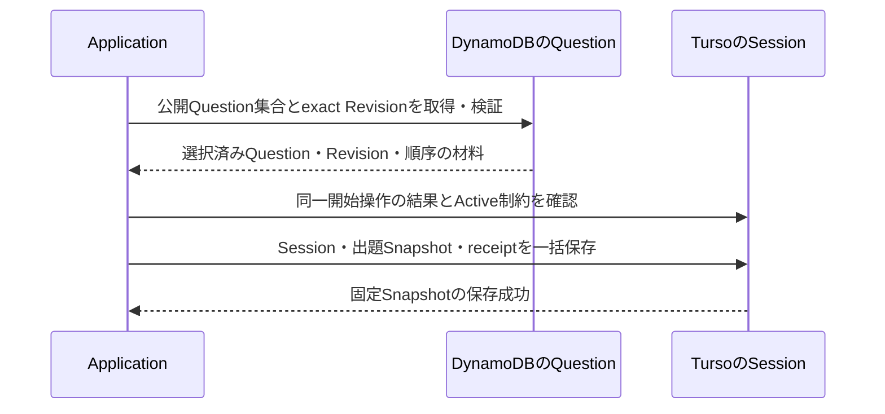
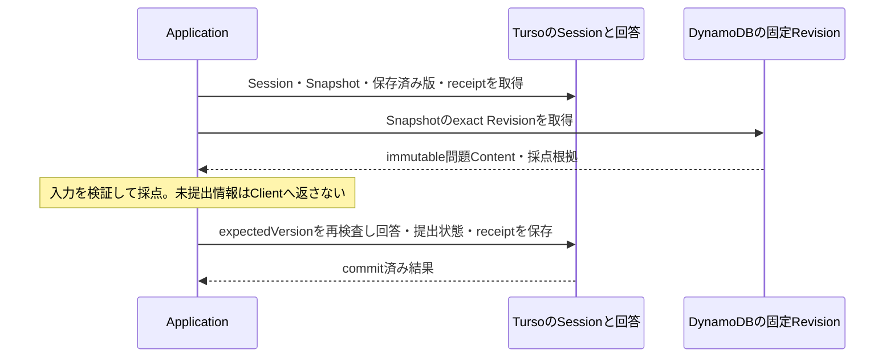

# Issue #12 永続化モデル設計 — Plan 1

- 状態: Approved / Implementation In Progress（Human承認・実装着手指示受領。第22節の未確定事項は継続）
- 調査日: 2026-10-04（JST）
- 対象: [Issue #12](https://github.com/abi-yusuke-wada/refriq/issues/12)
- Plan調査時の基点: main `9874feb3043d9eff5d7fb69d73a0c220f84fa6e9`
- 実装時の基点: main `e65e97a65b0db54a9b985cafd3fa04257116d00f`（PR #27取り込み後。第3.4節で影響を確認）
- 作業branch: `feature/12-persistence-model`
- 保存先: `docs/architecture/issue-12-plan.md`
- 本Plan作成時の成果物: 調査結果と設計Plan。実装着手後の進捗・判断待ちは[永続化モデル](persistence-model.md)へ記録する。

本書の「固定」はHuman判断または既存Contractを指す。「候補」は本Planでレビューする設計案、「要確認」は正本の情報が足りない事項を指す。物理名・Key・Index・追加Fieldは候補であり、採用済みSchemaではない。DDL、Adapter、型定義、Migration、Testの実装は含めない。

本書の「今回」「実装しない」「停止」はPlan作成フェーズの範囲を記録したもの。後続のHuman指示で実装着手が承認され、実装状況は[永続化モデル](persistence-model.md)で管理する。未確定事項が一括採用されたことは意味しない。

## 1. 目標

Issue #12では、Aggregateの不変条件と#11の読取・更新要求から、DynamoDB / Turso / S3の責務、取得経路、履歴、整合性、Repository Portを確定する。Entity一覧をTable一覧へ変換せず、同時に守るInvariantと実際のAccess Patternを単位に配置する。

Plan 1では全要求の対応候補を示し、設計確定までの判断とPhaseを定義する。**#11は未完了であるため、#12の「全Access Pattern対応」という受入条件の達成はまだ宣言できない。** #11確定後、本書の対応表を正式APへ置き換えて全件照合する。

## 2. 固定済みの判断

1. [#12のHumanコメント（2026-10-03 15:31:16 UTC）](https://github.com/abi-yusuke-wada/refriq/issues/12#issuecomment-5970601005)に従い、Pipeline / Content / ReviewerはDynamoDB + S3、Learner / Session / Answer / ProgressはTursoとする。DB選定を再検討しない。
2. Source本文、Normalized Snapshot、大きな生成ArtifactはS3参照可能にする。
3. DomainへStorage固有Key / SDK / SQL行型を漏らさない。Repository Portで実装を隔離する。
4. DB跨ぎJOINとDynamoDB / Turso跨ぎACID Transactionを前提にしない。ApplicationがIDで解決し、書込は各Store内で完結させる。
5. Questionはstable identity。SourceRevisionとQuestionRevisionのContentはimmutable。修正は新Revisionとする（ADR-0004）。QuestionIntentはValue Objectであり独立Tableを要求しない。
6. QuestionReviewはHumanの証跡で、同一QuestionRevisionへの決定的記録は最大1件。`APPROVE / REQUEST_CHANGES / REJECT`を使う。ApproveとPublishは同じDomain遷移で、`APPROVED`状態を追加しない。
7. SourceReview / SourcePolicyDecisionは追記履歴。取得時Policy Snapshotと現在Policyを分ける。Publish時に現在Policyと同一RevisionのHuman Approvalを再検査する（ADR-0005）。
8. Pipeline CandidateのRun内IDとDomainのstable IDを混同しない。Human `APPROVE / REQUEST_CHANGES / REJECT`を記録できるのはexact Domain QuestionRevisionのみで、Candidate IDへQuestionReviewを保存・Candidateを直接Publishしない。Evaluation `PASS / REVISE / REJECT`はHuman Reviewではない（ADR-0006）。
9. 提出済みUserAnswerとExamFeedbackはimmutable。LearningProgressはimmutable UserAnswer、提出済みLearningSession、固定Session Snapshot、提出結果を再現するために必要な確定済みSession事実から再構築可能なProjectionで、独立したSource of Truthではない。UserAnswerは実際に回答した事実を表し、Mock未回答を偽UserAnswerとして保存しない。提出済みMockは未回答も0点・分母20に含める。
10. #9のSession固定、Practice / Mock差、回答前後のデータ境界を維持する。認証・権限方式は本書で変更しない。

## 3. 入力と調査結果

### 3.1 Issueの確認

Issue本文と全コメントを確認した。#8 / #10 / #12はコメントのPaginationも確認し、各1件。#6 / #9 / #11 / #19はコメント0件だった。調査時点の内容を正とし、今後の並行変更は再照合する。

| 入力 | 状態・最新更新（UTC） | 永続化へ渡す契約・調査結果 |
| --- | --- | --- |
| [#6 Domain](https://github.com/abi-yusuke-wada/refriq/issues/6) | CLOSED、2026-09-24 05:15:43 | Aggregate、immutable Revision、最大1件のReview、exact RevisionへのAnswer、derived Progress。mainに成果物あり。 |
| [#8 Pipeline](https://github.com/abi-yusuke-wada/refriq/issues/8)・[詳細コメント](https://github.com/abi-yusuke-wada/refriq/issues/8#issuecomment-5811278720) | CLOSED、2026-10-02 15:15:32 | 4 Stage、Input / Output Schema、Grounding、Attempt、Failure、Resume、Candidate。現在はメモリ上の戻り値で耐久保存なし。本文には実際に省略文字列が残るため、詳細コメント・mainのCode / ADRで補う。 |
| [#11 Access Pattern](https://github.com/abi-yusuke-wada/refriq/issues/11) | OPEN、2026-08-28 09:32:40 | 本文に対象範囲14項目。正式AP ID、Actor別matrix、Sort / Filter / Pagination、Consistency、Concurrency等は未作成。コメント・設計成果物なし。 |
| [#12 Persistence](https://github.com/abi-yusuke-wada/refriq/issues/12) | OPEN、2026-10-03 15:31:16 | 背景・目的・対象範囲・対象外・受入条件・依存#6/#8/#11・検証方法・初期Table案と最新Human判断を確認。LearnerのTurso採用は固定。 |
| [#9 Learner](https://github.com/abi-yusuke-wada/refriq/issues/9) | CLOSED、2026-10-04 01:18:35（実装着手後に再確認） | PR #27でmainへ確定Contractを取り込み済み。Session Snapshot、最大1 Active Session / User×Certification×Mode、Practice確定、Mock途中保存と提出、stale応答、Result / History、Mode別集計は維持。UI配置をSchemaの根拠にしない。 |
| [#10 Reviewer](https://github.com/abi-yusuke-wada/refriq/issues/10)・[最新コメント](https://github.com/abi-yusuke-wada/refriq/issues/10#issuecomment-5970085479) | OPEN、2026-10-03 14:27:16 | Candidate詳細、Evaluation、Provenance、前Revision差分、Editによる新候補、Human判断と公開、抽象化ExamFeedback。Runtime Payload / 排他は未確定。 |
| [#19 Feedback](https://github.com/abi-yusuke-wada/refriq/issues/19) | OPEN、2026-08-28 09:33:09 | 選択式Feedback、Certification / Topic集計、Reviewer summary、Planningへの参照、識別情報の最小化。自由記述・実試験問題は対象外。 |

### 3.2 Repository

以下はPlan作成時点の調査結果。実装着手後に追加したPort / Schema等は[永続化モデル](persistence-model.md)を参照する。

確認した文書は[`README.md`](../../README.md)、[`AGENTS.md`](../../AGENTS.md)、[`MVP Scope`](../mvp-scope.md)、[`Architecture`](README.md)、[`Domain境界`](../domain/README.md)、[`用語集`](../domain/glossary.md)、[`Lifecycle`](../domain/lifecycle.md)、[`Source Governance`](../domain/source-governance.md)、ADR-0001〜0006と[`ADR作成手順`](../adr/README.md)。Accepted ADRと矛盾する変更は提案しない。

- `packages/domain`にはSource / Publish Gate、`SourceRevisionPolicySnapshot`、`QuestionSource`、`HumanQuestionReview`がある。その他のCRUDやLearner Runtime型は未実装。
- `packages/application`には[`Stage Contract`](../../packages/application/src/pipeline/contracts.ts)、[`JSON Schema`](../../packages/application/src/pipeline/schemas.ts)、[`Validation`](../../packages/application/src/pipeline/validation.ts)、[`実行・再開`](../../packages/application/src/pipeline/question-pipeline.ts)がある。既存Portは`StructuredOutputProvider`。永続化Repository Portは見つからない。
- `packages/contracts`、`apps/api`、`apps/web`は空の入口。`apps/pipeline`はComposition RootとFake Provider・Contract Testを持つ。
- `fixtures/pipeline`は架空のStage Fixture。独立した`tests/`はなく、TestはPackage内の`*.test.ts`。既存Fixture / Testは参照だけとする。
- `Makefile`の共通入口は`make check`。`package.json` / `pnpm-workspace.yaml` / `biome.json`も確認した。Markdown専用のValidation入口はない。
- 指定されたRepository / Port / Answer / Session / Revision / Review / Version / TTL / Retention / DynamoDB / S3 / Turso / SQLite等を検索。DynamoDB / Turso Adapter、DDL、Migration、Storage Keyの既存実装はない。AjvはApplicationに既存依存があり、Schema Libraryを重複導入する必要はない。

### 3.3 並行作業と入力の版

元worktreeは`/mnt/c/Users/10616_wada/develop/refriq`、branchは`feature/9-learner-ui-wireframes`、HEADは`677f760`。開始時statusは空。既存branch / remote / worktree / PRに#12専用作業場所と#11成果物は見つからなかった。branch実績の`feature/<番号>-<内容>`を採用した。

元`.git`が読み取り専用でworktree登録に失敗したため、mainのコミット済み履歴だけを`/tmp/refriq-issue12-git`へbare cloneし、`/tmp/refriq-issue-12`に専用worktreeを作成した。GitHub mainとlocal mainのSHAは一致。元worktreeの変更・#9/#10の未コミット成果物は取り込んでいない。

#9の契約はPlan作成時にIssue本文と[当時のコミット済みLearner文書](https://github.com/abi-yusuke-wada/refriq/blob/677f760843c489fe638df0967587f9a26c5f3bc4/docs/ux/learner-ui.md)を読取確認した。当時の文書SHA-256は`d697060218b1452efb767b6f8a0ffd730e67395b802c0c03b8c85c6fb076ebc8`。現在のmain正本と影響は第3.4節に記録する。#10は別worktree `/tmp/refriq-issue10`の`docs/ux/reviewer-ui.md`を読取確認し、文書SHA-256は`d7f66e6cfe29e5945ec7ff342f83dcd79a5f15c15bb4a601ecfddf08184a0144`。#10は並行作業中の参考資料であり、正本となるIssue / Domain / Accepted ADRを優先する。並行worktreeの文書をコピー・編集しない。

### 3.4 実装着手後のmain更新とPlanへの影響

Humanの通知を受け、main `e65e97a65b0db54a9b985cafd3fa04257116d00f`を専用branchへfast-forwardで取り込んだ。既存コミットの取込みで、新しいcommitは作成していない。取込み前の未コミット変更27ファイルは内容一致を確認した。

PR #27は#9の確定Learner文書とMock成果物をmainへ追加する更新。現在の正本は[`docs/ux/learner-ui.md`](../ux/learner-ui.md)、SHA-256は`05426e1a2cc7a7f25cf10b400490eead7db60df752ec85bcb38433e826ecae71`。Planが参照したcommit `677f760`との差分は、文書のブラウザ検証記録178→204件への更新と、保存中・失敗時の前問経由のロック解除防止 / 全問正解ResultのFixture維持修正の記録であり、Persistenceへ渡すBehavior Contractを変更していない。204件は#9の記録で、#12でブラウザ検証を再実行した件数ではない。

| 照合対象 | main正本のContractとPlanへの影響 |
| --- | --- |
| Session開始・Resume | Question単位で10 / 20問、exact Revisionと順序を固定。第8節・I11-09・C11-01/02を維持 |
| UserAnswer・Mock未回答 | 実回答のみimmutable、Mock未回答0点・分母20。提出済みSession / Snapshot等を含む第9/10節・U03の固定判断を維持 |
| Progress・Topic | Mode分離、Practice確定後 / Mock提出後、同一出題同一Topicの重複除去、別Session再回答累積。第10節を維持。Topic固定時点U04は新正本でも未確定 |
| 保存中・失敗・stale save | 古いackで最新編集を保存済みにしない。Practiceも前問経由で保存中 / 失敗の未確定回答ロックを解除しない。第14/19節の保存・再送条件を維持し、後続Applicationの画面遷移経由Scenarioでも確認する |
| Result / History | Sessionを固定して取得、Currentから過去Revisionを推測しない。全問正解Fixtureの往復修正は表示状態の修正で、新しい保存Table / APを要求しない |
| 正解情報・Source | Practice確定後 / Mock提出後だけClientへ返す。Repositoryの内部全ContentをそのままLearner APIへ渡さない |
| 未決事項 | #11は引き続きOPENで正式AP未作成。U03 / U04 / U08等は解消していない。#9完了を根拠に物理Schema・利用不可時の扱いを勝手に確定しない |

Storage分割、Aggregate境界、採用済み3指摘のInvariant、I11-01〜14 / C11候補は変更不要。更新したのは入力の版・#9状態・確認記録であり、#9 / #10 / #11の文書やIssueは編集しない。

## 4. Aggregateと永続化単位の分類

| Aggregate / 所属する概念 | 責務 | 変更モデル | Revisionモデル | 主な保存先候補 | 理由 |
| --- | --- | --- | --- | --- | --- |
| Certification / ExamTopic | 資格と内部Taxonomy | Metadata更新・Retire | 独自Revisionなし | DynamoDB Content | TopicはCertification内Entity。MVP既知資格IDから取得する。 |
| SourceDocument / SourceRevision | stable Source、取得時内容・Provenance | Documentはmutable、Revisionはimmutable | Content変更で追加。URLだけの変更では追加不要 | DynamoDB Content + S3 | Metadataと本文を分離し、過去の根拠を固定する。 |
| SourceReview / SourcePolicyDecision | Source用途のHuman証跡・Policy履歴 | append-only。現在Decision pointerのみmutable | 新判断を追記 | DynamoDB Content | 取得時判断とPublish時の最新判断を取得する。 |
| KnowledgePoint | 知識単位、主Topic、Evidence | 説明・Evidence更新、Meaning変更は別ID | MVPで独自Revisionを作らない | DynamoDB Content | Domainどおりmutable。Question内の固定関係を上書きしない。 |
| Question / QuestionRevision | 問題系列、固定Content、公開参照 | Revision Content immutable、Lifecycle / pointer mutable | 変更は新Revision | DynamoDB Question、巨大ContentのみS3参照候補 | Review / PublishのInvariantを同一責務へ置く。 |
| QuestionIntent / QuestionSource | 意図・固定根拠関係 | immutable Value Object | 親Revisionに固定 | Question Content内、Candidate段階はPipeline Artifact内 | 独立Aggregate / Tableを増やさない。 |
| QuestionReview | Humanの決定的判断 | append-only、Revisionごと最大1件 | 訂正・再提案は新RevisionでReview | DynamoDB Question | 公開参照更新と同じStoreの整合性境界。 |
| Evaluation / Pipeline Run / Stage Attempt / Candidate | 生成・評価・再開情報 | Head / Stage状態mutable、完了Artifact / Attemptイベントappend-only | Run / Stage / Attemptに紐付け | DynamoDB Pipeline + S3 | Application上の実行記録。Domain Aggregateを追加しない。 |
| LearningSession / Session Snapshot | 開始・再開・提出のApplication状態、提出結果を再構築する確定事実 | Sessionはmutable、出題と順序は固定、提出済みという確定事実を維持 | 開始時Snapshotのみ | Turso | #9の操作のまとまり。Progress / Resultの再構築元に含め、新Domain Aggregateとして扱わない。 |
| Mock途中回答 | 未提出回答の編集・途中保存 | mutable、version管理 | 確定UserAnswerとは別 | Turso | immutable UserAnswerを途中編集しない。 |
| UserAnswer | 特定Revisionへ実際に回答した提出済み事実 | immutable、再回答は別Record | 固定Snapshot経由でexact Revisionを参照 | Turso | 回答履歴の正本。Mock未回答Recordを作らない。 |
| LearningProgress / Result | 確定回答・提出済みSession・固定Snapshot等の確定事実からの読取Projection | derived、必要なら再計算・保存 | 計算版・入力位置を記録する候補 | Turso | Mock未回答と分母20を再構築でき、独立Aggregate / 正本にしない。 |
| ExamFeedback | 抽象化された受験体験の提出 | immutable、再提出は新Record | Schema版を記録する候補 | Turso | Learnerが提出するFeedback。Reviewerは同じ正本をPort経由で読む。 |

## 5. Access Pattern対応表

### 5.1 #11に実在する14項目

正式APの定義数は**未確定**。下記`I11-01`〜`I11-14`は#11本文の「対象範囲」を記載順に転記した、本書だけの追跡IDである。新しい正式APを作ったことを意味しない。ActorとQ / C（Query / Command）は文言からの候補であり、#11側で確定する。

`Content / Question / Pipeline`は第6節のDynamoDB論理Table名。SQL Table名は第7節の候補。各行に取得・保存経路を示すが、全行でSort / Filter / Pagination / Consistency / Idempotency / Concurrencyの正式な受入条件は**要確認**。一覧の時刻＋ID順、cursor等も下記では設計案に留める。

| 追跡ID | #11のUse Case（原文）・Actor / Q・C候補 | Aggregate / 保存単位 | Repository Port候補 | Store | Query / Key / Index候補と未確定条件 |
| --- | --- | --- | --- | --- | --- |
| I11-01 | Certification / Topic取得：Learner・Reviewer・Pipeline / Q | Certification / ExamTopic | CertificationCatalog | DynamoDB Content | `CERT#id / META`と`TOPIC#` prefix。MVP既知資格IDを指定。資格一覧の要否、ACTIVE / RETIRED filter・Topic順は要確認。 |
| I11-02 | Source Revision取得：Pipeline・Reviewer / Q | SourceRevision | SourceRepository | Content + S3 | `SOURCE_REVISION#id / META`をexact取得、body / normalized参照を必要時に解決。履歴は`SOURCE#id / REVISION#ordinal#id`。取得入力・順序は要確認。 |
| I11-03 | Pipeline待ち状態取得：Pipeline・Reviewer / Q | Run / Stage状態 | PipelineRunRepository | DynamoDB Pipeline | `GSI-Work`の資格×Stage×StatusとdueAt / runId順候補。取得後Headのversion / Statusを再確認。待ちの定義・lease・可視化遅延は要確認。 |
| I11-04 | Review Queue取得：Reviewer / Q | Candidate / QuestionRevisionの読取投影 | QuestionRepositoryのreview queue読取 | DynamoDB Question + Pipeline | `GSI-Review`資格×review種別、submittedAt / target種別 / targetId順。Read Projectionで`CANDIDATE / QUESTION_REVISION`を区別し、前者は確認・Edit・再評価・materializationへの遷移、後者のみHuman判断。未判断・評価条件・Policy filter、鮮度は要確認。 |
| I11-05 | Question Revision詳細取得：Reviewer、解禁後Learner / Q | QuestionRevision / QuestionSource / Review / Evaluation | QuestionRepository + SourceRepository | Question + Content + 必要時S3 | `REVISION#id / CONTENT・STATE・REVIEW・EVAL#`。exact IDで取得。ApplicationがGrounding / Source / Knowledgeを組み立て、Learner出力を時点別に制限。 |
| I11-06 | Revision差分取得：Reviewer / Q | SourceRevision / QuestionRevision | SourceRepository / QuestionRepository、Application差分処理 | DynamoDB + S3 | 比較元・先の固定IDで全文Snapshotを2件取得して差分を導出。任意保存は比較ID×algorithm版のArtifact。Source / Question双方か、前Revision選択・差分形式は要確認。 |
| I11-07 | Approve / Reject / Edit：Reviewer / C | Question / Review、編集Candidate | QuestionRepositoryの判断commit + PipelineRunRepository | Question + Content + Pipeline | Human判断は`QUESTION_REVISION`のexact IDへ固定し、確認対象との一致、Review非存在、Question / State version、現在Policyを検査。Editは別Candidate。原文は維持し、`REQUEST_CHANGES` Commandが正式APで明示されているか要確認。具体Command契約で`APPROVE / REQUEST_CHANGES / REJECT`を漏らさない。 |
| I11-08 | Published Question取得：Learner / Q | Questionの現在公開参照 | QuestionRepositoryのpublished読取 | DynamoDB Question | `GSI-Published`資格×Question ID、一意Questionのrootのみ。Session選択前にroot / exact Revisionを本Tableで再確認。新規公開のIndex遅延許容は要確認。 |
| I11-09 | Practice Session作成：Learner / C | Application Session / Snapshot | QuestionRepository + LearningSessionRepository | DynamoDB読取 → Turso書込 | TursoでSession・出題順・Topic Snapshotを原子的に作成。`User×Certification×Mode`のActive一意制約候補。Mock / Resume等は追加候補であり本行へ正式APとして混ぜない。 |
| I11-10 | UserAnswer保存：Learner / C | immutable UserAnswer | LearningSessionRepositoryのcommit + UserAnswerRepositoryの読取 | Turso | answerId PK、`UNIQUE(sessionId, ordinal)`、同じ2列でSnapshot FK、operation receipt。Question / exact Revisionは親Snapshotから解決して採点し、Session version条件と同時保存。Mock未回答は作らず、確定Session事実の物理表現だけU03に残す。 |
| I11-11 | Result取得：Learner / Q | Session / Answer / 固定Snapshot等の確定事実のProjection | LearningResultReader | Turso + exact QuestionRevision読取 | `session_questions`を`(sessionId, ordinal)`でAnswerへStore内JOIN、ordinal順。提出済みMockはSnapshot起点のLEFT JOIN等で未回答も含める。Question / exact RevisionはSnapshotから解決し、Currentを使わない。読取鮮度・History Paginationは要確認。 |
| I11-12 | Topic別正答率取得：Learner / Q | LearningProgress Projection | LearningProgressReader | Turso | User×Certification×Modeの確定回答、提出済みSession、固定Snapshot・Topic行等から集計し、Mock未回答も0点・分母に含める。必要時`learning_progress` PKで取得。期間・更新鮮度とTopic固定時点は要確認。 |
| I11-13 | Feedback保存：Learner / C | ExamFeedback | ExamFeedbackRepository | Turso | feedbackId PK、許可Fieldのみ、facets一意、再送receiptを同一Transactionで保存。#6/#10/#19からExamFeedbackと対応づける候補。別種Feedbackの存在は未確定。 |
| I11-14 | Feedback集計取得：Reviewer / Q | ExamFeedback summary | ExamFeedbackRepositoryのsummary読取 | Turso | certificationId / submittedAt IndexとfacetKind / value Index、Store内JOIN・GROUP BY。期間、分類、匿名化、再提出の数え方・summary鮮度は要確認。 |

14/14項目に経路候補がある。正式APがまだ存在しないため「未対応APゼロ」「#11受入条件完了」とは表現しない。設計不能な部分は要確認として残し、Phase Aの入力完了条件とする。

### 5.2 #11への追加・詳細化候補

以下はUI / Pipeline Contract → Access Pattern候補 → Persistence検討という順に整理した引き継ぎであり、#11の変更や新APの採用は行わない。

| 候補ID | 根拠となる要求 | #11への追加・詳細化候補 | 永続化へ必要となること |
| --- | --- | --- | --- |
| C11-01 | #9 Home / 再開 | Active Session取得、Resume、既存Session終了。User×資格×Modeの最大1件 | Active一意制約、Snapshot / 保存済状態の再取得。 |
| C11-02 | #9 Mock開始 | Mock Session作成、一意Question数の不足判定、重複なし抽選 | 20問の固定Snapshot。I11-08/09の詳細化候補。 |
| C11-03 | #9 Mock保存 | 途中保存、選択削除、stale write・stale応答、最終提出の再送 | DraftとAnswer分離、保存版・request対応、提出時条件。 |
| C11-04 | #9 History / Progress | 完了Session履歴の時刻順Pagination、exact Revision詳細、Mode別累積進捗 | 確定回答・提出済みSession・固定Snapshot等からの再構築、Session履歴Index、固定分類。 |
| C11-05 | #6 / #10 Revision履歴 | Questionの全Revision履歴、固定比較元、Review履歴 / 前Revision詳細 | Question単位history manifest、exact Domain Revisionに最大1 Review。Human判断`APPROVE / REQUEST_CHANGES / REJECT`の追跡をI11-07と照合。 |
| C11-06 | #8 / #10 Candidate接続 | Candidate・Evaluation詳細、KnowledgePoint ID解決、Domain Revision化、編集再評価 | Run内ID→stable ID対応記録、immutable Artifactと適用済み参照。CandidateへHuman判断を保存せず、materialization後にexact Revision Targetを取得・確認して判断する。 |
| C11-07 | #7 / #10 Source確認 | 現在用途別Policy、SourceReview / Policy履歴、Grounding・利用条件取得 | Current pointerとappend-only証跡。PublishのPolicy競合条件。 |
| C11-08 | #8 Failure / Retry | 同一Run再開、新Run生成、Stage claim、失敗取得・重複実行の区別 | 入力Fingerprint、Attempt履歴、Head条件更新・作業取得。 |
| C11-09 | #10 / #19 Feedback閲覧 | Feedback一覧・詳細、Planning向けsummary取得、集計期間・匿名化 | Tursoのsummary Port。Reviewer / Pipelineへ個人情報を渡す範囲。 |

Source更新→影響Questionの逆引きはMVP Scopeに関連するが、#11本文にはない。再評価判定と逆引きAPが必要ならC11-07/08の追加候補として扱い、先行GSIを増やさない。

## 6. DynamoDBモデル候補

### 6.1 Table責務

初期候補は3 Table。Content / Question / Pipelineは論理名であり物理名は未確定。LearnerのLearning Table、Feedback正本TableをDynamoDBへ作る案は採用しない。3 Tableの理由は、Catalog / SourceのPolicy、QuestionのReview / Publish、Pipelineの一時実行記録で取得・更新・保持期間が異なるため。最終Table数・GSI数はPhase A後に確認する。

| Table候補 | Item種別 | 主要AP | 保持・更新責務 |
| --- | --- | --- | --- |
| Content | Certification、ExamTopic、Source head、SourceRevision metadata / history manifest、SourceReview、Policy履歴 / current、KnowledgePoint | I11-01/02/05/06/07 | 許可SourceのMetadata、現在Policy、immutable本文へのS3参照。 |
| Question | Question head、Revision Content / State、Revision履歴manifest、Human Review、Evaluation参照、Review Queue投影 | I11-04/05/06/07/08 | 公開参照とHuman証跡の一貫性、Learner / Reviewerのexact Content取得。 |
| Pipeline | Run head、Input manifest、Stage current、Attemptイベント、Artifact manifest、Candidate→Domain対応記録 | I11-03/04/07、C11-06/08 | 再開に必要な検証済みArtifact、Failure・Attempt・生成Metadata。 |

### 6.2 PK / SK候補

Domain IDはopaqueのまま使い、Adapterだけがprefixを構築する。`ordinal`は親内のRevision順序を示す候補で、IDを時刻順UUID等と仮定しない。SKへ含めるordinalは、Adapterで桁埋め等の順序を保持する表現へ変換し、辞書順でRevision 10が2より先に並ばないようにする。履歴manifestはimmutable参照を持つ別Itemであり、増え続ける配列をheadへ詰め込まない。

| Table | PK候補 | SK候補 | 内容・取得方法 |
| --- | --- | --- | --- |
| Content | `CERT#certificationId` | `META` / `TOPIC#examTopicId` | 資格とTopicのprefix Query。 |
| Content | `SOURCE#sourceDocumentId` | `META` / `REVISION#ordinal#sourceRevisionId` | 現在Locator / latestRevisionId / versionと、Revision順の参照。 |
| Content | `SOURCE_REVISION#sourceRevisionId` | `META` | exact IDのPolicy Snapshot、original / normalized Artifact参照。 |
| Content | `SOURCE#sourceDocumentId` | `POLICY_CURRENT#purpose` / `POLICY#purpose#evaluatedAt#decisionId` / `SOURCE_REVIEW#reviewedAt#reviewId` | 用途別現在Decision / versionと不変の判断履歴。Timestamp同値はIDでtie-break。 |
| Content | `KNOWLEDGE#knowledgePointId` | `META` | mutable KnowledgePoint。追加一覧Indexは対応AP確定後のみ。 |
| Question | `QUESTION#questionId` | `META` / `HISTORY#ordinal#questionRevisionId` | Current Published pointer / version / latestRevision参照と不変履歴。latestとpublishedを別Fieldにする。 |
| Question | `REVISION#questionRevisionId` | `CONTENT` / `STATE` / `REVIEW` / `EVAL#evaluationId` | exact Content、可変Lifecycle、最大1 Human Review slot、評価Artifact参照。 |
| Question | `REVIEW_TARGET#targetKind#targetId` | `QUEUE` | `CANDIDATE / QUESTION_REVISION`を区別するderived投影。CandidateはRun内ID / Artifact参照、Revisionはexact questionRevisionId参照。Human Reviewの保存先は後者のみ。 |
| Pipeline | `RUN#pipelineRunId` | `META` / `INPUT` / `STAGE#stage` / `EVENT#stage#attempt#eventOrdinal` / `ARTIFACT#stage#attempt` / `MATERIALIZATION#candidateId` | Head / current状態を条件更新。完了出力とAttemptイベントは追記。Candidate IDはRun内参照に限定。 |

`targetKind`の`CANDIDATE / QUESTION_REVISION`はPersistence / Read Projectionで対象を区別する候補表記であり、新しいDomain enumではない。物理enum等の採用は後続Schema設計で決める。Candidate TargetのRun内IDと、Revision Targetのstable questionRevisionIdを識別できる参照を持たせる。QueueのtargetIdをそのままQuestionReviewのquestionRevisionIdへ代入しない。操作境界は第11節に従う。

QuestionSourceは通常の`CONTENT`内にimmutableな関係として保持する候補。SourceRevisionごとの本文はContent Tableへ複製しない。内容が大きい場合はContent全体をS3へ移す参照形式を検討し、必要なIdentity / checksum / LifecycleはDynamoDBに残す。独立したQuestionSource TableやDomain QuestionPlan Tableを先行追加しない。

### 6.3 GSI候補とConsistency

| Index候補 | 対象Item | Partition / Sort候補 | 用途と制約 |
| --- | --- | --- | --- |
| Question `GSI-Published` | 公開参照を持つQuestion headだけ | `PUBLISHED#certificationId` / `questionId` | I11-08。一意Questionを列挙。複数の過去PUBLISHED Revisionを出題数へ数えない。 |
| Question `GSI-Review` | 種別付きReview Target投影 | `REVIEW#certificationId#queueKind` / `submittedAt#targetKind#targetId` | I11-04。Candidate原ArtifactとDomain Stateを種別に従ってApplicationが組み立て、Human判断はexact Revisionのみ。queueKind / filterは要確認。 |
| Pipeline `GSI-Work` | 作業対象Stage current | `WORK#certificationId#stage#status` / `dueAt#runId` | I11-03。claim時にHead / Stage versionを条件確認。dueAtの要否はQueue契約次第。 |

GSIは結果整合性なので、一覧は候補を見つける経路とし、Review判断・Publish・Session選択では本Tableの現在状態を再検査する。[AWS読取整合性](https://docs.aws.amazon.com/amazondynamodb/latest/developerguide/HowItWorks.ReadConsistency.html)

本Table再検査は古い候補を除けるが、GSIにまだ現れていない新規公開Questionを補えない。#11が「公開直後の追加を含む厳密な不足判定」を要求するなら、資格配下の公開Catalog Itemを同一Publish Transactionで更新し、本Table Queryできる案へ変更する。鮮度未定のままGSIで全件最新を保証しない。Pagination後のfilterで件数が減る場合も、取得失敗や未確認を正常Emptyにしない。

### 6.4 Revision・差分・公開・排他

- Source / Questionとも全文Snapshotを正本とし、差分だけから復元する設計にしない。差分は固定from / to IDと比較algorithm / normalization版から導出する。保存する場合はderived ArtifactとしてS3参照可能にする。
- Revision作成はexact IDの非存在条件と親versionを用い、履歴manifestと同時保存する候補。再送は同一作成要求の結果を返し、同内容の別生成Runを自動的に同一Revisionとしない。
- Current Published pointer、Revision State、Human `REVIEW` slot、判断receipt、Queue投影の切替を同一DynamoDB Transactionへまとめる。確認した`QUESTION_REVISION` Targetとcommit先のexact questionRevisionIdを一致させ、Candidate IDをHuman Reviewの保存先にしない。Contentは更新対象に含めない。
- 現在PolicyをApplicationで読みGateへ渡しただけでは、その後のPolicy変更との競合を防げない。用途別`POLICY_CURRENT`のversion / decisionId / classificationを同じTransactionで条件確認する案。複数参照Sourceは重複を除き、同じItemを複数actionで操作しない。
- DynamoDB Transactionは同一Account / Regionの複数Tableを扱えるが、上限は100 action・4 MB。参照Sourceが多い場合のaction数を例で算出し、上限を超える候補を部分Publishしない。上限に収まらない場合は設計再レビューとする。[AWS Transaction仕様](https://docs.aws.amazon.com/amazondynamodb/latest/developerguide/transaction-apis.html)
- immutable Itemは上書き禁止。mutable head / stateはversion条件更新。TTLは第17節の運用Item候補に限定し、Domain Revision / Human履歴に付けない。

## 7. Tursoの関係モデル候補

候補は8 Tableと、任意のProgress投影1 Table。Tableを増やす理由は独立したDomain Entity数ではなく、Sessionの固定出題、mutable Draft、immutable提出、選択式Feedbackの集計、再送制御の違いである。DDL / SQL Schema実装はPlan承認後の範囲確認を経て行う。

| Table候補・責務 | PK候補 | FK / 外部参照・一意制約 | Index候補 | 変更性・排他 | 保持候補 |
| --- | --- | --- | --- | --- | --- |
| `learning_sessions`：開始・中断・終了・最終提出・位置、確定済み提出事実 | sessionId | User ID / Certification IDは外部のopaque参照。startOperationId一意。ActiveはUser×Certification×Modeで最大1件 | userId, certificationId, mode, completedAt, sessionId。Active取得用 | mutable。Session version / expectedVersion条件。出題条件・mode・開始時刻は固定し、提出済みという確定事実を維持 | Activeは無期限自動削除しない。完了・中断終了はHistory方針待ち。Progress再構築元も保持 |
| `session_questions`：固定出題・exact Revision・順序の正本 | sessionId, ordinal | Session FK。`UNIQUE(sessionId, questionId)`。Answer / DraftはPKと同じ`(sessionId, ordinal)`で参照。Question / Revision IDは外部のopaque IDでDB跨ぎFKにしない | 主Keyのordinal順、必要時sessionId, questionId | immutable。Session開始Transactionで全件保存、再抽選・更新不可 | 親Sessionと回答履歴、未回答を含むProgress再構築の参照期間 |
| `session_question_topics`：集計用の重複除去した分類Snapshot | sessionId, ordinal, examTopicId | Session Question FK。Certification / Topicは外部参照。必要なKnowledgePoint対応の固定Metadata候補 | examTopicId, sessionId, ordinal。User / ModeはSession経由 | immutable。作成時のTopic解決時点はHuman確認事項 | Snapshotと同期間 |
| `session_answer_drafts`：Mock途中状態・選択削除 | sessionId, ordinal | `FK(sessionId, ordinal)`でSession Questionを参照。1問1 current draft。子側にQuestion / Revision IDを必須重複保持せず、親から解決。未選択は空配列候補 | 主Key、Session内全件取得 | mutable。Session全体versionで一括保存する最小案。request ID / draftDigestを持つ候補 | 未提出はSession方針、提出後は削除・短期Archive候補 |
| `user_answers`：実際に回答した提出済み事実の正本 | userAnswerId | `FK(sessionId, ordinal)`でSession Questionを参照、`UNIQUE(sessionId, ordinal)`。子側にQuestion / Revision IDを必須重複保持せず、親から解決。UserはSession所有者と照合 | sessionId, ordinal。Userの直接履歴Indexは正式AP次第 | immutable。Sessionとの同一Transaction。selectedOptionIds、grading結果、submittedAt固定。Mock未回答行は作らない | Historyと同期間。自動TTLなし |
| `exam_feedback`：受験体験の選択式Record | examFeedbackId | Learner ID / Certification IDは外部参照。submitOperationId一意 | certificationId, submittedAt, examFeedbackId | immutable。rating等のscalar、schemaVersion候補。原本の本文・自由記述Fieldなし | 個人識別情報を含む保持期間は要確認 |
| `exam_feedback_facets`：Topic / Style / Missing Topic等の複数選択 | examFeedbackId, facetKind, value | Feedback FK。同じfacet値の重複禁止。Topic値は資格内存在をApplication検証 | facetKind, value, examFeedbackId | immutable。Feedbackと同時作成。「不明」はTopic IDにしない | 親Feedbackと同期間 |
| `operation_receipts`：再送結果の識別 | actorId, operationKind, operationId | 対象Session / Answer / Feedback IDへの参照、requestDigest。同一keyで異なる入力は拒否 | 保持期限、対象ID（必要時） | 結果・digestはimmutable。業務更新と同じTransaction | 有効な再送期間をHuman決定。自然一意制約は期限後も残す |
| `learning_progress`（任意）：確定回答・提出済みSession・固定Snapshot等からの集計Cache | userId, certificationId, mode, scopeKind, scopeId | scopeは全体 / Topic等。独立Domain IDなし | 主Key。追加Indexは正式AP次第 | derived / mutable。計算版、確定回答と提出済みSession事実を含む入力watermark、projection version | 再計算可能。回答・提出済みSession・Snapshotを消す理由にしない |

第一候補は、`session_questions`の`(sessionId, ordinal)`をDraft / Answerの唯一のQuestion参照元とする。子側のsessionId / ordinalは両方必須（NOT NULL相当）とし、参照を欠く行も拒否する。Domain / Applicationへ復元するUserAnswerは、このTurso内部参照を解決してquestionId / exact questionRevisionIdを持つため、Domainのexact Revision参照の意味は維持される。DynamoDBとTursoの間にはFKを作らない。

既存ContractにはQuestion / Revision IDを子側へ物理重複保存する要求は見つからない。監査等で必要と確認された場合だけ、親へ`UNIQUE(sessionId, ordinal, questionId, questionRevisionId)`、子へ同じ4列のComposite FKを定義する代替案を検討する。理由のない重複Columnは増やさない。U03は未回答・提出済みの物理表現をSession / Snapshotだけで表すか、Session Outcome等を追加するかに限定し、新Domain Aggregateを追加しない。

選択肢配列は選択肢IDを検証した小さいJSON値として保存する候補。現APは配列要素をSQL検索しないため、OptionごとのTableやSQLite固有JSON関数を先行導入しない。集計が必要なFeedback facetsは関係行にする。

Active一意制約は「Activeに該当する状態だけ」のunique Index候補。中断し再開可能なSessionもActiveに含め、未定義のDomain State enumを追加しない。SQLiteのpartial unique Indexは候補を実現できるが、採用時にTursoの対象engine / connectionで互換性を確認する。[SQLite partial Index](https://www.sqlite.org/partialindex.html)

Turso内FKの有効化・強制は採用する接続方式で実測する。SQLiteでFKが自動的に有効とは仮定しない。[SQLite FK](https://www.sqlite.org/foreignkeys.html) Active制約、expectedVersion検査、Draft / Answer / Session / receiptのcommitを同一Storeの短いTransactionにする候補。Tursoのbatch / interactive transaction仕様を確認したが、SDK・接続方式は今回導入・固定しない。[Turso TypeScript参照](https://docs.turso.tech/sdk/ts/reference)

## 8. Session Snapshot

#9の固定Contractに従い、Session開始前に次の値を固定してTursoへ保存する。

- User、Certification、Mode、選択したQuestion stable identity。
- 選択Questionごとに解決したexact QuestionRevision ID。
- 出題順`ordinal`。Practice 10問 / Mock 20問。重複判定と不足判定はQuestion単位。
- 集計用Topic対応Snapshotと出典解決に必要な参照Metadataは追加保存候補。固定する内容と時点は第22節U04で確認する。

Session・全`session_questions`・分類行・開始receiptを1つのTurso Transactionで作る。途中まで保存したSessionを開始成功として返さない。開始前の失敗・retryでは再送IDから確定済みSessionを探し、既存Snapshotを返す。新抽選をユーザーへ提示するのは「開始が未成立」であることを確認できた場合に限る。

Draft / Answerは`(sessionId, ordinal)`でimmutableな`session_questions`行をFK参照し、Question / exact Revisionをこの行から解決する。Snapshotに存在しない組み合わせをDB制約で拒否する。Sessionの確定済み提出事実と全Snapshotは、Mock未回答を含むResult / LearningProgressの再構築元として保持する。

Resumeは同じSession ID・Snapshot・順序・保存済みDraft / UserAnswerを復元する。公開pointerを再解決して出題を変更しない。開始後の新Revision公開も既存Sessionへ反映しない。Question ContentのTurso複製は初期必須にせず、exact IDからApplicationがDynamoDB Contentを組み立てる。

Published集合の列挙とRevision解決、Turso保存は同時ACIDにならない。「開始時点」をどの解決時点と定義するか、公開pointerが解決後に変わった場合の開始成功条件は#11のConsistencyとして要確認。候補は、Applicationが選択した固定Revision集合を開始Snapshotとし、Turso保存後にCurrentへ追従しない方式。全Questionが一瞬のDB跨ぎSnapshotを表す保証は置かない。

Source / Revisionの後日の利用不可は通常Resumeと区別する。再抽選、回答継続、強制終了、表示抑止を本書で採用せず、#9で残ったActive / HistoricalそれぞれのHuman判断を待つ。

## 9. UserAnswerと未提出状態

Domain上の正本は[`UserAnswer`](../domain/glossary.md#useranswer)であり、表示したexact Revisionへ実際に回答した提出済み事実をimmutableに保存する。物理行の`(sessionId, ordinal)`から固定Snapshotを解決し、Domain / ApplicationのUserAnswerへquestionId / exact questionRevisionIdを復元する。以下は保存Fieldと導出する論理項目の整理であり、Domain / API Payloadの確定ではない。

| 項目候補 | 意味・検証 |
| --- | --- |
| userAnswerId / learnerId | stable回答IDとopaque提出者。呼出元userIdとのIdentity対応は既存認証境界へ委ねる。Session所有者をApplicationで照合する。 |
| sessionId / ordinal（保存） | `session_questions`の同じ2列へのFK。存在しない出題参照を拒否し、1出題1確定回答を一意制約で保証する。 |
| questionId / questionRevisionId（Snapshotから導出） | 親SnapshotのQuestion identityと表示時のexact Revision。子側に必須重複保存せず、復元時に親から解決する。Current Published pointerから後日推測しない。 |
| selectedOptionIds | Revision内の有効Option ID、重複なし。集合を正規化して比較する。 |
| correctness / grading metadata | Applicationがexact Contentで採点した結果。完全一致・部分点なし。必要ならgrading rule版を固定する候補。 |
| submittedAt / operationId | サーバーで確定した回答時刻、同じ回答の再送を識別する値。Retryで新時刻の別回答を作らない。 |
| answer state | Domain Recordは提出済み。途中保存・未提出・通信中はUserAnswerへ混ぜない。 |

### Practice

確定前の選択は編集可能。確定時に固定Snapshotのexact Revisionで採点し、Answer・Session進行・receiptをTursoで原子的に保存する。保存成功が確認できた後、解禁された正解・解説・Sourceを別読取できる。結果取得だけの失敗ではAnswerを再作成しない。確定後の選択更新は拒否する。`UNIQUE(sessionId, ordinal)`とSnapshotのSession×Question一意性で同一Session×Questionの最大1確定回答を保証し、別Sessionでの再回答は新UserAnswerとする。

### Mock

最終提出前は`session_answer_drafts`で回答変更・選択削除を保存する。途中保存では採点結果をClientへ返さず、Progressへ含めない。最終提出時に保存済みDraft集合とexpectedVersionを照合し、exact Revisionで採点したimmutable UserAnswer・Session提出状態・receiptを同時commitする。

Mockの未回答は0点、分母20という#9 Contractは固定。#6のUserAnswerは「実際に回答した事実」であり、回答のある問だけRecordを作り、未回答を偽UserAnswerにしない。**提出済みSession・固定20問Snapshot・その他必要な確定済みSession事実から、未回答を含むResult / LearningProgressを再構築できることも固定**する。U03に残すのは、A: 既存Session / Snapshot状態だけで表現するか、B: Session Outcome等の追加Persistence表現を持つかという物理表現だけである。初期候補はAで、新Domain Aggregateを追加しない。途中Draftの空配列を自動的に提出済み回答と扱わない。

## 10. LearningProgress

LearningProgressの再構築元となるSource of Truthは、immutable UserAnswer、提出済みLearningSession、固定Session Snapshot、提出結果を再現するために必要な確定済みSession事実である。回答対象RevisionはSnapshotからexactに解決する。LearningProgress自体は独立した正本ではなく、`INV-PROGRESS-001`のProjectionとして扱う。Session / Snapshot等の確定事実を含める必要性は固定済みであり、U03はその物理的Persistence表現だけを扱う。

20問Mockで18問回答・2問未回答なら、UserAnswerは18件でも、提出済みSessionと固定20問Snapshot等から分母20・未回答2問の0点を再構築する。UserAnswerだけを起点として分母18へ縮めない。Practiceは確定回答を集計し、Mockは提出済みSessionの全出題Snapshotを起点に回答を対応づける。Progress再構築のために偽UserAnswerを追加しない。

#9のコミット済み契約から次を維持する。未マージのUI文書を正式APにするのではなく、Phase Aで#11へ受け渡す。

| 論点 | 契約・候補 |
| --- | --- |
| 集計単位 | User×Certification×Mode。Practice / Mockを分離する。 |
| 反映時点 | Practiceは各問の確定保存成功後。中断・終了後も確定回答を含む。Mockは最終提出成功後。途中保存・未提出を含めない。 |
| 分母と分子 | 対象の正答件数 / 対象件数。提出済みMockは固定20問Snapshot等の確定事実から全出題を数え、未回答も0点で含む。未学習は0%へ変換しない。 |
| 重複除去 | 同一Session出題の同一Topicへの寄与は1件。回答・未回答とも、同一Questionに同じTopicのKnowledgePointが複数あっても1件。複数Topicには各1件、全体には1件。 |
| 再回答 | 別Sessionでの再回答は別回答として累積する。全履歴をQuestion IDで重複除去しない。 |
| Topic対応 | exact Revisionが持つKnowledgePoint関係からTopicを解決する。KnowledgePointはmutableなので、過去分類を保つSnapshotの時点・範囲はU04で確認する。 |
| 初期計算候補 | Turso内の確定Answer・提出済みSession・固定出題 / Topic行等から読取時に集計。MockはSnapshot起点のLEFT JOIN等で未回答を落とさない。#11が鮮度・コスト上の必要性を示す場合だけProgressをmaterializeする。 |
| 保存する場合 | 計算版・確定回答と提出済みSession事実を含む入力watermark・projection versionを記録し、更新再送で二重計上しない。Answer / Sessionと同一Transactionの更新、または再構築可能な遅延更新のどちらかを#11の鮮度に合わせる。 |
| 再計算 | UserAnswerと提出済みSession / 固定Snapshot等の確定事実を変更せず再生成する。18問回答・2問未回答のMockでも分母20を維持し、同一入力から同一件数になることを確認する。 |
| Index | `learning_sessions`のUser×資格×Mode、AnswerのSession参照、固定TopicのPK / Topic Index。任意ProjectionはUser×資格×Mode×scopeでexact取得する。 |

期間窓、重み付け、新しい学習指標、Projectionの更新頻度は未確定。#9の累積正答率を別の計算式へ変えない。Materialized Projectionの必要性もHumanレビュー前には固定しない。

## 11. Review履歴とPublish

QuestionReview、AI Evaluation、SourceReviewを別の記録として扱う。

Review Targetは次の2種を区別する。`targetKind`は第6.2節のRead Projection上の候補であり、Domainへ新enumを追加しない。

| Target種別候補 | 原本・参照 | 可能な操作・保存境界 |
| --- | --- | --- |
| `CANDIDATE` | Pipeline Run内のCandidate IDとvalidated Artifact | 詳細・Evaluation・Source / Provenance確認、Edit、再評価、Domain materializationへの遷移。Candidate IDへ`APPROVE / REQUEST_CHANGES / REJECT`のHumanQuestionReviewを直接保存不可。Candidateを直接`PUBLISHED`にしない。 |
| `QUESTION_REVISION` | exact Domain questionRevisionIdとimmutable Content / State | 対象を取得・確認した上で`APPROVE / REQUEST_CHANGES / REJECT`を記録可能。QuestionReviewのquestionRevisionIdは確認したexact IDへ固定し、`APPROVE`は既存Publish遷移を伴う。 |

Candidate C1からDomain Revision R1へmaterializeした場合は、その対応を保持し、R1のRevision Targetと固定Contentを取得・確認してからHuman判断へ進む。C1を表示・確認したことだけで、別のRevision R2へHuman decisionをcommitしない。Applicationで操作のTarget種別、確認対象のexact Revision、要求・commit先のquestionRevisionId、必要な対応記録 / 対象版を照合し、Mismatchを拒否する。画面上のボタン制御だけを保存保証にしない。具体materialization・ID割当・retry方式はU05の未確定事項に残すが、このTarget境界は固定する。

Candidate Evaluation `PASS`はHuman `APPROVE`でも公開済みでもない。`REQUEST_CHANGES`はDomain RevisionへのHuman decisionであり、Candidate Edit / Evaluation `REVISE`と混同しない。#11原文の「Approve / Reject / Edit」は第5節で維持し、I11-07 / C11-05で`REQUEST_CHANGES` Commandの正式AP上の明示を追跡する。

| 記録 | 固定対象・内容 | 履歴性・取得経路 |
| --- | --- | --- |
| QuestionReview | exact QuestionRevision ID、reviewId、reviewerId、`APPROVE / REQUEST_CHANGES / REJECT`、reviewedAt | `REVISION#id / REVIEW`の固定slotへ1回だけ書く。更新・削除・同Revisionへの2件目の決定は禁止。QuestionのRevision manifestから全履歴を辿る。 |
| Question Evaluation | Candidateまたは固定Revision、Stage / Attempt、Checks / Findings、decision、生成Metadata | 新評価は新evaluationId / Artifact。旧結果を上書きしない。Domain Revisionへ接続した際に対象ContentのchecksumとRun参照を残す候補。 |
| SourceReview | SourceDocument、Purpose、Reviewer、Source利用Decision、日時 | Contentのappend-only履歴。Question公開承認に流用しない。 |

Domain用語集はQuestionReviewの任意Commentを概念として挙げるが、Runtime `HumanQuestionReview`にはCommentがない。新Field / UI要求が必要かは後続Contractで確認し、ここでFeedbackの自由記述Fieldとして増やさない。

`APPROVE`はGate再検査後にReview・`PUBLISHED` State・Current Published pointerをまとめてcommitする。Gate拒否 / 競合ならいずれも成功として残さず、再取得・Human再判断へ渡す。保存結果不明のretryでは同じ操作の結果 / Review slotを確認し、別Reviewを盲目的に追加しない。

新RevisionのReview中も旧Published pointerを維持する。新Revisionの公開後も旧Content、Human Review、公開履歴を保持する。`REQUEST_CHANGES` / `REJECT`後の再提案は新Revisionであり、旧Reviewの訂正ではない。Editは別Candidate作成・再評価へ戻し、過去Evaluation / Content / Source Snapshotを変更しない。Candidate→Domain ID解決方法はU05で確認する。

## 12. Feedbackの責務

| 呼称 | 確認できた意味 | Store・境界候補 |
| --- | --- | --- |
| ExamFeedback | #6/#10/#19の実試験後に提出する抽象化Signal。Certification / ExamTopic、Style、Difficulty、実機重要度、ギャップ、Missing Topic等 | Learner提出Recordの正本はTurso。ReviewerとPlanningがApplicationのsummary Portから読む。 |
| Learner Feedback | #12 Human方針のLearner側Feedback。既存の具体的Domain ConceptはExamFeedback | 現時点はExamFeedbackに対応させる候補。個別Questionの不備報告・一般コメント等の別Feedbackは定義されていないため、Tableを追加しない。 |
| Reviewer feedback | 特定QuestionへのHuman判断ならQuestionReview。Source用途判断ならSourceReview。その他の改善判断Recordは未定義 | 前者はDynamoDB Question、後者はContent。ExamFeedbackと同一Field / enum / Tableへ混ぜない。 |
| Feedback summary | #11集計、#19 Reviewer / Planning参照 | Turso原本から導出。Pipelineへ渡す場合は集計条件・Schema版・算出時刻・summary ID候補を付け、個別Learnerの識別情報を渡す範囲を確認する。 |

ReviewerはDynamoDB系責務を持つが、ExamFeedbackの読取だけのために正本をDynamoDBへ複製しない。Pipelineがsummaryを入力として固定保存する場合は、利用した集計SnapshotをPipeline Artifactとして保持する案をC11-09の承認後に検討する。これは技術的正答のSource / QuestionSourceにはならない。

ExamFeedbackは許可された選択項目とenumだけを保存する。問題本文、選択肢本文、再構成問題、自由記述、添付、Screenshot、URL入力を受け付けるFieldを設けない。提出時に未知Field・未知値・重複facet・矛盾した不明選択をApplicationで拒否する。違反InputをRaw保存・Log再出力しない。#10のUI用RatingはProduction Schemaの採用済みenumではないため、API / Domain Contract確定後にMappingする。

## 13. S3の責務

基本境界は、Identity・Policy・Lifecycle・取得用MetadataをDynamoDB、本文 / ArtifactをS3とする。S3 Bucket作成・Terraform・IAM設計の実装は含めない。

| Object候補 | 対応するMetadata | Identity・不変Key候補 |
| --- | --- | --- |
| Source original body | SourceRevisionのoriginalArtifact参照、取得時URL / Terms / Policy Snapshot | `sources/<sourceDocumentId>/<sourceRevisionId>/original/<artifactId>` |
| Normalized Snapshot | SourceRevisionのnormalizedArtifact参照、normalization版、ContentFingerprint | `sources/<sourceDocumentId>/<sourceRevisionId>/normalized/<normalizerVersion>/<artifactId>` |
| Stage Input / Output・Grounding・大きな生成Artifact | Run / Stage / AttemptのArtifact manifest、検証状態、Schema版、生成Metadata | `pipeline/<runId>/<stage>/<attempt>/<artifactId>` |
| 大きなQuestion Content / 差分 | exact RevisionのContent参照、checksum、Schema版 / 比較ID | `questions/<questionId>/<revisionId>/<artifactId>`または比較IDで識別するderived Artifact |

この物理KeyはAdapter内だけで使用する。Domain IDにBucket / objectKeyを埋め込まず、ApplicationのArtifact参照はopaque identityと検証Metadataにする候補。Provider-neutral参照からS3 locationを解決するのはObject Storage Adapterの責務。

参照Metadata候補はartifactId、object location、checksumのalgorithm / value、contentType、byteSize、createdAt、schemaVersion / normalizationVersion、sourceRevisionIdまたはRun / Stage / Attemptである。S3側には必要なStorage Metadataを持たせ、Domain由来の意味はDynamoDBのmanifestで辿れるようにする。SHA-256はchecksum候補であり、SourceのContentFingerprint algorithmは未確定。#8のimmutableInputFingerprintは既存実装どおりSHA-256だが別の目的の値である。

同じKeyへ別Contentを上書きしない。Source Content変更は新Revision / 新Objectとし、normalize方法変更で旧Snapshotも書き換えない。同一Content再取得とNormalization変更のRevision規則はU06で確定する。

DynamoDB Itemの上限はAttribute名と値を含め400 KB。保存前にサイズを計測し、余裕を持ったS3移行閾値をPhase Bで決める。全Artifactや長大なGroundingをheadへ積み重ねない。[AWS Item制約](https://docs.aws.amazon.com/amazondynamodb/latest/developerguide/Constraints.html)

`PROHIBITED`本文はS3にも保存しない。許可されたSourceでも、利用条件に基づく本文保持期間と後日のPolicy変更時の扱いをU07/U08で確認する。S3 lifecycleでexact Revisionが参照する本文を無条件削除しない。

## 14. Store間の整合性

### 14.1 Session開始



開始時のDynamoDB操作は読取だけ。Turso失敗でQuestion側の補償更新は不要。開始retryは確定済みreceipt / startOperationIdを先に確認し、保存済みSnapshotを返す。図のDynamoDB読取を省略できる再送もある。並行開始はActive一意制約で競合させ、既存Sessionを勝手に終了しない。既存Sessionの明示終了と新規開始を同時保存する必要性はC11-01で確認する。

### 14.2 回答・Mock最終提出



DynamoDB / S3読取と採点を済ませてからTursoの短い書込Transactionを開始する。外部読取をTransaction内へ保持しない。読取後のDraft変更はSession version / digest条件で拒否し、古い採点結果をcommitしない。PracticeとMockの書込単位・解禁時点は第9節に従う。

### 14.3 失敗・再送・境界

| シナリオ | 必要な振る舞い・設計候補 |
| --- | --- |
| DynamoDB / S3取得失敗・missing Revision | Session開始 / 採点を成功にしない。exact IDのまま再試行・診断する。最新Revisionや代替Questionへ無言で置き換えない。物理欠損とPolicy上の利用不可を分ける。 |
| Turso保存失敗 | 同一StoreのTransactionをrollback。採点成功だけを回答確定成功として返さない。確定前の情報解禁を行わない。 |
| 保存成功・応答消失 | operationId / requestDigestと自然一意制約で確定結果を確認し、同じ結果を返す。同じ操作IDで別入力は拒否。timeoutだけで未保存と決めない。 |
| 保存成功・Result取得失敗 | 確定したAnswer / Sessionを維持。読取だけretryする。 |
| Save A送信後にUserがBへ変更 | AのackはAのrequest / versionにのみ対応。Bを保存済みにしない。Clientの最新編集とackの対応付けはApplication / API契約としてC11-03へ渡す。 |
| 古い途中保存が後着 | expectedVersion条件で拒否。成功応答の順番も最新編集の順番とは仮定しない。DBが保存した版と画面の最新編集を別に扱う。 |
| Mock最終提出時に未保存変更 | Clientは提出を止める。サーバーも提出対象digest / 保存済みversionを検査する。サーバーが未送信のClient編集を知る保証は置かない。 |
| 開始後の新Revision公開 | Snapshot / Answerは旧exact Revisionを維持。次の新Sessionだけ新しい公開参照を解決する。 |
| Source Policyが後日利用不可 | ActiveとHistoryの扱いはU08で別々に確認。新Publishは現在Policyで拒否する。 |
| Review / Publish | 確認した`QUESTION_REVISION`のexact IDへHuman判断をDynamoDB内で原子的に保存。Candidateへの直接判断とTarget Mismatchを拒否。Tursoの既存Snapshotを書き換える操作を組み合わせない。 |
| Feedback提出・集計 | Turso内で完結。Reviewer / PipelineはPortから集計を読む。summary生成失敗で提出原本を消さない。 |
| S3 Object成功・DynamoDB manifest失敗 | 許可本文を新immutable Objectへ置き、検証後にmanifestを登録する案。未参照Objectはorphanとして遅延清掃候補。即削除・Domain TTLを前提にしない。 |
| manifest成功後にObjectを取得できない | 不完全Contentを成功とせず診断・再試行。参照先変更で旧Revisionを修復した扱いにしない。 |

代表Learner Use Caseは「DynamoDB読取＋Turso書込」であり、両DBへ同時に業務更新する必要はない。DB片側だけのwrite成功に備えるためだけに分散Transaction / Saga / Outbox基盤を追加しない。Store間で新たなwrite同期が必要と分かった場合は、そのAccess Patternと障害シナリオを先にレビューする。

## 15. Repository Port

現Repositoryには永続化Portがない。既存`StructuredOutputProvider`とDomain Gateを再利用し、Applicationの必要なUse Caseごとに最小Portを定義する候補。名前・methodはPhase Cで確定し、本書ではTypeScript Interfaceを追加しない。

| Port候補 | 取得・更新責務 | Contract境界 |
| --- | --- | --- |
| CertificationCatalog | Certification / Topicの取得 | Domain ID / Catalog DTO。一覧条件は正式APに合わせる。 |
| SourceRepository | exact Snapshot、現在用途別Policy、Source / Review履歴、Revision追記・現在pointer更新 | 既存`SourceRevisionPolicySnapshot`、`SourcePolicyDecision`、`SourceReviewRecord`を活用する。 |
| KnowledgePointRepository | stable KnowledgePoint取得、mutable内容・Evidenceの条件更新 | 候補IDとのMappingをDomain IDへ解決した後に使う。 |
| QuestionRepository | exact Revision / current published / 履歴 / 種別付きreview queue、Revision追加、Human判断とPublishのcommit | Human判断は確認したexact Domain questionRevisionIdへ限定し、Candidate ID・Target Mismatchを受理しない。現在Policyの期待値・versionをStorage非依存の検証tokenとして受ける候補。 |
| PipelineRunRepository | Run / Stage / Attempt / validated Artifact取得とcheckpoint、Candidate→Domain対応保存 | #8のContractを再利用。CandidateへQuestionReviewを保存しない。失敗Run再開と新Run生成を区別する。 |
| LearningSessionRepository | start / resume、Mock Draft保存、Practice確定、Mock提出・終了 | User所有者、固定Snapshot、expectedVersion、operationId。Draft / AnswerはSession×ordinalの出題へ結び、Session / Answer / receiptを原子的commitする。 |
| UserAnswerRepository（読取） | 確定Answerのexact取得・履歴材料取得 | `(sessionId, ordinal)`で固定SnapshotからQuestion / exact Revisionを解決してDomain / ApplicationのAnswerを復元。Currentは使わず、無条件append / updateを公開しない。 |
| LearningResultReader / LearningProgressReader | 確定回答・提出済みSession・固定Snapshot等から結果・累積 / Topic別集計を読取 | 未回答も含む確定事実から再構築するProjection DTO。Storage行を公開しない。materializeが必要なら再構築Portを追加検討する。 |
| ExamFeedbackRepository | 選択式提出、詳細・一覧・summary | Learner原本とReviewer / Planning向けsummaryを区別。一般FeedbackRepositoryを別に重複作成しない。 |
| ArtifactStore | 許可されたimmutable Artifact保存 / 取得、Metadata検証 | Storage固有locationをDomainへ返さない。大きな本文の境界に限る。 |

QuestionReviewRepositoryを別の書込Portにすると、Reviewのみ保存して公開pointerを更新できない使い方が生じる。初期候補はQuestionRepository内のexact Domain Revisionへの原子的判断commitとし、一般targetIdを受けるCandidate共通のHuman判断APIにしない。Read Projectionの種別はApplicationで扱い、保存前に確認対象と要求対象の一致を検証する。独立読取APが必要ならQuestionReviewReaderを設けるか、既存Question読取へまとめる。LearningProgressも一般CRUD Repositoryを必須にしない。

Domain / ApplicationのPortへPK / SK / GSI、DynamoDB AttributeValue、AWS SDK型、libSQL / Turso SDK型、SQL行型、物理Table名を含めない。Paginationは意味が分かる条件とopaque cursorに限定し、DBのLastEvaluatedKeyやSQL offsetをDomain Value Objectにしない。Missing / Conflict / AlreadyCommitted / ValidationRejected / StorageUnavailable等の結果候補はAdapterでStorage例外から変換する。

## 16. Optimistic Locking

Storage非依存Contractの候補は、取得値の`version`、更新時`expectedVersion`、操作識別`operationId`とrequestDigest。Storageの条件失敗を業務上のConflictへ変換し、Applicationが再取得・ユーザー再判断を選べるようにする。

| mutableな対象 | DynamoDB / Turso内の候補 | 競合時に守ること |
| --- | --- | --- |
| SourceDocument / KnowledgePoint / Certification | Content Itemのversion条件update | 後着更新がCatalog / Evidenceを無言で消さない。 |
| 現在Source Policy pointer | decisionId / version条件update。新Decisionはappend-only | Publishの読取後変更を条件確認で検出する。 |
| Question head / Revision State / Review Queue投影 | 確認対象の種別 / exact Revision一致、expectedVersion、Review非存在条件、原子的状態遷移 | CandidateへのHuman判断・Target Mismatch、同時Reviewの二重決定、古いRevisionへの公開pointer巻戻しを防ぐ。 |
| Pipeline Head / Stage current | version / attempt条件更新。必要ならleaseとfencing tokenを検討 | 同一Stageの古いworker結果が新Attemptを上書きしない。leaseの必要性はC11-08確定後。 |
| LearningSession / Mock Draft | TursoのexpectedVersion条件更新と更新件数確認を同一Transactionで実施 | 古い保存が最新Draftを上書きしない。Practice確定後・Mock提出後の変更を拒否。 |
| 任意のLearningProgress | projection versionと入力watermark条件 | 二重計上・古い再構築による新集計の上書きを防ぐ。 |

immutable Content / Answer / Review / Feedbackはversion updateの対象ではなく、新ID・非存在 / 一意制約で保存する。serializationのschemaVersionと排他versionを混同しない。

再送receiptはexpectedVersion検査より先に同一操作・同一入力か確認する。成功済み操作を古いexpectedVersionだけでConflictへ変えない。成功済みApproveの再送も、現在pointerを当時のRevisionへ戻さず当時の結果を返す。Tursoの更新件数0をbatch成功だけで成功とみなさず、条件確認と業務writeを同じTransactionで制御する。実Adapter方式は後続検証で決める。

`updatedAt`だけで排他やrequest対応を保証しない。stale response対策は第14節のack / 最新編集の区別も必要。TTLによる削除をlease解除や排他成功の条件にはしない。

## 17. TTL / Retention

以下は分類候補。日数・永久保持の採否はHuman判断待ちで、具体値を本書で設定しない。参照整合性とSource利用条件を合わせて決める。

| データ | 分類候補 | 判断条件・削除制約 |
| --- | --- | --- |
| Certification / ExamTopic / KnowledgePoint | 長期・永久保持候補、Retired / Deprecatedで管理 | 過去Question / Answer / Feedback参照が存続する限りIdentityを消さない。 |
| SourceRevision metadata / Policy Snapshot | 長期・永久保持候補、Archive候補 | QuestionSourceから辿れる参照を保持。TTLは初期対象外。 |
| Source original / normalized body | 長期・Archive候補、利用条件で保持上限の確認が必要 | Metadataの保持と本文保持を分ける。利用不可時の表示・削除判断はU08。 |
| QuestionRevision / QuestionSource / QuestionIntent | 長期・永久保持候補、Archive候補 | Session / Answer / Historyがexact IDを参照。参照があるRevisionのTTLは不可。 |
| QuestionReview / SourceReview / Policy履歴 / 公開履歴 | 長期・永久保持候補 | Human証跡と取得時 / 現在判断を維持。上書き削除で容量を削減しない。 |
| Evaluation / 採用済みGenerated Artifact | 長期・Archive候補 | 公開RevisionのReview根拠に使ったものを一時Artifactと同じTTLにしない。 |
| Active Session / 固定Snapshot | 継続保持 | 勝手に期限切れ終了しない。Inactive終了PolicyとUser合意条件は未確定。 |
| 完了 / 終了Session、UserAnswer | History方針に沿う一定期間または長期保持候補 | 回答と提出済みSession / 固定Snapshot等はProgress再構築元。Draft / AnswerがFK参照するSnapshotと提出確定事実を失って、未回答・結果を再現不能にしない。 |
| Mock Draft | 一定期間保持 / 提出後Archive・削除候補 | 未提出Resume期間と整合。UserAnswer / Session提出済み事実を消さない。 |
| LearningProgress Cache | 再構築可能な短期Cache候補 | 期限切れは再計算で扱う。正本として削除判断しない。 |
| ExamFeedback原本 / facets / 個人参照 | 一定期間保持 / 非識別summary Archive候補 | 原本と識別情報の保持期間、再提出・削除後の集計再現をU07/U10で決める。 |
| 失敗 / 未採用Pipeline Run・一時Artifact | 一定期間 / TTL候補 | 再開可能期間、Reviewer参照、採用済みRevisionへの接続を確認する。 |
| 完了Runの生成Metadata / 採用対応 | 長期・Archive候補 | ProvenanceからRun / model / prompt / attemptを辿れること。 |
| operation receipt / 運用lease | TTL・期限削除候補 | retry可能期間と自然一意制約を整合。expiration判定はApplication / Adapterで行う。 |
| manifest未登録のS3 orphan | 遅延清掃候補 | 書込途中・再送・参照有無を確認してから削除。遅延期間は未確定。 |

DynamoDB TTL削除は期限時刻ぴったりには起きず、期限切れItemが残る。そのためexpiresAt判定で利用可否を制御し、削除完了を正しさの前提にしない。[AWS TTL仕様](https://docs.aws.amazon.com/amazondynamodb/latest/developerguide/TTL.html)

Turso側はexpiresAtによる論理判定と後続cleanup処理の候補を示すに留める。DynamoDB TTLをTursoへ同一機能として要求しない。今回cleanup Job、S3 lifecycle設定、Production削除を作成しない。

## 18. 置換可能性と将来Migration

| 設計部分 | 特定DBへの依存度 | 置換時の境界 |
| --- | --- | --- |
| Domain ID / immutable Revision / Review / Answer | 低い | Domain意味を維持して移送する。IDに物理Keyを埋め込まない。 |
| Repository Port / optimistic version / operation ID | 低い | 保証する挙動を固定し、条件更新・Transaction実装をAdapterで変更する。 |
| DynamoDB PK / SK prefix、GSI、history manifest、TTL | 高い | Adapter内の物理Model。RDB等へ移行時にJOIN / Indexへ置換し、Domainに伝播させない。 |
| Turso PK / FK / UNIQUE / 関係行 | 低〜中 | PostgreSQL / Aurora等で概念関係を維持可能。DDL・型・Connection / Transaction APIはAdapterで変更する。 |
| partial unique Index、JSONの保存表現、connectionのFK設定 | 中 | 対象DBの制約へMappingする。保証したいActive一意性・Option意味をContractで維持する。 |
| S3 objectKey / Bucket / Storage Class | 高い | ArtifactStoreと参照manifestのAdapterで閉じる。checksum / size / Artifact Identityは維持する。 |

TursoからPostgreSQL / Aurora等へ移行する際は、固定Snapshot・確定回答・FeedbackのDomain IDを維持し、参照整合性、件数、checksum、Mode別集計を照合する。具体Export / Import / dual write / 切替手順の実装は対象外。Row型をApplicationへ公開せず、SQL関数・DB専用enum・Driver例外でUse Caseを記述しない。

DB分割と原子的境界は永続化方式の重要Decisionなので、Plan承認後にADR-0007相当を`Proposed`で記録する候補。既存ADR-0004〜0006を改変して判断を消さない。実際の連番は作成時のRepositoryを確認する。Humanが固定したTurso採用をADR化する際もDB選定の再投票はしない。

## 19. 検証計画

### 19.1 Access Patternと境界

1. #11の正式AP一覧を受け取り、第5節の14項目とC11候補を照合する。正式AP ID→Use Case→Table / Index / Query / Command→Port→例→失敗条件を全件追跡する。
2. 各APのSort / Filter / Pagination / Consistency / Idempotency / Concurrencyを埋める。GSIの鮮度、Active一意性、Policy変更との競合を説明できない行は完了扱いにしない。
3. Domain / Applicationのimport・依存manifest・公開型を検査し、`@aws-sdk/*`、DynamoDB Key / AttributeValue、PK / SK / GSI、libSQL / Turso型、SQL storage modelが漏れていないことを確認する。名称検索に加え、exportと型の依存方向をレビューする。
4. I11-10/11/12を第7節のSnapshot FK・確定Session事実と照合する。Progressの再構築元がUserAnswerだけになっていないこと、U03が物理表現だけの未決事項であることを確認する。
5. I11-04/07、C11-05/06を第11節のTarget境界と照合する。CandidateへのHuman判断禁止、exact Domain Revisionへの固定、`REQUEST_CHANGES` Commandの正式APへの追跡とU05の固定 / 未確定の区別を確認する。

### 19.2 代表的なItem / Row例

以下は**設計説明用の断片**であり、採用済みSchema・新Fixtureではない。Artifact本文や既存Snapshotの必須Fieldを省略したものを「Schema検証済み」と主張しない。Phase D/Eでは完全な例へ展開し、Schema / Invariantを検証する。

Question root例（新Revision公開後）:

```json
{
  "PK": "QUESTION#synthetic-q1",
  "SK": "META",
  "questionId": "synthetic-q1",
  "certificationId": "synthetic-cert",
  "currentPublishedRevisionId": "synthetic-qr2",
  "version": 2
}
```

過去Sessionが参照するimmutable Revision Content例:

```json
{
  "PK": "REVISION#synthetic-qr1",
  "SK": "CONTENT",
  "schemaVersion": 1,
  "questionId": "synthetic-q1",
  "questionRevisionId": "synthetic-qr1",
  "knowledgePointIds": ["synthetic-kp1"],
  "question": {
    "type": "single_choice",
    "stem": "架空GatewayでRouteに関連づける対象はどれか。",
    "options": [
      { "id": "A", "text": "Service" },
      { "id": "B", "text": "架空の画面配色設定" }
    ],
    "correctOptionIds": ["A"],
    "explanation": "架空の公式相当SourceではRouteとServiceの関連を定義する。",
    "optionExplanations": {
      "A": "Sourceの定義に対応する。",
      "B": "Routingの関連対象ではない。"
    },
    "sourceReferences": [
      { "sourceRevisionId": "synthetic-sr1", "locator": "section:route-service" }
    ]
  },
  "questionSources": [
    {
      "questionRevisionId": "synthetic-qr1",
      "sourceRevisionId": "synthetic-sr1",
      "knowledgePointId": "synthetic-kp1",
      "usagePurpose": "NORMATIVE_TECHNICAL",
      "relation": "SUPPORTS_KNOWLEDGE_POINT",
      "sourcePolicyDecisionId": "synthetic-policy1"
    }
  ]
}
```

Human Review例（上書きしない）:

```json
{
  "PK": "REVISION#synthetic-qr1",
  "SK": "REVIEW",
  "questionReviewId": "synthetic-review1",
  "questionRevisionId": "synthetic-qr1",
  "reviewerId": "synthetic-reviewer",
  "decision": "APPROVE",
  "reviewedAt": "2026-10-04T00:00:00Z"
}
```

Turso行の抜粋（Mode表記・Field名も候補）:

| Table候補 | 行の抜粋 | 確認する性質 |
| --- | --- | --- |
| learning_sessions | sessionId=`synthetic-session1`, userId=`synthetic-learner`, certificationId=`synthetic-cert`, mode=`practice`, version=1 | User×資格×ModeのActive一意性。 |
| session_questions | sessionId=`synthetic-session1`, ordinal=1, questionId=`synthetic-q1`, questionRevisionId=`synthetic-qr1` | Currentがqr2になっても固定qr1を参照。 |
| session_question_topics | sessionId=`synthetic-session1`, ordinal=1, examTopicId=`synthetic-topic1` | 同一問・同一Topicの行重複を拒否。 |
| user_answers | userAnswerId=`synthetic-answer1`, sessionId=`synthetic-session1`, ordinal=1, selectedOptionIds=`["A"]`, correctness=true | 同じ2列のSnapshot FKでq1 / qr1を導出。子にQuestion / Revision IDを必須重複保存しない。提出後immutable、別Session再回答は別ID。 |
| session_answer_drafts | sessionId=`synthetic-mock1`, ordinal=1, selectedOptionIds=`[]`, savedVersion=3 | 同じ2列で存在するMock Snapshot行へFK参照。Question / Revisionは親から解決。未選択は途中状態で確定UserAnswerへ誤変換しない。 |
| exam_feedback | examFeedbackId=`synthetic-feedback1`, certificationId=`synthetic-cert`, difficulty=3 | 抽象化scalarのみ。未知Field拒否。 |
| exam_feedback_facets | examFeedbackId=`synthetic-feedback1`, facetKind=`topic_emphasis`, value=`synthetic-topic1` | 複数選択を一意行で集計。 |
| operation_receipts | actorId=`synthetic-learner`, operationKind=`confirm_answer`, operationId=`synthetic-op1`, resultId=`synthetic-answer1` | 同一digest再送は同じ結果。別digestを拒否。 |

SourceRevision Metadata完全例、original / normalized S3参照、Pipeline Attempt / Artifact、Publish時のState / head同時更新例もPhase Dで追加する。参照Itemがない例と、参照先checksum不一致を否定例に含める。実試験問題・Exam Dumpを例へ入れない。

### 19.3 Schema検証

- 既存Ajv / JSON Schema Draft 2020-12を活用し、Application Boundaryで必須Field、enum、format、未知Field、Option重複、正答集合、参照整合性を検証する候補。Storage Model SchemaをDomainへ追加しない。
- SourceRevision復元には既存`validateSourceRevisionPolicySnapshot`を再利用し、現在Policyは別Gateで確認する。
- ArtifactはschemaVersion / checksum / size / contentType / owner参照を確認する。validation失敗OutputのRaw本文は永続化・Log出力しない。
- 関係ModelではFK / UNIQUE / Active制約 / Snapshot参照 / 条件更新件数を確認する。SQLiteだけで成功したものを、Turso接続で検証済みとは表現しない。
- Draft / Answerの必須2列`FK(sessionId, ordinal)`が`session_questions`のPKへ成立し、存在しない組み合わせ・欠けた参照を拒否することを確認する。UserAnswerの同じ2列にUNIQUEを設け、復元するQuestion / exact Revisionが親Snapshotと一致することを検証する。
- Review Targetの種別と原本参照を検証し、HumanQuestionReviewのquestionRevisionIdをexact Domain Revisionに限定する。CandidateのRun内IDや確認対象と異なるRevisionを受理しない。物理enumの採否は後続Schema設計で決める。

### 19.4 シナリオ対応

| シナリオ | 検証する結果 | 対応 |
| --- | --- | --- |
| Session start | 一意Questionで10/20問。全Snapshot一括保存。同時開始はModeごと最大1件 | I11-08/09、C11-01/02 |
| Resume | 同じQuestion・Revision・順序・保存済み状態。再抽選なし | C11-01 |
| Answer | Snapshotへの2列FKからexact Revisionを解決して採点。未知Session×ordinalを拒否。確定Record不変、再送二重保存なし、保存後だけ解禁 | I11-10、第7/9節 |
| intermediate save | Mock Draft編集 / 削除、採点情報非公開、Progressに未反映 | C11-03 |
| stale save | 古いwriteを拒否。Save A ackでBを保存済みにしない。未保存で提出不可 | C11-03 |
| Result | 確定回答・提出済みSession・固定Snapshot等から取得。読取失敗時は再保存しない。Mock未回答0点・分母20。U03は物理表現だけ | I11-11、第9/10節、U03 |
| History | Currentがqr2になっても、Snapshotへの2列FK経由でAnswerのqr1 / Sourceを維持。履歴順 / Paginationは正式APに従う | C11-04、第7/8節 |
| LearningProgress | 確定回答・提出済みSession・固定Snapshot等から再構築し、18問回答・2問未回答でも分母20。Mode分離、同一出題同一Topic1件、別Session再回答累積 | I11-12、C11-04、第10節、U03/U04 |
| Review | `QUESTION_REVISION`の確認したexact IDへ最大1件。Candidateへの直接判断・無関係なRevisionへのcommitを拒否。`APPROVE / REQUEST_CHANGES / REJECT`を追跡し、Evaluation / SourceReviewで代替不可 | I11-04/05/07、C11-05/06、第11節、U05 |
| Publish | Human証跡・State・pointerの一括commit。Policy競合拒否、旧Revision / Answer維持 | I11-07/08、C11-07 |
| Pipeline retry / Feedback | FAILED Stage再開と新Runを区別。選択式Feedbackのみ、再送・集計再現 | I11-03/13/14、C11-08/09 |

承認済み3指摘に対応する具体的な検証対象（今回Test / DDLは実装しない）:

| ケース | 入力・操作 | 期待結果 |
| --- | --- | --- |
| Progress再構築 | 提出済み20問Mock、固定Snapshot20件、回答18件・未回答2問 | 確定Session事実と回答から分母20、未回答2問の0点を再現。UserAnswerは18件のままで偽回答を追加しない。 |
| Snapshot FK Positive | Snapshot `(sessionId=s1, ordinal=1)`のRevisionがqr1。Answerも`(s1, 1)` | 親Snapshotからqr1への回答として解決。Draftも同じ2列の参照方式。 |
| Snapshot FK Negative | Snapshotに存在しない`(sessionId, ordinal)`へAnswer / Draftを保存 | Turso内部のFK制約でreject。 |
| Snapshot FK Regression | Current Publishedがqr2へ変更後、Snapshot `(s1, 1)`はqr1のまま | Answerの復元Revisionはqr1。Current pointerから後日推測しない。 |
| Candidate Target | `targetKind=CANDIDATE`でHuman判断を要求 | Candidate IDへ`APPROVE / REQUEST_CHANGES / REJECT`のQuestionReviewを直接保存不可、直接Publish不可。 |
| Domain Revision Target | `targetKind=QUESTION_REVISION`、確認対象questionRevisionId=qr1でHuman判断 | 状態・Gate・排他等の既存条件を満たす場合だけ判断可能。Human Reviewはqr1へ固定し、APPROVEはPublish遷移。 |
| Target Mismatch | Candidate C1を表示・確認した状態で無関係なDomain Revision R2へHuman判断をcommitしようとする | Applicationの対象照合でreject。materialization後は対応するRevision Targetを取得・確認する。 |
| Evaluation境界 | Candidate Evaluation PASS | Human APPROVEでもPublishedでもない。 |

正常・重複・version競合・timeout後結果不明・片Store読取不可・欠損参照を組み合わせてレビューする。U08未決のSource利用不可シナリオは、Product判断なしに成功側期待値を作らない。

### 19.5 今回の文書検証

Planだけの追加なので、今回の検証は`git status --short`、`git diff --check`、未追跡Plan自体の空白確認、Markdown構成 / ローカル参照 / JSON断片 / 14項目転記の照合に絞る。`make check`の対象はCode / Nix等でありMarkdown専用チェックはない。今回TypeScript・設定を変更しないためProduction Test / `pnpm typecheck`は実行対象にしない。

今回の確認結果:

- `git diff --check`は成功。新規Planは未追跡なので、ファイル自体の末尾空白・最終改行も別途確認した。
- 必須21節と未確定事項の第22節、14/14の#11本文項目の順序・文言、3つのJSON断片の構文、14個のローカル文書参照、表の列数、Code fence対応を確認した。
- JSONの確認は構文だけであり、未実装のPersistence Schemaの検証成功を意味しない。
- #12本文・Humanコメントの更新日時 / IDを再確認し、調査開始時から変更なし。#11本文も再取得して転記を照合した。
- #9はstatus空・branch維持、#10は既存の`?? docs/ux/`・branch維持。参照したLearner / Reviewer文書のSHA-256は第3.3節と一致した。
- 変更は本Plan 1ファイルのみ。Schema / Adapter / DDL / Test / Production code、GitHubコメント、commit / push / PRは作成していない。

## 20. 対象外

今回のPlan保存で行わないもの:

- DynamoDB Schema実装、Turso SQL Schema / DDL、Migration、Repository PortのCode定義、Adapter、AWS / Turso SDK追加、Test実装、Production code / config変更。
- Terraform、AWS resource / S3 Bucket作成、RDS実装、Production deployment / migration実行。
- Extreme Single Table Design、将来規模を仮定した抽象化 / 専用基盤、DB跨ぎJOIN / ACIDの導入。
- #9 Learner UI、#10 Reviewer UI、#11本文 / 正式APの変更。
- Domain再設計。発見した不整合は報告し、必要な場合の判断を別途確認する。
- Authentication / Authorization設計変更、未確定のSource利用不可Policy採用。
- GitHub IssueへのPlanコメント追加、commit、push、PR作成。

Issue #12設計承認後も、Adapter実装・AWS resource・Production適用は別の実行Scopeで扱う。下記Phaseは今回の実行許可ではない。

## 21. 承認後の作業Phase

| Phase | 入力 | 出力・変更対象候補 | 検証 | 完了条件 |
| --- | --- | --- | --- | --- |
| A：正式APとの照合 | #11成果物、#9/#10の最新版、Planレビュー | 本書第5節の正式ID対応表。必要な#11追加候補のHuman確認 | AP→経路を全件照合。条件・失敗・Pagination・Consistency / Concurrency、Target種別とHuman判断のexact Revision、`REQUEST_CHANGES` Commandの追跡をレビュー | 正式AP欠落なし。I11-04/07とC11-05/06の境界・Command対応、U01/U02と開始・保存・提出条件が解消 |
| B：永続化設計文書とDecision | Phase A、再構築元・Target境界の固定判断、U03〜U10の残る判断 | `docs/architecture/persistence-model.md`候補と必要なProposed ADR。Table / Key / Index / S3 / 保持 / 原子的境界を記録 | Query例、サイズ・Transaction action数、将来置換、Source Policy、未回答を含む確定事実の再構築、Candidate / Revisionの分離をレビュー | U03は物理表現のみ、U05はmaterialization等の方式だけ未確定。固定境界を再検討せず、未決が実装を妨げるか明示 |
| C：Port Contract | 確定AP / Aggregate保存境界、既存Domain / Pipeline型 | `packages/application`内の必要なPort定義。`packages/contracts`へStorage Modelを複製しない | Domain依存検査、Use Case commitの原子性、`pnpm typecheck` / `make check` | PortがStorage固有型を含まず、重複Repository・部分commit経路がない |
| D：DynamoDBの保存形と例 | Phase B/C、既存Ajv / Schema | 保存Model Schema / 完全な架空Item例。配置先は実行Scopeレビューで確定 | 全APのQuery / Index、immutable復元、Review / Publish、Target種別・Mismatch・Evaluation境界、400 KB・action数、Schema検証 | Candidateへ直接Human Reviewを保存せず、exact Revisionに固定する例を検証可能。Adapter / AWS作成不要 |
| E：Tursoの関係Schemaと例 | Phase B/C、固定再構築元・Snapshot参照契約、U03の物理表現 / Topic契約 | 論理列・制約・Indexと完全な架空Row例。DDL等はHumanの実行Scope承認後のみ | 2列Snapshot FKのPositive / Negative / Current更新後Regression、UNIQUE / Active、18回答・2未回答Mockの分母20再構築、expectedVersionと提出境界 | Draft / AnswerはSnapshotのexact Revisionへ固定。確定回答と提出済みSession / Snapshot等から未回答を再現でき、全経路を説明可能 |
| F：Contract検証と完了レビュー | D/E、第19.4節の具体例、承認済み検証Scope | 最小のSchema / Contract検証、対応表・検証記録。実AWS / Turso integrationは必要な別Scopeで扱う | `make check`、TypeScript変更時`pnpm typecheck`。Progress分母20、Snapshot FK、Candidate / Revision・Mismatch・Evaluation境界と否定例・再送・競合・Store間失敗を検証 | #12受入条件と3指摘のInvariantを正式AP / 完全例で示せる。未解決・未検証の実サービス保証を明記 |

Phase C〜FのCode / Schema / Test変更はPlanレビュー後、実行Scopeを確認してから開始する。Phaseを完了しただけでProduction接続・Migrationを実行しない。今回のStop Pointは本Plan保存とHuman報告まで。

## 22. 未確定事項とHumanレビューの判断点

| ID | 要確認事項 | 根拠・実装前に必要な判断 |
| --- | --- | --- |
| U01 | #11の正式AP、Actor、Query / Command、Sort / Filter / Pagination・失敗条件 | #11はOPENで一覧成果物なし。14項目とC11候補を正式APへ確定する。#12だけで勝手に追加しない。 |
| U02 | 公開集合の鮮度とSession開始の解決時点 | GSIのIndex遅延、Questionごとのpointer解決からTurso保存までの窓を許容するか。厳密性が必要なら本Table Catalog案を採用する。 |
| U03 | Mock未回答・提出済み事実の物理的Persistence表現のみ | 固定: 未回答を偽UserAnswerにせず、提出済みSession / 固定Snapshot等の確定事実から再構築し、未回答0点・分母20を維持する。未確定: A: 既存Session / Snapshot状態だけで表すか、B: Session Outcome等の追加Persistence表現を持つか。第一候補A。新Domain Aggregateを追加しない。 |
| U04 | Topic分類の固定時点とProgressの保存・鮮度 | #9の累積・Mode分離・重複規則は維持。mutable KnowledgePointを辿る過去集計の分類固定をRevision作成時 / Session開始時のどちらで行うか。初期read-time集計で十分か。 |
| U05 | Candidate→stable Domain materializationの方式 | 固定: Candidate IDはRun内、Human QuestionReviewは確認したexact Domain QuestionRevisionのみ。Candidateへの直接判断・公開、Target Mismatchを拒否。未確定: 同じIntentのstable Question選択、新QuestionRevisionへのmaterialization方法、Revision ordinal割当、KnowledgePoint stable ID解決、QuestionSource生成、retry / idempotency。 |
| U06 | SourceFingerprintとNormalization版・差分保存 | #6はalgorithm未定、#8のRun fingerprintとは別。取得内容とnormalized内容の比較基準、Normalizer変更時のRevision規則、差分の保存必要性を決める。 |
| U07 | Retention値、retry期間、Archive / cleanup | Session / Answer / Feedback識別情報、Pipeline再開、一時Artifact、S3 orphan等の値と削除順。Source利用条件との整合。永久保持はまだ候補。 |
| U08 | Active / HistoricalでRevision / Sourceが利用不可になった場合 | #9で明示未決。継続・停止・表示・本文保持 / 削除を別々に判断する。通常Resumeや新PublishのRuleから推測しない。 |
| U09 | 排他・Transaction / retry詳細、Pipeline checkpoint | Policy条件とReview commit、Session保存版・ack / digest、再送識別、Turso接続 / primary読取保証を確定する。#8 Runtimeには永続checkpoint Hookがなく、保存粒度・process crashからの再開と「実行後結果保存」の違いもレビューする。 |
| U10 | ExamFeedbackのProduction Contract / 集計 / 非識別化 | #10のRatingはUX用。Schema版・不明値・再提出の集計、summary公開範囲、Planning入力Snapshot、識別情報の保持を決める。別種Learner / Reviewer feedbackがあると仮定しない。 |

3 DynamoDB Table・8 Turso Table＋任意Progress投影・Key / Indexは本Planの提案であり、Human採用待ち。特にU01/U02/U03/U04/U05/U07/U08/U09/U10を未確定のまま確定Schemaへ進めない。調査・Plan 1作成後に停止し、次の作業はHumanレビュー後とする。
