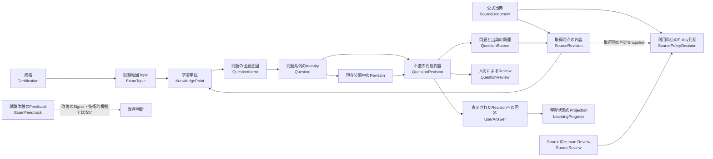

# ドメインモデル

このDirectoryは、`refriq` のDomain Concept、Identity、Lifecycle、不変条件についてのSource of Truthである。MVP ScopeをDomainの言葉へ整理し、後続IssueのPipeline、UI、Persistence設計が参照する。

ここではDomain上の意味を定義する。IDの生成形式、API Payload、Database Schema、DynamoDB Key、S3 Object Key、Transaction実装は定義しない。

## 文書一覧

- [Glossary](glossary.md): 各ConceptのDefinition、Responsibility、Identity、変更性、Lifecycle、Relationships
- [Lifecycle and Invariants](lifecycle.md): Lifecycle図、State Transition、Invariant Catalog、Test Case Mapping、Open Questions
- [Source Governance](source-governance.md): Source Classification、Allowlist、Ingestion / Publish Gate、禁止Content、Provenance Policy

## ドメイン上の関係

図はDomain上の参照関係を示す。`ExamFeedback` はKnowledgeやQuestionの正しさを裏付けるSourceではない。`QuestionSource` はQuestionRevisionから、その作成根拠となった特定のSourceRevisionへ到達させるAssociationである。詳細なSource Policyは[Sourceガバナンス](source-governance.md)を正とする。

## AggregateとObjectの境界

Aggregateは、同時に守る必要があるDomain Invariantの境界として扱う。Aggregate間はConceptual IDで参照し、永続化上の配置やTransaction方式は後続設計へ残す。

| Concept | Domain上の役割 | Boundaryと責務 |
| --- | --- | --- |
| `Certification` | Aggregate Root | 資格Identityと、その資格内の`ExamTopic` Entityを管理する。 |
| `ExamTopic` | Entity | `Certification`内の公式Scopeに基づくTopic Identity。単独Aggregateにはしない。 |
| `SourceDocument` | Aggregate Root | Sourceのstable identityと現在のLocator等を管理する。 |
| `SourceRevision` | Immutable Entity / Snapshot | 取得・解析対象Contentの不変Snapshot。親`SourceDocument`に属する。 |
| `SourceReview` | Append-only Entity / Record | `SourceDocument`の利用用途を確認するHuman Decisionの証跡。 |
| `SourcePolicyDecision` | Append-only Policy Record | SourceとUsage Purposeを評価した時点のClassification、Reason、Review参照。 |
| `KnowledgePoint` | Aggregate Root | 学習可能な知識単位とそのTopic / Source Revisionへの関係を管理する。 |
| `Question` | Aggregate Root | 問題系列のstable identity、Revision履歴、Review記録、現在公開中のRevision参照を管理する。 |
| `QuestionIntent` | Value Object | 問題で測る知識・判断方法・形式などの意図を表す。独立Identityを持たない。 |
| `QuestionRevision` | Immutable Entity | 特定時点の問題Content。`Question`内で不変として保持する。 |
| `QuestionSource` | Association Value Object | `QuestionRevision`と特定の`SourceRevision`の根拠関係。独立Identityを持たない。 |
| `QuestionReview` | Append-only Entity / Record | 特定の`QuestionRevision`に対するHuman Decisionの証跡。`Question`のPublish Invariantを支える。 |
| `ExamFeedback` | Aggregate Root / Record | Learnerが提出した抽象化済みの試験体験Signal。 |
| `UserAnswer` | Aggregate Root / Record | 表示された特定の`QuestionRevision`への回答事実。 |
| `LearningProgress` | Projection / Read Model | 回答履歴から導出されるLearner別の学習状態表示。独立Aggregateではない。 |

この境界はDomain上の整合性を表し、DynamoDBのItem境界や同一Transactionへの格納を意味しない。

## Value ObjectとIdentity

`CertificationId`、`ExamTopicId`、`SourceDocumentId`、`SourceRevisionId`、`SourceReviewId`、`SourcePolicyDecisionId`、`KnowledgePointId`、`QuestionId`、`QuestionRevisionId`、`QuestionReviewId`、`ExamFeedbackId`、`UserAnswerId`、`UserId`、`LearnerId`、`ReviewerId`は、対象Conceptを識別するOpaqueなDomain Identityである。UUID、ULID、文字列形式、採番方式、User認証方式は決めない。

`Vendor`、`SourceUrl`、`ContentFingerprint`、`QuestionType`、`Difficulty`、`Language`、`ReviewDecision`、Lifecycle State、回答選択などは、その値自体に独立Identityを与えないValue Object候補である。すべてをTypeScript Classとして実装することは要求しない。

`UserId`、`LearnerId`、`ReviewerId`はいずれも利用者のOpaque Identityを表す。これらが同じPrincipalか、権限をどう判定するか、Authenticationをどう行うかは未決定である。

## 後続Issueとの責務境界

- Issue #7の[Sourceガバナンス](source-governance.md)はSourceの採用・禁止Policy、利用条件確認、禁止Contentの扱いとGateを定義する。このModelはDomain関係とNormative Sourceの意味を定義する。
- Issue #8はKnowledge抽出、Question生成、LLM境界、Pipeline orchestrationを設計する。このModelはPipelineが扱うDomain ObjectとQuestionIntentまでを定義する。
- Issue #9 / #10はLearner / ReviewerのScreen、操作、API、権限運用を設計する。このModelはAnswer、Review、Decisionの意味までを定義する。
- Issue #12はDomain ObjectをDynamoDB / S3へどうMappingするかを設計する。Storage Key、Table、Object Key、Index、Transactionはここでは決めない。

## TypeScriptでの実装

`packages/domain`は、Issue #7で定義したSource Policy GateのExecutable Ruleを含む。その他のConceptのCRUD、API、PersistenceへのMappingは定義しない。
