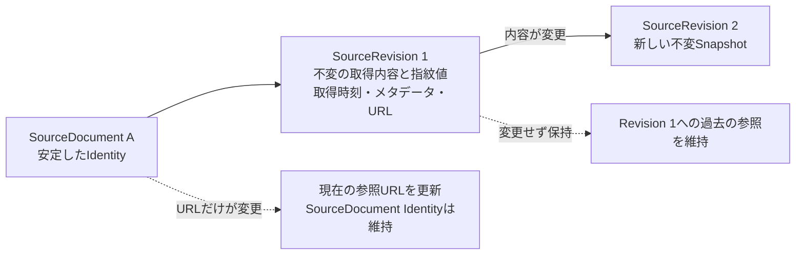
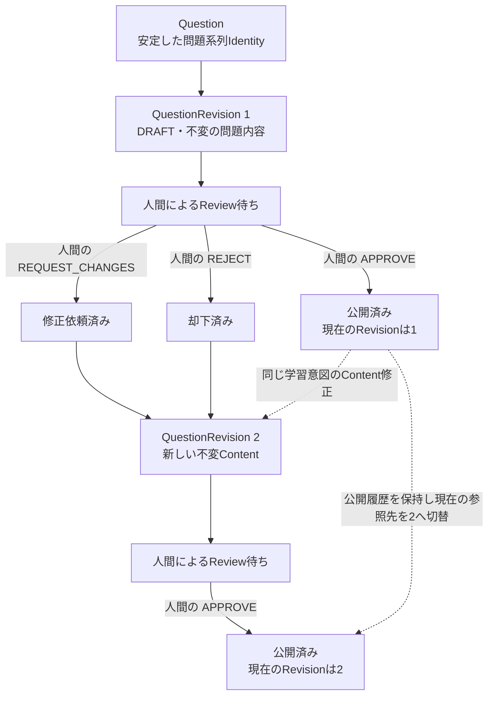
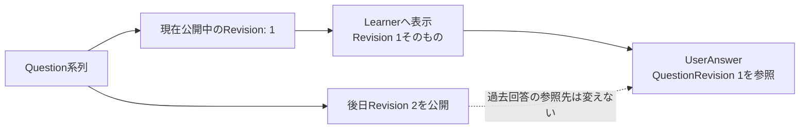

# ライフサイクルと不変条件

この文書はDomainのState Transitionと、後続Testに変換できるInvariantを定義する。Lifecycle StateはDomain上の意味であり、Database列やAPI Enumの定義ではない。

## Sourceのライフサイクル

`SourceDocument`はStable Identityであり、URLは変更可能なLocatorである。`SourceRevision`は取得・解析対象Contentのimmutable snapshotである。



- Contentが変わった場合は新SourceRevisionを作成し、旧Revisionは書き換えない。
- URLのみが変わりContentが変わらない場合はSourceDocumentのCurrent Locatorを更新する。URL変更だけで新しいContent Revisionを作らず、旧Revisionの取得時URLも変更しない。
- SourceRevisionは`retrievedAt`、Content Fingerprint、取得時Metadata Snapshot、取得時Source URLを含む概念である。Hash Algorithm、Normalization、保存方式は決めない。
- SourceDocumentをRetireしても過去Revisionとそれを参照するQuestionSourceは維持する。

## Questionと公開のライフサイクル

`Question`は系列のIdentityであり、`QuestionRevision`はimmutable Contentである。RevisionにIdentityを付与した時点でContentを凍結する。編集可能な一時作業中の候補とDomain上のQuestionRevisionを混同しない。



- `APPROVE`は特定Revisionに対するHuman Review Recordであり、そのRevisionを`PUBLISHED`にするDomain Actionでもある。`APPROVED`を独立したRevision Stateとして挟まない。
- Revision 2のReview中は、Revision 1をLearnerへ提示する。Revision 2がHuman Approvalを得てPublishされた後、QuestionのCurrent Published RevisionをRevision 2へ切り替える。
- 過去に公開されたRevision 1のContentおよびStatus上の公開履歴は残す。CurrentであるかどうかはQuestionの`currentPublishedRevision`で表し、旧Revisionを書き換えて非公開履歴にしない。
- `REQUEST_CHANGES`後にContentを直す場合、同じRevisionを編集せず、新しいQuestionRevisionを作る。`REJECT`されたRevisionも不変のまま残る。
- LLM生成 / Automated Evaluation / AI JudgeだけではReview Approvalにならず、Publishできない。

### QuestionRevisionの状態遷移

| 変更前 | 操作 | 変更後 | 前提条件 | 不正な遷移・結果 |
| --- | --- | --- | --- | --- |
| なし | QuestionRevisionを作成 | `DRAFT` | 新しいRevision Identityを付与し、ContentとQuestionIntentを確定する。 | Identity付与後のContent編集は拒否し、修正は新Revisionにする。 |
| `DRAFT` | Reviewへ提出 | `REVIEW_REQUIRED` | 構造上の必須Contentがあり、KnowledgePointとSourceRevisionへのTraceを確認できる。 | Human Review前の直接Publishは禁止。 |
| `REVIEW_REQUIRED` | 人間が`APPROVE` | `PUBLISHED` | `APPROVE` Reviewが同じQuestionRevisionを対象にし、QuestionSourceが1つ以上のSourceRevisionへ到達する。Publish時にQuestionのCurrent Published Revisionを切り替える。 | Reviewなし、AI Reviewのみ、別RevisionへのApproval、Trace不足ならPublishを拒否する。 |
| `REVIEW_REQUIRED` | 人間が`REQUEST_CHANGES` | `CHANGES_REQUESTED` | 同Revisionを対象とするHuman Review RecordとDecisionを記録する。 | Contentをその場で編集したり、同じRevisionを再提出可能な状態へ戻したりしない。 |
| `REVIEW_REQUIRED` | 人間が`REJECT` | `REJECTED` | 同Revisionを対象とするHuman Review RecordとDecisionを記録する。 | Reject済みRevisionのPublishは禁止する。再提案は新Revisionにする。 |
| `CHANGES_REQUESTED`または`REJECTED` | 後続Revisionを作成 | 新Revisionの`DRAFT` | 新Identityを付与し、変更後Contentを凍結する。 | 旧Revisionを更新して差し替えない。 |
| 現在のRevisionが`PUBLISHED` | 後続Revisionを作成 | 新Revisionの`DRAFT` | Questionの学習意図を保ったContent修正を行い、新Identityを付与する。旧Revisionは新RevisionがPublishされるまでCurrentのまま。 | 公開済みRevisionのContent編集は禁止。別の学習意図なら新Questionを作る。 |
| 現在のRevisionが`PUBLISHED` | 承認済みの後続Revisionを公開 | 旧・新Revisionの公開履歴を保持 | Successor RevisionがHuman `APPROVE`され、Publish条件を満たす。現在公開中のRevision参照を新Revisionへ切り替える。 | 未承認Revisionへの切替は禁止。旧Revisionを更新したりUserAnswer参照先を書き換えたりしない。 |

`APPROVED`と`PUBLISHED`を別Stateにしない理由は、MVPでは人間のApproveがそのRevisionの公開条件を満たし、別のEditorial ApprovalやScheduled Releaseを持たないためである。将来、承認と公開に別のDomain責務・待ち時間・権限が生じた場合に再検討する。

## Learnerの回答ライフサイクル



Answer時に表示した`QuestionRevisionId`をUserAnswerに固定する。QuestionのCurrent Published Revisionが後日変わっても、回答時のQuestion Content、正解、ExplanationをRevision 1から再現できる。

## ExamFeedbackとSourceの境界

```text
公式SourceDocument / SourceRevision → 技術的な正しさの根拠
ExamFeedback                       → 試験体験がどう感じられたか
```

ExamFeedbackはCoverage / Difficulty / Style等の改善Signalであり、技術的正答のNormative Source、QuestionSource、SourceRevisionに変換しない。実問題全文、選択肢、Screenshot、Exam Dump、再構成した正確な問題はDomain上の正規Feedback Contentに含めない。具体的なInput Policy / Content DetectionはIssue #7で扱う。

## 不変条件一覧とテストケース対応

### INV-CERT-001 — ExamTopicはCertificationに属する

- **Given（前提）:** ExamTopic TはCertification Cに属している。
- **When（操作）:** Tを別Certificationへ移す、またはTを用いてKnowledgePointを分類する。
- **Then（結果）:** TのIdentityは元Certification内で維持され、別資格のScopeへ移す場合は適切な新Topic Identityを作る。各KnowledgePointの主たるExamTopicは1つで、そのCertificationと整合する。
- **Expected test（想定テスト）:** Topicは親Certificationなしに作成できない。KnowledgePointの主Topicと資格が矛盾する場合は拒否する。

### INV-SOURCE-001 — SourceRevisionのContentは不変

- **Given（前提）:** SourceDocument AにSourceRevision 1がある。
- **When（操作）:** Sourceの取得Contentが変わる。
- **Then（結果）:** Revision 1のContent、Fingerprint、Retrieved At、Metadata Snapshot、取得時URLはそのままでRevision 2を追加する。
- **Expected test（想定テスト）:** Source更新後もRevision 1の全Snapshot Fieldが変わらず、Revision 2が新Identityを持つ。

### INV-SOURCE-002 — SourceDocument IdentityはURLに依存しない

- **Given（前提）:** URL U1で識別されていたSourceDocument A。
- **When（操作）:** 同じ著作物がURL U2へ移り、解析対象Contentは同じである。
- **Then（結果）:** SourceDocument AのIdentityを維持しCurrent LocatorをU2へ更新する。Revision 1とその取得時URL U1は変えない。
- **Expected test（想定テスト）:** Locator更新でSourceDocument / SourceRevision identityが変わらず、履歴SnapshotにU1が残る。

### INV-SOURCE-003 — Content変更時は新Revisionを作る

- **Given（前提）:** SourceDocument Aの現行ContentをSourceRevision 1が表す。
- **When（操作）:** 次の取得・解析対象Contentが異なる。
- **Then（結果）:** Revision 1を書き換えず新Revisionを作成する。新Revisionは取得時MetadataとURLを記録する。
- **Expected test（想定テスト）:** 異なるContent Fingerprintで新Revisionが作られ、既存Revisionを参照するQuestionSourceは変わらない。

### INV-KNOWLEDGE-001 — KnowledgePointは主たるExamTopicを持つ

- **Given（前提）:** KnowledgePoint Kを作成・有効化する。
- **When（操作）:** Kに主たるExamTopicを割り当てる。
- **Then（結果）:** Kは1つのCertification内の1つのTopicに分類される。
- **Expected test（想定テスト）:** Topic未指定またはCertification不整合のKnowledgePointは有効化できない。

### INV-KNOWLEDGE-002 — KnowledgePointは根拠を持ち、Deprecated後も履歴を保つ

- **Given（前提）:** KnowledgePoint Kが公式SourceRevisionに基づき、ActiveまたはDeprecatedである。
- **When（操作）:** Kを作成する、Sourceが更新される、またはKがDeprecatedになる。
- **Then（結果）:** Kには1つ以上のSourceRevision根拠があり、Source更新はKを消さない。Deprecated Kは新QuestionIntentの対象にできないが、過去Question / Answer参照を維持する。
- **Expected test（想定テスト）:** EvidenceなしのKnowledgePoint作成を拒否し、Deprecated後も既存Revisionからの参照が維持される。

### INV-QUESTION-001 — Questionはstable identityを持つ

- **Given（前提）:** Question Q1が特定の学習意図を持つ。
- **When（操作）:** 同じ意図の問題文 / 選択肢 / Explanationを改善する。
- **Then（結果）:** QuestionIdを維持し、新QuestionRevisionを作る。学習意図そのものが変わる場合は新Questionを作る。
- **Expected test（想定テスト）:** Content修正は同じQuestion系列内の別Revisionとなり、別意図の候補は同じQへ追加できない。

### INV-QUESTION-002 — QuestionRevisionのContentは不変

- **Given（前提）:** QuestionRevision 1がIdentityを得ている。
- **When（操作）:** Stem、Options、Answer、Explanation、Language、Difficulty、KnowledgePoint、またはQuestionSourceを変える。
- **Then（結果）:** Revision 1を更新せず、新QuestionRevisionを作る。
- **Expected test（想定テスト）:** Published / Review中を問わず既存Revision ContentへのUpdateを拒否し、修正は新Revisionになる。

### INV-QUESTION-003 — PublishにはHuman Approvalが必要

- **Given（前提）:** QuestionRevision Q1-R1は`REVIEW_REQUIRED`で、対象RevisionへのHuman `APPROVE` Reviewがない。
- **When（操作）:** Q1-R1のPublishを要求する。
- **Then（結果）:** Publishを拒否し、Current Published Revisionも変えない。別RevisionへのApprove、AI Reviewのみも条件を満たさない。
- **Expected test（想定テスト）:** Approvalなし / AIのみ / 別RevisionへのApprovalではPublish不可。Human APPROVE後は対象RevisionをPublish可能。

### INV-QUESTION-004 — 公開Revisionは正確なSourceへTraceできる

- **Given（前提）:** QuestionRevisionをReviewへ提出またはPublishする。
- **When（操作）:** そのRevisionの根拠関係を検査する。
- **Then（結果）:** 少なくとも1つのQuestionSourceがあり、特定SourceRevision、SourceDocumentまで遡れる。MVPではそのSourceはSource Policy上利用可能なOfficial Sourceである。
- **Expected test（想定テスト）:** SourceRevisionのないQuestionRevisionをPublishできず、公開Revisionから固定されたSourceRevisionまで到達できる。

### INV-QUESTION-005 — Reviewは特定の不変Revisionを対象にする

- **Given（前提）:** Question QにRevision 1とRevision 2がある。
- **When（操作）:** HumanがRevision 1をReviewする。
- **Then（結果）:** QuestionReviewはRevision 1だけを対象とし、そのDecisionはRevision 2や以後のRevisionを承認しない。
- **Expected test（想定テスト）:** Revision 1のApprove記録をRevision 2のPublish認可として使えない。

### INV-QUESTION-006 — Questionの現在公開中Revisionは最大1つ

- **Given（前提）:** Question Qは未公開、またはRevision 1をCurrent Published Revisionとして持つ。
- **When（操作）:** 適格なRevision 2がPublishされる。
- **Then（結果）:** QはCurrent Published Revisionを1つだけ持ち、新状態ではRevision 2を指す。未承認Revisionでは切り替えず、従来の公開履歴は残す。
- **Expected test（想定テスト）:** Current pointerは存在する公開済Revisionを1つだけ参照し、Review中のRevisionでは変化しない。

### INV-REVIEW-001 — Reviewは変更できないHumanの証跡

- **Given（前提）:** QuestionReviewが特定RevisionにDecisionを記録している。
- **When（操作）:** その記録を更新・削除する、または同じQuestionRevisionへ別Decisionを追加する。
- **Then（結果）:** 過去Reviewを書き換えず、同じRevisionへの2件目の決定的Reviewを拒否する。修正が必要なQuestion Contentは新RevisionとしてReviewする。AI JudgeはHuman Review Identity / Decisionとして記録しない。
- **Expected test（想定テスト）:** Review Record Update / Deleteと同Revisionへの2件目の決定を拒否し、AI結果だけでHuman Approval条件を満たさない。

### INV-ANSWER-001 — UserAnswerは表示されたQuestionRevisionを参照する

- **Given（前提）:** LearnerへQuestion QのRevision 1が表示される。
- **When（操作）:** Learnerが回答する。
- **Then（結果）:** UserAnswerはRevision 1の`QuestionRevisionId`を記録する。QのIdentityやCurrent pointerだけを参照してはならない。
- **Expected test（想定テスト）:** Answer作成時にQuestionRevisionが固定され、QuestionIdだけの参照では受理しない。

### INV-ANSWER-002 — 後日の公開で過去回答を書き換えない

- **Given（前提）:** UserAnswer AがQuestionRevision 1を参照している。
- **When（操作）:** QuestionRevision 2が後日Publishされる。
- **Then（結果）:** AのRevision参照と回答時に再現する問題ContentはRevision 1のまま。
- **Expected test（想定テスト）:** Current pointer更新後もAを読み直すとRevision 1の選択肢・正解・Explanationが得られる。

### INV-FEEDBACK-001 — ExamFeedbackは問題のNormative Sourceではない

- **Given（前提）:** LearnerがTopic Emphasis等の抽象化Feedbackを提出する。
- **When（操作）:** FeedbackをQuestion生成・Reviewの根拠として扱おうとする。
- **Then（結果）:** Feedbackは改善Signalとしてのみ利用し、QuestionSource / SourceRevision / Normative Sourceにしない。実問題を正規Domain Contentとして受理しない。
- **Expected test（想定テスト）:** ExamFeedbackからQuestionSourceを作成できず、抽象化されたFeedbackとSource参照を別Conceptとして扱う。

### INV-PROGRESS-001 — LearningProgressは回答履歴から導くProjection

- **Given（前提）:** UserAnswerとimmutableなQuestionRevision / KnowledgePoint関係が存在する。
- **When（操作）:** LearningProgressを計算・再構築する。
- **Then（結果）:** Projectionは回答履歴から再構築でき、回答履歴の代わりに使わない。正答率や重み付けはDomain決定されていない。
- **Expected test（想定テスト）:** Projection再生成がUserAnswerを変更せず、未確定の計算式を前提としたInvariantを追加しない。

## 未解決事項

| 未解決事項 | 後続Issue等で決める内容 |
| --- | --- |
| User / Learner / ReviewerのIdentityは同じPrincipalか。Authentication Provider、Identity形式は何か。 | User IdentityとAuthenticationは後続設計。Cognito、Google Login、Email等をDomain決定にしない。 |
| Review permissionとReviewer roleをどう判定するか。 | Issue #10のReviewer操作設計と、Security設計で決める。Human Approvalが必要というInvariantは維持する。 |
| LearningProgressのAccuracy、分母、期間、重み付け、更新頻度はどうするか。 | Calculationは未決定。Issue #9のLearner表示要件とApplication / Persistence設計で確定する。 |
| SourceのAllow / Deny、利用規約・License、取得・保存可能範囲、禁止Inputをどう確認するか。 | Issue #7でSource Governanceを定義する。 |
| Source Content Fingerprintの対象表現、Normalization、取得MetadataのSchemaは何か。 | Issue #8のPipelineとIssue #12のPersistence Mappingで決める。 |
| KnowledgePointの粒度、Source変更時の再評価、Question再Reviewを要求する判定規則は何か。 | Issue #8でPipeline責務として決める。KnowledgePoint独自RevisionはMVPで導入しない。 |
| Current Published QuestionをWithdraw / RestoreするDomain Commandと、その場合の過去回答表示はどうなるか。 | MVPに明確なUse CaseがないためStateを追加していない。必要性が確認されたIssueで定義する。 |
| ExamFeedbackの入力Validation、Retention、違反Contentの扱いは何か。 | Issue #7のSource Governanceと後続Learner / Reviewer設計で決める。 |
