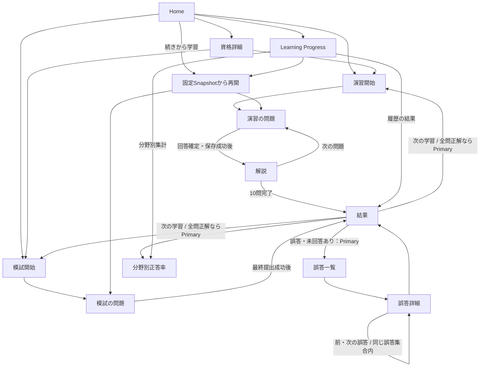
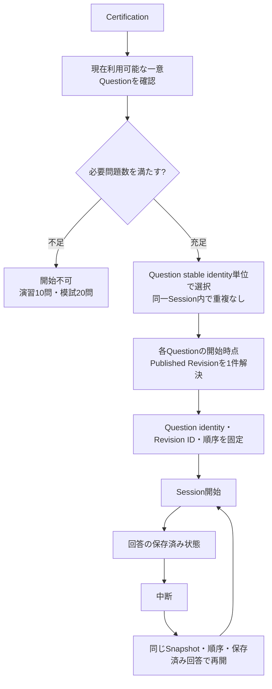
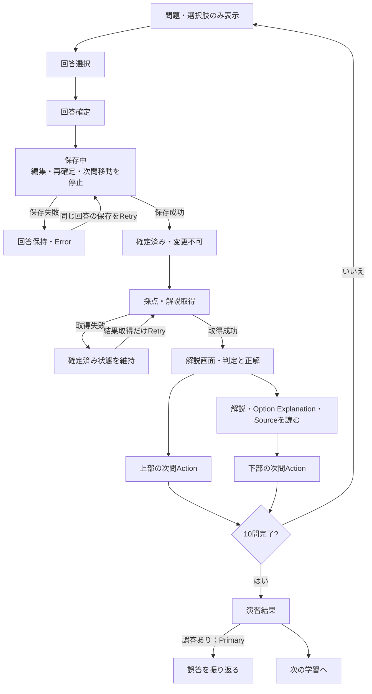
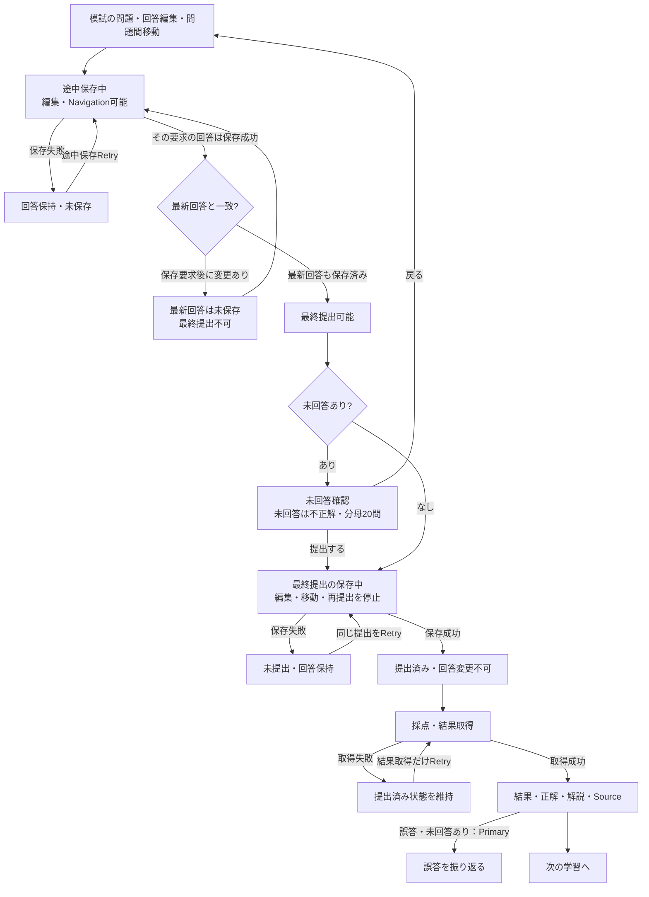
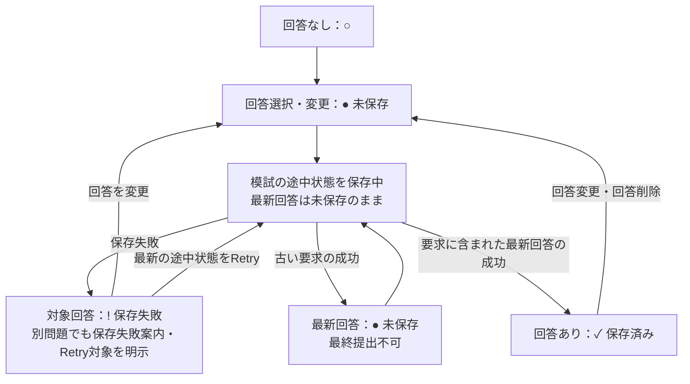
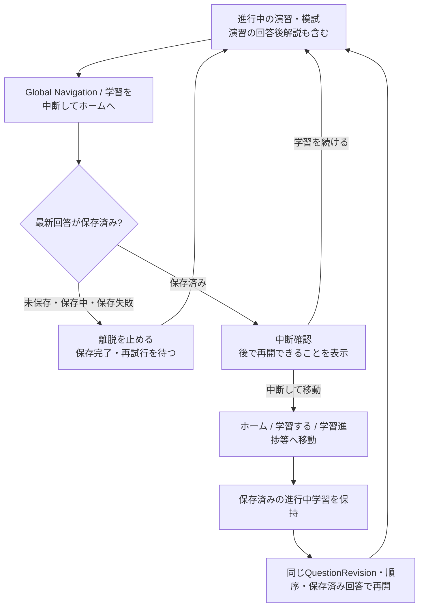
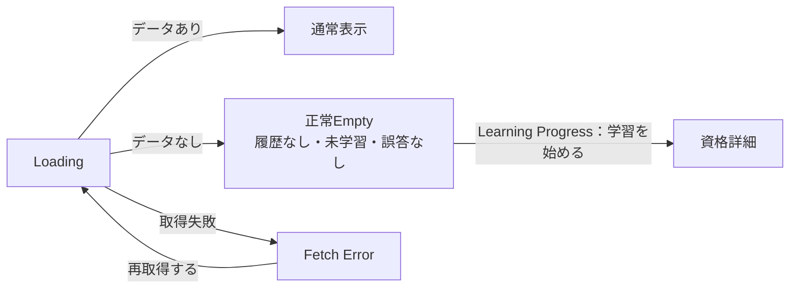

# Layout C 画面フロー

この資料は現在のStatic Mockと既存UX Contractをレビューするための整理であり、新しい仕様の正本ではない。Layout CはHumanが最終採用し、[learner-ui.md](../../learner-ui.md)へ確定反映済み。

12画面・必要状態の展開、初回UXレビュー7件・再レビュー4件・最終レビューMinor 2件の反映と再Validationは完了。最終確認へのHumanの「OK！」に基づきLayout C最終採用とLearner UX Contractの確定反映を記録した。画面遷移・保存の状態Contractは変更しない。

矢印は画面の導線または期待するUX遷移を表す。保存・取得成功は固定Fixtureの表示例をレビュー操作で切り替える。API・保存・採点・抽選は実行しない。

## 1. 全体の画面遷移

上部Navigationの「ホーム」「学習する」「学習進捗」は共通の移動手段。進行中の学習から移動する際は、保存済みでも中断確認を表示する。「学習を中断してホームへ」も同じ確認を使う。未保存・保存中・保存失敗の回答がある場合は離脱を止め、保存完了・再試行を待つ。

Home・資格詳細・Learning Progressから再開する場合も、既存SessionのQuestion identity・QuestionRevision・順序・保存済み回答を維持する。

## 2. Session開始と再開

これは後続Applicationへ渡す既存Contract。Static Mockでは既存Sessionと新Sessionの固定例を使う。抽選やPublished判定は実装していない。

- 必要問題数はRevision件数ではなく一意Question数で判定する。
- 開始済みSessionへ後日の新Revisionを反映しない。再開時に再抽選しない。
- User × Certification × Modeごとに進行中Sessionは最大1件。
- 既存Sessionがある開始画面では再開、または終了確認後の新Session開始例を確認できる。
- 演習の確定回答は変更不可。模試の未提出回答は編集可能。
- Snapshot内Revision / Sourceが後から利用不可となる場合は後続Issueで決定する。このFlowで再抽選・継続・終了の仕様を確定しない。

## 3. 演習の保存・解説・Retry

保存成功前は正解・解説を取得せず、次問題への確定遷移を行わない。保存成功後の結果取得失敗では回答を再保存しない。

演習の保存中・保存失敗では「前の確定済み回答を確認」も無効にし、保存成功後に確認できることを表示する。前問の解説経由で元の未解決の保存状態を解除できない。通常時と保存成功後の前問確認は維持する。

上部と下部のActionは同じ遷移先である。全文を読むことを進行条件にしない。10問目では両Actionが結果へ進む。誤答があれば振り返りをPrimaryにしつつ、次の学習へも進める。全問正解なら次の学習をPrimaryにする。

Static Mockの操作例：回答を選ぶ → 「回答を確定する」 → 保存中。レビュー欄で保存失敗・保存成功例を選び、Retryや解説への導線を確認する。成功例の回答・採点は固定Fixtureであり、自由に変更した選択の採点結果ではない。

## 4. 模試の途中保存と最終提出

- 時間制限なし。途中保存の成功は最終提出を意味しない。
- 通常時のrail上部「✓ 最新の状態は保存済み」は、模試全体に未保存変更がないことを示す。問題セルの「○ 回答なし」は、その問題への回答がないことを示す。現在問題に回答があるという意味にはしない。
- Save Aの要求後にBへ変更した場合、Save Aが成功しても現在のBは未保存のまま。古い応答で最新回答を保存済みにしない。
- 最終提出成功前には正解・score・解説・Option Explanation・Sourceを取得しない。
- Static Mockで回答を編集した後は「最新回答未保存」の表示と最終提出不可を確認する。最新回答の保存成功例へ進むにはレビュー欄の状態切替を使用する。
- 既存Contractは保存要求に含まれる回答状態への成功確認を定めており、API・DBの保存単位は定めていない。現行Mockは問題移動後も共通の途中保存状態を維持するため、保存失敗とRetryは「模試の途中状態」を対象とする案内にする。問題別の印は最新回答の表示状態であり、問題単位の保存APIを定義しない。
- railは回答有無と保存状態を組み合わせて表示する。○ 回答なし / ✓ 回答あり・保存済み / ● 最新変更が未保存 / ! 保存失敗。現在問題は太枠とaria-currentで独立して示す。失敗後の別問題移動でも対象の印を維持し、変更後の最新回答は●へ更新する。古い成功で●を✓へ変更しない。

- 最終提出後の結果取得失敗では再提出せず、結果取得だけRetryする。

## 5. 進行中の学習からの離脱

Product文言は「学習」「問題」「前回と同じ問題・同じ順番」とする。Question stable identity、QuestionRevision、Session Snapshotの内部Contractは維持する。学習完了・模試提出後の画面は進行中学習として中断しない。

Static MockではUser自身の回答・問題位置・確定状態・既存/新Sessionの参照をURL上のレビュー用表示状態で引き継ぐ。browser close / reload時の耐久保存、実際のPersistence、保存APIは実装しない。

## 6. 読取画面の状態

対象はHome、資格詳細、結果、誤答一覧、誤答詳細、分野別正答率、Learning Progress。正常Emptyと取得失敗は別状態として確認する。保存・提出成功後の結果取得失敗は、保存失敗と区別して確定済み状態を維持する。

Learning ProgressのEmptyでは「まだ学習履歴がありません。学習を始めると、ここに進捗が表示されます。」と「学習を始める」Primaryを表示する。Fetch Errorは「学習進捗を読み込めませんでした。時間をおいて、もう一度お試しください。」と「再取得する」であり、同じ状態・Actionにしない。Empty / Fetch Error等の内部名と設計説明はレビュー欄だけに置く。

## 7. 振り返りと集計

- 全問正解の固定結果例から分野別詳細へ進み、結果へ戻る場合も同じ結果Fixture・Snapshotを使用する。取得失敗・Retryを挟んでも保持し、別モード・次の学習には持ち越さない。
- 結果 → 誤答一覧 → 誤答詳細で、回答時点のQuestionRevision・解説・Sourceを確認する。後日のRevisionへ置き換えない。
- 誤答詳細は同じResult / Historyの誤答・未回答集合内で前後移動する。上部と解説・Sourceの下に同じ現在位置・前後Navigationを表示し、先頭の「前」と末尾の「次」は両方とも無効。上下に別の集合・順序・Navigationロジックを作らない。誤答一覧・結果への導線も維持する。
- Single Choice / Multiple Selectとも完全一致、部分点なし。模試未回答は不正解として20問の分母に含める。
- Learning Progressは演習・模試を分離する。確定済み回答のみ、模試は最終提出後に反映する。
- 複数KnowledgePointに関連していても全体Question countでは1問を1回だけ数える。回答のない分野は「未学習」。
- Historical QuestionRevision / Sourceの後日利用不可と、Active Session Snapshot内Revision / Sourceの後日利用不可は別の未決事項。Source Governance・履歴表示・Session実装Issueへ引き継ぐ。

## 8. レビュー用Snapshotとの対応

画面番号01〜12は[画面一覧](README.md#画面一覧)のSnapshot番号とPNGファイル名に対応する。状態13〜17は演習の保存失敗、模試の古い保存成功、結果取得失敗、読取Empty、Fetch Errorの例。追加18〜25は全問正解、誤答末尾、Session離脱確認、未保存離脱Blocking、単一/複数選択の配置確認用である。26・27は模試の途中保存失敗と最新回答未保存のrailを確認する。28は現在問題が未回答でも模試全体の最新状態は保存済みである通常例。

Snapshotだけでは全操作やData Boundaryを証明できない。操作は`selected/index.html`、読み込みFixtureと境界は`selected/view.js`・`selected/fixtures/`・`selected/validation.md`を確認する。
