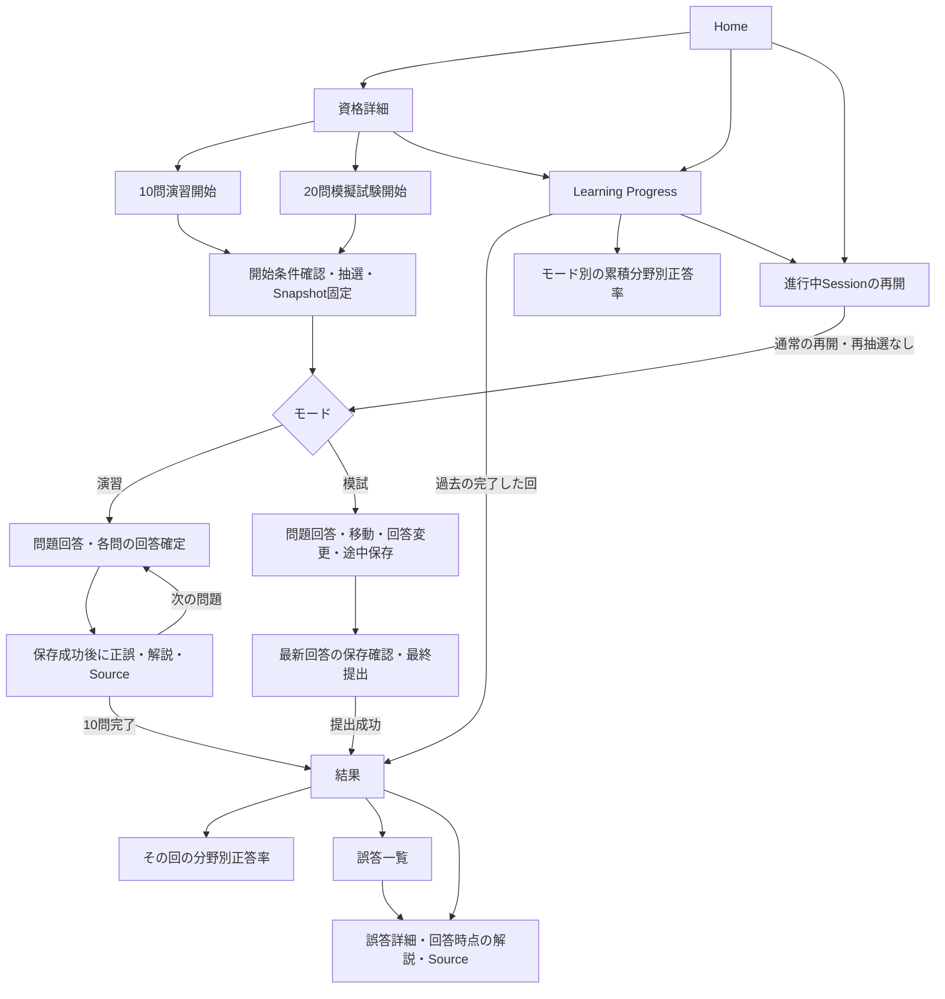
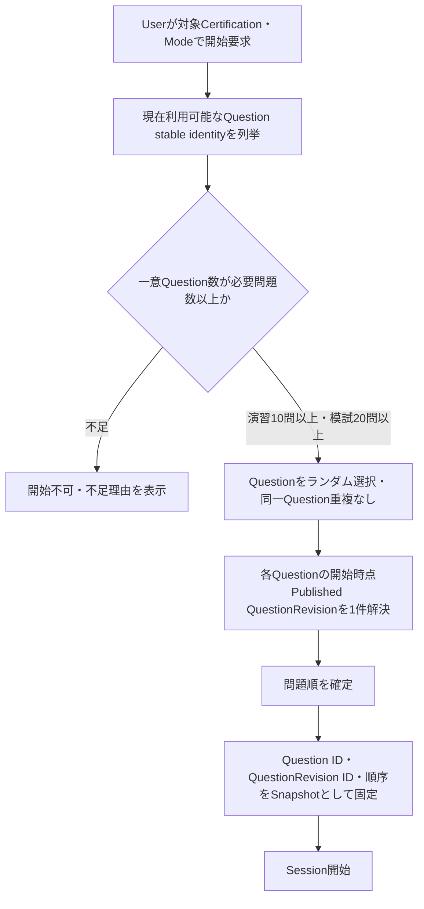
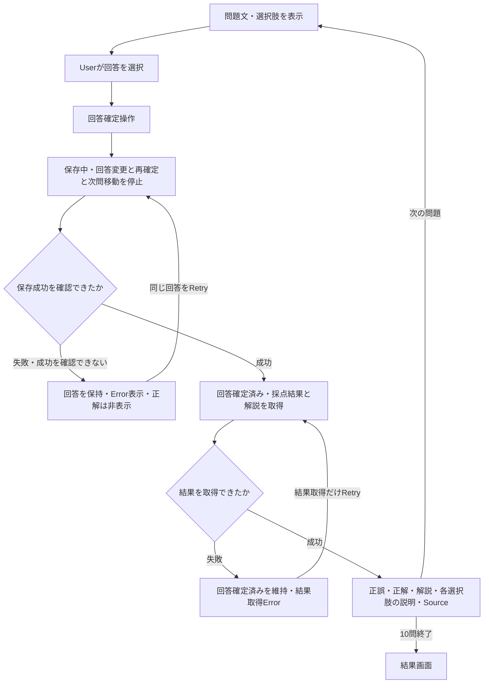
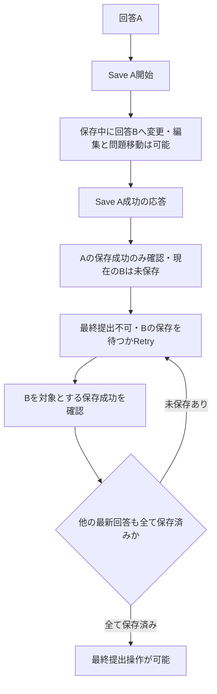
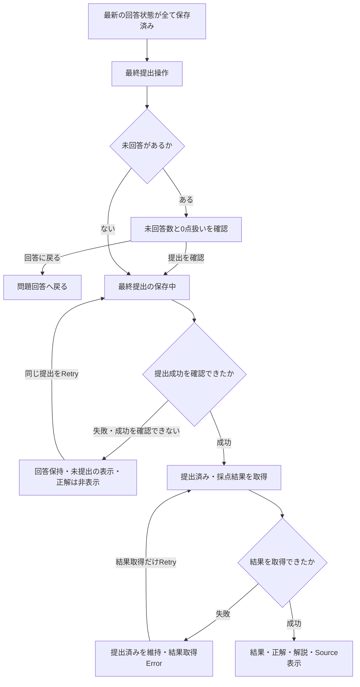
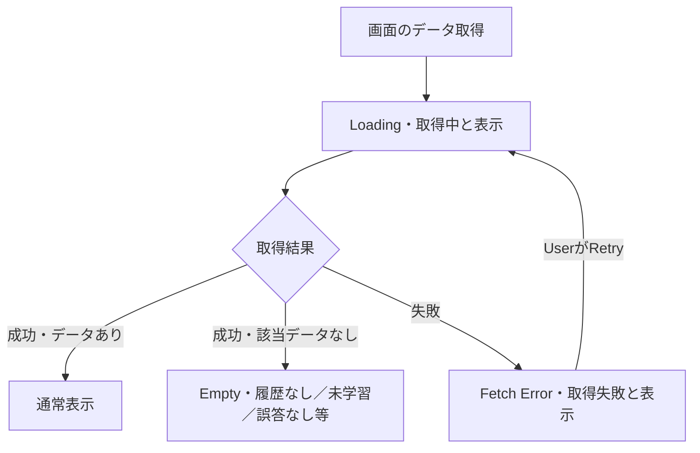
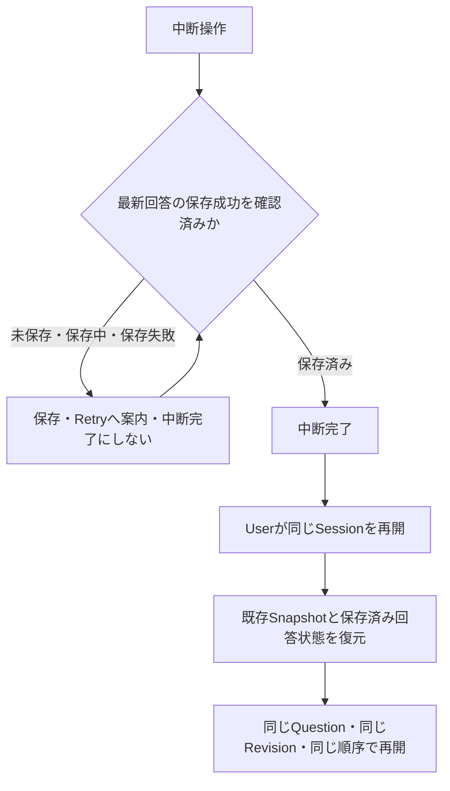

# Learner画面と学習フロー

- 対象: [Issue #9](https://github.com/abi-yusuke-wada/refriq/issues/9)
- 対象資格: Kong Gateway Certified Associate
- 状態: HumanがLayout Cを最終採用し、Issue #9のLearner UX Contractとして本書への確定反映を承認。12画面・必要状態、UXレビュー7件・再レビュー4件・最終レビューMinor 2件を反映し、再Validation済み。

この文書はLearnerの画面の目的、操作、状態、遷移、必要データ、および後続Application設計へのContractの正本である。PCを優先する。Production UIの実装完了を示す文書ではない。Static Mockの作成・確認状況は末尾の受入状況に記録する。

[MVP Scope](../mvp-scope.md)、[Domain Model](../domain/README.md)、[Domain用語集](../domain/glossary.md)、[Lifecycle](../domain/lifecycle.md)、[Source Governance](../domain/source-governance.md)を前提にする。Domain Model、Source Policy、Accepted ADRは変更しない。

## 成果物の役割と進行状況

| 成果物 | 正本としての役割 | 現在の状態 |
| --- | --- | --- |
| Design Prototype / `mockups/comparison.md` | Layout比較、情報階層、Navigation、Wireframe、比較評価、Human判断記録。Toolは交換可能 | 3案×4代表画面を比較し、HumanがCを最終採用。UXレビュー7件・再レビュー4件・最終レビューMinor 2件と最終承認を記録 |
| 採用案のStatic HTML/CSS Mock | Visual・Layoutと画面・状態配置の確認成果物 | Cの12画面・必要状態を作成し、再Validation済み。Human最終承認済み |
| この文書 | Behavior・UX Contractの正本。画面目的、操作、状態、Wireflow、必要データ、Revision固定、表示タイミング、Error・Retry、引き継ぎ事項 | 既存Contractを維持し、承認された採用理由・画面配置・操作・Brand方針・Validationを確定反映済み |
| `docs/ux/learner-ui-assets/` | 必要な場合のReview用Snapshot。この文書から参照する画面画像 | [CのReview Snapshot](learner-ui-assets/layout-c-review/README.md)を作成・更新。画像は仕様の正本ではない |

この文書をBehavior・UX Contractの正本とし、採用確定したStatic MockをVisual・Layoutの確認成果物とする。画像自体を仕様の正本にしない。実行工程は[Issue #9 Plan](issue-9-plan.md)を参照する。3案比較、Human暫定採用、全画面Validation、承認指摘反映・再Validation、Human最終承認を経て本書を確定した。

## レイアウト比較と選定

Design Toolの認証・接続を前提にせず、[比較Prototype](mockups/index.html)で次の3案を作成する。共通のPC画面幅、架空の問題・集計データ、日本語の文言、共通の配色・Fontを使い、配置と情報階層を比較する。最終Visual polishは別Issueとする。

| 案 | 配置 | 比較する意図 |
| --- | --- | --- |
| A | 上部Navigationと中央コンテンツのシンプルな縦配置 | 学習開始と問題文の読みやすさ |
| B | 左側Navigationとカード・一覧のダッシュボード配置 | 進捗と履歴の見渡しやすさ |
| C | 主コンテンツと補助情報を並べる2ペイン配置 | 回答後の解説と結果確認の読みやすさ |

各案でHome・問題回答・結果・Learning Progressの4代表画面を作り、計12画面を並べる。Learning Progressは簡易レベルで履歴一覧と分野別集計を比較する。問題回答では回答前と確定後の表示差を示す。C案でも回答前の補助ペインに正解・解説・Sourceを置かない。

| 評価軸 | 確認内容 |
| --- | --- |
| 問題文の読みやすさ | 長いシナリオ、設定、コマンドを読みやすいか |
| 選択肢の操作性 | 単一選択・複数選択の操作と選択状態が分かるか |
| 解説・Sourceの読みやすさ | 回答後に正答理由と出典を追いやすいか |
| 現在位置・Progressの把握 | 問題番号、回答状況、進行状態が分かるか |
| 履歴・Learning Progressの一覧性 | 過去の回と分野別の傾向を見渡せるか |
| Navigationの分かりやすさ | 開始、再開、提出、結果、履歴への導線が分かるか |
| PC画面での情報密度 | 情報過多や過度な余白がないか |
| 画面間の一貫性 | 操作位置と情報配置が揃っているか |

点数制は必須にしない。各案の良い点、懸念点、向いている画面を[比較記録](mockups/comparison.md)へ残す。Humanが1案を暫定採用し、その案だけを全対象画面へ展開する。全画面・状態・WireflowのValidationで重大なLayout問題が判明した場合は、問題を報告してHumanの再判断へ戻る。Codexは自動で別案へ変更しない。重大問題がないことを確認後、採用確定とする。

**選定状態:** Layout C最終採用・本書への確定反映をHumanが承認。最終確認「Layout Cを最終採用し、Issue #9のLearner UX Contractとしてlearner-ui.mdへ確定反映してよいですか？」に対する「OK！」をHuman Decisionとして記録する。理由とレビュー履歴は[比較記録](mockups/comparison.md)、Mockの検証は[Validation記録](mockups/selected/validation.md)を参照する。

## 採用Layout Cの画面配置

### 採用理由と基本原則

Main contentとSupporting information railの責務を分け、学習操作をMainの中心に置きながら、進捗・継続・履歴・振り返りを並行表示する。Homeでは今行う学習と継続情報、Resultでは結果本体と振り返り、Learning Progressでは集計本体と履歴を分離できる。補助情報が増えてもMainを壊しにくく、Bより管理画面感を抑えつつAより情報量を扱いやすいことを採用理由とする。

PC優先。主操作をrailへ追い出さない。Supporting informationは状態・補足・履歴・継続導線に限定する。長い解説・Option Explanation・SourceはMainで十分な幅を使って読む。

### 12画面の役割

| 画面 | Main content | Supporting information rail |
| --- | --- | --- |
| Home | 今日の学習、演習・模試の主CTA、最近の学習概要 | 続きから学習、学習履歴、資格・学習範囲の簡易情報 |
| 資格詳細 | 資格・分野・利用可能問題数、演習・模試開始 | 継続学習、学習状況への導線 |
| 演習開始 | 10問・各問の即時解説、開始条件、開始・再開・終了確認 | 必要問題数、中断・再開の補足 |
| 模試開始 | 20問・時間制限なし・提出後結果、開始・再開・終了確認 | 必要問題数、中断・再開の補足 |
| 演習の問題 | 問題番号・方式・本文・設定例・選択肢、回答確定・Retry | 現在位置、全問題数、確定件数、保存状態 |
| 模試の問題 | 問題・選択肢、編集・前後移動・最終提出・Retry | 現在位置、回答有無・保存状態、20問Navigation |
| 解説 | 読取専用の問題、判定・正解・解説・Option Explanation・Source、上下Next | 問題位置、確定済み状態 |
| 結果 | 正答数・率・モード・完了時点・分野別結果、結果に応じた次のAction | 振り返り概要、誤答一覧・詳細への導線 |
| 誤答一覧 | そのResult / Historyの誤答・未回答と詳細への導線 | 振り返り対象、結果への導線 |
| 誤答詳細 | 回答時点の問題・自分の回答・正解・理由・Source、上下の前後Navigation | 問題位置、確定済み状態 |
| 分野別正答率 | その回または累積の分野別件数・率、未学習 | 集計対象の補足、結果・進捗への導線 |
| Learning Progress | 演習・模試切替、累積正答率・回答数、分野別集計 | 最近の履歴、継続学習、集計対象の補足 |

### Questionの簡略C

Questionは問題文・選択肢への集中を優先し、Mainに問題番号、方式、長い日本語本文、code / command、選択肢、主操作を置く。通常railは300px、Question・解説・誤答詳細のrailは220pxとする。確認済みMockでは1280px時のQuestion Main幅968px、1440px時1048pxを確保する。Productionの最終CSS・Mobile最適化は後続Issueで扱う。

回答前のrailには現在問題番号・全問題数・回答件数・保存状態と、模試Navigationだけを表示する。正解・正誤・score・解説・Option Explanation・Sourceは置かず、回答後Fixture自体もloadしない。演習の保存成功後、模試の最終提出成功後に初めて回答後情報を取得できる。

模試railは3列、大きな問題番号、○ 回答なし、✓ 回答あり・保存済み、● 最新変更が未保存、! 保存失敗、太枠とaria-currentによる現在問題を組み合わせる。Legend・aria-label・titleの意味を一致させ、色だけに依存しない。回答削除も未保存変更として扱う。rail上部の「✓ 最新の状態は保存済み」は模試全体に未保存変更がないことを示し、その問題に回答があることを意味しない。

途中保存の失敗案内とRetry対象は「模試の途中状態」と明示する。各問題の印は回答有無と最新状態の表示であり、API・DBの物理保存単位を決めるものではない。古い保存成功で最新回答を保存済みにせず、未保存変更がある間は最終提出を止める。

### 承認済みの操作・状態表示

- Learner向け文言は「問題」「利用可能な問題数」「学習・演習・模試」「前回と同じ問題・同じ順番」とする。内部Domain用語は設計文書・source code・review metadataに限定する。
- 進行中学習からGlobal Navigationまたは「学習を中断してホームへ」で離れる際は同じ中断確認を使う。保存済みなら「中断して移動 / 学習を続ける」、最新回答が未保存・保存中・保存失敗なら離脱を止める。どちらの離脱経路でも同じSnapshotと保存済み状態から再開する。
- 演習解説の上部と下部のNextは同じTransitionを使う。全文を読むことを条件にせず、10問目では結果へ進む。
- 結果に誤答・未回答があれば「誤答を振り返る」をPrimary、「次の学習へ」をSecondaryとする。全問正解なら「次の学習へ」がPrimary。振り返りを強制しない。
- 誤答詳細の上部・Sourceの下に同じ現在位置と前後Navigationを置く。同じResult / Historyの誤答集合・順序を使い、先頭Previousと末尾Nextを無効にする。一覧・結果へ戻る導線を維持する。
- Learning Progress Emptyは「まだ学習履歴がありません。学習を始めると、ここに進捗が表示されます。」と「学習を始める」から資格詳細へ進む。Fetch Errorは「学習進捗を読み込めませんでした。時間をおいて、もう一度お試しください。」と「再取得する」。内部状態名や設計説明はレビュー欄に限定し、EmptyとErrorを統合しない。

### Brand visual direction

深い紫をPrimary Accent、淡いLavenderをSupporting surface、白系を学習本文の背景とする。余白・落ち着いたBorder・高Contrastを優先し、装飾的な紫背景を本文背面へ多用しない。Human指定のStatic Mock専用暫定Tokenであり、会社の正式Brand GuidelineやProduction Design Systemとして扱わない。

| 用途 | 現行MockのToken |
| --- | --- |
| Primary CTA・active Navigation・selected tab・Progress | `--brand-primary: #4b2a7b` |
| Primary hover / strong | `#3d2266` / `#321a59` |
| Supporting surface / strong | `#f5f2f9` / `#eee8f5` |
| Main reading surface | `--surface-card: #ffffff` |
| Focus | `--focus-ring: #75609a` |
| Success / Warning / Error | `#287a52` / `#9a6700` / `#b42318` |

Semantic ColorはBrand Colorから分離する。正解・保存成功はSuccess、未保存・確認はWarning、不正解・ErrorはErrorとし、記号・文字・枠も併用する。最終的な配色・Font・余白等のVisual polishは別Issue。

### 採用確定のValidation根拠

12画面をPC幅1280px / 1440pxで確認し、長い日本語・設定例、Single / Multiple Select、解説・Source、Navigation、一覧・集計、Loading / Empty / Errorを検証した。最新のブラウザ回帰は204ケース（既存178 + PR指摘の追加26）成功、HTTP通信・page errorは0件。レビュー7件・再レビュー4件・Minor 2件に加え、Humanが承認したPR独立レビュー2件を反映した。演習保存中・失敗時の前問経由のロック解除と、全問正解結果の詳細往復でのFixture切替を修正・再確認済み。

使用する文字・背景11組のContrastは4.5:1以上、focusは3px、模試Navigationのセルは44px以上を確認している。正式なAccessibility certificationではない。回答前 / 回答後Fixtureの物理分離と読込み境界を維持する。

実施記録は[validation.md](mockups/selected/validation.md)、全体Flowは[screen-flow.md](learner-ui-assets/layout-c-review/screen-flow.md)、Visual確認は[12画面Mock](mockups/selected/index.html)と[Review Snapshot](learner-ui-assets/layout-c-review/README.md)を参照する。成功応答・採点・結果は固定Fixtureの表示例であり、実API・DB・Persistence・Production Reactの動作確認ではない。

## 対象画面と必要データ

次は画面に必要な論理的なデータ項目であり、API Payload、TypeScript型、DB Schemaではない。取得・表示可能な時点は[回答前後のデータ境界](#回答前後のデータ境界)に従う。SessionはApplication上の学習操作のまとまりとして扱い、Domain Aggregateを追加しない。

| ID | 画面・状態 | 目的と主な操作 | 必要データ | Domain概念・Application上の対応 |
| --- | --- | --- | --- | --- |
| L01 | Home | 資格詳細へ進む。モードごとの進行中Sessionを再開する。Learning Progressへ進む | 資格ID・名称、モード別の進行中Session参照と進行状況、演習・模試別の累積概要 | Certification、LearningProgress、ApplicationのSession |
| L02 | 資格詳細 | 資格と分野を確認し、演習開始・模試開始・学習進捗へ進む | 資格ID・名称・説明、分野ID・名称・説明、現在利用可能な一意Question数、モード別進行中Sessionの有無 | Certification、ExamTopic、Question、ApplicationのSession |
| L03 | 演習開始 | 10問・各問の即時解説を確認して開始する。既存Sessionがあれば再開または終了確認へ進む | 対象User・資格、Practiceモード、必要問題数10、利用可能な一意Question数、既存Session参照、開始可否と不足理由 | Certification、Question、Applicationの開始条件・Session |
| L04 | 模試開始 | 20問・時間制限なし・提出後の結果表示を確認して開始する。既存Sessionがあれば再開または終了確認へ進む | 対象User・資格、Mock Examモード、必要問題数20、利用可能な一意Question数、既存Session参照、開始可否と不足理由 | Certification、Question、Applicationの開始条件・Session |
| L05 | 演習の回答前 | 問題を読み、選択肢を選び、回答確定操作を行う | Session参照、モード、Question ID、固定QuestionRevision ID、問題番号・全問題数、問題文、選択方式、選択肢ID・本文、表示に必要なmetadata、User自身の選択状態・保存状態 | Question、QuestionRevision、ApplicationのSnapshot・未確定回答 |
| L06 | 演習の回答確定後 | 正誤・正解・解説・Sourceを確認し、次の問題へ進む。回答は変更できない | L05の問題、確定回答参照・選択内容、正誤、正解、解説、各選択肢の説明、出典情報 | UserAnswer、回答対象QuestionRevision、QuestionSource、SourceRevision、SourceDocument |
| L07 | 模試の最終提出前 | 問題間を移動し、回答を変更する。全ての最新回答状態が保存済みなら最終提出へ進む | Session参照、モード、SnapshotのQuestion・Revision・順序、問題文・選択方式・選択肢、問題番号・全問題数、User自身の各問の回答状態、最新回答の保存状態、未回答数、Navigationに必要な情報 | Question、QuestionRevision、ApplicationのSnapshot・途中回答・進行状態 |
| L08 | 結果 | 正答数・正答率・分野別正答率を確認し、誤答一覧と各問の解説へ進む | Session参照・モード・対象資格、確定回答または提出の状態、正答数・全問題数・正答率、分野別の正答数・対象問題数・正答率、誤答・未回答の参照 | UserAnswer、QuestionRevision、ExamTopic、Applicationの結果集計 |
| L09 | 誤答一覧 | 各回の誤答・未回答を見渡し、詳細を開く | 対象Session・モード、回答時点のQuestion・Revision参照、問題番号・本文の一覧用表示、関連分野、Userの確定回答、誤答・未回答の区別 | UserAnswer、QuestionRevision、ExamTopic、Applicationの提出済み未回答結果 |
| L10 | 誤答詳細・解説確認 | 回答時点の問題、自分の回答、正解、理由、Sourceを確認する | 対象Session・確定回答参照、固定QuestionRevision ID、問題文・選択肢、自分の回答、正誤・未回答の区別、正解、解説、各選択肢の説明、出典情報 | UserAnswer、QuestionRevision、QuestionSource、SourceRevision、SourceDocument |
| L11 | 分野別正答率 | その回の結果または累積進捗の分野別の傾向を確認する | 集計対象SessionまたはUser・資格・モード、分野ID・名称、正答数・対象件数・正答率、回答なしの区別 | ExamTopic、UserAnswer、QuestionRevision、KnowledgePoint、LearningProgress |
| L12 | Learning Progress | 演習と模試を分けて累積結果と履歴を確認し、過去の結果を開く | User・資格・モード、累積正答数・対象件数・正答率、分野別集計、Session履歴の参照・モード・進行状態・開始や完了の時点、完了した回の結果参照、再開可能なSession参照 | LearningProgress、UserAnswer、QuestionRevision、ExamTopic、ApplicationのSession・履歴 |

出典情報は、回答対象RevisionのQuestionSourceから辿れるSourceRevision・SourceDocumentの参照、出典タイトル、URL、該当箇所・取得時点を確認するための情報を指す。現在のSource本文から正解・根拠を推測し直さない。

Exam Feedback入力は[Issue #10](https://github.com/abi-yusuke-wada/refriq/issues/10)の責務とし、画面展開時には同Issueで定義する画面への導線だけを示す。

## 画面間のWireflow

上図は通常の遷移を示す。保存・取得失敗と再開時の例外は以下の個別Wireflowで扱う。開始後にQuestionRevision・Sourceが利用不可となった場合は未決事項であり、この通常Flowによって再開を許可したものと解釈しない。

## Session開始とSnapshot

Questionはstable identity、QuestionRevisionはimmutableな内容である。抽選・重複判定・必要問題数の判定はQuestion単位で行う。

Q001にRevision 1とRevision 2があっても最大1問として数える。例えば一意Questionが9件でRevisionが12件ある場合、10問演習は開始できない。

開始後はQuestion ID・解決済みQuestionRevision ID・順序を変更しない。新RevisionがPublishされても進行中Sessionには反映せず、新しいSessionの開始時に最新Published Revisionを利用できる。DB構造、Query実装、Snapshot保存方式は後続Issueで決める。

## 演習と模試の挙動差

| 項目 | 10問演習 | 20問模擬試験 |
| --- | --- | --- |
| 問題の選択 | 利用可能なQuestionをランダム選択・Session内重複なし | 同左 |
| 回答の確定 | 各問の回答確定・保存成功時 | 最終提出成功時 |
| 回答変更 | 確定前に可能。確定後は不可 | 最終提出前に可能 |
| 問題間の移動 | 確定回答の解説確認は可能。次問への確定遷移は保存成功後 | 最終提出前は移動可能。途中保存中も可能 |
| 正解・解説・Source | 各問の回答確定・保存成功後 | 最終提出成功後 |
| 制限時間 | 今回の確定要件に含めない | 時間制限なし |
| 結果表示 | 10問終了後 | 最終提出成功後 |
| 未回答 | 未確定のまま次問へ確定遷移しない | 未回答を含む提出は確認を挟み、未回答を0点とする |
| 中断・再開 | 同じSnapshotと保存済み状態を復元 | 同左。未提出回答は編集可能 |
| Learning Progressへの反映 | 各問の回答確定・保存成功後 | 最終提出成功後。途中保存は含めない |

### 採点

Single Choiceは正解の選択肢との完全一致、Multiple Selectは正解集合との完全一致で1点とする。部分点はない。模試の未回答は0点とし、正答率の分母は20問とする。演習の完了結果の分母は10問とする。

## 回答前後のデータ境界

UIで非表示にするだけでなく、解禁前には正解情報そのものをClientへ渡さない。公開済みQuestionRevisionであっても、内部の全ContentやReviewer向け情報をそのままLearnerへ渡してよいことを意味しない。

| モード・時点 | Clientへ渡せる情報 | 渡さない情報 |
| --- | --- | --- |
| 演習の回答確定・保存成功前 | 問題文、選択肢、表示に必要なmetadata。User自身の選択内容は画面上に保持する | correctOptionIds、正誤判定、optionごとの正誤理由、explanation、option explanation、正答を直接推測できる情報、Source・出典リンク |
| 演習の回答確定・保存成功後 | 上記に加え、正解、正誤、explanation、option explanation、Source・出典情報 | 確定前の別問題については引き続き回答前の境界を適用 |
| 模試の最終提出成功前 | 問題文、選択肢、User自身の回答状態、Navigationに必要な情報 | 正解、採点結果、explanation、option explanation、正答を直接推測できる情報、Source・出典リンク |
| 模試の最終提出成功後 | 正解、採点結果、explanation、option explanation、Source・出典情報 | 未提出状態の別Sessionについては引き続き提出前の境界を適用 |

Sourceリンク自体が正答を直接示す可能性も考慮し、表示タイミングは演習の回答確定後・模試の最終提出後とする。後続API設計で守るContractであり、Payload SchemaやEndpointは定義しない。

## 演習の回答確定・保存・Retry

保存成功前には正解表示も次問への確定遷移も行わない。保存失敗時は確定対象の回答を画面上に保持し、回答変更・次問移動を止めたまま同じ回答のRetryを可能にする。保存後の結果取得失敗は保存失敗と区別し、確定回答の再保存を行わない。

## 模試の途中保存と最新回答状態

途中保存中も回答編集・問題移動を許可する。保存成功は、その保存要求に含まれた回答状態についてのみ成立する。要求後に変更された最新回答の保存成功を意味しない。

古い保存成功responseで最新回答の「未保存」を「保存済み」に変更しない。保存失敗時も最新の選択内容を画面上に保持し、編集・問題移動・Retryを可能にする。未保存の最新回答が存在する間は最終提出を止める。

要求と応答の対応付け、応答順序の制御、request sequence、version number、updatedAt、optimistic concurrency、idempotency key等の具体策は後続Application設計に残す。

## 模試の最終提出・結果取得

最終提出の保存中は回答変更・問題移動・再提出を止める。失敗時は回答を保持し、提出済み扱いにせず、回答変更を止めたまま同じ提出のRetryを可能にする。提出成功後の結果取得失敗では提出済みを維持し、再提出しない。

### 保存状態と操作の一覧

| 状態 | 回答編集・移動 | Retry | 最終提出・次問遷移 | 正解・解説 |
| --- | --- | --- | --- | --- |
| 演習の確定保存中 | 回答変更・再確定・次問移動を停止 | 保存中は再送を停止 | 次問への確定遷移不可 | 返さない・表示しない |
| 演習の確定保存失敗 | 回答を保持し、回答変更・次問移動を停止 | 同じ回答の保存をRetry可能 | 次問への確定遷移不可 | 返さない・表示しない |
| 模試の途中保存中 | 編集・問題移動可能 | 保存結果に応じて案内 | 未保存の最新回答があれば最終提出不可 | 返さない・表示しない |
| 模試の途中保存失敗 | 最新回答を保持し、編集・問題移動可能 | 最新回答の保存をRetry可能 | 最新回答の保存成功まで最終提出不可 | 返さない・表示しない |
| 模試の最終提出保存中 | 回答変更・問題移動・再提出を停止 | 保存中は再送を停止 | 成功を確認するまで未提出 | 返さない・表示しない |
| 模試の最終提出失敗 | 回答を保持し、回答変更を停止 | 同じ提出をRetry可能 | 成功を確認するまで未提出 | 返さない・表示しない |
| 確定・提出成功後の結果取得失敗 | 確定回答を変更しない | 結果取得のみRetry可能 | 確定・提出成功を維持 | 取得失敗を表示 |

Retryや応答不明後の再試行で二重回答・二重提出にならないことをApplication要件とする。TransactionやIdempotencyの実装はここで決めない。

## 読取画面のLoading・Empty・Fetch Error・Retry

対象はHome、資格詳細、結果、誤答一覧、誤答詳細、分野別正答率、Learning Progressである。

| 状態 | 必要な表示・操作 |
| --- | --- |
| Loading | 取得中であることが分かる。取得中をEmptyやFetch Errorとして表示しない |
| Empty | 取得成功後の該当データなしを示す。画面に応じて履歴なし、未学習、誤答なし等を区別する |
| Fetch Error | 取得失敗を示す。失敗を履歴なし・未学習・誤答なしへ置き換えない |
| Retry | Userが再取得できる。再取得中はLoadingへ戻り、結果に応じて通常表示・Empty・Fetch Errorへ進む |

| 読取画面 | Emptyの確認対象と注意点 |
| --- | --- |
| Home | 学習履歴・進行中Sessionがない状態と、取得失敗を区別する |
| 資格詳細 | 各表示領域のデータ有無を確認する。取得失敗を利用可能問題数0と見なさない |
| 結果 | 結果データが存在しない場合と取得失敗を区別する。確定・提出成功後の取得失敗を保存失敗にしない |
| 誤答一覧 | 誤答なしを表示する。未回答がある場合は提出結果に基づいて区別する |
| 誤答詳細 | 該当詳細データなしと取得失敗を区別する。後日の利用不可は別の未決事項として扱う |
| 分野別正答率 | 回答なしの分野を未学習と表示する。取得失敗を正答率0%や未学習にしない |
| Learning Progress | モード別の履歴なし・未学習と取得失敗を区別する |

必要な状態はHuman暫定採用後の全画面Static Mockにも含める。HTTP Status、API Error Schema、Retry回数、exponential backoff、cache、network libraryは設計しない。

## 中断・再開と進行中Sessionの粒度

進行中Sessionは概念上User × Certification × Modeごとに最大1件とする。同じUser・CertificationでPracticeとMock Examは別々に持てる。MVPが1資格でもSessionの対象Certificationを省かない。DB UNIQUE constraint、PK、Persistence Modelは定義しない。

通常の再開でQuestionやQuestionRevisionを再抽選しない。演習の確定回答は変更せず、模試の未提出回答は編集できる。同じUser × Certification × Modeで新しい回を開始する場合は既存Sessionを終了する確認を挟む。演習の確定回答は履歴に残し、未提出の模試は採点しない。

開始後にSnapshot内のQuestionRevisionまたはSourceが利用不可となった場合は上記通常Flowの確定対象外である。そのまま再開、回答不可、Session終了、Human判断・別表示のいずれも今回決めない。代替Questionへの再抽選も採用しない。

## 結果・履歴・Learning Progress

### 結果と履歴

各回の結果にはScoreとして正答数・正答率を表示し、Topic別正答率と誤答・未回答から詳細へ進める。過去の完了した回はLearning Progressの履歴から開く。累積誤答一覧や誤答だけの復習演習は追加しない。

UserAnswerが参照する回答時点のQuestionRevisionを使い、問題文・選択肢・正解・解説・QuestionSourceを表示する。後日新RevisionがPublishされても、過去の回答参照先を変更しない。

### モード別の累積集計

| 項目 | 集計規則 |
| --- | --- |
| 集計単位 | User・Certification・Modeごと。演習と模試を分けて表示する |
| 演習の反映時点 | 各問の回答確定・保存成功後。Session中断・終了後も確定回答は残る |
| 模試の反映時点 | 最終提出成功後。途中保存・未提出の模試は含めない |
| 再回答 | 別Sessionでの再回答は新たな回答として毎回累積する |
| 全体正答率 | 集計対象の正答件数を対象件数で割る。提出済み模試の未回答は0点として含める |
| 分野別正答率 | 対象Revisionに関連するKnowledgePointからExamTopicを辿る。1回答を関連する各分野に1回ずつ計上する |
| 同一分野の重複 | 同じQuestionに複数のKnowledgePointが関連しても、同一分野には1回答を1回だけ計上する |
| 全体との件数差 | 全体スコアではQuestionを1回だけ数える。複数分野の件数合計が全体件数を超える場合がある |
| 回答なし | 正答率0%ではなく「未学習」と表示する |

例えばQ001がD2・D3を問う場合、その回答はD2とD3に各1件、全体には1件として計上する。同じQ001にD2のKnowledgePointが2件あっても、D2の件数は1件である。別SessionでQ001へ再回答した場合は各集計に新たな1件を加える。

LearningProgressは既存Domainの回答履歴から再構築できるProjectionとして扱う。保存方式や更新処理は追加しない。

## 後続Issueへの引き継ぎと未決事項

| 引き継ぎ先 | UX / Application Contract | 同Issue等で決める事項 |
| --- | --- | --- |
| Issue #11 Access Pattern | 一意Question数による開始条件、Question単位の抽選、Revision解決・Snapshot固定、Session開始・再開、User × Certification × Modeの粒度、回答保存・結果・履歴取得 | Query / Command、Consistency、Concurrency、Idempotency、必要な取得・保存手段 |
| Issue #11・後続Application設計 | 古い途中保存成功応答で最新回答を保存済みにしない。最新回答が未保存なら最終提出不可。Retryで二重回答・二重提出にしない | 要求と応答の対応付け、request sequence、version number、updatedAt、optimistic concurrency、idempotency key等の具体策 |
| Issue #12 Persistence | Snapshot、途中回答、確定回答、履歴、モード別集計に必要な保存要件 | DB Schema、PK、UNIQUE constraint、Transaction、保存方式、Projection更新処理 |
| 後続API設計 | 回答前後のデータ境界、成功確認、Loading / Empty / Fetch Error / Retryの画面状態 | Payload Schema、Endpoint、HTTP Status、Error Schema、取得方式。Retry回数・backoff・cache・network library等の具体策 |
| Source Governance・履歴表示実装Issue | Historical QuestionRevision / Sourceが後日利用不可になった場合の履歴表示ルール | 表示可否・表示内容・Human判断等。Issue #9では決定しない |
| Source Governance・Session実装Issue | 進行中SessionのSnapshotに含まれるQuestionRevisionまたはSourceがSession開始後に利用不可となった場合の再開・回答可否・Session継続ルール | 再開・回答の許可、終了、Human判断・別表示等。Issue #9では決定しない |
| Issue #10 | LearnerからExam Feedback入力への導線 | 入力画面、抽象化された選択式Feedback、Reviewer UI |
| 別のVisual polish Issue | 選定済みLayoutとBehavior Contract | 配色、Font、共通部品、細かな余白の仕上げ |

履歴の利用不可と進行中Sessionの利用不可は別々に扱う。Issue #7のSource Governanceを再設計せず、Snapshot固定原則との整合を確認する後続Issueへ残す。

## 検証シナリオ

実装テストではなく、成果物のレビューとWireflowの再生で確認する。下表は実施結果の成功報告ではなく、設計レビューと後続実装で使う受入シナリオである。

| ID | 前提・操作 | 期待する状態・遷移 |
| --- | --- | --- |
| UX-01 | 一意Questionが9件、複数RevisionによりRevision件数は12件 | 10問演習は開始不可。Revisionを追加しても利用可能問題数を水増ししない |
| UX-02 | 演習・模試を新しく開始する | Question単位に重複なしで10問・20問を選び、各QuestionのPublished Revisionと順序をSnapshot固定してから開始する |
| UX-03 | 開始後に新RevisionがPublishされ、中断・再開する | 同じQuestion・固定Revision・順序・保存済み回答状態を復元し、再抽選しない。新Sessionは開始時点の最新Published Revisionを利用できる |
| UX-04 | 演習で回答を確定し、保存中・保存失敗・Retryへ進む | 回答を保持。保存成功まで正解・解説を渡さず、次問に確定遷移しない。同じ回答のRetryで二重回答にしない |
| UX-05 | 演習の保存成功後に結果取得が失敗する | 回答確定済みを維持し、結果取得だけRetryする。回答を再保存しない |
| UX-06 | 模試で回答Aを保存中にBへ変更し、Save A成功が返る | 編集・問題移動は可能。Bは未保存のままで、Bの保存成功確認まで最終提出不可 |
| UX-07 | 模試の途中保存に失敗する | 最新回答を画面上に保持し、編集・移動・Retry可能。最新回答の保存成功までは最終提出不可 |
| UX-08 | 模試に未回答を残して最終提出する | 未回答数と0点扱いの確認を挟む。提出保存中・失敗時は正解・結果を渡さず、同じ提出をRetryできる |
| UX-09 | 模試の提出成功後に結果取得が失敗する | 提出済みを維持し、結果取得のみRetryする。再提出しない |
| UX-10 | Single Choiceを誤選択する、Multiple Selectで一部だけ正解または余分な選択を含める | 完全一致の場合だけ1点。部分点なし。提出済み模試の未回答は0点、結果の分母は20問 |
| UX-11 | 各問の回答前情報や未提出模試の情報を確認する | 正解、正誤、optionごとの理由、解説、Source、正答を直接推測できる情報をClientへ渡さない |
| UX-12 | 同じUser・Certificationで演習と模試を開始する | 各Modeで進行中Sessionを別々に持てる。同じ組み合わせで新規開始する場合は終了確認を挟む |
| UX-13 | 回答後に新RevisionがPublishされ、過去結果を開く | UserAnswerが参照する回答時点のRevisionで問題・解説・Sourceを確認する |
| UX-14 | 1問が複数分野を問う。同一分野のKnowledgePointが複数ある。別Sessionで再回答する | 各関連分野には1回答1件、全体には1件。同一分野内の重複なし。再回答は別の回答として累積する |
| UX-15 | 演習の各問を確定し、模試では途中保存後に最終提出する | 演習は各問確定後に反映。模試は提出成功後に反映。モード別に集計し、未学習分野は0%表示にしない |
| UX-16 | Home・資格詳細・結果・誤答一覧・誤答詳細・分野別正答率・Learning Progressで取得中、データなし、取得失敗、再取得を確認する | Loading / Empty / Fetch Error / Retryを区別し、取得失敗を履歴なし・未学習・誤答なしにしない |
| UX-17 | Historical Revision / Sourceが後日利用不可、または進行中Snapshot内で利用不可となる | 2つの未決事項を別に引き継ぐ。今回の通常Flowから表示・再開許可や再抽選を推測しない |
| UX-18 | ツール非依存のPrototypeで3案・4代表画面を比較する | 12画面と8評価軸があり、良い点・懸念点・向いている画面・採用理由を追跡できる |
| UX-19 | 採用後の全画面ワイヤーフレームを確認する | L01〜L12の状態と必要データが対応し、各画面からDomain概念へ辿れる。保存・読取の各状態も含む |

### Issue #9の受入状況

| 受入条件 | 現在の状態 |
| --- | --- |
| 各画面のワイヤーフレーム | 3案×4代表画面の比較、12画面・必要状態の展開・再Validationを経てHumanがCを最終採用。画面配置を本書へ確定反映済み |
| 演習の解説表示タイミング | 各問の回答確定・保存成功後として文書化済み |
| 模試の結果表示タイミング | 最終提出成功後として文書化済み |
| 結果のScore・Topic別正答率・誤答問題 | 必要項目と導線を文書化済み。C全画面Mock・状態Snapshot・ブラウザで結果と誤答連続Reviewを確認済み |
| 各画面に必要なデータ項目 | L01〜L12の一覧と取得可能な時点を文書化済み |
| 操作のWireflowとDomainへの対応 | Mermaid・画面別一覧を文書化済み。演習10問、模試保存・提出、中断・再開、誤答前後移動、読取状態をStatic Mockで再生確認済み。実API・Persistenceの検証は対象外 |

確認根拠は[Validation記録](mockups/selected/validation.md)、[画面フロー](learner-ui-assets/layout-c-review/screen-flow.md)、[Review Snapshot](learner-ui-assets/layout-c-review/README.md)。以下は成果物・表示例の確認状況であり、Production実装の完了を意味しない。

- [x] HumanによるLayout C暫定採用。
- [x] 12対象画面Static Mock展開。
- [x] 保存・保存失敗・結果取得失敗・Loading・Empty・Fetch Error等の主要状態確認。
- [x] UX Reviewと再レビューの承認済み指摘反映。
- [x] ブラウザValidation・再レビュー対応後の再確認。
- [x] HumanによるLayout C最終採用。
- [x] learner-ui.mdの最終Contract確定。

## 対象外

- Application・Webアプリ・APIの実装、API Payloadの詳細Schema設計。
- DB・Query・Persistence・PK・UNIQUE constraint・Transaction・Idempotencyの設計・実装。
- 非同期保存やネットワーク処理の具体的な実装方式の選定。
- Domain Modelの再設計、Domain Aggregate・Physical Schema追加、Accepted ADRの変更。
- Source Governanceの再設計、利用不可時の履歴表示・進行中Session継続の仕様確定。
- Reviewer UI、Exam Feedback入力画面、ゲーミフィケーション、適応型出題、通知。
- 配色・Font・共通部品の最終Visual polish。

新しい仕様判断が必要になった場合は、この文書で確定せず「要確認」としてレビューへ戻す。
