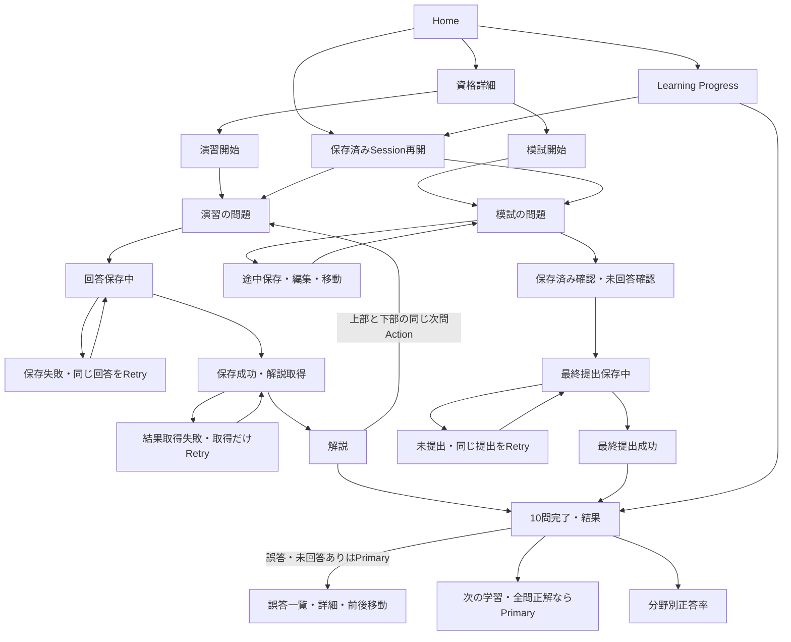

# Layout C 全画面Mockの検証記録

対象は[Issue #9](https://github.com/abi-yusuke-wada/refriq/issues/9)。[承認済み実行Plan](../../issue-9-plan.md)と[既存UX Contract](../../learner-ui.md)を維持し、Humanが暫定採用したCのみを全画面へ展開・検証した。最終承認を受け、採用確定とContractの確定反映を完了した。

**Layout CはHuman最終承認済み。learner-ui.mdへLearner UX Contractを確定反映済み。**

現在は12画面・必要状態の展開、初回UXレビュー7件・再レビュー4件・最終レビューMinor 2件の反映を完了し、同じ178ケースを最終Minor修正後と最終承認の表示更新後にも再実行済み。詳細は末尾の最終レビューMinor記録とHuman最終承認記録を参照する。

## Human Decision

Human final selection: **Layout C（2ペイン配置）**。暫定採用後の全画面Validation・承認指摘反映・再Validationを経て、Humanが最終採用を承認した。

- Main contentとSupporting informationの責務を明確に分ける。
- Homeで今行う学習と、継続・履歴を分離する。
- Resultで結果本体と、振り返り・誤答確認を分離する。
- Learning Progressで集計本体と、履歴・次の行動を並行表示する。
- 補助情報が増えてもMain contentを壊しにくい構成を使う。
- Bより管理画面感を抑え、Aより情報量を扱いやすくする。

Questionは集中を優先してrailを細くする。これらは[比較記録](../comparison.md)にも記録する。全画面Validationで重大問題があればHuman判断の比較Checkpointへ戻り、Codexが別案へ変更しない。

## 閲覧方法

[index.html](index.html)をブラウザで開く。Build、HTTPサーバー、外部Font、CDNは不要。PC幅1280px / 1440pxを確認基準とする。

各View上部は設計レビュー用の操作であり、Production UIの機能ではない。画面・状態・モードを切り替え、問題4で複数選択を確認できる。Question・解説の「設計検証用metadata」でQuestion identity、Revision、Snapshot参照を確認できる。

Fixtureは架空の設計メモと学習履歴であり、実試験問題や実際のPublishedデータではない。Sourceリンクも`example.invalid`の架空参照とする。

## 12画面と配置

| 画面 | Main content | Supporting rail |
| --- | --- | --- |
| [Home](view.html?screen=home) | 今日の学習、演習・模試の主CTA、学習概要 | 続きから学習、最近の履歴、資格の簡易情報 |
| [資格詳細](view.html?screen=certification) | 資格・分野・利用可能問題数、開始操作 | 継続学習、学習状況への導線 |
| [演習開始](view.html?screen=practice-start) | 10問・即時解説、開始条件、再開・終了確認 | 必要問題数、中断・再開の補足 |
| [模試開始](view.html?screen=mock-start) | 20問・時間制限なし、開始条件、再開・終了確認 | 必要問題数、中断・再開の補足 |
| [演習の問題](view.html?screen=practice) | 問題番号・方式・長文・設定例・選択肢・回答確定・Retry | 問題位置、確定件数、保存状態だけ |
| [模試の問題](view.html?screen=mock) | 問題・選択肢・編集・前後移動・最終提出・Retry | 問題位置、回答件数、保存状態、20問Navigation |
| [解説](view.html?screen=explanation) | 読取専用の問題、判定、正解、解説、Option Explanation、Source、次の操作 | 問題位置、確定済みの状態 |
| [結果](view.html?screen=result) | モード、正答数・率、完了時点、分野別結果。誤答ありは振り返りPrimary、全問正解は次の学習Primary | 振り返り、誤答一覧・詳細への導線 |
| [誤答一覧](view.html?screen=incorrect) | その回の誤答・未回答と詳細への導線 | 振り返りの対象、結果への導線 |
| [誤答詳細](view.html?screen=incorrect-detail&q=4) | 同じ誤答集合内の現在位置・前後移動、回答時点の問題・自分の回答・判定・理由・Source | 問題位置、確定済み状態 |
| [分野別正答率](view.html?screen=topics) | 分野別の正答数・対象回答数・率、未学習 | 集計対象の補足、結果・進捗への導線 |
| [Learning Progress](view.html?screen=progress) | 演習・模試切替、累積正答率・回答数、分野別集計 | 最近の履歴、継続学習、集計対象の補足 |

通常railは300px、Question・解説・誤答詳細は220pxとする。1280pxではQuestionのMainが968px、1440pxでは1048pxとなる。主操作はMainに置き、長い解説とSourceもMain下部で広く読む。

本文・選択肢の背景は白系。railは淡いLavenderとする。Cの情報設計原則を維持し、全画面へ同じ情報量のrailを機械的に適用しない。

## 必要状態

| 対象 | 切り替えられる状態 |
| --- | --- |
| Home・資格詳細・誤答一覧・分野別正答率・Learning Progress | Normal / Loading / 正常Empty / Fetch Error / Retry |
| 演習開始・模試開始 | Normal / 進行中Sessionあり / 一意Question数不足 / 開始準備中 |
| 演習の問題 | Normal / 未回答 / 保存中 / 保存失敗 / 保存成功・結果取得中 / 結果取得失敗 / 中断・再開 |
| 模試の問題 | Normal / 未回答 / 最新回答未保存 / 途中保存中 / 途中保存失敗 / 古い保存成功・最新未保存 / 最終提出保存中 / 最終提出失敗 / Submitted / 結果取得失敗 / 中断・再開 |
| 解説 | Normal / Loading / 保存成功後の結果取得失敗・Retry |
| 結果 | Normal / Submitted / 全問正解の固定例 / Loading / 正常Empty / Fetch Error / 保存・提出成功後の結果取得失敗・Retry |
| 誤答詳細 | Normal / Loading / 正常Empty / Fetch Error / Retry。模試では未回答の固定例も確認可能 |

RetryはLoadingまたは該当する保存中の表示例へ進む。レビュー欄から成功例・失敗例へ切り替える。自動Retry、実通信、保存要求、非同期応答は生成しない。

## Fixture / Data Boundary

```text
selected/
├── index.html
├── view.html
├── view.js
├── tokens.css
├── styles.css
├── validation.md
└── fixtures/
    ├── catalog.js
    ├── session-before.js
    ├── answer-after/
    │   ├── practice-01.js … practice-10.js
    │   └── mock-01.js … mock-20.js
    └── result-after/
        ├── currentPractice.js
        ├── currentPractice-new.js
        ├── currentMock.js
        ├── currentMock-new.js
        ├── historyPractice80.js
        ├── historyPractice70.js
        ├── historyMock85.js
        ├── historyMock70.js
        └── *-all-correct.js（上記8結果の全問正解表示例）
```

| Fixture | 内容・読み込み時点 |
| --- | --- |
| catalog.js | 資格・利用可能な一意Question数・過去の概要・履歴。Question Viewでは読み込まない |
| session-before.js | 固定されたQuestion identity・Revision・順序、問題・選択肢、User自身の選択・確定状態。正解・正誤・score・解説・Sourceは含めない |
| answer-after/ | 確定済みの1問だけの正解・判定・解説・Source。演習保存成功後、または模試最終提出成功後の解説Viewでのみ読み込む |
| result-after/ | 完了・最終提出済みの1 Sessionだけの結果・回答・Source。別の進行中Sessionの正解はまとめない |

各documentは必要なFixtureを1ファイルだけ読み込む。回答前・保存中・保存失敗・模試提出前のQuestionでは`session-before.js`だけを読み込む。SubmittedのQuestionも同じ回答前Fixtureを使い、結果・解説への移動後に初めて回答後Fixtureを読み込む。

演習1問の解説から未確定の別問題の正解を受け取らないよう、回答後Fixtureも問題単位に分割した。結果もSession単位で物理分割する。HTML・共通JS・非表示DOM・data属性には正解を先に埋め込まず、preloadや全Fixtureのbundleも作らない。

Static filesは設計成果物であり、Productionの認証・アクセス制御を実装するものではない。ここでは画面が受け取る情報の境界を再現する。

## 表示切替と保存・再開Contract

- 選択変更はブラウザ内の表示状態に反映し、失敗・Retryや問題移動で保持する。URLにはUser自身の選択と表示用状態だけを引き継ぐ。localStorage / IndexedDBは使わない。
- 保存・採点は実行しない。成功例の解説・結果は固定Fixtureを表示するため、自由に選び直した回答に応じて判定・scoreを計算しない。レビュー欄にこの制約を明示する。
- 演習保存中・保存失敗では編集・再確定・次問移動を止め、保存失敗のRetryは同じ選択を保持する。
- 保存成功後の結果取得失敗では確定済み状態を維持し、結果取得だけRetryする。回答を再保存しない。
- 模試途中保存中・失敗中は編集・問題移動を可能にする。古い保存成功の表示例でも最新回答は未保存のままで、最終提出を無効にする。
- 模試最終提出では未回答確認を挟む。保存中・失敗中は編集・問題移動を止め、失敗時は未提出のまま同じ提出をRetryする。
- 最終提出成功後の結果取得失敗は提出済みを維持し、結果取得だけRetryする。再提出しない。
- 中断時に最新回答が未保存・保存中・保存失敗なら中断完了として扱わない。保存済み状態から再開する例では同じSnapshot・QuestionRevision・順序を使う。
- 新Sessionの固定例は、既存Sessionの選択・確定状態を引き継がず、未回答から始める。既存Sessionを終了する操作には確認を挟む。

- 進行中学習のGlobal Navigationと「学習を中断してホームへ」は同じ中断確認を使う。保存済みなら「中断して移動 / 学習を続ける」、未保存なら離脱を止める。User自身の保存済み回答・位置・確定状態だけをレビュー用URLで保持し、同じSnapshotへ再開する。
- Product文言にはQuestion / QuestionRevision / Session / Snapshotを出さない。内部Contract、source code、review metadata、設計文書には残す。
- 演習の解説には上部と下部の同じ次問Actionを置く。全文を読むことを進行条件にしない。誤答・未回答ありの結果では振り返りがPrimary、次の学習がSecondary。全問正解なら次の学習がPrimary。
- 誤答詳細の前後移動は、そのResult / Historyの誤答・未回答集合に限定する。上部と下部に同じ現在位置・前後移動・先頭/末尾のdisabled理由を表示する。両方が同じNavigation定義を使う。Learning Progressの正常Emptyは資格詳細への「学習を始める」をPrimaryにする。
- 模試railは3列・番号18px・状態記号14px・最小高さ56pxとし、○ 回答なし / ✓ 回答あり・保存済み / ● 未保存 / ! 保存失敗 / 太枠とaria-currentによる現在位置を区別する。セルは大きな番号と記号、意味は12pxのLegendで表示し、長い状態文言のセル内折り返しを避ける。色だけに依存せず、aria-label・titleも回答有無・最新の保存状態に一致させる。回答を消した未保存変更も「回答なし・未保存」として最終提出を止める。
- Empty / Fetch Errorの内部名・正常Emptyと失敗の実装上の違いはレビュー欄で確認する。Product本文は学習履歴なしと開始案内、または読込み失敗と再取得案内だけを表示する。

このURL上の状態はStatic Mockを確認するための表示方法であり、API Payload・Persistence・Concurrency実装の仕様ではない。

## Wireflow確認



開始前に必要問題数を確認し、Questionを選び、開始時点Published Revisionと順序をSnapshotへ固定する既存Contractは変更しない。Mockでは固定済みFixtureだけを表示し、抽選・Published判定・Snapshot保存は実装しない。

## Brand DirectionとContrast

正式なBrand Guideline / TokenはRepository内に見つからなかったため、Human指定値を`tokens.css`へ集約した。会社の正式カラーとは扱わない。

| 用途 | 暫定Token |
| --- | --- |
| Primary CTA・active Navigation・selected tab・Progress | `--brand-primary: #4b2a7b` |
| Primary hover | `--brand-primary-hover: #3d2266` |
| 強いBrand表示 | `--brand-primary-strong: #321a59` |
| 補助文字・focus | `--brand-secondary` / `--focus-ring: #75609a` |
| Supporting surface | `--brand-surface: #f5f2f9` / `--brand-surface-strong: #eee8f5` |
| 読む面 | `--surface-card: #ffffff` |
| 正解・保存成功 | `--success: #287a52` |
| 未保存・不足・確認 | `--warning: #9a6700` |
| 不正解・Error | `--error: #b42318` |

色だけに依存せず、「✓ 選択中」「✓ 正解」「! 不正解」「未回答」「保存失敗」等の文字、native input、枠、Navigationの現在位置を併用する。

## 初回全画面Validation結果

以下の初回・各レビューのValidation記録は、その時点の結果を保存した履歴である。「Human承認待ち」「暫定採用」の記述は最終承認前の状態であり、現在の状態は冒頭と末尾のHuman最終承認記録を参照する。

Chromiumのローカル`file://`表示で、合計126ケースを確認した。ブラウザ検証用のツール・結果JSON・スクリーンショットはRepository外の一時領域に保存し、Runtime dependencyへ追加していない。

| 確認 | 結果 |
| --- | --- |
| 12画面 × PC幅1280px / 1440px | 24ケース成功。横方向のはみ出しなし。Main幅はrailの2倍以上 |
| 必要状態 | 60ケースと模試側の追加26ケース成功。Loading・正常Empty・Fetch Error、保存・提出・結果取得の失敗を区別 |
| 操作・履歴・Accessibility | 16ケース成功。選択保持・Retry・未回答確認・再開・回答時点Revision・モード別集計・focusを確認 |
| Questionの幅 | railは220px、Mainは1280pxで968px、1440pxで1048px。長い日本語問題・設定例・単一選択・複数選択を確認 |
| 回答前Data Boundary | 読み込みscriptとFixtureを確認。回答前Viewに回答後Fixture・禁止項目・正解情報なし |
| 回答後Fixture | 解説は確定済み1問、結果は完了済み1 Sessionだけを読み込む。別の未確定問題・進行中Sessionの正解を含めない |
| Snapshot / 問題数 | 演習10問・模試20問のQuestion identityと順序が一意。回答前後のstem・options・Revisionが一致。新Sessionは既存回答を引き継がない |
| 演習保存・結果取得 | 保存失敗は回答を保持してRetry。保存中は編集・次問移動不可。保存成功後の取得失敗は結果取得だけRetry |
| 模試途中保存 | 編集・Navigationが可能。古い保存成功後も最新回答は未保存で最終提出不可。問題移動後も選択と未保存状態を保持 |
| 模試最終提出 | 未回答確認、保存中の操作制限、失敗時の未提出・回答保持・Retry、成功後の取得だけRetryを確認 |
| 中断・再開 / History | 同じSnapshot・Revision・順序で再開。未保存時は中断完了扱いにしない。履歴では回答時点Revisionを表示 |
| Accessibilityの基本確認 | キーボードfocusの3px outline、選択中の文字表示、native inputを確認。正式な認証は行っていない |
| Contrast | 使用する文字・背景11組すべて4.5:1以上。本文/白16.00:1、白/Primary 10.96:1、最小はWarning/補助背景4.56:1 |
| 外部通信 / JavaScriptエラー | 検証中のHTTP通信・page errorともに0件 |
| Repository標準Validation | `make check`成功。Format・Lint・Typecheck・既存テスト68件・Nixチェック成功 |
| 差分確認 | `git diff --check`成功。untrackedファイルも直接確認。既存13ファイルを編集前コピーと比較し、変更は比較記録と比較入口の2ファイルだけ |

README、承認済みPlan、`learner-ui.md`、既存A/B/C比較View・Fixtureを維持した。Productionの`apps/`・`packages/`、package manifest、lockfile、Build設定は変更していない。

検証中に見つかった新Sessionの確定件数表示の持ち越しは修正し、未回答開始・再開のケースで再確認した。Question identity等の設計用metadataはレビュー欄へ移し、学習本文の情報密度を抑えた。現時点でLayout Cの最終採用を妨げる重大な問題は確認されていない。**最終採用はHuman承認待ち。**

成功応答・採点・結果は固定Fixtureであり、Userが自由に変更した回答への実採点や保存は検証していない。API・DB・Persistence、Mobile最適化、最終Visual polishは後続Issueの範囲とする。

## 承認済みUXレビュー7件の反映と再Validation

Humanが7件すべてを承認したため、Cの情報構造を維持して修正した。Layout A/Bへ変更せず、Layout Cの最終採用も確定しない。

| No. | 状態 | 修正 | 実ブラウザ確認 |
| --- | --- | --- | --- |
| 1 | 反映済み | Product文言のQuestion / QuestionRevision / Session / Snapshotを自然な日本語へ変更。内部Contract・レビュー用metadataは維持 | 主要画面と開始条件・再開周辺のProduct表示に内部用語がないことを確認 |
| 2 | 反映済み | Global Navigationと明示的中断で同じ確認を表示。保存済みは中断して移動 / 学習を続ける、未保存は離脱Blocking | 演習・模試からHome / 資格詳細 / 学習進捗への確認・取消・移動・再開。新Sessionの同じSnapshot・Revision・位置・自分の回答を維持。演習解説からも確定回答を維持 |
| 3 | 反映済み | 演習解説の上部に判定・正解と次問CTA、下部CTAを維持。両方が同じ遷移先 | 上部CTAがviewport内にあり、上下リンクが一致。次問4の複数選択、10問目の結果遷移を確認 |
| 4 | 反映済み | 誤答・未回答ありは振り返りPrimary / 次の学習Secondary。全問正解は次の学習Primary | 演習・模試それぞれの誤答あり / 全問正解を確認。元の結果Fixtureは変更せず、8つの結果ごとに別の全問正解Fixtureを追加 |
| 5 | 反映済み | 誤答詳細に現在位置・前後移動・境界のdisabledと理由を追加。一覧・結果への導線を維持 | 演習・模試の現行結果とHistoryの4集合で先頭→末尾→先頭を連続確認。Result参照と回答時点Revisionを維持 |
| 6 | 反映済み | Learning Progressの正常Emptyへ「学習を始める」Primaryを追加し、資格詳細へ遷移 | Empty→資格詳細と、Fetch Error→再取得→Loadingを別々に確認 |
| 7 | 反映済み | 模試railを3列、番号18px・記号14px・Legend 12pxへ変更。現在問題は太枠・aria-current | 全20セルが44px以上の幅・高さ、現在枠3px、focus3px、✓/○/Legend、複数選択への移動を確認 |

### 実施結果

- 既存の全画面回帰を更新して128ケース成功：PC表示24、通常/状態61、模試側の追加状態27、操作・History・Accessibility16。
- 今回の承認指摘を対象とする27ケース成功。演習開始から10問の確定・解説・次問・結果、模試開始から途中保存・Navigation・最終提出・結果までを確認した。
- 合計155ケースでHTTP通信・JavaScript page errorは0件。保存・取得成功はレビュー用固定例であり、実API・実採点を確認したものではない。
- `make check`成功。Format・Lint・Typecheck・既存テスト68件・Nixチェックを再確認した。Nix cacheへの書込み制限でsandbox内の実行が停止したため、sandbox外で同じチェックを再実行して成功した。
- 回答前・保存中・失敗時・再開時・模試提出前に回答後Fixtureを読み込まない。回答前Fixtureの禁止項目不在、DOMの正解・Source不在、既存Question identity・Revision・順序の一致を再確認した。
- 全問正解Fixtureも1つの完了済みSession単位で物理分離する。既存の回答前Fixture、回答後1問Fixture、元の結果Fixtureは保持した。
- Review Snapshotは12画面・主要状態5例を更新し、全問正解・誤答末尾・中断確認・未保存Blocking・複数選択の8例を追加済み。25ページのPDF・ZIP・manifestも更新済み。Snapshotは仕様の正本ではない。中断確認3例は実際の1280×900px viewportを撮影した。
- `git diff --check`とuntrackedファイルの直接確認を実施。編集前82ファイルをRepository外へコピーして保護し、既存の未コミット変更を保持した。Productionのapps/・packages/・dependency・Build設定には変更を加えていない。

検証後の状態は**Layout C暫定採用・Human最終承認待ち**。確認範囲で採用を妨げる重大なLayout問題は見つかっていない。承認済みPlanは変更せず、`learner-ui.md`は進行状況だけを更新し、採用確定内容・Contractの最終反映はHuman承認後とする。

## 承認済み再レビュー4件の反映と再Validation

Humanが4件を全件承認した。作業前の98ファイルをRepository外へbaseline copyとして保護し、承認済みPlan・A/B/C比較実装・Fixture・Runtime dependencyを変更せず、Cの表示と関連文書だけを更新した。Cは引き続き暫定採用。

### 途中保存の既存Contractの確認

Plan §5.4 / §5.5とlearner-ui.mdは「その保存要求に含まれる回答状態にだけ保存成功が成立する」と定めている。問題単位のAPI、Session全体のAPI、DB書込み単位は未定義である。現行Mockでは`dirty`と途中保存状態を問題移動後も共通に保持しているため、今回のProduct案内は**模試の途中状態の保存**として明示する。問題別の印は回答有無と最新回答の表示状態を区別するためのもので、問題単位Persistenceを新たに定義するものではない。

| railの表示 | 意味 | Accessibility |
| --- | --- | --- |
| ○ 回答なし | 選択がない | aria-labelに回答なし |
| ✓ 保存済み | 回答があり、その最新状態の保存成功を確認した表示例 | aria-labelに回答あり・保存済み |
| ● 未保存 | 最新回答の保存成功が未確認。保存中・stale後も含む | aria-labelに回答あり・未保存。回答削除なら回答なし・未保存 |
| ! 保存失敗 | 保存できなかった対象回答。移動しても対象の印を維持 | aria-labelに回答有無・保存失敗、Error色と文字 |
| 太枠 | 現在の問題。上記の保存状態と独立 | aria-current="step"、aria-labelに現在の問題 |

回答変更直後にrailを更新する。失敗後に回答を変更した場合は、最新変更を未保存として表示する。失敗NoticeとRetryは別問題でも模試の途中状態を対象と明示し、現在問題の保存失敗と誤認させない。Retry中は未保存を維持し、最新回答の保存成功例を確認した後に保存済みへ変える。古い成功例では未保存を消さず、未保存の回答や回答削除がある間は最終提出を無効にする。

`pending` / `failed`等のレビュー用URL表示はUser自身の回答状態だけを扱う。要求の生成・非同期応答の照合・耐久保存は行わず、request sequence、optimistic concurrency、idempotency等の方式は決定しない。

### 修正内容と実ブラウザ確認

| No. | 状態 | 修正内容 | Validation |
| --- | --- | --- | --- |
| 1 | 反映済み | 回答有無と保存状態・現在位置を分離。意味が一致するLegend / aria-label、模試全体の途中保存失敗案内とRetry対象を明示 | 回答なし→選択→保存中→成功→最新変更→stale→保存失敗→別問題移動→Retry→成功。影響のない回答は保存済みを維持、対象問題だけ未保存・失敗。回答削除も提出Blocking |
| 2 | 反映済み | 誤答詳細上下に同じNavigationを配置。次Primary / 前Secondary、一覧・結果への導線を維持 | 現行演習・模試とHistoryの4誤答集合でSourceの下までスクロールして下部Next、上下リンク一致、末尾Next無効、下部Previousを確認 |
| 3 | 反映済み | 正常Emptyの内部説明・Fetch Error名・失敗とEmptyの設計説明をProduct本文から除去 | Learning Progress Empty→資格詳細、Fetch Error→再取得→Loadingを確認。他の主要読取画面のEmpty / Errorにも内部説明がない。内部状態名はレビュー欄で確認可能 |
| 4 | 反映済み | learner-ui.mdの受入状況と進行状況を現実へ更新。12画面・状態・Review・ブラウザ確認を実施済み、Human最終採用と最終Contractは未完了 | 現行Mock、Validation記録、画面フロー、Snapshotを根拠に文書確認。Contract本文・最終採用状態を変更していない |

### 実施結果

- Chromiumのローカル`file://`表示で既存回帰128ケース、前回7件の操作回帰27ケース、今回の操作検証23ケース、合計178ケースが成功。HTTP通信・page errorともに0件。
- 12画面を1280px / 1440pxで確認し、横方向のはみ出しなし。QuestionのMain幅、長い日本語・設定例、Single / Multiple Select、Source、focus、状態文字12px以上・セル44px以上・現在枠3pxを再確認した。
- 演習10問の開始→保存→解説→Next→結果、保存失敗Retry、模試開始→途中保存→移動→最終提出→結果、中断確認→同じSnapshotから再開、結果の誤答優先CTAと全問正解CTA、Empty開始導線を回帰確認した。
- 回答前・途中保存中・失敗・stale・最終提出前で、回答後Fixtureと結果Fixtureのscript読込み・グローバルObject・解説 / Source DOMがない。回答前Fixtureの禁止項目不在、固定identity・Revision・順序も維持。
- Snapshotは12通常画面と従来13状態・操作例を更新し、模試途中保存失敗・最新未保存の2例を追加。PNG 27枚、PDF 27ページ、manifest・ZIPを更新済み。画像は仕様の正本ではない。
- Browser起動はsandboxのソケット制限で停止したため、同じローカル検証をsandbox外で再実行した。実API・保存・採点・応答順序の実装を検証したものではない。
- `make check`成功。Format・Lint・6 WorkspaceのTypecheck・既存テスト68件・Nixチェックを確認。Nix cache書込み制限のためsandbox外で再実行した。`git diff --check`とuntrackedファイルの直接確認を実施。Production code・Runtime dependencyへの変更なし。

確認範囲でCの採用を妨げる重大なLayout問題は見つかっていない。**Layout C暫定採用・Human最終判断待ち**を維持し、別案へ変更しない。learner-ui.mdは受入状況・進捗のみを更新し、最終Contract確定は行っていない。

## 承認済み最終レビューMinor 2件の反映と再Validation

作業開始時の100ファイルをRepository外へbaseline copyとして保護した。変更は保存済み状態の文言と現在状態のDocumentation・Review Snapshotに限定し、承認済みPlan、Layout Cの構造、Fixture、既存UX Contractを維持した。

| No. | 状態 | 修正内容 | Validation |
| --- | --- | --- | --- |
| 1 | 反映済み | 模試rail上部の「✓ 最新回答は保存済み」を「✓ 最新の状態は保存済み」へ変更。現在問題の回答有無を意味しない表現にする | 通常の問題6が未回答でも新文言と○ 回答なしが併存。aria-live="polite"の本文も一致。回答あり・保存成功後にも同じ文言。未保存・保存中・失敗・stale・最終提出Blockingは維持 |
| 2 | 反映済み | comparison.md冒頭を7件・4件・Minor 2件反映、12画面・必要状態展開・再Validation完了、Human最終判断待ちへ更新 | learner-ui.md、比較記録、検証記録、画面フロー、Snapshot説明の現在状態を照合。最終採用・最終Contractは未承認のまま |

### 実施結果

- 既存回帰128ケース、初回7件の操作回帰27ケース、再レビュー4件の操作回帰23ケース、**合計178ケースを再実行して成功**。既存ケース内に未回答問題・保存成功後の文言とaria-liveの確認を追加した。前回との累積件数にはしない。HTTP通信・JavaScript page errorは0件。
- Learner向け内部Domain用語、中断・Global Navigation・Resume、Explanation上下Next、結果別CTA、誤答詳細上下Navigation、Empty開始・Error再取得、rail可読性と回答 / 保存状態分離、stale、失敗 / Retry、Final Submit Blockingを回帰確認した。
- 回答前と模試最終提出前はbefore Fixtureだけを読み込む。正解・正誤・score・解説・Option Explanation・Sourceの禁止項目が回答前Fixtureになく、回答後script・Object・DOMの先読みもない。48 Fixtureファイルは変更していない。
- 27既存Snapshotを再撮影し、現在問題が未回答・模試全体の状態は保存済みである例28を追加。PNG 28枚、PDF 28ページ、manifest・ZIPを更新。画像はReview用であり仕様の正本ではない。
- `make check`、`git diff --check`とuntrackedファイルの直接確認を実施。Production apps/・packages/、Runtime dependency、Domain、API、DBへの変更なし。

確認範囲でMajor / Criticalは見つかっていない。**Layout CはHuman暫定採用、全画面展開・UX Review・再Validationは完了。最終採用とlearner-ui.mdの最終Contract確定はHuman判断待ち。** 保存・採点・結果は固定Fixtureの表示確認であり、実API・Persistenceの確認ではない。

## Human最終承認とContract確定

最終確認「Layout Cを最終採用し、Issue #9のLearner UX Contractとしてlearner-ui.mdへ確定反映してよいですか？」へのHumanの「OK！」に基づき、Layout Cを最終採用した。自動採用ではなくHuman Decisionであり、既存UX Contractを維持する。

- `learner-ui.md`へ採用理由、12画面のMain / Supporting rail配置、Questionの簡略C、レビューで承認された操作・状態表示、紫系の暫定Brand Token、Validationの根拠を確定反映した。
- 比較記録・画面フロー・Review説明・レビュー用操作の現在状態をHuman最終承認済みに揃えた。過去の暫定採用・承認待ち記録は各時点の履歴として保持する。承認済み実行Planは変更しない。
- 表示更新後にChromiumのローカル`file://`で既存回帰128ケース、初回レビューの操作回帰27ケース、再レビューの操作回帰23ケース、合計178ケースを再実行して成功した。ケースを累積加算しない。HTTP通信・page errorは0件。
- 中断・再開、解説上下Next、結果別CTA、誤答上下Navigation、Empty開始・Error再取得、模試の回答有無 / 保存状態 / stale / Retry / 最終提出Blockingを回帰確認した。回答前・最終提出前のFixture読込み境界も維持する。
- `make check`成功。Format・Lint・Typecheck・既存テスト68件・Nixチェックを確認した。最終承認表示の現行MockからPNG 28枚・PDF 28ページ・manifest・ZIPを更新した。画像はReview用であり仕様の正本ではない。
- Production code、Runtime dependency、Fixture、CSS Token、既存の保存・採点・抽選・Session Contractには変更を加えていない。Production実装、GitHub Issue更新、git add / commit / push / PR作成は実施しない。

## PR向けの成果物整理

Humanが採用CのMockを残す方針を承認した。CのHTML / CSS / JS / Fixture一式、A/B/C比較、採用・検証記録、画面フロー、PNG Snapshot 28枚、承認済みPlan、UX Contract、既存ADRを保持する。

内容が重複する配布用PDF・ZIPはRepository外にbaseline copyを保護したうえで除去した。上記Validation・レビュー履歴に記載したPDF・ZIPの作成は各時点の実施記録であり、現在のPR成果物には含めない。Review資料の参照はPNG・Static Mock・文書へ揃え、manifestの番号はSnapshot番号として管理する。Mockの実装とUX Contractは変更していない。

## Handoff / 未決事項

- User × Certification × Modeの進行中Session最大1件、Practice 10問、Mock 20問、一意Questionでの不足判定・重複禁止、Revision・順序固定を維持する。
- Publishedの意味、Source Governance、Human Review / Pipelineの責務は#6 / #7 / #8を変更しない。
- Historyは実際に回答したQuestionRevisionを使う。Historical Revision / Sourceの後日利用不可はSource Governance・履歴表示Issueへ残す。
- Active Session Snapshot内のRevision / Sourceの後日利用不可はSource Governance・Session実装Issueへ残す。再抽選や終了等を勝手に決めない。
- Request sequence、Idempotency、Transaction、API Error Schema、DB Schema、Persistence、Production Reactは後続Issueの責務とする。
- Reviewer UI、Exam Feedback入力、Authentication、Production LLM、Mobile polish、最終Visual polish、Runtime Design System、Design Tool integrationは今回実装しない。
- `learner-ui.md`へHuman最終承認に基づく採用理由・12画面の配置・Questionの簡略C・承認済み操作・Brand方向・Validationを確定反映済み。Production実装は後続Issueの責務とする。

今後重大なLayout問題が見つかった場合も、Humanへ具体的な画面・状態・影響を報告し、比較CheckpointでHumanが再判断する。Codexが自動で別案へ変更しない。
