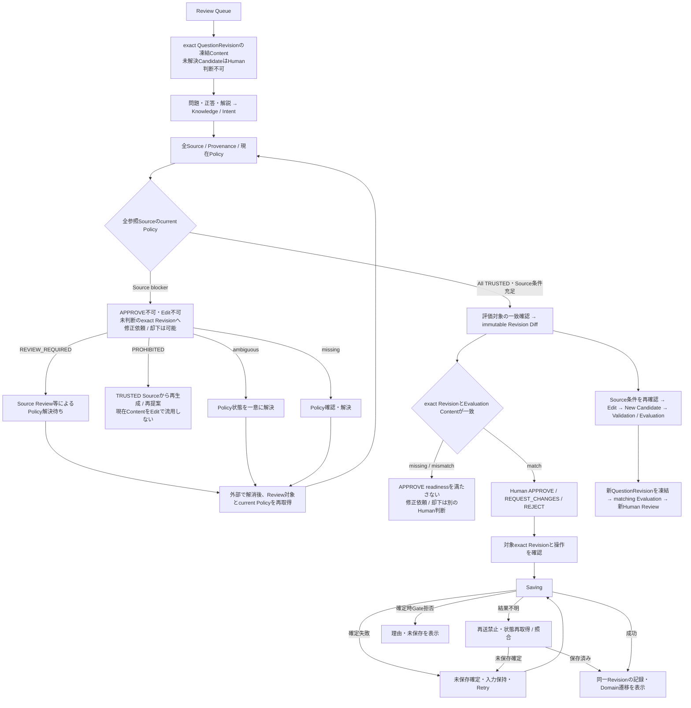
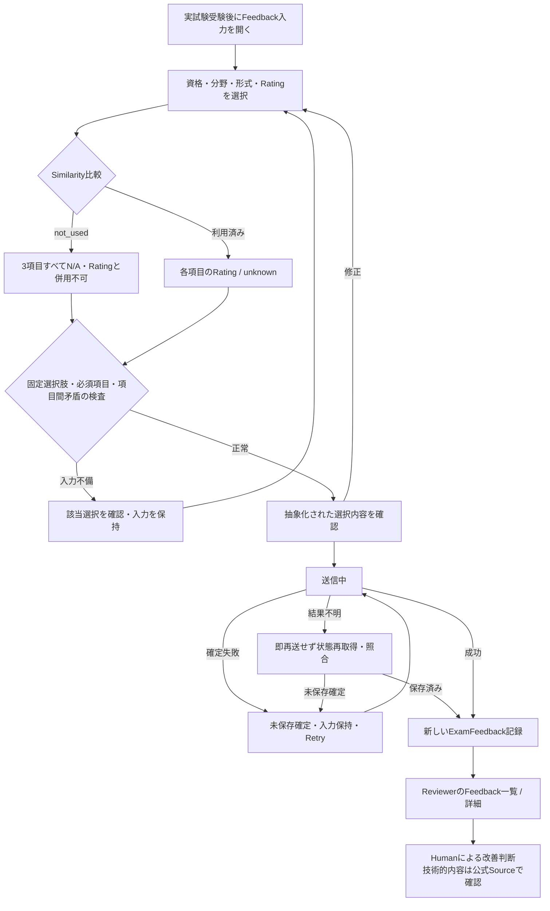

# Reviewer画面と受験Feedbackの体験

Humanが承認したI-01〜I-06、R-01〜R-04とN-01（Source blocker中はEdit禁止）を反映したUX契約。変更内容は[指摘対応](reviewer-ui-assets/issue-10-review/review-findings.md)を参照。

対象は[Issue #10](https://github.com/abi-yusuke-wada/refriq/issues/10)。[実行計画](issue-10-plan.md)と[実装前のIssueコメント](https://github.com/abi-yusuke-wada/refriq/issues/10#issuecomment-5970085479)に従う。Domainの正本は[用語集](../domain/glossary.md)、[Lifecycle](../domain/lifecycle.md)、[Sourceガバナンス](../domain/source-governance.md)。Pipeline出力は[Architecture](../architecture/README.md)と[Stage契約](../../packages/application/src/pipeline/contracts.ts)を参照する。

## 成果物と閲覧

[操作Mock](mockups/reviewer/index.html)をブラウザで開く。Build・Backend・外部Font・CDNは不要。PC幅1280px / 1440pxを基準とする。Mockは架空のCertification / Source / Question / Feedbackを使用し、実試験問題を使用しない。公式Source URLの表示欄には架空の公式相当URL `https://docs.example.test/gateway/routes` を表示する。実SourceのTermsや利用許可をこのFixtureで主張しない。

紫・白を基調に、Reviewerが内容と生成意図を比較し、続けて根拠・評価・差分・Human判断を確認する独立した配置とした。Issue #9の未マージファイルはコピー・importせず、共有Design Systemを作らない。

上部の「設計検証の状態」と「Mockを初期化」は設計レビュー用操作。保存・送信・公開はメモリ内の模擬動作であり、Reloadで初期化する。検証結果は[検証記録](mockups/reviewer/validation.md)に記載する。

## レビュー対象と既存の判断境界

| 概念 | この画面での意味 |
| --- | --- |
| Question | 同じ学習意図のstable identity。現在公開中のRevision参照を持つ。本文の訂正ではIdentityを変えない。 |
| QuestionRevision | Identity付与時点で内容が凍結されたDomain Revision。内容を直接更新しない。 |
| QuestionRevision Candidate | PipelineのApplication出力。Run内のCandidate IDをDomain Revision IDとして使用しない。KnowledgePointもCandidate IDの段階である。 |
| QuestionIntent / QuestionPlan | Intentは学習目標・対象Concept・形式・制約。QuestionPlanは独立したDomain Entityではない。 |
| Question Evaluation | Schema検証済みのAI評価。`PASS / REVISE / REJECT`、Criterion別`PASS / CONCERN / FAIL`、Findings、曖昧さ、前提を判断材料として読む。 |
| Human Review / QuestionReview | Humanが正確なDomain QuestionRevisionへ記録する`APPROVE / REQUEST_CHANGES / REJECT`。Reviewer・日時・対象IDを明示する。AI評価で代替しない。 |
| SourceReview | Source利用適格性の判断。`APPROVED_FOR_USE / REJECTED / NEEDS_MORE_INFORMATION`。QuestionReviewと別の記録である。 |
| ExamFeedback | 実試験後の抽象的な体験Signal。個別問題のReview・修正依頼や技術的な正答根拠ではない。 |

`PASS != Human APPROVE != Source APPROVED_FOR_USE`。Issue #8コメントの`Human Review APPROVED`は概念例であり、現在のDomain decisionは`APPROVE`である。MVPでは`APPROVE`とPublishは同じDomain遷移で、独立した`APPROVED`状態・別Publish操作・自動Approveを追加しない。

## Reviewerの責務と変更範囲

Reviewerは、正答候補だけでなく誤答理由、学習意図、出典の該当箇所、評価の指摘、前Revisionからの変更を確認する。QueueでもAI評価・Human判断・Domain状態・Source分類を別の列で表示する。

| 情報 | Reviewerの操作 | 制約 |
| --- | --- | --- |
| Stem / Options / 正答候補 / 解説 / Option Explanation | Source条件を満たす場合だけEditから新しい作業候補を作る | Source blocker中はEdit不可。元Revisionを更新しない。Option IDはこのMockでは維持。単一選択は正答1件、複数選択は1件以上。 |
| Topic / KnowledgePoint / Source参照 | Source条件を満たすRevisionで、同じ学習意図に属する利用可能な参照を選択する | Source差し替えで元Revisionのblockerを迂回しない。 TopicはKnowledgePointから辿る。MockはKnowledgePoint 1組と複数Source・同Locatorの別SourceRevisionを表示。Sourceの利用分類・既存KnowledgePoint定義をこの画面で変更しない。 |
| Question / Revision ID、公開参照、前Revision | 閲覧 | UIでID解決や系列変更を行わない。学習意図を変える案は別Questionとして後続Use Caseへ渡す。 |
| Intent / Difficulty / Question Type | このMockでは閲覧 | 解決済みReviewではexact Revisionの値、未解決ではCandidateの値を表示する。方式変更のProduction編集UIは先取りしない。 |
| SourceRevision / Terms / Policy / SourceReview | 閲覧 | 取得時Snapshotは不変。Source利用可否の再判断は別のSourceReview責務。 |
| Validation / Evaluation / Stage metadata | 閲覧 | HumanがAI結果を書き換えたり、編集前のPASSを編集候補へ流用したりしない。 |
| Human decision | 確認後、特定Revisionへ記録 | 1 Revisionに決定記録は最大1件。記録後の更新・削除・再判断はしない。 |
| 提出済みExamFeedback | 閲覧 | Immutable。訂正は新しいFeedback。Reviewerが受験者の選択を改変しない。 |

## Reviewerのワイヤーフロー

### Queueと詳細

Queueの行は「何をレビューしているか」を示す入口。Candidate ID、Domain Revisionの有無、現在公開中Revision、AI評価、Human判断、現在Source分類を確認する。評価の`REVISE / REJECT`はStageの技術的失敗と混同しない。該当候補は指摘を読めるが、通常のApprove操作へ進めない。

詳細は内容とContextを横に並べ、同じページのSource・評価・差分・判断へ移動する。前Revisionとexact対象Revisionの凍結Contentを比較する。形式、問題文、選択肢、正答、解説、選択肢ごとの説明、Language、Difficulty、stable KnowledgePoint関係、QuestionSource関係・取得時Decision、凍結時QuestionIntentの11項目を表示する。所属Revision IDは各欄に表示し、QuestionSourceの変更判定からのみ除外する。QuestionSource関係、KnowledgePoint ID（凍結Intent内も含む）、正答IDは順序を持たない集合としてcanonical比較する。QuestionSourceはSourceRevision / KnowledgePoint / Usage Purpose / Relation / 取得時Decisionの全値で安定比較し、元配列を変更しない。Optionsの表示順とIntentのconstraints等の配列順は維持し、順序変更もDiffへ表示する。現在Policy・現在Terms・LifecycleはContent Diffへ入れない。初版は「前Revisionなし」。前Revisionの取得失敗を差分なしと扱わない。

### CandidateとDomain Revisionの接続

現在のPipelineはDomain Question / QuestionRevision / QuestionSourceを作らない。Productionの後続Use Caseには、同じIntentのQuestion選択、KnowledgePoint stable ID解決、固定Contentへの新Revision ID付与、各KnowledgePointへのQuestionSource作成、`DRAFT → REVIEW_REQUIRED`が必要である。

MockのDomain IDはこれらの接続が済んだ状態を示す仮の読取投影であり、ID割当Use Caseの実装ではない。未解決Candidateでは全Human decisionを記録できない。Candidate IDを`questionRevisionId`へ代入しない。

Read Modelの`reviewTargetRevision`はexact QuestionRevisionの凍結Contentと正確なQuestion / Revision ID、Language / Difficulty、stable KnowledgePoint関係、QuestionSource関係、凍結時Intentを保持する。これはUX読取投影で、Domain Schemaの追加ではない。Stem・Options・正答・解説・Context・Source関連・Diff・Human確認はこの対象から読む。Lifecycleは`revision.state`へ分離する。生成元Candidateは別metadataとして表示し、Contentが違ってもReview正本へ読み替えない。KnowledgePoint説明等はstable IDで関連する別読取投影から取得する。Candidateの評価は生成元の判断材料であり、Contentが違うRevisionへ検証済み結果として引き継がない。

`content-mismatch` FixtureではCandidateとRevisionの本文・選択肢・解説を意図的に異ならせる。このCandidateのPASSは対象Revisionへ適用せず、APPROVE readinessを満たさない。REQUEST_CHANGES等のHuman Recordも表示したexact Revision IDへだけ記録する。対象ID・Question IDの投影が不一致ならCandidateへFallbackしない。

### Evaluation対象とReview readiness（R-01）

Evaluationは評価したContentを持つ。既存`QuestionEvaluationInput.question`とIntent / Knowledge / Grounding Context、`QuestionRevisionCandidate.candidateId`を再利用し、評価時Inputと凍結時ID解決の対応を後続Applicationが保持する。現在Pipeline OutputにはDomain Revision ID・生成Question ContentのFingerprintがない。既存`immutableInputFingerprint`はCertification / ExamTopic / Source Snapshot / Groundingを識別するPipeline入力用であり、生成QuestionやRevision Contentの一致証明へ流用しない。

Mockの`reviewEvaluation`は`targetKind`、既存Candidate ID、exact `questionRevisionId`、評価対象の`evaluatedContent` Snapshot、既存Evaluation Result / reviewEligibilityを保持するUX読取投影。新Domain enum / API Schemaではない。SnapshotのQuestion / Revision ID、全11 immutable Content項目、QuestionSourceの所属IDをexact `reviewTargetRevision`と照合する。順序を持たない集合だけcanonical比較し、Options等の順序は維持する。

一致する対象のPASSと既存`ELIGIBLE_FOR_HUMAN_REVIEW`だけをAPPROVE readinessの評価条件に使う。別Candidate ID、別Revision ID、別Content、対象未解決、matching Evaluation欠落は適用不可で、Candidate側のPASS / reviewEligibilityへfallbackしない。Queue・Evaluation・Human判断欄に一致 / 不一致 / 未確認を表示し、不一致または未確認はAPPROVEを無効化する。REQUEST_CHANGES / REJECTはexact対象の別のHuman判断として残す。

このreadinessはReviewer / Applicationの対象確認であり、Accepted ADRやDomain Publish Gateに新しいenum・Invariant・公開条件を追加しない。一致PASSでもHuman Recordなしでは公開しない。MVPのHuman APPROVEがPublish遷移であり、別Publish操作を作らない。

`ready`は一致PASS、`content-mismatch`はCandidate AへのPASSと異なるRevision B、`evaluation-missing`はexact Revisionが存在してもmatching Evaluationなしの回帰例。通常Fixtureのexact評価は独立した架空の表示投影であり、実評価を実行した結果ではない。Productionで現在targetを後付けコピーしてCandidate PASSへ結びつけてはならない。検証済みEvaluation Inputとmaterialization時の対応から評価時Snapshotを復元できる場合だけ、exact対象へ接続する。実処理・Hash方式・Backend接続は今回実装しない。

### Human decisionと公開

「承認して公開」は、対象Revision、Reviewer、公開参照の切替と既存回答の維持を確認してから実行する。修正依頼・却下も、対象Revisionと記録の不変性を確認する。キャンセルで記録は作らない。

Productionでは既存[canPublishQuestionRevision](../../packages/domain/src/source-governance.ts)とLifecycleをUse Case境界で検査する。UIの表示・ボタン無効化だけで認可しない。各KnowledgePointのQuestionSource、取得時Provenance、現在Source Policy、同じRevisionへのHuman `APPROVE`を確認する。Approve完了・公開参照切替は保存整合性を含めた成功後だけを表示する。

確認後に現在Policyが変わった場合も公開を拒否する。Mockの「承認確認後のPolicy変更」で失敗を再生できる。`APPROVED`という中間状態は作らず、失敗時にHuman記録やCurrent Published Revisionの成功を推測しない。保存の確定失敗と結果不明は、Human Review・Edit・Feedbackの共通UXとして分離する。

| 保存結果 | 表示と次の操作 | 契約 |
| --- | --- | --- |
| 確定失敗 | 「保存できませんでした。この操作は保存されていません。」→ Retry | 未保存が確認済み。入力を保持する。現在の`save-error`がこの例。 |
| 結果不明 | 「保存結果を確認できません。」→ 状態再取得 / 結果照合 | 即再送、別Human decision、編集、画面移動、確認破棄を抑止。保存済みなら結果を表示し、未保存確定の場合だけRetryを許可する。 |
| 成功 | 同一RevisionへのHuman RecordとDomain遷移を表示 | 2件目の決定記録を作らない。 |

Mockには`save-unknown-saved`と`save-unknown-unsaved`を設ける。前者は応答喪失の前にメモリ上の記録を1回だけ行い、照合で既存結果を表示する。後者は記録せず、照合後だけ未保存確定のRetryへ進む。照合処理自体は保存しない。これは設計上の状態であり、Domain Lifecycle enumではない。ProductionのAPI・idempotency・排他・Transaction方式は実装しない。再取得しても不明のままなら再送禁止を続ける必要がある。

### Editと修正依頼の区別

`REQUEST_CHANGES`は元のDomain RevisionへのHuman decision。Editは、現在利用可能なSourceに基づくRevision Contentを変更し、新しい作業候補へ戻す操作である。Edit自体をQuestionReviewとして記録しない。

N-01の採用方針として、元Review対象RevisionにSource blockerがあればEditを許可しない。SourceReferenceを外す / 差し替えるだけで元Contentをコピーした新Candidateを作る経路は提供しない。通常のEdit初期化・submit・保存確定時にも元対象のSource条件を確認する。`#edit/<blocked>`へ直接到達した場合は編集フォームを作らず、候補作成不可の原因とRemediationを表示する。送信を直接発火しても候補を作らない。Source条件が途中で不成立になった場合も保存を拒否し、原因・次の行動を表示する。

新候補を保存しても、元Revision、過去Evaluation、Human Review、Source Snapshot、現在公開中Revisionは変更しない。編集候補の評価は引き継がず「再評価待ち」と表示する。新候補はDomain Revision未作成でApproveできない。Editの初期内容もexact Revisionを使い、新Candidateとの差分はDomain Revision間Diffと別に表示する。新Revisionになった後も古いReviewは新Revisionを承認しない。SourceReferenceは`sourceRevisionId + locator`の組で選択する。表示LabelやURLはIdentityに使わない。Applicationの`referenceKey`（NUL区切り）規約を、classic `file://` Mockでは互換helperで再利用し、Unitで既存helperとの一致を確認する。HTML valueはそのキーを可逆encodeし、submitで利用可能な完全SourceReferenceへ復元する。locator単独・未知キー・重複選択は拒否する。`same-locator`例ではAだけ / Bだけ / A+Bを独立に保存できる。編集中の離脱・破棄には確認を設ける。

## SourceとProvenanceの表示

Sourceパネルはexact対象Revisionの全QuestionSourceを固定SourceRevision Snapshotへ結び、SourceDocument / Usage Purposeごとに現在Decisionを一意に確認する。各Sourceの分類・全Decision ID・Purpose・理由・Termsを表示し、重複 / 未取得も公開不可として明示する。Queueは先頭Sourceの代表値ではなく「全Source TRUSTED」「REVIEW_REQUIREDあり」「PROHIBITEDあり」「Policy不整合あり」を表示する。

ApproveはRead Modelの`sourcePolicyGate.eligible / blockers`を使う。Fixtureの投影は既存Domain Gateへsame-Revision APPROVEを与えた結果と照合する。Human記録前のGateの`QUESTION_REVIEW_REQUIRED`をUIが勝手に消すものではなく、Source条件部分の事前表示である。既存`AMBIGUOUS_POLICY_DECISION`、`QUESTION_PROVENANCE_MISSING`、`SOURCE_POLICY_NOT_TRUSTED`等を再利用し、新しいDomain reasonを作らない。Backend Gateの実呼出しは後続Use Caseへ残す。

Sourceパネルは、取得時の`TRUSTED`と現在の分類を別に表示する。Source URLは取得時URLを使い、現在URL・現在Contentから根拠を読み替えない。

- SourceDocument / SourceRevision ID、取得時URL、時刻、Content Fingerprint。
- Source Kind、Usage Purpose、Owner、Origin、Access、自動取得の確認状態。
- 取得時Policy Decision参照・分類、Allowlist Rule参照、Terms確認者・日時・URL、SourceReview参照（経由した場合）。
- 現在Policy Decision参照・分類・評価時刻・Reason Code・Terms状態・SourceReview参照。
- KnowledgePointからQuestionSourceの`SUPPORTS_KNOWLEDGE_POINT / SUPPORTS_CORRECT_ANSWER / SUPPORTS_EXPLANATION`を経由する根拠関係。
- 「生成元Candidateが使用したGrounding」として、SourceRevision ID / Locatorと短い抜粋を表示。exact Revisionの検証済みGroundingへ読み替えない。

`REVIEW_REQUIRED`はSource利用判断待ち、`PROHIBITED`は公開不可と明示する。TRUSTEDだった取得時SnapshotやQuestionのHuman判断で迂回しない。禁止例は架空Sourceの利用条件が後日禁止へ変わるMetadataで作り、禁止された実試験本文をFixtureに入れない。現在禁止の例では抜粋を表示せず、SourceRevision ID / Locator等のGrounding metadataだけを残す。Source全文の無制限コピー、Sampleのnear-copy、禁止本文のError / Log再出力はしない。

### Source blockerと解消経路（N-01）

APPROVEとEditは、全QuestionSourceの現在Source条件を満たす場合だけ利用できる。Source条件の可否は既存`sourcePolicyGate.eligible / blockers`の読取投影を使う。Source行から次の行動を説明するが、Static MockでDomain Gateを再実装したり、新しいReason Code・enum・Publish invariantを追加したりしない。

| 現在の状態 | APPROVE / Edit | Reviewerへ示す次の行動 |
| --- | --- | --- |
| 全Source `TRUSTED`、Source条件充足 | Edit可。APPROVEはmatching Evaluation、未決の同Revision Human Review等も確認 | 内容・根拠・評価を確認して通常のReviewへ。Editは新Candidate → 再評価 → 新Revision → matching Evaluation → 新Human Review。 |
| `REVIEW_REQUIRED`あり | 両方不可 | Source Review等による利用可否・Terms / Policy解決を待ち、完了後に再取得。Question Reviewで迂回しない。 |
| `PROHIBITED`あり | 両方不可 | このRevisionのContentをEditで流用しない。TRUSTED Sourceを入力にPipelineから再生成 / 再提案が必要。実Pipeline操作は#10対象外。 |
| ambiguous current Policy | 両方不可 | 同一SourceDocument / Usage Purposeのcurrent decisionを一意に解決してから再取得。 |
| missing current Policy | 両方不可 | 現在のSource利用判断を確認・解決してから再取得。TRUSTEDと仮定しない。 |

Source blockerだけを理由に`REQUEST_CHANGES / REJECT`まで無効化しない。解決済みexact Revisionが未判断なら、修正・再生成が必要というHuman decisionを既存decisionで記録できる。Content、Source Policy、公開参照は変えない。未materialize・記録済みのRevisionへの再判断は従来どおり不可。Source問題解消後も過去Human decisionを消さず、同じRevisionへの決定記録を追加しない。

Question ReviewはSource Policyを変更しない。Source利用適格性はSource Review / Source Governanceの責務。取得時TRUSTED、過去Human判断、Candidate Groundingで現在Policyを優先順位から外さない。TRUSTED Sourceからの独立した再生成 / 再提案は可能だが、現在Contentから禁止Sourceだけを外して流用するEditとは区別する。

Source blockerの理由と次の行動はSourceパネルとHuman操作の近くに常時表示し、disabled controlの`aria-describedby`へ結ぶ。色やhoverに依存せず、テキストとstatus / alertで説明する。直接Editも同じ案内を表示する。PROHIBITED中は本文を新たに表示・再取得・再利用せず、取得時Snapshot / Source ID / current Policy / Candidate由来Locator等の証跡metadataを維持する。

解消後はReview対象とcurrent Policyの新しい読取投影を再取得し、全SourceのGateを再評価する。古い画面のblockerを使い続けたり、画面からTRUSTEDへ変更したりしない。Mockの`sources-review.sourcePolicyRefresh`はSource Review等が外部で完了した後の新しい読取例。設計用の再取得操作でcurrent Decision / Gateを更新し、exact Content・取得時Snapshot・Human記録を維持する。同じRevisionのmatching Evaluationを再確認し、Source条件充足だけでAPPROVE成功を表示しない。実API / Source Review / Pipeline再生成は実装しない。

## 受験Feedbackのワイヤーフロー

### 入力と関連先

入力時期は実試験受験後。Learnerの個別誤答へのコメントではない。Qualification / Topicに関する印象を集め、Certification、選択式ExamTopic、提出者に関連づける。Question / QuestionRevision / QuestionSource / SourceRevisionへ紐づけない。認証済み利用者ID・提出日時・Feedback IDの付与は後続Applicationの責務。

| 対象項目 | UXでの入力 | 不明・未利用の扱い |
| --- | --- | --- |
| 資格 | 対象資格を選ぶ（MVPは1資格） | 未選択は確認へ進めない。Mockは架空資格。 |
| 出題分野 | 資格の既存ExamTopicから複数選択 | 「覚えていない / 判断できない」を単独選択。 |
| 問題形式 | 知識、シナリオ、設定の読み取り、トラブルシューティング、実機・Lab形式から複数選択 | 「判断できない」を単独選択。 |
| 難易度 | 1（易しい）〜5（難しい） | 「判断できない」。 |
| シナリオ比率 | ほとんどなし / 少なめ / 半分程度 / 多め | 「覚えていない」。厳密な公式比率を主張しない。 |
| 実機操作・経験の重要度 | 1（ほぼ不要）〜5（とても重要） | 「判断できない」。 |
| 模擬試験とのギャップ | 論点・判断方法の近さを別々に1〜5、難易度差を実試験の方が易しい / 同程度 / 難しい | 「refriqを利用していない」=`not_used`は3項目すべてN/A。「利用したが判断できない」=`unknown`は利用済みの各観点で独立に選択・保存。 |
| 不足分野 | 既存ExamTopicから複数選択 | 「不足を感じなかった」「判断できない」は各々単独選択。 |

Ratingの端点と方向を明示する。実機重要度が高いこととrefriqのSimilarityが高いことを同じ意味にしない。これらはMVP Scopeが後続UI設計へ委ねた選択肢であり、Production API / Domain enumではない。`not_used != unknown`はHuman承認済みの抽象Signalの区別。自由記述やDomain Lifecycle変更ではない。MockのTopicは架空であり、Productionでは既存CertificationのExamTopicを供給する。「不明」「不足なし」の選択値をDomainのExamTopic IDとして扱わない。Production Payloadでの表現は後続Contract設計へ渡す。

### Similarityの項目間制約（R-03）

`not_used`はrefriq未利用でSimilarity比較そのものができないSignal。3項目でall-or-noneとし、いずれかを選ぶと残りも`not_used`へ同期する。利用済みのRating / unknownへ戻すと残りの未利用選択を未選択へ戻し、各観点を選び直す。`unknown`は利用済みだがその観点を判断できないSignalで、Ratingと併用できる。例: concept=unknown / judgment=4 / difficulty=similar。

送信境界でも、未利用1項目とRating・unknown・未選択の混在を拒否し、Similarityの該当項目へinline error / ARIA / Focusを紐付ける。UI同期を迂回したPayloadでも確認・保存へ進めない。全not_usedは有効、not_usedとRatingの混在・not_used / unknown / not_usedは無効。新しいProduction Domain enumは追加しない。

### 入力制約とPayload確認

Feedback画面には自由記述、問題文、選択肢、解答、URL、File / Screenshotの入力を一切置かない。「その他」の自由入力も置かない。確認画面は選択ラベルの読み取り専用。送信時にも許可された全項目・全値を検査し、余分なField、Objectの混入、未知の値、未入力、重複選択、矛盾する不明選択を拒否する。

[feedback.js](mockups/reviewer/feedback.js)はMock内の選択データ境界で、[feedback.test.js](mockups/reviewer/feedback.test.js)は不許可Field / 値を拒否する検証。禁止本文のサンプルは作らず架空のField名・文字列で検証する。違反内容をErrorやLogへ返さない。検証結果はFieldと安全な理由を返す。各Fieldset / Controlにinline error、`aria-invalid`、`aria-describedby`を付け、最初の不正ControlへFocusする。未知Fieldだけの場合はError summaryへFocusする。Summaryは`role="alert"`で通知し、Fieldへのリンクで修正位置へ戻れる。Editも本文・各Option / Explanation・正答数・KnowledgePoint・Source参照を同じ方式で紐付ける。ProductionではApplication Boundaryで同じ要件を検証する必要があり、このClient検証をBackend Validationの代わりにしない。

提出済みFeedbackはImmutableで、再提出は新Record。Reviewerは別のFeedback一覧 / 詳細で選択内容を読み取り、改善判断へ利用する。QuestionReviewやRevision Requestへ自動変換しない。集計、改善判断の永続Record、自動生成は今回実装しない。

## 画面別の必要データ

| 画面 | 必要情報 | 既存Concept / 供給元 | 操作 |
| --- | --- | --- | --- |
| Review Queue | Candidate ID、Question / Revision参照、現在公開参照、対象一致する評価 / Readiness、Human decision / Revision状態、現在Source分類 | Application Candidateと、後続Review Use Caseの読取投影 | 対象を開く、編集候補を開く。 |
| Question Review | Stem、Type、全Options、正答候補、解説、Option Explanation、Certification / ExamTopic、KnowledgePoint Candidate / stable ID、Intent、Source / Evaluation、前Revision、Human Record | exact #6 Revisionの凍結Contentとstable関係。#8 Candidateは経路metadata、#7現在Policyは別読取 | 内容・根拠・評価・差分の確認、Human判断、Edit。 |
| Sourceパネル | Snapshot、現在Policy Decision、Terms、SourceReview参照、SourceReferences / Grounding、QuestionSourceの関係 | #7 Domainと#8 Candidate。SourceReview詳細は経由した場合に後続読取へ要求 | 閲覧・Source URLへ移動。利用分類の変更はしない。 |
| 差分 | 同じQuestionの比較元Revision ID / Content、現在対象Content | 固定Domain Revisionの読取。#8 Candidate単体には前Revisionがない | 項目比較。初版・取得失敗を区別。 |
| 編集候補 | 元内容、選択可能な同一IntentのKnowledgePoint・Topic・Source、変更中Content、入力状態、新Candidate参照 | UI作業状態と既存参照。保存・ID解決は後続Use Case | 新候補作成、破棄、再評価待ちの確認。 |
| Human確認 / 結果 | 正確な対象Revision、Reviewer、Decision、時刻、Gate結果 / Reason、公開参照 | HumanQuestionReview / Domain Gate / Lifecycle | 確認、キャンセル、記録、失敗時の再確認。 |
| Feedback入力 / 確認 | 資格・既存Topic・固定選択肢・選択状態・Validation結果 | Certification / ExamTopic、ExamFeedbackのDomain意味、UI作業状態 | 選択、確認、戻る、送信。 |
| Feedback一覧 / 詳細 | Feedback ID、資格、抽象化選択内容、提出時刻 | Immutable ExamFeedback読取 | 閲覧。内容の更新・Sourceへの変換をしない。 |

API DTO / HTTP経路 / DB Schemaは確定しない。SourceReviewの詳細読取、前Revision検索、stable ID解決、Validation記録の保存は今のPipeline出力だけでは足りず、後続Use Caseの依存である。

## 必要な状態と操作

| 状態 | 表示・許可する操作 |
| --- | --- |
| 取得中 | 内容取得中を表示。設計検証で成功 / 失敗の例へ切り替える。 |
| 正常な空 | Queue / Feedbackがないことを表示。取得失敗と区別。 |
| 取得失敗 | 取得失敗と再試行。Retryは取得中へ戻す。 |
| Review待ち | 対象Revision・AI評価・未判断・Source分類を表示。必要条件に応じて判断操作を制限。 |
| Review完了 | Human decision・Reviewer・日時・Record参照。対象への二度目の判断は不可。 |
| Domain Identity未解決 | Application Candidateと表示。Human decisionは不可。 |
| Source未確認 / 禁止 | 現在の分類・Reasonを表示。Approveを無効化。禁止例のGroundingは表示しない。 |
| 初版 | 前Revisionなし。取得失敗を初版と解釈しない。 |
| 編集後再評価待ち | 新Candidateと差分、元Revision / 公開参照を表示。Approve不可。 |
| 入力不備 | 内容を保持して選択・正答数・必須項目を修正。 |
| 保存 / 送信中 | 操作の重複・画面移動・確認のキャンセルを抑止。 |
| 保存 / 送信の確定失敗 | 未保存と明示して入力を保持しRetry。成功や公開を推測しない。 |
| 保存 / 送信結果不明 | 再送・離脱を抑止し、状態再取得 / 保存結果照合だけを許可。未保存確定後だけRetry、保存済みなら既存結果を表示。 |
| 保存 / 送信成功 | Human判断・候補作成・Feedback提出それぞれの結果を表示。内容保存成功と再評価成功を混同しない。 |
| 確認後にPolicy変更 | Gate拒否、Human Record・公開参照を維持。再取得で確認する。 |

Mockは実通信・永続化・競合排他を行わない。将来のUse Caseでは、保存失敗と保存結果不明、成功後の読取失敗を区別し、同一Revisionへの最大1件のHuman Recordと公開参照更新を一貫させる。

## 受入条件への対応

| Issue #10の受入条件 | 成果物での確認場所 |
| --- | --- |
| 生成問題・正解・解説 | Review詳細の内容パネル。全Option Explanationも表示。 |
| 元KnowledgePoint | ContextパネルのKnowledgePoint・Topic・Candidate / Domain参照。 |
| 公式Source URL | Sourceパネルの取得時URL。Mockでは架空の公式相当Source。 |
| AIが問題を作った意図 | Contextの学習目標・Target Concept・形式・制約。 |
| 前Revisionとの差分 | 差分パネルの固定IDと項目比較、初版の区別。 |
| 一つのReview体験 | Queueから一つの詳細ページを開き、各パネルとHuman判断を確認。 |
| 抽象化された選択式Feedbackだけ | 入力・確認・Reviewer閲覧。本文 / 選択肢入力なしとPayload allowlistの否定ケースを検証。 |
| Reviewシナリオの再生 | Human三決定、Edit、Policy拒否、失敗 / Retryを操作Mockで確認。 |

## 後続への引き継ぎと未決事項

- Frontend / Application: 本文書の画面・操作・状態をWeb UI、HTTP Adapter、Application workflowへ実装済み。[実装引き継ぎ](reviewer-implementation.md)に層ごとの責務と接続手順を記載する。残る接続境界は実Persistence Adapter、Authentication、LLM Provider / 再評価・materializationであり、UIを重複実装する必要はない。
- Application / #11: CandidateからDomainへのmaterialization、同じIntentのQuestion選択、KnowledgePoint ID解決、QuestionSource作成、編集再評価、前Revision読取、Human判断の確定時Gate再確認。
- Persistence / #12: Immutable Revision / Review / Feedback保存、Reviewと公開参照の整合性、並行Review・Policy変更、重複送信・結果不明時の再取得。
- Security / Source運用: Reviewer権限、SourceReviewの独立した操作、違反Inputの検知・拒否Metadata・Retention。今回権限や運用方式を決めない。
- Issue #9 / 後続Frontend: Learner側の「実試験受験後のFeedback」導線をこの入力へ接続する。Issue #9の画面を今回編集しない。

Publish Boundaryは`Candidate → exact QuestionRevision / matching Evaluation → Human APPROVE（既存Gateを満たすPublish遷移）→ Published QuestionRevision → Learner`。Issue #9はPublished Revisionを利用し、Reviewerの内部評価・未公開候補へ直接依存しない。

このUX設計を止める新しいProduct判断はない。上記Productionの未決事項は勝手に確定せず、後続実装の条件として残す。Domain・ADR・Source Policy・Pipeline Contractは変更していない。

## 承認指摘の回帰確認

`ready / content-mismatch / evaluation-missing`の評価対象一致・不一致・欠落、`same-locator`参照の個別選択、全not_usedと混在拒否、`diff-reordered`の集合比較、複数Source全TRUSTED / 再確認待ち / 禁止 / 重複 / 未取得、結果不明の保存済み / 未保存確定、Similarityの`not_used / unknown`、Edit / Feedbackのinline errorを[本実装の検証記録](reviewer-ui-assets/production/validation.md)で確認する。Unitでは凍結対象選択・Diff・Domain Gate投影・保存遷移・Feedback境界を、Browserでは実操作・Focus・ARIA・Dialog・保存結果照合を検証する。Snapshotを状態遷移Testの代替にしない。
